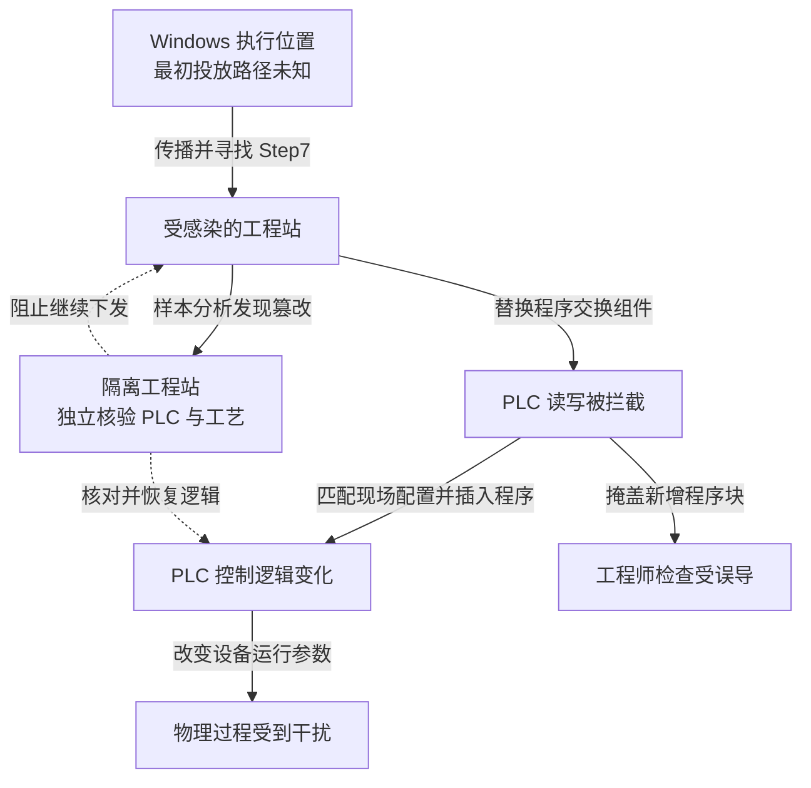

一台工程电脑可以正常显示设备程序，设备却执行着被篡改的逻辑。2010 年曝光的震网（Stuxnet）把这种偏差带进工业控制系统：它既修改可编程逻辑控制器（PLC）的程序，又干预工程软件读取程序的过程。防守方不仅要阻止恶意代码进入，还要确认自己看到的运行状态是否可信。

本文以 Symantec 2011 年 2 月的 [W32.Stuxnet Dossier v1.4](https://docs.broadcom.com/doc/security-response-w32-stuxnet-dossier-11-en)为主要技术依据。报告通过样本分析解释具体能力，但不能单独证明目标设施中每一次执行和全部物理损失；其承包商、移动介质进入设施的场景属于调查假设。

## 攻击者需要跨过三种环境

正常情况下，工程师在 Windows 工程站上使用 Siemens Step7 编写和下发控制逻辑，PLC 按程序控制现场设备。工程软件可以读取控制器中的代码供检查，但这种读取仍经过工程站的软件组件。

攻击者首先需要获得 Windows 执行位置。样本具有移动介质快捷方式漏洞传播、网络共享传播和其他扩展能力，能利用漏洞及被盗代码签名证书辅助安装和隐藏。报告讨论了外部人员或设备把感染带入目标网络的可能路线，没有公开足以确定最初投放者、介质及现场路径的证据。能够跨越隔离不等于已经查明某根 U 盘怎样进入设施。

其次，恶意代码需要找到合适的工程站。它寻找 Step7 环境，以恶意组件替换处理工程站与 PLC 程序交换的 `s7otbxdx.dll`，保留正常接口并拦截读写。攻击者由此得到的不只是电脑权限，而是代工程软件与控制器交互、隐藏额外程序块的能力。

最后，代码检查控制器与现场设备配置。只有满足特定条件，才插入改变控制行为的逻辑；感染一台普通 Windows 电脑，不自动意味着工业破坏载荷已经触发。报告中的变频驱动攻击会在特定序列中改变输出频率，使正常工艺边界受到干扰，同时掩盖部分变化。报告还检查特定控制器、通信和驱动配置；只有样本命中的设备条件成立，才能把这一载荷能力用于解释某段工艺风险。

下图概括样本支持的能力路径，最初投放方式保持未知。图可横向滚动。

实线表示样本分析支持的能力关系，虚线表示处置对象；图中的恢复方法是建议，不代表已核实目标设施采用该流程。物理扰动与程序隐蔽互相配合，但不能由图推算破坏数量。

## 最关键的突破是写入与核验依赖同一环境

第 36 页起的组件分析给出一个可核对的证据：恶意 DLL 可以保留正常接口，在读写程序块时插入或隐藏内容。应分别检查工程项目、控制器实际程序和现场测量，不能把一次从同一受感染工程站读回的“程序一致”当作三者都可信。

第一道边界是工程站能够接触外部代码，同时保有控制器写入能力。扫描 U 盘和修补 Windows 有必要，但一台已经失陷的工程站如果仍可直接下发程序，入口防护失败就会变成控制逻辑风险。可以把外部文件处理、工程开发和现场下发分到不同环境，只允许经批准的项目与依赖进入下发环境，并限制维护窗口和目标控制器。

第二道边界是可信工程接口被替换。代码签名可以说明签署来源，不能保证签名密钥未失窃，也不能证明制品符合工艺意图。应由不同管理权限保护工程软件基线与发布批准，核对实际程序块、配置和批准版本，避免同一终端既产生修改又提供全部核验依据。

第三道边界是数字监控与物理安全相互依赖。独立传感器、独立保护回路以及对实际转速、压力等关键量的交叉核对，可以减少工程站失陷后对人员判断的影响。它们仍有校准、供电、通信及共因故障边界，不能笼统认为“加一个传感器”就能覆盖全部破坏。若保护回路仍允许同一工程站修改阈值或旁路，独立硬件也可能受共同管理权限影响；需单独保护其配置和旁路批准。

建议监测工程通信组件变化、维护窗口外的程序块写入，以及控制指令与独立过程测量的偏离。正常维护也可能产生这些事件，应关联变更批准、目标设备和操作身份；单个 DLL 名称或一次程序下载不足以证明震网感染。

## 在不损害工艺的条件下验收

先在仿真、测试台或停机维护环境验证，不能向生产控制器重放破坏性载荷。工控负责人决定可接受的工艺边界和安全停机方式，自动化团队负责项目与控制器基线，安全团队验证失陷工程站的剩余能力。

| 已失陷条件 | 需要证明的限制 |
| --- | --- |
| 外部项目处理电脑被控制 | 不能直接取得现场下发身份或访问控制器写接口 |
| 工程站上的读取结果被伪造 | 独立来源仍能发现实际程序或物理参数偏离 |
| 一套监控不可用 | 保护回路仍按设计进入安全状态，操作员能获得可信指引 |

恢复不能只重装 Windows。需要核验工程项目、通信组件、PLC 中的实际代码及现场设备状态，再逐步恢复连接。验收记录至少包括获准逻辑与读回结果、独立过程量、保护功能测试及恢复后观察窗口；由自动化与现场运行人员共同签认，不能仅凭恶意文件已删除放行。停机损失与设备安全发生冲突时，由现场安全负责人按已批准的安全程序决定，不能让远程 IT 隔离动作替代工艺判断。

## 资料与核验入口

- [Symantec：W32.Stuxnet Dossier v1.4](https://docs.broadcom.com/doc/security-response-w32-stuxnet-dossier-11-en)，第 3 页区分假设攻击场景，第 25—35 页说明传播能力，第 36 页开始解释 PLC 程序交换与篡改。
