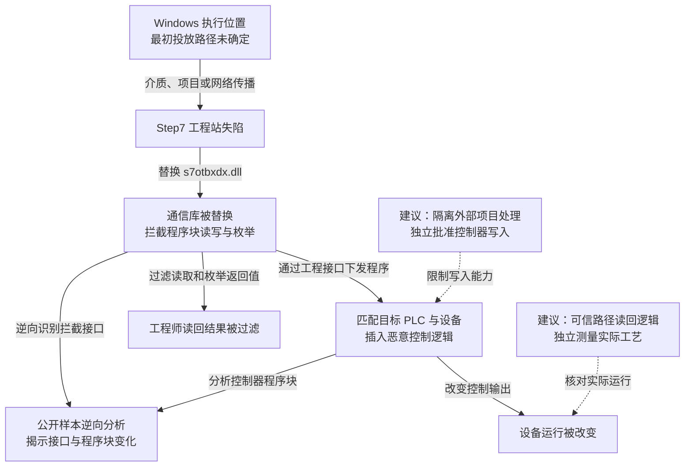

2010 年披露的震网（Stuxnet）针对工业控制环境实施破坏：恶意程序先在 Windows 环境传播，再替换 Siemens Step7 工程站的通信组件，在识别到特定 PLC 与现场设备配置后插入控制逻辑，改变设备运行，并过滤工程师读回的程序信息。[Symantec 2011 年样本报告](https://docs.broadcom.com/doc/security-response-w32-stuxnet-dossier-11-en)还原了这一机制。攻击者把工程站的正常下发与检查能力同时据为己用，使设备被修改后仍可能在原工程软件里显得正常。

## 攻击经过

### 从 Windows 执行位置进入工程环境

正常业务中，工程师在 Windows 工程站使用 Step7 编写程序，经通信组件将程序块下发到可编程逻辑控制器（PLC），由 PLC 控制现场设备。工程软件也通过同一套接口读回程序，供工程师核查。

震网样本具有多种 Windows 传播能力：通过移动介质快捷方式漏洞触发执行，经共享目录、打印后台服务漏洞等进入其他主机，还能随 Step7 工程项目转移。被盗代码签名证书则用于部分驱动组件的签署。最初怎样投放到目标设施没有由这份样本报告确定；报告第 3 页将人员或设备带入感染列为假设场景。

这些能力解释了隔离网络为何仍可能接触恶意代码：维护电脑、移动介质和工程项目可以跨越日常网络边界。进入一台 Windows 主机后，样本还会寻找合适的工程环境，感染本身与触发工业破坏是两个阶段。

### 替换通信库，同时控制下发和读回

在 Step7 环境中，震网把正常的 `s7otbxdx.dll` 改名为 `s7otbxsx.dll`，再用恶意库占据原文件名。正常软件仍调用原接口，但调用已经先经过恶意实现。

[报告第 36—38 页](https://docs.broadcom.com/doc/security-response-w32-stuxnet-dossier-11-en#page=36)描述：最多 109 个导出接口中，93 个继续转发到正常库，另外 16 个被拦截，涉及 PLC 程序块的读、写和枚举。以读取接口 `s7blk_read` 为例，工程师请求读回 PLC 程序，返回结果可以先被恶意库过滤，再送回 Step7。保留大量正常功能，使工程软件继续可用，同时掩盖了关键接口被替换的事实。

### 匹配设备后修改控制逻辑，隐藏程序变化

恶意代码检查 PLC 与设备配置，匹配目标条件后才插入控制程序。报告分析了变频驱动攻击中的频率调整逻辑；新增程序块及调用关系，使控制器在特定时序中执行攻击者安排的动作。报告第 37 页的 `FC1873` 反汇编，提供了控制器端代码的核对入口。

这一步把攻击从“电脑上执行程序”推进到“现场设备按恶意逻辑运行”。同时，工程站上的拦截层可以隐藏程序块变化，削弱工程师通过原软件发现异常的机会。样本披露后的逆向分析，才将 Windows 组件、工程接口与 PLC 逻辑连成了可解释的路径。

下图区分样本支持的能力关系与本文建议；可横向滚动。

主图依据 Symantec 的 Windows 传播与 PLC 篡改分析；其中设备变化表示样本可执行的控制行为。

## 关键突破、成因与防护

### 外部代码进入后，工程站仍持有现场写入能力

修补 Windows、检查移动介质和识别恶意工程项目，可以减少感染机会。更决定后果的是：一台可能接触外部代码的电脑，同时有权向现场控制器提交程序。

应把外部项目处理、工程开发和现场下发分到不同环境，限定下发环境可连接的控制器、维护时段和允许修改的项目。批准依据需由受保护的发布或变更环节提供，不能让失陷工程站自行生成“已批准”标记。对于仍允许直接写入的旧控制器，需要在其前方建立受限维护通道；只隔离互联网连接，无法限制经维护介质带入的代码。

### 写入与核验经过同一套可替换组件

震网对少数关键导出接口的拦截，使“下发了什么”和“工程师读到了什么”都受攻击者影响。重装工程电脑、核对通信库与签名是必要动作，但恢复后的工程站还需要与控制器中的实际程序相互核对。

更深的边界是独立保护获准项目与核验路径：从可信环境读取 PLC 程序块，与受保护的批准版本对照，再核对设备配置。若另一台核验电脑仍使用相同受污染项目、共享凭据或可被同一管理员替换的组件，两次检查仍可能受同一失陷条件影响。代码签名也需配合签名密钥与制品批准的独立保护。

### 工艺保护需要在数字控制失陷后继续成立

程序块一致性不足以证明现场设备运行安全。独立过程测量与保护回路，可以在工程站给出错误信息时，继续发现实际转速、压力等关键量越界。保护逻辑、阈值和旁路权限也需要单独管理，避免工程站获得写入能力后连保护条件一起改掉。

处置应同时覆盖 Windows 组件、工程项目、PLC 实际程序和现场状态。删除 Windows 恶意文件不会自动撤销已经写入控制器的逻辑。隔离和恢复需遵循现场安全停机条件；工业过程不允许突然断开时，可以先限制维护写入，再由可信路径核对控制逻辑和工艺状态。独立核验与停机维护会增加设备和运维成本，但它们直接限制了同一工程环境同时控制执行与证据的能力。

## 参考资料

- [Symantec：W32.Stuxnet Dossier v1.4（2011）](https://docs.broadcom.com/doc/security-response-w32-stuxnet-dossier-11-en)，第 3 页说明假设攻击场景，第 25—35 页分析传播，第 36 页起分析 PLC 读写拦截、目标匹配和控制逻辑。
