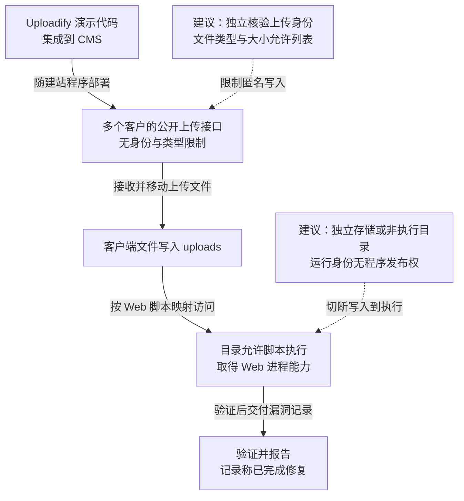

这份 2013—2015 年的 BocWeb CMS 漏洞记录显示，建站厂商将 Uploadify 后端演示代码直接用于企业官网，没有补充身份认证和类型限制，上传目录又允许脚本执行，使外部请求可写入文件并取得站点执行权限。同类代码随 CMS 分发到多个客户站点，原验证对象包括万科、绿城、广厦等企业网站。记录记载 2013 年提交补天、2015 年又出现同类报告，并称已向相关渠道报告、完成修复。

## 攻击经过

### 从供应商共用组件定位上传入口

研究者取得一份 CMS 源码后，在 `/j/uploadify.php` 发现接近 Uploadify 演示版本的后端逻辑。官网页脚的供应商信息，帮助将共用代码与多个部署实例对应起来。

演示程序负责接收文件并移动到站点 `/uploads` 目录，没有判断当前用户是否登录或拥有上传权限。公开路径因此不只是一个页面，而是匿名访问者可以调用的写入接口。

### 用户文件名进入服务器存储路径

原代码使用 `$_FILES['Filedata']` 取得上传临时文件，将客户端文件名拼接到目标目录，再调用 `move_uploaded_file` 保存。虽然创建了 `$fileParts`，后续没有据此执行扩展名允许列表或内容校验。

下面保留原验证中的关键后端代码。它能证明未认证接收与保存文件的逻辑，脚本能否执行还取决于 Web 服务器对该目录和扩展名的处理。

```php
<?php
/*
Uploadify
Copyright (c) 2012 Reactive Apps, Ronnie Garcia
Released under the MIT License <http://www.opensource.org/licenses/mit-license.php> 
*/

// Define a destination
$targetFolder = '/uploads'; // Relative to the root

if (!empty($_FILES)) {
    $tempFile = $_FILES['Filedata']['tmp_name'];
    $targetPath = $_SERVER['DOCUMENT_ROOT'] . $targetFolder;
    $targetFile = rtrim($targetPath,'/') . '/' . $_FILES['Filedata']['name'];
    
    $fileParts = pathinfo($_FILES['Filedata']['name']);
    
    move_uploaded_file($tempFile,$targetFile);
    echo $targetFile;
}
?>
```

### 从文件写入到 Web 进程执行

验证者构造表单向上传接口提交文件，再访问保存后的路径。当文件类型被服务器映射为 PHP 等脚本、且目录允许执行时，上传能力便进一步成为站点代码执行能力。

以下表单字段与 PHP 中的 `Filedata` 对应；它用于演示请求结构，实际路径和处理器以各部署实例为准。

```html
<!DOCTYPE html>
<html>
<head>
    <title>BocWeb Upload Demo</title>
</head>
<body>
    <form action="http://demo.feei.cn/bocweb/j/uploadify.php" method="post" enctype="multipart/form-data">
        <input type="text" name="folder" value="/">
        <input type="file" name="Filedata" />
        <input type="submit" name="Upload">
    </form>
</body>
</html>
```

执行代码首先继承 Web 应用进程的文件、数据库和网络权限。原记录展示站点执行能力，进一步取得整台服务器管理权仍需依赖运行账号权限或其他扩展条件，影响分析应沿实际权限继续展开。

### 共用代码分发使问题在多个客户重复出现

相同后端进入多个客户网站后，修复供应商主仓库并不会自动修改所有已部署副本。2013 年与 2015 年的报告记录说明，同类缺陷在不同时间被再次发现，客户部署与版本分发是治理范围的一部分。

原有验证与修复记录如下：


记录称漏洞已通过 CNCERT、乌云、补天或厂商等渠道报告并修复。主图仅表示已验证能力与代码分发关系，虚线是本文建议，可横向滚动。

<div class="incident-diagram" role="region" tabindex="0" aria-label="CMS 从演示代码分发到未认证上传与脚本执行验证，可横向滚动">



</div>

## 关键突破、成因与防护

### 演示功能进入生产，却没有建立业务权限

直接集成的代码展示了上传功能，没有包含业务用户与用途判断。上线时应检查实际暴露接口，让请求绑定当前用户和允许的上传任务，在服务端执行认证与授权。

类型、大小及文件内容校验可以减少危险输入，服务端生成文件名并限定目标位置，避免客户端自行决定存储属性。文件头或扩展名校验仍需与存储隔离配合，多格式文件与服务器解析差异可能绕开单一检查。

### 上传结果与可执行程序共享发布位置

取得文件上传权后还能将其当代码调用，才形成本案的执行突破。上传认证即使被绕过，独立对象存储或明确禁用脚本的文件域，也能切断写入到执行的转换。

运行账号应只能写业务数据，不应替换应用程序或放宽 Web 解析规则。需要提供下载时，由受限服务按对象权限返回文件，不把业务上传目录直接当程序入口。若允许上传内容被后端处理器再次解析，还需限制该处理器的权限与可用功能。

### 供应商修复没有天然覆盖客户部署副本

供应商需要将修复版本对应到具体部署，客户也应核对实际运行的接口、目录与配置。只修一处示例文件或发布公告，会留下旧安装包、复制站点和备用实例。

服务端限制与非执行存储可先减少现有风险，随后更新共用组件并检查程序目录中是否已有异常脚本。删除入口不自动清理已经写入的文件，恢复时需对照可信制品及站点身份权限。
