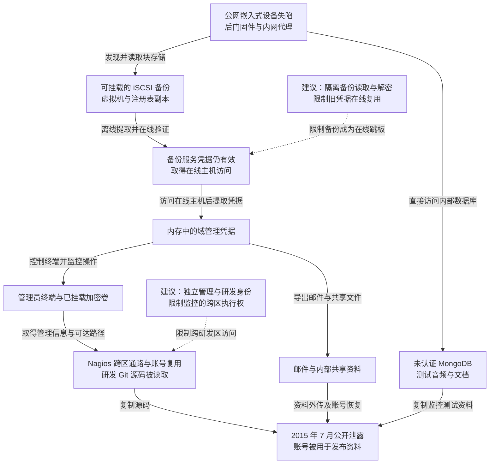

2015 年 7 月 5 日，意大利监控软件公司 Hacking Team 逾 400GB 的邮件、源码、客户信息和内部资料被公开泄露，其 Twitter 账号也被用于发布泄露内容。自称 Phineas Fisher 的入侵者随后描述了从公网嵌入式设备进入、通过备份取得在线凭据、控制管理员终端，再跨入研发网络的经过。本文依其[攻击者自述](https://raw.githubusercontent.com/PMaynard/Viva-Phineas-Fisher/master/manifestos/2016-HackBack-HackingTeam.txt)还原技术路径，泄露规模与日期可核对[瑞士政府同期回顾](https://www.newsd.admin.ch/newsd/message/attachments/43838.pdf)。行动以公开资料为结果，攻击者将动机表述为反对监控业务。

## 攻击经过

### 从公网嵌入式设备取得内网执行位置

自述称，Hacking Team 对外暴露了网站、邮件服务器和少量网络设备。攻击者选择逆向其中一类嵌入式设备，发现远程执行漏洞，准备带后门的固件与网络工具后植入。

设备型号和漏洞细节没有在自述中公开，不能把其他事件中的 VPN 漏洞直接代入。已经明确的是，边界设备既可被公网触及，又能访问内网；取得其执行权后，攻击者可在设备上监听、扫描，并通过代理与端口转发访问内部服务。

### 未认证数据库与备份存储提供了不同的资料

内部扫描发现未要求认证的 MongoDB，其中保存 RCS 测试实例的监控音频和内部文档，部分文件通过 GridFS 存储。这条路径直接提供资料。

另一条更关键的路径是 iSCSI：本应在独立网络的存储设备可从已进入的区域访问，攻击者将其作为块设备挂载，读取包括 Exchange 在内的虚拟机备份。访问磁盘副本不需要先通过原服务器的交互登录，备份中的注册表、配置与历史文件可以被离线分析。

### 备份中的服务凭据仍可用于在线主机

自述记录，攻击者对备份注册表配置单元进行离线提取，得到服务账号材料，再向在线系统验证，发现仍有效。先取得在线主机访问后，才从运行环境内存中进一步提取域管理员等凭据。

这个顺序解释了备份如何成为跳板：读到虚拟机副本，先取得历史身份；历史身份仍有效，再换取当前执行位置；当前主机上又存在更高权限登录材料，最终扩大到 Windows 域。不能把读取备份直接写成已经取得域管理员。

取得域权限后，攻击者通过 Exchange 管理能力导出邮件，并从文件共享持续取得资料。邮件中包含内部网络、账号和管理操作信息，又成为研发网络侦察的来源。

### 管理员终端与监控系统跨过研发隔离

研发网络与普通网络存在隔离，攻击者于是监视同时承担管理任务的人员。自述称，攻击者在管理员电脑上记录键盘、截取屏幕，并等待 TrueCrypt 加密卷正常挂载后复制已解密文件。

卷内保存的 Nagios 管理信息，帮助攻击者接触可监控研发网络的服务器，再利用其代码执行缺陷形成跨区通路。另有已取得的 Windows 密码在 Git 服务器上仍能使用，使攻击者读取 RCS 源码。邮件控制权还被用于重置 GitLab 与 Twitter 账号，后者成为发布泄露内容的渠道。

这些资料沿不同路径汇合：MongoDB 提供测试监控数据，Exchange 与共享提供内部文档和邮件，研发网络提供源码。自述中对工具的一般介绍，不应全部当作本案已经执行的动作。

### 公开泄露同时暴露产品与客户关系

泄露使内部邮件、客户往来、监控软件源码和技术资料进入公开渠道。研究者利用源码与文档进一步分析 RCS／Galileo，[Masaryk University 的案例研究](https://is.muni.cz/publication/1382042/2017-SPI-hacking-team-case-study-paper.pdf)将软件放入隔离环境观察行为。

这类后果超出一个账号被盗：客户信息与可复用攻击技术一旦公开，重建公司的在线环境也无法重新收回副本。防守方需要同时处理自身身份、产品内秘密及受影响客户的后续风险。

下图保留备份跳板、研发桥梁与资料并行泄露；虚线连接本文建议，可横向滚动。

## 关键突破、成因与防护

### 边界设备失陷后可直接访问内部数据服务

修补设备和收敛公网入口，可以减少最初进入机会。设备本身承担网络连接，却不应因此取得内部数据库和块存储的任意访问权。

数据库认证、iSCSI 访问控制和网络分区应由目标端独立执行，使边界代理的位置不自动等于业务身份。固件完整性与日志也需在设备之外核对，避免攻击者控制设备后自己提供正常状态证明。

### 备份包含当前仍有效的秘密，读取权变成执行权

备份复制了生产系统的配置和身份材料；离线分析绕过了原系统的登录检查，仍有效的服务账号又把历史副本连接回在线环境。

应按高敏感资产限制备份读取和解密，独立管理恢复身份，减少账号跨环境复用。轮换需处理泄露副本中的实际身份及相关会话；只给备份文件重新加密，无法撤销已提取的密码和哈希。高权限身份也应减少登录普通服务器，降低低权限落脚点继续收集域管理材料的机会。

### 网络隔离被共同管理终端与监控通路连接

加密卷在未挂载时保护静态文件，挂载后却由已经失陷的操作系统提供可读内容。研发隔离也被同一管理员终端、复用密码和监控服务连接。

生产、域管理与研发应使用不同的管理身份和执行环境，监控接口按状态读取而非任意执行授权。凭据与批准由目标系统核验，不能让一个管理员桌面同时持有所有区域的可复制秘密。增加独立管理环境会增加操作步骤，却能限制同一终端失陷后跨越全部区域。

### 邮件恢复权延伸到了外部发布账号

邮件不仅保存资料，也是 GitLab、社交账号等系统的恢复依据。控制邮箱后，攻击者可以利用正常“忘记密码”流程取得外部账号，进而发布已经复制的数据。

重要账号的恢复需要单独保护，敏感重置结合额外身份依据和原渠道通知。应急沟通也应使用可信的新环境。重建边界设备、在线主机和管理身份后，还需核对外部恢复信息与产品秘密；已经公开的源码与客户资料则需要按其暴露内容处理，不能靠删掉本机文件来消除影响。

## 参考资料

- [Phineas Fisher：Hacking Team 入侵自述](https://raw.githubusercontent.com/PMaynard/Viva-Phineas-Fisher/master/manifestos/2016-HackBack-HackingTeam.txt)，第 5—15 节描述本案路径，通用工具介绍与实际动作应分开阅读。
- [瑞士政府：2015 年下半年网络安全形势回顾](https://www.newsd.admin.ch/newsd/message/attachments/43838.pdf)，第 5.1.1 节记录泄露日期、规模及资料类型。
- [Masaryk University：Hacking Team 软件案例研究](https://is.muni.cz/publication/1382042/2017-SPI-hacking-team-case-study-paper.pdf)。
