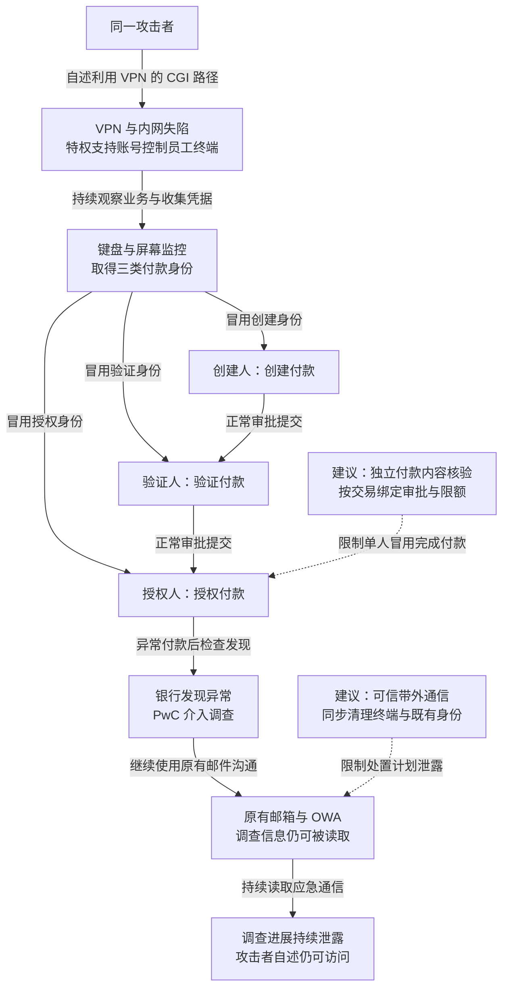

这起针对马恩岛开曼国家银行的入侵，从 2015 年 7 月的边界突破延续到 2016 年 1 月的未经授权 SWIFT 付款。攻击者 Phineas Fisher 的自述将入口归于 SonicWall VPN 上的 Shellshock 利用途径；PwC 调查摘要记录了特权账号、员工终端监控及付款操作。入侵者取得创建、验证和授权三种角色的凭据后，独自冒用三人提交付款，部分付款被拒绝。银行 1 月 7 日发现异常，PwC 于 1 月 19 日介入应急，攻击者自述此后仍能读取调查邮件。

## 攻击经过

### VPN 的远程执行位置通向域与员工终端

攻击者称，其先扫描 SonicWall 服务，再通过归属信息选定目标。入口使用 Shellshock：易受影响的 Bash 在特定环境变量处理条件下执行附加命令，Web CGI 把请求信息传给该进程，便可能把外部输入变成设备上的命令。

自述特别指出，早先补丁处理了一个 CGI 入口，却遗漏 `jarrewrite.sh` 相关路径。这里是已知漏洞机制在另一暴露路径仍可触发，不能简单理解为所有入口已经因“设备打过补丁”而受保护。

进入 VPN 设备后，攻击者继续控制内网和域，利用具有管理员权限的支持账号访问员工终端，安装键盘记录和屏幕监控工具。具体入口依据来自[攻击者自述](https://raw.githubusercontent.com/PMaynard/Viva-Phineas-Fisher/master/manifestos/2019-%5BTranslated-en%5D-HackBack-Guide-to-rob-banks.txt)，后续账号与终端活动还可与 PwC 摘要对照。

### 数月观察把系统权限变成业务流程知识

攻击者读取内部文档，搜索 SWIFT 与电汇信息，并通过员工画面观察日常付款。银行使用 Bottomline 远程 Citrix 环境接触 SWIFT，每笔付款需要创建、验证、授权三个角色参与。

攻击者没有把三个岗位合并成一个岗位，而是取得了三个岗位各自使用的身份材料。同一入侵者可以在不同会话中依次扮演三人，按原审批顺序完成业务操作。终端监控还让其知道什么时候操作、怎样填写和确认付款。

### 冒用三个审批身份提交付款

PwC 调查摘要记载：2015 年 12 月 17 日有利用支持账号提取邮件的失败尝试；2016 年 1 月 5 日，支持账号进入员工电脑后出现两次付款操作；1 月 6 日又出现八次，其中两笔被拒绝。1 月 7 日，银行日常检查发现异常 SWIFT 付款。

这些记录显示，域和桌面权限最终被用于金融业务状态变化。攻击者使用的账号、工具与操作界面均可属于正常业务，关键证据需关联操作员会话、付款内容、审批角色和实际处理结果。

### 调查启动后，失陷通信仍暴露处置进展

PwC 于 1 月 19 日介入。调查摘要记录了远程特权访问和多处恶意软件，未发现员工参与。攻击者自述则称，其在调查期间降低活动频率，继续取得更新后的身份材料，并通过 Outlook Web Access 读取调查邮件。

调查还发现冒用 SWIFT 名义、携带 AdWind 附件的钓鱼邮件，这是另外的可疑活动线索，不应据此替换或补齐前述 VPN 进入路径。不同来源需要分别支持各自描述的动作。

下图保留同一攻击者向三个角色分叉，以及调查启动后信息仍被读取的应急路径；实线为来源描述的经过，虚线仅为本文建议，可横向滚动。

## 关键突破、成因与防护

### 边界设备的已知机制在遗漏路径仍可触发

修补 VPN 与流量规则可限制 Shellshock，但修复需要覆盖实际 CGI 和执行路径。设备版本显示更新成功，不能代替确认另一个暴露入口是否仍把外部数据传给易受影响组件。

更深的限制是边界设备即使已经被控制，也不能直接管理域、接触付款工作环境或读取后台凭据。网络可达关系与管理身份在内侧另行授权，使一次边界执行权不直接换取全行终端控制。

### 三个账号没有形成三个独立的批准依据

职责分离的前提是不同角色能独立确认付款。三人的输入和会话都能由相同域管理能力监控后，攻击者便可以收集身份，顺序执行看起来合规的三步。

应将付款环境与普通办公和支持管理分离，强认证结合对收款方、币种、金额及付款编号的独立确认。批准凭证绑定实际交易，执行端核验未被更换；批准设备、身份恢复与规则管理也需独立保护。仅增加一个用户名或一次可实时转发的确认，仍可能落在相同失陷终端上。

付款限额、新收款方等待和带外复核可以限制已获账号的滥用，但需要覆盖交易内容与累计流出。日常小额付款可保留受限自动化，超出范围的变更进入更强批准流程，避免便利性要求把全部约束取消。

### 只轮换密码，失陷终端仍可收集新身份

键盘记录器与内存凭据读取意味着新密码也可能再次泄露。处置需要从可信环境重建管理与付款访问，清理终端驻留、撤销会话和旧凭据，并核对支持账号还能接触哪些资源。

应急通信应脱离可疑邮箱和原管理信任，避免攻击者提前知道监测、隔离与轮换计划。付款调查则需将已发出请求、审批记录、银行处理与退回记录对应，才能确定实际转出及追回结果。网络重建与账号恢复保护后续访问，已经发出的付款还需沿金融交易链处理。

## 参考资料

- [Phineas Fisher：A DIY Guide to Robbing Banks（2019）](https://raw.githubusercontent.com/PMaynard/Viva-Phineas-Fisher/master/manifestos/2019-%5BTranslated-en%5D-HackBack-Guide-to-rob-banks.txt)，攻击者自述，重点见入口与银行操作章节。
- [PwC：Project Pallid / Nutmeg（2016 年 6 月 23 日）](https://feei.cn/wp-content/uploads/2023/11/Cayman-National-Bank-and-Trust-CompanyIsle-of-Man-Limited-Project-Pallid-Nutmeg-2016-mini.pdf)，调查摘要，付款与账号时间线以其记录为依据。
- [攻击者银行自述的研究存档目录](https://github.com/PMaynard/Viva-Phineas-Fisher/tree/master/manifestos)，可查对应 2019 年原文与英文译文。
