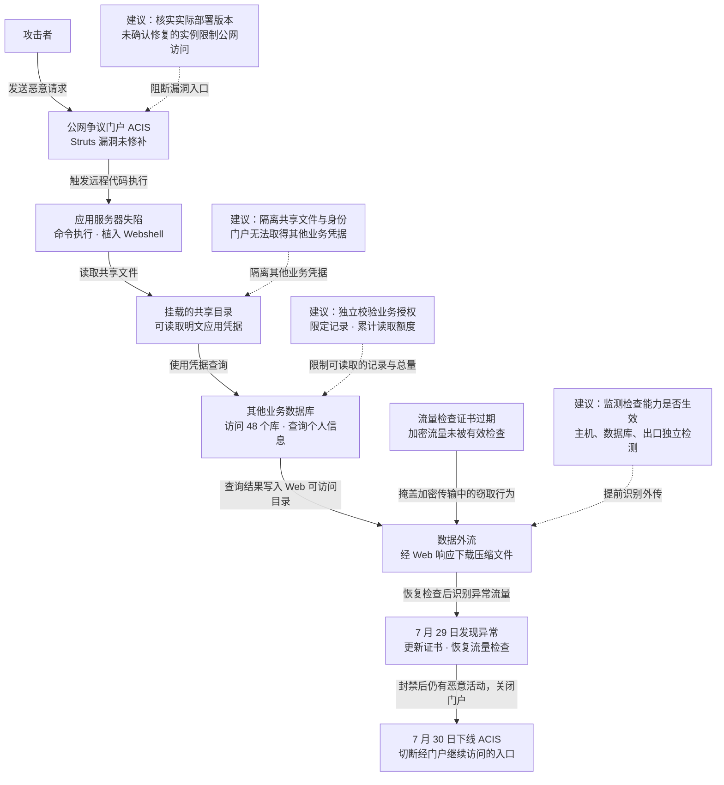

2017 年 5 月 13 日至 7 月 30 日，攻击者利用美国征信机构 Equifax 在线争议门户未修补的 Apache Struts 漏洞控制应用服务器，从挂载的共享目录中取得明文凭据，访问其他数据库并分批窃取数据，[约 1.47 亿人](https://www.ftc.gov/news-events/news/press-releases/2019/07/equifax-pay-575-million-part-settlement-ftc-cfpb-states-related-2017-data-breach)的姓名、出生日期、社会安全号码等信息泄露。Equifax 在 7 月 29 日更新流量检查证书后发现异常，次日下线门户，9 月 7 日公开事件。美国司法部于 2020 年[起诉四名中国军方人员](https://www.justice.gov/archives/opa/pr/chinese-military-personnel-charged-computer-fraud-economic-espionage-and-wire-fraud-hacking)，指控其实施入侵、窃取个人信息及商业秘密。

## 攻击经过

### 一个处理信用争议的门户，连向了其他业务的数据

ACIS（Automated Credit Investigation System）是消费者向 Equifax 提出信用记录异议的系统。例如，消费者发现报告里有不属于自己的账户，可以通过这个公网门户发起争议处理。它的正常业务只需要访问 3 个数据库。

攻击者先获得门户服务器的执行能力，再利用服务器能读取的凭据扩大数据库访问范围。下图把这条路径与实际发现、处置连起来；虚线连接本文建议及其作用位置，措施均以“建议”标明，可横向滚动。

图中实际经过主要依据[美国众议院调查报告第 31—36 页](https://oversight.house.gov/wp-content/uploads/2018/12/Equifax-Report.pdf#page=31)。流量检查失效，使持续的数据外传未被及时发现。

### 补丁已公布，门户仍可被利用

2017 年 3 月 7 日，Apache Struts 披露 S2-045（CVE-2017-5638）并发布修复版本。漏洞位于 Jakarta Multipart 文件上传解析器的异常处理逻辑：恶意 `Content-Type` 请求头触发解析异常后，其中的内容在生成错误消息时进入 OGNL 表达式求值。OGNL 是 Struts 使用的表达式语言，公开利用可借它调用 Java 功能、启动系统命令，使外部输入变成应用进程内的执行操作。[Apache 官方公告](https://cwiki.apache.org/confluence/spaces/WW/pages/68717257/S2-045)和 [Metasploit 对应模块](https://github.com/rapid7/metasploit-framework/blob/master/modules/exploits/multi/http/struts2_content_type_ognl.rb)分别说明漏洞条件和公开利用机制。

这种执行首先继承应用进程已有的身份与权限：进程能读到哪些共享文件、持有哪些账号、能连接哪些数据库，决定攻击者接下来能做什么。Equifax 后续的共享凭据读取与跨库查询，就发生在这些权限没有被有效限制的条件下。

Equifax 收到通知后采取了多项动作，但没有修复 ACIS：

| 时间 | 已采取的动作与遗漏 |
| --- | --- |
| 3 月 8—9 日 | 收到 US-CERT 通知后，安全团队向数百人发送邮件，要求 48 小时内修补；ACIS 对应的关键负责人未收到通知。 |
| 3 月 9 日起 | 组件扫描未覆盖实际部署 Struts 的子目录，遗漏了 ACIS。 |
| 3 月 14—16 日 | 团队发布 Snort 规则、对外部 IP 进行漏洞扫描，并开会讨论漏洞，仍未识别出 ACIS 的风险。 |
| 5 月 13 日 | 攻击者开始利用 ACIS 上尚未修补的 Struts 漏洞，进入持续窃取数据的阶段。 |

[调查报告第 27—31 页](https://oversight.house.gov/wp-content/uploads/2018/12/Equifax-Report.pdf#page=27)记录了通知、扫描与入侵之间的这段空档。报告还记载了 3 月 10 日的漏洞利用探测；本次持续窃取活动从 5 月 13 日开始。

### 服务器上的执行能力，换来了跨库查询能力

进入 ACIS 后，攻击者在两台应用服务器上植入 Webshell，即可通过网络反复调用的恶意脚本。调查识别出约 30 个不同的 Webshell，用于执行命令、读写文件和传输数据。ACIS 当时没有启用文件完整性监控，这些新增文件没有触发相应告警。

随后，攻击者读取应用服务器挂载的共享目录。这里存有未加密的应用用户名和密码，旧系统之间对敏感文件的访问缺少限制。这些凭据让攻击者得以访问 ACIS 环境之外的 48 个数据库，远超门户原本需要的 3 个数据库。

攻击者先查询元数据，判断哪些表保存了有价值的信息，再读取个人数据。调查统计约有 9,000 次查询，其中 265 次返回包含个人信息的数据集。这个过程解释了损害为何迅速扩大：一个公网应用被控制后，攻击者可以继续寻找其他系统的数据，无须逐个攻破这些系统的公网入口。[报告第 32—33 页](https://oversight.house.gov/wp-content/uploads/2018/12/Equifax-Report.pdf#page=32)给出了 Webshell、共享凭据及数据库查询记录。

### 数据经门户分批外流，流量检查长期失效

攻击者把查询结果写入文件，压缩后放到 Web 可访问的目录，再通过 Wget 等工具下载，部分数据经 Webshell 外传。对下载这一路径，数据从内部数据库进入门户的文件目录，再经对外 Web 响应返回攻击者。门户接受外部访问的既有通道，也承担了数据窃取。

司法部起诉材料还描述了拆分文件、借用多国服务器转发通信，以及删除文件和日志等隐藏活动的做法。[众议院报告](https://oversight.house.gov/wp-content/uploads/2018/12/Equifax-Report.pdf#page=33)和[司法部通报](https://www.justice.gov/archives/opa/pr/chinese-military-personnel-charged-computer-fraud-economic-espionage-and-wire-fraud-hacking)分别记录了这些步骤。

Equifax 原本部署了 SSL Visibility 流量检查设备，用于解密流量，再交给检测系统分析。相关证书长期过期，设备仍允许加密通信通过，后续检测却无法正常检查其中的内容。业务访问继续运行，数据窃取也持续未被发现。

### 更新证书后发现异常，封禁地址未能终止攻击

7 月 29 日，工程师更新证书、恢复流量检查后，检测到了可疑通信。团队先封禁相关 IP，但次日仍观察到来自另一地址的恶意活动，于 7 月 30 日下线 ACIS，切断经该门户继续访问的入口。8 月 2 日，Equifax 聘请 Mandiant 协助调查并通知 FBI，9 月 7 日向公众披露事件。[调查报告第 34—36 页](https://oversight.house.gov/wp-content/uploads/2018/12/Equifax-Report.pdf#page=34)记录了发现和响应过程。

最终披露的影响约为 1.47 亿人，涉及姓名、出生日期、地址、社会安全号码，以及部分信用卡信息。这些数据广泛用于识别个人身份，更换密码无法消除已经泄露的身份资料所带来的冒用风险。

2019 年 7 月，FTC 等机构宣布与 Equifax 达成和解，总额至少 5.75 亿美元、最高可达 7 亿美元。其中，消费者补偿基金为 3 亿美元，必要时追加至 4.25 亿美元；另有 1.75 亿美元支付给各州及地区、1 亿美元支付给消费者金融保护局作为民事罚款。[FTC 公告](https://www.ftc.gov/news-events/news/press-releases/2019/07/equifax-pay-575-million-part-settlement-ftc-cfpb-states-related-2017-data-breach)说明了人数、数据类型和资金构成。

## 关键突破、成因与防护

### 修补通知没有落实到实际运行的应用

Equifax 有漏洞情报、48 小时修补要求、邮件通知和扫描工具，ACIS 却始终留在公网。通知链漏掉了关键负责人，扫描路径又漏掉了实际组件，组织无法从“发出了修补要求”追踪到“这个运行实例已经不受影响”。[报告第 70 页](https://oversight.house.gov/wp-content/uploads/2018/12/Equifax-Report.pdf#page=70)还指出，2017 年 1 月修补另一个 Struts 漏洞时，ACIS 已被识别为使用该组件的系统，这一信息却没有得到记录和跟踪。

常规办法是及时升级、部署临时过滤规则，并验证修复结果。要减少下次再次漏掉同一个系统的机会，还需把公网入口、运行实例、组件版本与维护方关联起来，结合构建依赖和运行时信息核实实际部署。没有扫描到的实例应保持“未确认”，继续检查其部署路径和版本。

对于已公开可远程执行代码的漏洞，修补状态未确认的实例应限制公网访问，或暂时关闭受影响功能，直到能够核实修复。这样，通知遗漏或扫描漏检不会自动变成长期暴露。业务方需要承担临时降级或中断的代价，尤其要为这类消费者服务准备替代办理渠道。

应用目录只读、部署账号与运行账号分离、上传目录不允许执行脚本，可以减少攻击者写入并保留 Webshell 的机会。远程代码执行仍可能直接调用应用已有能力，文件写入限制还需与后续凭据、数据权限隔离配合。

### 应用失陷后，可以读取其他业务的凭据

明文凭据放在应用服务器能够访问的共享目录里，文件权限和共享范围又没有按业务用途收紧。攻击者拿到应用的执行权限，就能读取这些凭据，跨过原本应由身份验证守住的边界。

清理共享目录中的明文密码、收紧文件权限、轮换泄露凭据，可以直接压缩这条路径。更深一层是让每个应用使用独立身份和短期凭据，限制它能取得哪些秘密，并同时收紧数据库网络访问与账号权限。即使门户进程已被控制，它也不应能读取其他业务的账号，或连通无关数据库。

秘密管理服务需要与这些限制配合：如果失陷的门户仍有权领取所有数据库密码，攻击者仍能使用相同权限。隔离边界必须落在“这个业务身份能申请什么、能连接哪里、能执行哪些操作”上。

本案已出现 Webshell 与凭据窃取，处置也需要覆盖这些既有能力。假设只修补 Struts 后便重新开放门户，已写入的后门仍可能接受请求，泄露凭据仍可能用于其他可达的访问路径。重建失陷应用环境、撤销和轮换被暴露的凭据，并检查这些身份的其他使用位置，才能避免恢复服务时把攻击者的访问一并恢复。

### 数据访问权限远超门户需要，单点失陷扩成大规模泄露

3 个业务必需数据库与 48 个额外可访问数据库之间的差距，说明影响范围已经超出漏洞所在系统。数据库隔离和数据授权没有有效限制门户失陷后的访问，攻击者能够探查表结构、定位个人信息并持续提取。

常规措施包括收紧数据库账号、限制来源网络、记录敏感查询，并对异常导出告警。即使只允许访问业务必需的 3 个数据库，如果应用账号仍能遍历其中的个人记录，大规模泄露依然可能发生。进一步可以把门户所需的数据访问收敛到专用服务，只开放争议处理需要的字段与操作，使门户无需直接持有可遍历底层数据表的账号。

数据服务还需独立校验“哪位消费者、哪张争议单、允许读取哪些记录”。服务身份只能证明请求来自哪个应用；如果仅凭 ACIS 的身份就允许查询任何消费者，攻击者仍能借失陷门户逐条读取。可以由独立的身份与争议受理系统核验业务关系，签发限定记录、操作和有效期的授权凭证，数据服务自行验证，门户无权签发或扩大授权。单次与累计读取额度也应在数据服务端执行，防止把一次批量导出拆成许多小请求。这类按请求和对象核验权限的设计可参照 [OWASP 授权指南](https://cheatsheetseries.owasp.org/cheatsheets/Authorization_Cheat_Sheet.html)。

对不再需要的数据缩短保留时间，也能减少一次入侵可取走的总量。敏感字段加密可保护文件或备份被直接复制的场景；若应用账号可以正常查询并获得解密结果，仍需依靠上述用途和范围限制来阻止批量读取。

### 检测能力已经失效，系统运行状态仍显得正常

证书过期后，流量依然通过，消费者仍可使用门户，解密检查却已失效。仅监控设备在线、接口可用或业务成功率，无法发现这个缺口。[报告第 70 页](https://oversight.house.gov/wp-content/uploads/2018/12/Equifax-Report.pdf#page=70)记载，2017 年 1 月已经有内部记录提示 SSLV 缺少证书、影响攻击检测。与此前已识别却未持续跟踪的 Struts 组件一样，风险被发现后，没有及时转化为对系统运行的有效限制。

证书自动续期、到期告警和 Webshell 检测是直接措施。进一步需要持续检查检测链路是否产生预期结果，例如观察解密流量覆盖率，通过受控探测确认已知测试请求能触发规则。检测失效后，应通知响应团队，并按受影响业务限制高风险访问，而不是让故障长期静默存在。

主机进程与文件变化、数据库查询、对外响应还应有各自的检测和集中日志，日志保存在应用账号无权删除的位置。尤其是本案的文件下载路径，数据可以经门户响应发往外部，限制服务器主动建立出站连接仍需配合 Web 目录发布权限、异常下载和累计响应量检测。这样，即使解密检查再次失效，批量查询、异常打包或外传仍有机会从其他环节被发现。

这些控制承担不同作用：补丁和入口限制减少入侵机会，身份与数据授权限制可窃取范围，检测与响应缩短攻击持续时间，环境重建与凭据撤销则清除已经取得的访问能力。

## 参考资料

- [美国众议院监督与政府改革委员会：Equifax 数据泄露调查报告（2018）](https://oversight.house.gov/wp-content/uploads/2018/12/Equifax-Report.pdf)，重点见第 27—36 页的修补、攻击和发现过程，以及第 57—70 页的控制缺陷。
- [美国政府问责局：Equifax 数据泄露的调查与处置（GAO-18-559）](https://www.gao.gov/products/gao-18-559)。
- [Apache Struts：S2-045 安全公告](https://cwiki.apache.org/confluence/spaces/WW/pages/68717257/S2-045)。
- [Metasploit：Struts Jakarta Multipart OGNL 注入模块](https://github.com/rapid7/metasploit-framework/blob/master/modules/exploits/multi/http/struts2_content_type_ognl.rb)，用于核对公开漏洞利用机制。
- [OWASP：授权设计指南](https://cheatsheetseries.owasp.org/cheatsheets/Authorization_Cheat_Sheet.html)，用于分析请求与业务对象的授权边界。
- [FTC：Equifax 与联邦、各州达成至少 5.75 亿美元和解（2019）](https://www.ftc.gov/news-events/news/press-releases/2019/07/equifax-pay-575-million-part-settlement-ftc-cfpb-states-related-2017-data-breach)。
- [美国司法部：起诉四名中国军方人员涉嫌入侵 Equifax（2020）](https://www.justice.gov/archives/opa/pr/chinese-military-personnel-charged-computer-fraud-economic-espionage-and-wire-fraud-hacking)。
