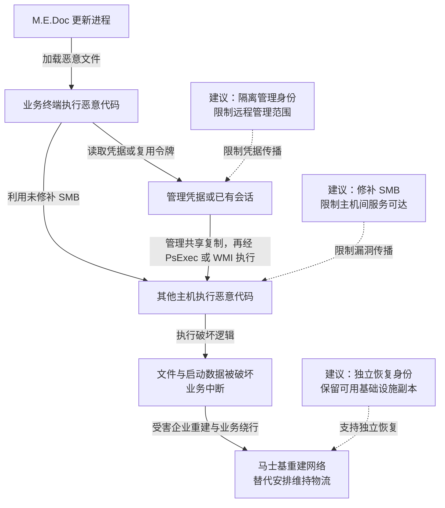

2017 年 6 月 27 日，NotPetya 通过部分组织使用的 M.E.Doc 会计软件更新进入 Windows 环境，再利用 SMB 漏洞、窃取的管理凭据及已有会话向其他主机扩散，破坏文件与启动相关数据，造成多家企业业务中断。微软从更新进程的执行记录中确认了部分初始感染路径，Kaspersky 的样本分析则指出其恢复机制与正常勒索解密存在关键差异。受害企业马士基后来回顾，公司几乎全部系统不可用，用十天重建网络，并通过替代安排维持货物流转。

## 攻击经过

### 合法更新进程启动恶意代码

M.E.Doc 是乌克兰使用的财税软件，更新程序原本承担正常的软件维护。微软遥测记录到 `EzVit.exe` 于 6 月 27 日启动恶意执行链，经 `rundll32.exe` 加载攻击文件。这让恶意程序直接在已经安装业务软件的终端运行，绕过了逐个诱骗用户安装陌生程序的步骤。[微软原始分析](https://www.microsoft.com/en-us/security/blog/2017/06/27/new-ransomware-old-techniques-petya-adds-worm-capabilities/)提供了进程与命令行关系。

进入 Windows 终端后，恶意代码可利用该执行身份已有的本地权限。终端上出现的管理凭据、网络会话与共享访问权，又成为后续扩展的条件。

### 漏洞利用与管理身份并行传播

NotPetya 一边尝试利用未修补的 SMB 服务漏洞，一边读取凭据或复用已有会话，访问其他主机的管理共享。取得有效管理权限后，它可以将恶意文件复制到远端，再通过 PsExec 或 WMI 启动执行。

这两条路径不依赖相同条件。漏洞路径要求目标存在可利用的 SMB 缺陷；凭据路径则借用了正常远程运维能力，已经安装 SMB 补丁的主机仍可能接受获准管理员的远程任务。微软还记录了对本地网络与共享服务的发现，解释了单台感染为何能沿内部可达关系继续扩大。

### 破坏数据后，以勒索界面呈现结果

程序对文件和磁盘相关数据进行破坏，重启后的勒索界面使受害者难以正常启动或使用系统。Kaspersky 检查安装标识与密钥恢复关系后指出，本次变种没有保留旧 Petya 那种支持逐个受害者恢复的必要关联，因此将其判断为破坏程序。[原始技术说明](https://securelist.com/expetrpetyanotpetya-is-a-wiper-not-ransomware/78902/)给出了判断依据。

受害企业需要切断继续传播的连接和管理访问，并重建受损基础设施。马士基在 [2020 年业务连续性白皮书第 5 页](https://www.maersk.com/~/media_sc9/maersk/stay-ahead/maersk---a-view-from-the-other-side-of-a-crisis---final.pdf#page=5)回顾了十天重建网络的过程。重建期间维持运输，依靠替代业务安排与技术恢复并行推进。

下图保留两条并行传播路径；虚线连接本文建议，可横向滚动。

## 关键突破、成因与防护

### 业务更新的执行权可以到达其他业务区域

更新进程具有安装和维护软件的能力，供应链失陷后，这项正常执行权成为入口。验证供应商公告、监测更新进程异常子进程，是直接措施；制品签名还需要与供应方的构建、签名密钥和发布批准共同保护。

消费方更可控的边界，是让财税软件所在终端只接触业务必需资源，避免它同时承担域管理、备份或跨区域部署任务。即使更新本身已带入恶意代码，受限的执行身份与网络关系也能缩小下一步的可达范围。供应方则需让源码、构建产物和发布批准能够相互核验。

### 管理员的合法能力被失陷终端复用

本案不能只归结为补丁迟滞。被窃取的账号、令牌或已有会话，使正常管理共享和远程工具也能传播恶意程序；单独封禁 PsExec 文件名，还会留下其他远程执行方式。

应限制高权限身份登录业务终端，使用独立管理环境、分区授权和不跨主机复用的本地管理凭据。远程任务的授权需在目标侧执行，按来源管理环境、目标和任务范围校验。若已经向被控终端发放了可跨区使用的管理员令牌，密码复杂度和目标漏洞修补都无法撤销这项现有能力，处置时还需停用相关身份与会话。

### 恢复所需的身份和基础服务也可能随生产环境失效

破坏同时影响大量主机时，副本仍在不代表能够顺利恢复。作为设计推论，恢复登录、DNS、时间同步、制品和备份目录如果全部依赖受损生产域，恢复团队可能连基础服务都无法启动。

备份应配合独立的删除权限、恢复身份与可信制品，必要恢复资料可以在生产目录不可用时取得。恢复应先建立干净的基础服务与新管理身份，再接回业务系统；否则旧凭据和受污染终端可能重新触达新环境。修补和隔离只能限制继续扩散，已经发生的磁盘破坏需要可信副本与重建来处理。管理分区和独立恢复环境会增加运维成本，但可以减少单一业务终端失陷后同时拖垮生产与恢复能力的风险。

## 参考资料

- [微软：Petya 更新执行链与横向移动方法](https://www.microsoft.com/en-us/security/blog/2017/06/27/new-ransomware-old-techniques-petya-adds-worm-capabilities/)。
- [Kaspersky：为何将该变种判断为破坏程序](https://securelist.com/expetrpetyanotpetya-is-a-wiper-not-ransomware/78902/)。
- [马士基：业务连续性白皮书](https://www.maersk.com/~/media_sc9/maersk/stay-ahead/maersk---a-view-from-the-other-side-of-a-crisis---final.pdf)，第 5 页回顾系统重建与货物流转。
