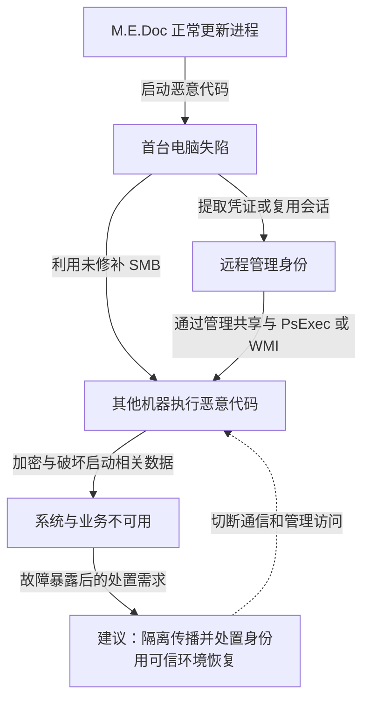

2017 年 6 月 27 日，多家企业遭遇 NotPetya 破坏。微软当时报告乌克兰超过 12,500 台设备遇到该威胁，并在另 64 国观察到活动；这是其遥测覆盖，不能直接换算为全球实际受损设备或损失金额。攻击从正常软件更新进入部分环境后，既利用 SMB 漏洞，也用已经取得的管理员凭证和系统管理工具扩散。因此，打上 MS17-010 可以关闭一类利用路径，却不能证明整台设备不再会被感染。

本文依据[微软的执行与传播分析](https://www.microsoft.com/en-us/security/blog/2017/06/27/new-ransomware-old-techniques-petya-adds-worm-capabilities/)和 [Kaspersky 对恢复机制的检查](https://securelist.com/expetrpetyanotpetya-is-a-wiper-not-ransomware/78902/)。样本机制与每家受害企业的具体内网路径分开讨论，不推定所有企业都经同一个远程接口失陷。

## 正常更新成为第一段执行的来源

会计软件 M.E.Doc 本应分发业务更新。微软观察到合法更新进程 `EzVit.exe` 启动了与攻击一致的恶意执行链，这把“供应商可能有问题”的猜测推进为部分感染的遥测证据。它仍不能单独说明攻击者最初怎样取得供应商权限。

进入一台电脑后，恶意代码提取凭证或复用已有会话，寻找其他机器上的管理共享，并借助 PsExec、WMI 等正常管理能力远程执行。同时，它尝试利用未修补的 SMB 服务漏洞。一个分支需要目标存在漏洞，另一个分支依赖已经有效的管理权限；两者不能画成必须依次发生的阶段。

拿到执行位置后，程序进行文件和磁盘相关破坏，重启后展示勒索界面。Kaspersky 对安装标识与密钥恢复关系的分析认为，本次样本缺少旧 Petya 那种可支持恢复的必要信息：展示给受害者的安装标识不能像旧版本那样提供恢复所需的密钥关联。因此，出现付款提示不证明攻击者有能力按付款逐个解密；也不能据此断言任何受害文件在任何条件下都绝无恢复可能。

下图突出两条传播路径。图可横向滚动。

实线表示技术分析支持的执行或能力路径，虚线表示建议遏制的位置。恢复节点不意味着仅靠网络隔离即可清除凭证和持久访问。

## 补丁关闭了漏洞路径，管理身份仍能开门

软件更新能以业务必需程序的身份执行，说明安装来源可信与制品实际内容可信需要分别验证。消费方不能直接修复供应商构建环境，但能把财务软件运行区域与域管理、备份管理和其他业务区域隔开，降低供应商失陷后的可达范围。供应方则需要独立保护源码、构建和发布批准。

管理员凭证在业务终端出现，使单机执行权扩展为多机执行权。补丁与恶意代码检测之外，应使用独立管理终端、限制高权限登录落点，并避免跨区域重复使用可复用的本地管理凭证。控制点不只是“密码复杂”，还包括攻击者能否在被控业务机上取得可用于下一台机器的身份。

共享的目录、备份与部署系统又可能扩大恢复依赖。如果备份数据尚存，但恢复必须依赖已损坏的目录或同一组管理员凭证，恢复速度仍会受限。应让备份删除权限、恢复环境和生产管理身份具有独立边界，并演练从基础服务到业务的恢复顺序。恢复清单应包含目录、DNS、时间同步、制品和备份目录；离线介质存在，不等于能在生产身份系统损坏时找到、解密并恢复正确版本。

检测可关联更新进程启动非预期系统工具、异常读取凭证、向多个管理共享复制文件和远程执行。PsExec 与 WMI 都有合法用途，只有与调用身份、批准任务和受害主机关系对照，才能减少把正常运维当作攻击。

## 从马士基的重建记录看恢复依赖

马士基在 [2020 年业务连续性白皮书第 5 页](https://www.maersk.com/~/media_sc9/maersk/stay-ahead/maersk---a-view-from-the-other-side-of-a-crisis---final.pdf)回顾：2017 年事件使其几乎全部系统不可用，需要从头重建；公司称用十天重建网络，同时通过替代安排继续运送货物。这是受害企业的回顾性陈述。“网络重建”与“货物继续流转”是两个结果，不证明十天内所有应用、历史数据与积压都已恢复，也没有披露其全部身份恢复步骤。

这段记录提供的决策信息是，IT 重建与业务绕行必须并行预算。以下依赖分析属于设计推论：生产目录失效时，恢复人员可能无法登录；DNS、时间同步或备份目录未恢复时，即使副本完好也难以找到并启动正确服务。若仍使用可从财务终端窃取的管理身份接回新环境，还会重开凭证传播路径。因此应先在独立恢复区建立身份与基础服务，再按依赖恢复应用，并由业务人员核对运输或财务记录。

6 月 27 日是微软遥测与企业中断的事件日期，白皮书的“十天”是该企业自报重建耗时；资料没有给出逐项凭证撤销和最终对账日期，不能据此补出统一的全球恢复时间线。

## 以被控财务终端和失效目录验收

对类似系统，平台负责人维护更新的隔离与发布验证，身份团队减少横向管理权限，业务负责人确定可接受的停机时间。允许短期暂停高风险更新会增加维护成本，管理分区也会增加运维步骤，这些代价需要进入业务决策。财务软件到其他区域的例外访问应有明确任务和期限，恢复演练则记录实际恢复点、完成时间与业务数据一致性，避免仅用备份任务成功作为通过依据。

建议演练同时覆盖传播与恢复，以下均非本文已实测的结果：

- 给测试者财务终端的本地管理权及该终端已有会话，向另一业务区的测试主机发起无害远程管理任务。即使目标已修补 SMB，也应由管理身份或区域策略拒绝；检查身份登录、管理共享与目标任务记录。独立管理终端执行获批任务应成功。
- 断开测试恢复区对生产目录、DNS 和管理平台的依赖，恢复团队使用封存的独立身份、制品和副本建立最低业务。记录每项依赖的实际启动次序、数据恢复点和首笔业务核对结果；再接回获准新身份，证明正常运维可用且旧身份仍被拒绝。

应急时同时考虑漏洞入口、会话、管理凭证和已执行代码；修补不逆转已发生的磁盘破坏。先保全必要证据，再按可信恢复流程处置，而不是根据勒索界面把付款当作确定可用的恢复方案。

## 资料与核验入口

- [微软：Petya 的更新执行链与多种横向移动方法](https://www.microsoft.com/en-us/security/blog/2017/06/27/new-ransomware-old-techniques-petya-adds-worm-capabilities/)。
- [Kaspersky：为何将该变种判断为破坏程序](https://securelist.com/expetrpetyanotpetya-is-a-wiper-not-ransomware/78902/)。
- [马士基：业务连续性白皮书](https://www.maersk.com/~/media_sc9/maersk/stay-ahead/maersk---a-view-from-the-other-side-of-a-crisis---final.pdf)，第 5 页回顾 NotPetya 后的系统重建与物流维持，非完整取证报告。
