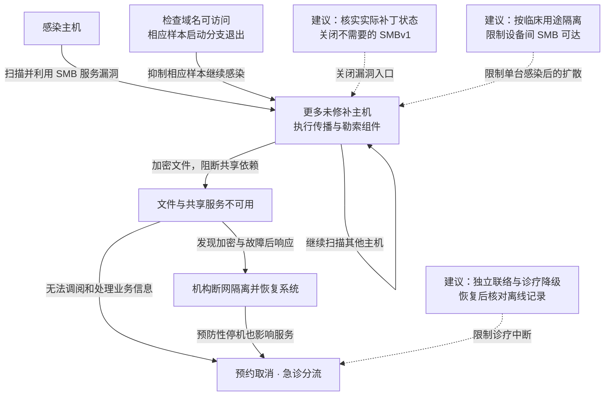

2017 年 5 月 12 日，WannaCry 利用未修补的 Windows SMB 服务自动传播并加密文件，使英国英格兰 NHS 的部分设备和医疗服务不可用。英国国家审计署（NAO）记录至少 81 家信托机构受到影响，估计超过 19,000 次预约取消；影响包括直接感染、预防性断网和共享服务中断。研究者注册样本检查的域名后抑制了相应样本的继续执行，各机构同时隔离和恢复系统，到 5 月 16 日仍有两家医院分流患者。[微软样本分析](https://www.microsoft.com/en-us/security/blog/2017/05/12/wannacrypt-ransomware-worm-targets-out-of-date-systems/)解释传播机制，[NAO 调查](https://www.nao.org.uk/reports/investigation-wannacry-cyber-attack-and-the-nhs/)记录医疗影响与响应。

## 攻击经过

### 无须逐台诱骗用户，网络请求就能带来执行能力

SMB 是 Windows 的文件与共享服务。WannaCry 使用公开的 EternalBlue 利用代码，向可达的未修补 SMBv1 服务发送特殊请求，在目标上取得恶意代码执行能力，再由该主机继续扫描和传播。微软 3 月 14 日发布的 MS17-010 已提供修复。

微软分析的传播组件创建 `mssecsvc2.0` 服务，扫描其他主机的 SMB 服务并尝试感染。传播由服务端漏洞触发，不要求每名医护人员都打开附件。最初怎样进入每家 NHS 机构没有统一确认，但机构内部的扩散可以沿可达且未修补的设备发生。

### 文件加密与隔离动作一起影响诊疗

勒索组件加密文件并显示付款提示，感染设备难以提供正常服务。共享应用、文件和信息交换失效后，业务影响继续传到未直接被加密的终端。防守方为减缓扩散主动断网和停用系统，也使预约、检查和转诊受阻。

NAO 区分了已收集到的 6,912 次预约取消与超过 19,000 次的总量估计。这个口径反映本案的业务后果：被感染设备数量之外，服务依赖与应急停机同样决定了患者受到的影响。

### 检查域名限制样本启动，机构仍需恢复设备和服务

部分样本在继续释放勒索程序与传播组件前，通过 `InternetOpenUrlA` 尝试访问一个域名；连接成功便退出，失败则继续感染。域名被注册并可访问后，这个分支有助于遏制相应样本。它不会解密已加密文件，也不能替代对受感染设备的处置。

NHS 机构随后组织隔离和恢复。NAO 记录，5 月 16 日仍有两家医院分流患者，事后还要求相关机构确认落实先前警报和防火墙措施。业务恢复需要患者身份、预约、医嘱与检查结果重新对应，并处理离线期间的补录与遗漏。

下图同时显示感染、业务依赖和实际遏制；虚线只连接本文建议，可横向滚动。

## 关键突破、成因与防护

### 补丁警报没有变成设备上的修复

NAO 记录 NHS Digital 在 3 月和 4 月已发出关键补丁警报，但攻击发生前，卫生部门没有正式机制确认地方机构是否落实。通知已经到达中央流程，未修补设备却继续留在可达网络中。

安装 MS17-010、停用不需要的 SMBv1，是直接措施。进一步需要将维护记录与实际运行设备对应，核实版本和漏洞状态，不能用邮件转发或部署任务成功替代设备证据。医疗设备涉及兼容性和维护窗口时，可以先限制其通信对象与共享接口，再安排修补或替换；代价是设备维护和临床排班需要协调。

### 一台旧设备仍能接触大量其他设备

蠕虫传播把单点失陷变成自动扩散，关键条件是未修补服务既存在，又能从感染位置直接访问。单纯提高用户识别钓鱼的能力，无法限制这个网络路径。

按诊疗用途分区、减少主机间 SMB 通信、将维护访问与普通办公访问分离，可以在仍有设备未修补时降低扩散范围。限制应落在交换、主机或区域边界的策略上，避免感染主机凭自己的本地管理权便解除限制。对于确需共享服务的设备，应只允许明确的客户端与服务端关系，保留业务必需通信，同时减少横向连接。

### 技术遏制会进一步切断医疗依赖

断网可以减缓传播，也会使依赖共享身份、邮件和临床应用的工作停下来。仅让设备重新启动，无法处理预约中断、患者识别与离线记录问题。

备用联络和最低限度诊疗流程，应能在主要身份服务、邮件或预约平台不可用时继续使用。恢复时先确认设备可信与共享依赖可用，再处理离线期间的医嘱、检查和转诊记录。临床业务需要承担纸面处理、补录和容量下降的成本，但这能减少安全隔离直接扩大为全面诊疗中断的机会。检查域名带来的遏制效果属于此次样本的实现特征，长期防线仍需要设备修补、通信隔离和可信恢复。

## 参考资料

- [微软：WannaCrypt 初期技术分析](https://www.microsoft.com/en-us/security/blog/2017/05/12/wannacrypt-ransomware-worm-targets-out-of-date-systems/)，含 SMB 漏洞、服务创建和检查域名的启动分支。
- [NAO：WannaCry 与 NHS 调查](https://www.nao.org.uk/reports/investigation-wannacry-cyber-attack-and-the-nhs/)，核对机构、预约及应急通信的统计口径。
