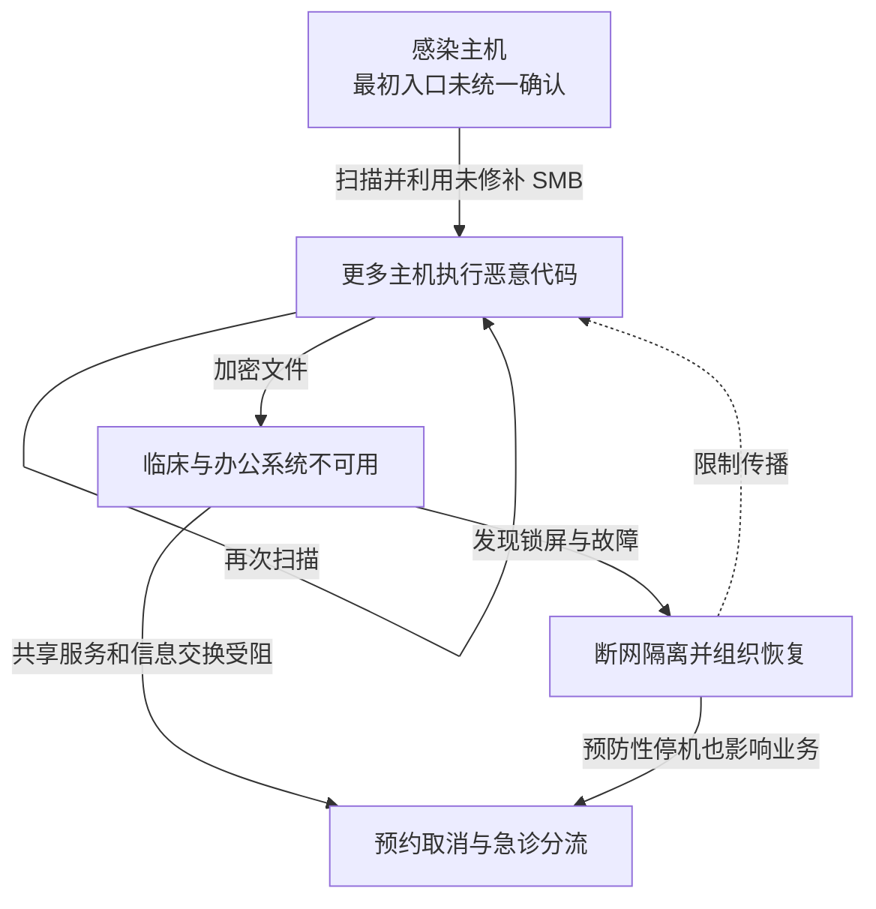

2017 年 5 月 12 日，WannaCry 利用 Windows 文件共享服务漏洞扩散并加密文件。对英国英格兰国家医疗服务体系（NHS）而言，后果不仅是电脑锁屏：预约、急诊分流和跨机构信息交换也受到影响。英国国家审计署（NAO）统计至少 81 家信托机构受到影响，并估计超过 19,000 次预约取消；这两个数字既不是全部机构感染数，也不是完整医疗损失。信托机构是提供医疗服务的组织，可以管理多个院区，不能直接换算为医院或设备数量。

技术机制依据[微软当时的样本分析](https://www.microsoft.com/en-us/security/blog/2017/05/12/wannacrypt-ransomware-worm-targets-out-of-date-systems/)，业务和组织响应依据 [NAO 2017 年调查](https://www.nao.org.uk/reports/investigation-wannacry-cyber-attack-and-the-nhs/)。不能把全世界的感染统计直接当作 NHS 的受害规模。NAO 报告区分已经收集到的 6,912 次预约取消与超过 19,000 次的总量估计，并说明部分门诊和转运损失未完整统计。

## 自动传播怎样绕过逐台诱骗

正常文件共享允许获准的设备访问 Windows 的 SMB 服务。攻击者利用的关键变化，是未修补的 SMBv1 服务可以被特殊网络请求触发漏洞，进而执行代码。微软已于 3 月 14 日发布 MS17-010，攻击爆发时修复已经可用。

一台感染设备扫描其他可达主机，利用漏洞执行恶意代码，新主机又成为扩散源，文件加密则使临床系统和普通办公文件难以使用。传播不要求每名医护人员都点击邮件。最初入口不能从这段蠕虫能力反推为某一封 NHS 钓鱼邮件；微软初期报告也没有确认确切的初始入口。

防守方还主动断网、关闭系统来遏制扩散。即使某机构本身没有被加密，也可能因共享系统失效或预防性停机无法工作。NAO 特别指出，其掌握的记录不足以完整统计这些依赖引起的中断。

下图同时表示感染与业务影响，避免把所有不可用都算作恶意程序直接加密。图可横向滚动。

实线表示传播或影响，虚线只表示响应对传播的限制。NAO 的“受影响”同时覆盖感染与服务中断，不能按节点相加。

## 补丁通知没有变成可证实的修复结果

NAO 发现，中央机构曾发出重要补丁警报，但攻击前缺少正式机制确认地方机构是否落实。问题既包括易受攻击的系统，也包括从资产识别、补丁兼容性测试到变更批准和最终验证的链条没有闭合。收到通知、补丁包被分发与漏洞不再可利用是三种状态。

第二个突破口是设备之间仍有足够的 SMB 可达关系。即使一台旧医疗设备暂时无法修补，也可以按临床用途限制其通信对象，避免普通办公网或其他病区直接访问文件共享接口。不能把“在内网”当作设备已经可信。

第三个突破口是临床业务依赖与应急通信没有充分独立。邮件失效会同时影响响应协调，系统停用又可能阻断急诊、检查或转诊。单纯购买备份，不能保证人员在身份服务、DNS 或关键应用不可用时仍能开展最低限度医疗活动。

建议将异常 SMB 扫描、受影响主机版本、加密与服务故障记录关联起来，再按临床服务核对后果。域名访问既可能来自样本，也可能来自研究或防守工具，不能直接按访问次数统计感染设备。

## 假设还有一台设备没打补丁

架构验收应允许存在这个现实前提，再检查其传播范围是否被限制。医疗设备负责人维护不能及时修补的设备清单与退出计划，网络团队实施按用途的访问策略，临床负责人确定降级流程和恢复顺序。例外需要有期限、负责人和补偿控制，避免永久以“影响业务”为由开放访问。

| 演练条件 | 应观察的结果 |
| --- | --- |
| 一台隔离测试设备具备易受攻击服务 | 普通办公区不能访问，获准临床接口仍工作 |
| 补丁平台显示部署成功 | 目标设备版本与漏洞验证支持实际修复结论 |
| 邮件、身份或预约系统同时不可用 | 备用联络、患者识别和急诊降级流程能够运行 |

部分当时样本启动时检查一个域名，能够连接时退出；研究者注册该域名后，这种分支限制了相应样本的继续执行，有助于遏制扩散，但不会解密已经加密的文件，也不应成为未来防线的依赖。恢复还需要确认设备可信、服务依赖可用和临床数据一致；减少新感染与恢复诊疗是不同验收目标。恢复时应由临床人员验证患者身份、检查结果、预约与医嘱能对应，并核对离线期间的重复或遗漏；补丁窗口和设备替换成本也需要纳入负责人预算。

## 资料与核验入口

- [微软：WannaCrypt 初期技术分析](https://www.microsoft.com/en-us/security/blog/2017/05/12/wannacrypt-ransomware-worm-targets-out-of-date-systems/)，查阅 Attack vector 与传播机制。
- [NAO：WannaCry 与 NHS 调查](https://www.nao.org.uk/reports/investigation-wannacry-cyber-attack-and-the-nhs/)，核对信托机构、预约与应急通信的统计范围。
