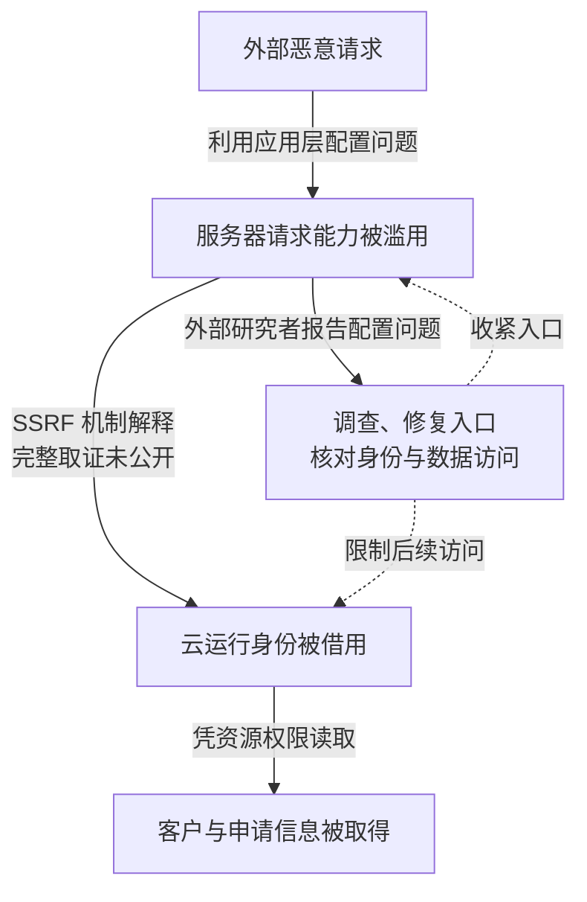

2019 年 3 月，Capital One 的部分信用卡申请与客户信息被外部人员取得。公司披露的影响约为美国一亿人和加拿大六百万人；这是个人信息受影响规模，不是同等数量银行账户被控制或发生资金损失。事件表明，修复入口配置只是其中一道边界，还需要检查入口后的运行身份能够读取什么。

日期与影响依据 [Capital One 事件说明](https://www.capitalone.com/digital/facts2019/)。技术路径结合 [Amazon 在相关诉讼中的答辩](https://www.capitalonesettlement.com/Content/Documents/Amazon%20Answer.pdf)，其中明确承认其公开说明涉及应用层防火墙配置错误、过宽权限，并认为使用了服务端请求伪造（SSRF）。答辩中承认的说明、当事方技术判断和法院最终认定不能混为一谈。

## 攻击者需要让请求带上服务器的能力

正常业务中，互联网用户向应用提交请求，应用在自己的云身份范围内访问后端。用户的请求不应自动获得服务器访问内部资源或云凭证的能力。

SSRF 的一般原理是，攻击者控制请求目标或相关参数，让服务器代为访问攻击者自己不能直接访问的位置。在云环境中，若进程能访问实例元数据并取得运行角色的临时凭证，外部输入就可能进一步变成可复用的云 API 身份。这是解释本案常见技术还原的机制，不能把公开材料未逐项披露的请求参数、元数据响应和完整权限策略补写为已独立核验的日志。本文没有重放利用，也未取得原始云审计记录；应以这种证据边界理解图中的中间路径。

下一步才决定泄露规模：云存储收到带有效凭证的读取请求时，主要依据角色权限与资源策略判断，而不认识最初那次外部请求是否恶意。临时凭证有效不等于业务用途正当；对象没有公开访问，也不等于拿到内部角色后无法读取。

公司说明，访问发生在 3 月 22—23 日，7 月 17 日收到外部研究者报告，7 月 19 日确认事件。时间差说明需要长期可调查的身份与对象访问记录，但不能据此断言期间持续遭到同一攻击者访问。

下图区分已披露的入口与权限问题，以及用于解释的 SSRF 机制。图可横向滚动。

图中的机制解释标注在连线上，不代表已经展示本案完整云审计日志。虚线只表示响应对象，修复不会自动删除已复制的数据。

## 三个突破点需要分别限制

入口组件可以发出不符合业务预期的请求，是第一层失守。应用团队需要明确允许访问的服务、协议和目标，处理重定向与地址解析后的最终目标，避免只用字符串黑名单阻挡内部地址。这些是相似系统的设计建议，不是对本案具体代码的断言。

请求可以接触身份来源，是第二层放大。工作负载只应取得自身所需身份，非必要进程不能获取云凭证。实例元数据保护和进程隔离有价值，但其效果要结合实际请求能力、转发行为与主机控制程度测试，不能把启用某一选项当作全部 SSRF 已解决。

角色可以读取大量业务数据，是第三层放大。面向互联网的入口通常不需要历史申请资料的广泛读取权。应按服务和数据域划分角色、对象范围及解密用途，让前端失陷仍无法批量读取历史数据。存储加密在获准身份能够请求解密时，不会独立阻止此次读取链路。需要一起检查角色权限、对象资源策略及密钥用途；分开放置的配置，如果都能被同一管理员放宽，仍有共同失陷边界。

建议将入口请求与云 API 身份、对象读取数量和异常来源关联。调查前先确认数据访问日志是否已启用、覆盖哪些对象及保留多久；没有相关日志时，“未查到读取记录”不能证明未访问。

## 用已经失陷的工作负载检验边界

云平台团队负责身份发放和资源策略，应用团队负责请求用途，数据负责人决定必要字段与保留期限。限制过宽角色可能影响既有程序，迁移应通过调用记录和业务测试完成，而非为避免报错重新授予全量权限。历史申请数据能否删除或去标识化，由数据负责人结合用途与保留义务决定；限制只涉及新数据，也不足以缩小旧数据集的暴露。

| 测试条件 | 需要观察的结果 |
| --- | --- |
| 应用可被诱导发出服务端请求 | 不能取得其他服务身份或访问身份管理接口 |
| 应用角色临时凭证已经外泄 | 不能跨数据域读取、扩大权限或持续刷新为更高权限 |
| 有效角色短时批量读取历史对象 | 日志能关联主体、对象与数量，检测和响应能够限制继续读取 |

事件响应要同时核对入口修复、凭证剩余有效期、策略变更和实际数据访问范围。删除某个源密钥不应直接被当作所有已签发临时会话都失效的证据，应使用目标服务实际授权结果核验。阻止下一次读取与确认既有数据外传是不同问题；未发现后续欺诈，也不能消除已发生的隐私影响。

## 资料与核验入口

- [Capital One：2019 年事件事实与时间](https://www.capitalone.com/digital/facts2019/)。
- [Amazon 诉讼答辩](https://www.capitalonesettlement.com/Content/Documents/Amazon%20Answer.pdf)，检索 SSRF 与 misconfiguration，区分承认事项和争议事项。
