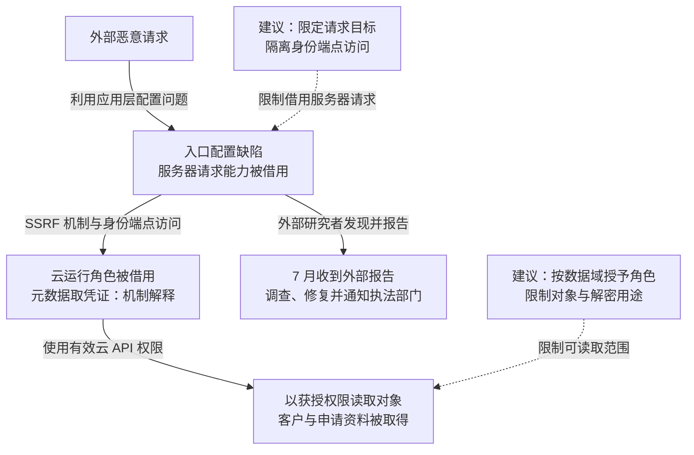

2019 年 3 月 22—23 日，攻击者利用 Capital One 云环境中的入口配置缺陷取得客户及信用卡申请资料，影响约一亿美国人和六百万加拿大人。公司 7 月 17 日收到外部报告，7 月 19 日确认事件，7 月 29 日公开。入口的服务端请求能力与过宽云权限共同放大了泄露范围；Amazon 在诉讼答辩中将其解释为涉及 SSRF 的攻击。实施相关数据窃取的 Paige Thompson 后于 2022 年被判定多项罪名成立。[公司披露](https://www.capitalone.com/digital/facts2019/)与[司法部通报](https://www.justice.gov/usao-wdwa/pr/former-seattle-tech-worker-convicted-wire-fraud-and-computer-intrusions)分别记录了影响、时间和司法结果。

## 攻击经过

### 外部输入借用了服务器的请求位置

正常业务中，公网入口处理用户请求，再以应用自身的身份访问获准后端。攻击者不能因为能够提交一个 URL 或请求参数，就获得应用服务器访问内部服务的能力。

SSRF（服务端请求伪造）使服务器向攻击者指定的位置发送请求。在 [Amazon 诉讼答辩第 13 页](https://www.capitalonesettlement.com/Content/Documents/Amazon%20Answer.pdf#page=13)的技术立场中，本案涉及应用层防火墙配置错误，并被较预期更宽的权限放大。这一来源说明了服务端请求与权限的连接，但属于当事方在诉讼中的表述。

### 服务器侧身份把请求缺陷变成云资源读取

云工作负载经常通过运行角色取得临时凭证，以便访问后端资源。在实例元数据这种机制下，本应仅供实例内部使用的身份端点，如果被不受约束的服务端请求触及，就可能将角色凭证返回给攻击者。

凭证外泄之后，攻击者可在其有效期和策略范围内构造云 API 请求。此时云服务判断的是角色能否执行某项操作，而不是最初发起 SSRF 的互联网用户是否被授权。对象存储无需被设为公开，攻击者也可能借内部角色读取对象；这解释了入口配置和存储权限为何需要连续分析。

### 有效读取权限扩大到客户与申请资料

最终可读取多少对象，取决于角色权限、对象资源策略，以及涉及加密时的密钥使用权限。公司披露的数据包括信用卡申请所提供的信息和部分客户资料。影响人数约 1.06 亿，部分社会安全号码和银行账号也受到影响；信用卡账号和登录凭据未在此次披露范围内。

公司在收到外部研究者报告后调查并修复入口，再与执法部门合作。访问发生于 3 月，确认与公开发生于 7 月，这段间隔也使长期保存的身份与对象访问记录成为范围调查的重要材料。

下图用 Amazon 的技术立场及云身份机制解释能力转换；虚线连接本文建议，可横向滚动。

## 关键突破、成因与防护

### 入口能够访问超出业务用途的目标

直接措施是修正入口配置，按业务限定协议、目标地址和服务。校验要覆盖域名解析后的地址、重定向与最终连接目标，避免检查初始字符串后仍访问内部端点。

更深的限制需落在请求代理、进程或网络授权层，使入口即使收到恶意目标，也不能随意接触身份来源。若应用本身已被完全控制，代码中的 URL 校验也可被绕开，此时仍需依靠独立执行的出站策略与后端授权约束其能力。

### 运行角色既能取得身份，又能读取过多资料

非必要进程应无法取得云凭证。现代相似环境可要求 IMDSv2，通过先取得会话令牌再请求元数据来约束直接转发型请求，并停用不需要的元数据访问。[AWS 官方说明](https://docs.aws.amazon.com/AWSEC2/latest/UserGuide/configuring-instance-metadata-service.html)给出了机制；这是可用于相似环境的防护设计，不是对本案当时部署状态的描述。

如果攻击者已有主机执行权，仍可能按合法流程取得实例角色。因此，面向公网的角色应只读业务必需对象，历史申请资料按数据域另行授权；对象策略与密钥用途需配合限制。加密对象若能由同一角色请求解密，仍会返回可读内容。把密钥与存储配置分别放置，也需要防止同一失陷身份同时放宽两边策略。

### 修复请求入口后，已经签发的身份还可能有效

入口修复阻止继续通过同一路径取证，不会自动消除攻击者已经复制的临时凭证或数据。处置需要对照角色会话、资源策略与有效期，限制已暴露身份的后续访问，并调查实际被读取的对象。

对象访问审计、异常来源与累计读取量能缩短调查和发现时间；应核对记录是否覆盖目标对象及整个访问窗口。业务迁移时，收紧角色可能暴露旧程序对全量权限的依赖，可以将必要调用迁入专用数据服务，而不是为避免报错继续扩大入口身份。这个设计直接影响一次入口失陷后可触及的数据总量。

## 参考资料

- [Capital One：2019 年事件事实与时间](https://www.capitalone.com/digital/facts2019/)。
- [Amazon 诉讼答辩](https://www.capitalonesettlement.com/Content/Documents/Amazon%20Answer.pdf)，第 13 页附近讨论 SSRF、入口配置与权限。
- [美国司法部：Paige Thompson 被判定多项罪名成立](https://www.justice.gov/usao-wdwa/pr/former-seattle-tech-worker-convicted-wire-fraud-and-computer-intrusions)。
- [AWS：实例元数据服务与 IMDSv2](https://docs.aws.amazon.com/AWSEC2/latest/UserGuide/configuring-instance-metadata-service.html)，用于解释相似环境的身份端点保护。
