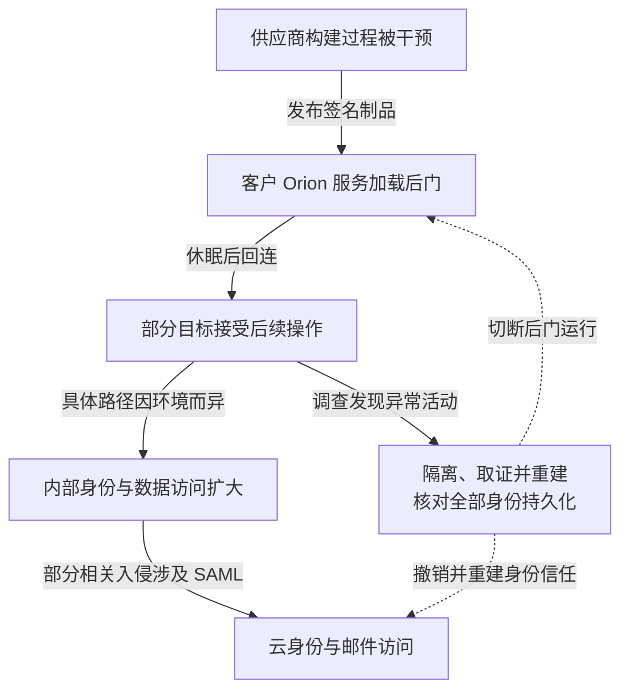

SolarWinds Orion 是用于监控基础设施的软件。2020 年曝光的供应链入侵把 SUNBURST 后门放进正常发布且具有有效签名的组件，使部分客户通过自己的更新流程执行恶意代码。信任更新来源并不能证明更新内容安全，监控服务的身份又可能扩大后续访问范围。SolarWinds 在 [2020 年 12 月 14 日 8-K](https://www.sec.gov/Archives/edgar/data/1739942/000162828020017451/swi-20201214.htm)中估计，可能安装含该问题版本的客户少于 18,000；这是当时的安装覆盖估计，不是已确认遭人工深入入侵的数量。

本文依据 [Mandiant 的 SUNBURST 调查](https://cloud.google.com/blog/topics/threat-intelligence/evasive-attacker-leverages-solarwinds-supply-chain-compromises-with-sunburst-backdoor)、[SolarWinds 后续披露](https://www.solarwinds.com/blog/new-findings-from-our-investigation-of-sunburst)及 [CISA AA20-352A](https://content.govdelivery.com/accounts/USDHSCISA/bulletins/2b1b32d)。CISA 描述的是多起相关调查中的活动，不能将每种持久化手法都套到所有安装过 Orion 的客户。

## 攻击者依次借用了发布者和客户的信任

第一段发生在供应商构建环境。SolarWinds 后续调查称，攻击者使用专门的构建注入程序，将恶意代码插入 Orion 制品。源码被审查、构建成功和签名完成，没有单独证明最终制品与获准源码一致；攻击者利用的是这几者之间的信任连接。

第二段由客户正常安装更新完成。后门位于 `SolarWinds.Orion.Core.BusinessLayer.dll`，在服务运行环境中加载，休眠一段时间并检查分析工具，再通过伪装成合法软件活动的通信联络外部基础设施。Mandiant 观察到最长约两周的初始休眠。延迟与流量伪装减少异常与刚安装更新之间的直观联系。

第三段是选择目标后开展人工操作。初始回连、接收后续载荷与进一步窃取数据是不同状态；一个 DNS 请求不能证明环境已经被完整人工渗透。攻击者可能利用服务可接触的凭证及更高权限继续扩展，但具体路径随受害环境变化。分析每家环境时需要核对 Orion 实际服务身份、保存的凭证和可达接口，不能仅凭产品名称推定拥有域管理员权限。

CISA 在相关入侵中还观察到联合身份风险：攻击者取得 SAML 签名能力后，可以生成被云服务接受的伪造身份断言，读取邮件等资源。SAML 是让服务依据身份提供方的签名信任用户身份的机制；一旦签名信任根被控制，重置某位用户密码不能单独终止这种能力。

下图保留客户之间路径不同的边界。图可横向滚动。

实线连接资料支持的能力变化，连线中的“部分”限制适用范围；虚线只表示响应对象。隔离 Orion 不会自动撤销已经建立的其他访问。

## 三道边界不能由同一权限同时批准

供应方需要证明制品来自获准源码、可信构建及获准参数，并保护签名和发布批准。若攻击者能改构建、生成来源证明、修改验证规则并发布更新，增加一份签名文件仍无法形成独立约束。可由隔离构建、受保护的发布根及独立对照缩小这种共同失陷面。

客户方需要限制监控软件的运行身份。网络监控可能需要读取状态，但不应因此默认拥有所有业务区的交互管理权或可复用管理员凭证。通过分区、专用身份和只读接口，可以在监控节点已经失陷的前提下限制继续部署和接触身份系统的能力。

联合身份签名根则应单独保护。不能让普通服务器管理权自然通向签名密钥、联合信任配置和云应用凭证。即使私钥不可导出，攻击者若能调用签名服务或替换受信根，仍可能伪造可接受身份，验收需覆盖这两种能力。恢复时还应检查新增服务主体、应用授权和长期凭证，避免只处理用户账号。

身份调查可交叉核对云服务接受的断言、身份提供方认证记录、新增联合信任与应用凭证。缺少对应交互登录可以成为线索，但合法后台任务、日志保留与时间差也要排除，不能仅靠一个时间戳认定伪造。

## 遏制不等于清除了所有下游访问

CISA 提醒，根除可能复杂且需要带外通信，因为攻击者会关注 IT 和响应人员的邮箱。响应讨论若仍在可疑身份域和邮箱中进行，可能继续暴露处置计划。可信通信、身份重建和主机重建需要共同安排。

| 负责方与演练条件 | 验收要求 |
| --- | --- |
| 发布负责人：构建节点被控制 | 无法单独发布未经批准的制品或修改验证规则 |
| 平台负责人：监控服务被控制 | 无法取得业务区管理身份或联合身份签名能力 |
| 身份与应急负责人：原签名根失陷 | 旧断言、应用凭证和会话被逐项核对，关键业务使用新信任恢复 |

重建和轮换会影响监控、自动化与登录可用性，需要按依赖排序和保留回退条件。客户是否收到恶意更新、后门是否激活、是否形成额外访问及是否发生外传，应分别建立证据，不能用一个“受影响客户数”代替所有结论。升级到不含后门的版本可以改变该组件，但不清除先前建立的账号、应用授权或其他载荷；恢复准入应由客户侧证据支持。

## 资料与核验入口

- [Mandiant：SUNBURST 的加载、通信和后续入侵](https://cloud.google.com/blog/topics/threat-intelligence/evasive-attacker-leverages-solarwinds-supply-chain-compromises-with-sunburst-backdoor)。
- [SolarWinds：后续构建注入调查](https://www.solarwinds.com/blog/new-findings-from-our-investigation-of-sunburst)。
- [CISA AA20-352A：身份滥用和根除边界](https://content.govdelivery.com/accounts/USDHSCISA/bulletins/2b1b32d)。
