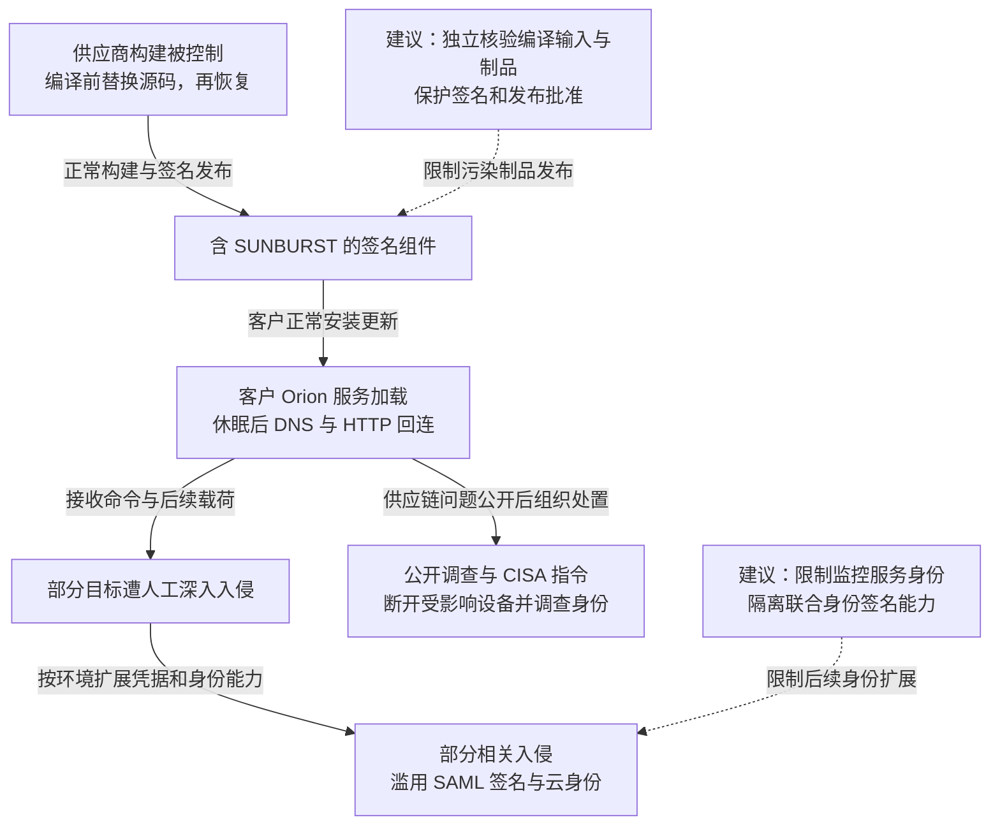

2020 年 12 月披露的 SolarWinds 入侵，通过 Orion 软件的正常签名更新向客户分发 SUNBURST 后门。攻击者先在供应商构建时替换编译输入，客户安装更新后，后门以监控服务环境中的权限运行并回连，部分目标再遭人工深入入侵及数据窃取。SolarWinds 当时估计可能安装问题版本的客户少于 18,000；后续深入入侵只发生在其中部分目标。事件公开后，CISA 要求美国联邦民事机构断开受影响设备，调查继续延伸到下游凭据与身份系统。Mandiant 后将这组活动归入 APT29。[供应商披露](https://www.sec.gov/Archives/edgar/data/1739942/000162828020017451/swi-20201214.htm)和 [Mandiant 调查](https://cloud.google.com/blog/topics/threat-intelligence/evasive-attacker-leverages-solarwinds-supply-chain-compromises-with-sunburst-backdoor)记录了影响与归因。

## 攻击经过

### 在编译器读取前替换源码，构建后再还原

SolarWinds 后续调查把已知可疑活动追溯至 2019 年 9 月，描述了 10 月的构建插入测试、2020 年 2 月 20 日起的恶意注入，以及 6 月移除相应构建恶意代码的经过。公司直到 12 月才获知攻击。[供应商调查时间线](https://www.solarwinds.com/blog/new-findings-from-our-investigation-of-sunburst)给出了这些阶段。

[CrowdStrike 对 SUNSPOT 的分析](https://www.crowdstrike.com/en-us/blog/sunspot-malware-technical-analysis/)进一步解释了构建注入：样本监视 `MsBuild.exe`，识别 Orion 工程，在编译器读取前把 `InventoryManager.cs` 换成包含 SUNBURST 的版本，构建完成后恢复原源码。报告中的测试日志用于演示这一机制。

攻击者改变的是构建过程实际消费的输入。源码库审查和事后文件检查都可能看到干净代码，而编译出来的 DLL 已含后门。后续正常签名流程又为受污染制品加上可信发布者的签名。

### 客户正常安装后，监控服务加载后门

恶意代码位于 `SolarWinds.Orion.Core.BusinessLayer.dll`，由正常 Orion 服务进程加载。SUNBURST 初始可休眠最长约两周，检查分析工具，再通过 DNS 选择通信基础设施，使用 HTTP 与外部控制服务器交换命令和数据。

Mandiant 描述其通信伪装成 Orion Improvement Program（OIP）活动，侦察结果存入正常插件配置文件。可执行任务包括传输文件、运行文件和查询系统。延迟启动与正常协议外观，减少了异常行为与刚安装更新之间的直观联系。

### 从服务运行身份扩展到部分目标的其他权限

后门首先拥有 Orion 服务所在环境的执行能力。客户授予监控软件的身份、网络可达性及可接触凭据，决定攻击者能否继续管理其他服务器或接触身份系统。

CISA 在相关入侵中还观察到 SAML 签名能力被滥用：身份提供方用签名断言向云服务证明用户身份，攻击者取得签名密钥或相应控制能力后，可生成被目标服务接受的断言，再访问邮件等资源。这是部分相关入侵的扩展路径；它将持久访问从一个 DLL 转移到了身份信任关系。

### 公开调查促使断开设备，根除继续覆盖身份

2020 年 12 月 13 日，CISA 发布紧急指令要求相关联邦机构断开受影响 Orion 产品。[AA20-352A](https://content.govdelivery.com/accounts/USDHSCISA/bulletins/2b1b32d)随后指出，并非所有安装后门的组织都遭到后续行动，已深入失陷的环境则需要复杂的根除。

CISA 还提醒使用可信的带外通信，攻击者可能关注 IT 与响应人员邮箱。隔离 Orion 能切断它的继续执行和通信，已有账号、应用凭证或身份信任需要另外处置。

下图区分发布、客户执行及部分目标的身份扩展；虚线表示本文建议，可横向滚动。

## 关键突破、成因与防护

### 源码审查与有效签名没有覆盖实际编译输入

SUNSPOT 在编译期间短暂替换源码，避开了只看代码仓库或构建结束后文件的检查。供应方需要核对实际编译输入、构建参数与最终制品，并让发布验证与被验证的构建节点分属不同控制边界。

隔离和短生命周期构建环境、受保护的输入摘要、独立构建对照与签名门禁，可以减少构建管理权直接变成发布权的机会。来源证明也需独立保护；若同一攻击者能改输入、重写证明并放宽验证规则，新增签名仍由同一失陷权限背书。

### 监控节点的正常权限可以成为横向管理权限

客户安装更新属于正常操作，后门执行后继承的是服务身份。及时隔离和升级受影响版本可以限制这条入口，但监控软件原有的管理员凭据与跨区访问，会决定入口失守后的损害。

应按监控用途授予只读接口、专用身份和受限通信，不让监控运行账号默认拥有域管理或各业务区的交互登录权。真正的隔离由目标服务与网络策略执行，不能只依赖 Orion 自己声明“只读”。异常服务子进程、DNS/HTTP 通信和远程身份使用，也需在监控节点之外留存记录。

### 身份签名根失陷后，改密码不足以清除访问

SAML 验证依赖受信签名，用户密码并不参与每一次断言验证。限制私钥导出需要配合签名服务调用权限与信任配置保护，否则攻击者仍可能请求合法签名或替换受信根。

恢复应覆盖签名信任、会话、服务主体和应用授权，并按目标服务的实现撤销既有访问。可信的管理环境与带外通信可以减少处置计划继续暴露。重新安装 Orion 不会删除此前建立的独立账号或云应用凭证，重建与轮换需要按依赖排序，以免在恢复监控和登录时重新引入原有权限。

## 参考资料

- [SolarWinds：2020 年 12 月 8-K 披露](https://www.sec.gov/Archives/edgar/data/1739942/000162828020017451/swi-20201214.htm)。
- [Mandiant：SUNBURST 加载、通信与后续入侵](https://cloud.google.com/blog/topics/threat-intelligence/evasive-attacker-leverages-solarwinds-supply-chain-compromises-with-sunburst-backdoor)。
- [SolarWinds：构建注入与时间线调查](https://www.solarwinds.com/blog/new-findings-from-our-investigation-of-sunburst)。
- [CrowdStrike：SUNSPOT 技术分析](https://www.crowdstrike.com/en-us/blog/sunspot-malware-technical-analysis/)，参见 Build Hijacking Steps。
- [CISA AA20-352A：入侵、身份滥用及根除](https://content.govdelivery.com/accounts/USDHSCISA/bulletins/2b1b32d)。
