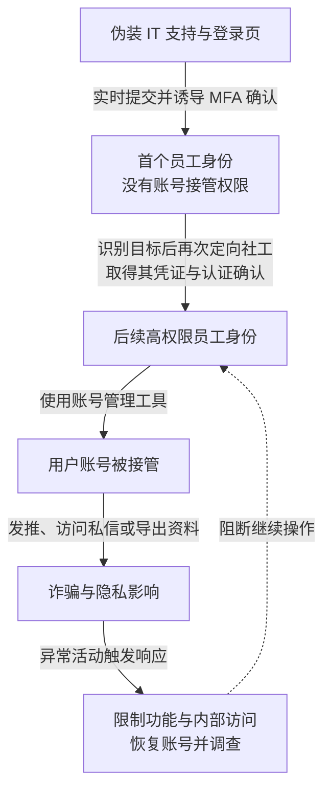

2020 年 7 月 15 日，多个 Twitter 名人与机构账号发布比特币诈骗信息。攻击者没有必要逐一破解用户密码，而是先取得平台员工访问，再利用内部账号管理工具操作用户账号。平台后台的恢复能力，成为绕过用户自身防护的路线。

纽约州金融服务署（NYDFS）[2020 年 10 月调查报告](https://www.dfs.ny.gov/reports-and-publications/other-reports/Twitter_Report)记录 130 个账号受攻击影响，其中 45 个用于发推，7 个账号的信息被下载，最多 36 个账号的私信收件箱被访问。报告还提到另有账号产生导出请求而未下载；应分别检查请求、生成和下载记录。不同后果覆盖的集合不能相加或互相替代；约 118,000 美元诈骗所得也不能概括全部隐私和平台信任影响。

## 从一名普通员工到拥有后台能力的员工

7 月 14 日，攻击者冒充 IT 帮助台联系员工，以 VPN 故障为由引导其访问类似真实登录站点的页面。员工输入凭证后，攻击者实时向真实站点提交，触发真实多因素认证（MFA）请求，部分员工完成确认。认证要求第二因素，但当时的交互仍可被实时转发和诱导确认。这里不能写成“Twitter 没有 MFA”：认证确实发生，只是用户被诱导批准了攻击者发起的登录。

最初被控制的员工没有可接管用户账号的内部工具权限。攻击者先查看内部站点和操作说明，再识别并攻击拥有目标权限的员工。这一阶段说明，初始低权限访问可以提供组织与权限地图，但没有自动授予最高权限；第二批身份仍然是后续操作的必要条件。

取得相应后台权限后，攻击者先交易稀有用户名，再接管高影响力账号发出诈骗信息。NYDFS 描述的后台能力能具体改变下列状态；表格区分工具功能与本案结果，不假定每个受害账号都经过全部操作。

| 对象 | 后台可以改变什么 | 为什么改变用户控制权 |
| --- | --- | --- |
| 恢复邮箱 | 更新账号绑定邮箱 | 恢复信息可以转向攻击者控制的收件方 |
| 密码与 MFA | 重置密码，启用或禁用 MFA | 用户原有登录保护可被支持工具覆盖 |
| 账号资料导出 | 发起 Your Twitter Data 请求 | 请求不等于下载；报告区分 7 个已下载与另 52 个只产生请求的账号 |

要核验一次接管，应把操作员、原状态、变更后状态与实际访问连起来。员工 VPN 登录只证明取得员工会话，账号邮箱变化才说明恢复路径改变，后续用户登录或资料下载才能证明相应能力被使用。

正常客服恢复账号需要一定覆盖能力，否则用户遗失密码或第二因素后无法找回。问题在于：谁能针对哪个账号、基于什么请求、做何种变更，是否由独立条件限制，而不只是员工是否已经通过 VPN 登录。

下图保留最初身份没有后台权限这一关键区别。图可横向滚动。

实线表示报告还原的经过，虚线表示处置作用。第二批账号仍需被攻击，图中的前后关系不代表首个员工原本拥有全部权限。

## 不应把员工登录当作所有后台操作的授权

第一处突破是可被实时转发的认证与员工误确认。防钓鱼认证可以通过来源绑定减少假站点复用凭证的效果，但还需要保护注册、丢失恢复和帮助台重置流程。否则攻击者可能绕向更弱的恢复路径。即使会话已被窃取，后续高风险操作也应继续受限。

第二处突破是后台操作的权限集中。查询账号、重置认证、修改恢复信息和导出隐私资料应按用途分开。操作必须绑定真实服务请求与目标账号，限制范围和有效期；高影响力账号或批量操作采用独立批准，并向原有可信渠道发出可核对通知。

增加第二个点击者后，仍需验证审批是否独立。如果两个身份可以在同一终端、同一恢复渠道或同一管理员权限下被接管，攻击者仍可能完成两次确认。关键是批准依据与执行权限不能由同一次身份失陷共同伪造。

第三处突破是平台恢复权可以改变用户安全状态。恢复流程应明确哪些用户设置可被客服覆盖，敏感变更是否存在等待期与撤销窗口。对确需紧急恢复的场景，可设计范围受限、独立核验并留证的例外；不能让“紧急”成为后台操作员可自行启用的全面绕过。产品团队需要在找回便利性和账号控制风险之间作出明确取舍，而不能只让安全团队承担误封与恢复延迟的责任。

后台审计应将改邮箱、重置认证、生成资料和实际下载串到同一任务，监测操作员短时跨多个高影响力账号的状态变化。告警后还需要能暂缓高风险任务，不能只在资料下载完成后发送通知。

## 早晨收到线索，不等于当时已经遏制

报告记录，Twitter 在 7 月 15 日早晨收到员工关于可疑来电和登录的报告，调查期间账号接管继续发生。当日平台限制部分认证账号发推与改密码、锁定部分近期改密账号，并大幅限制或撤销员工内部访问；当晚报告多数账号可恢复发推，但仍可能不稳定。公开记录没有证明所有员工身份、用户会话和隐私导出已在同一时点处理完毕。限制功能也影响公共机构发布信息与正常客服请求，需要分别记录遏制收益和业务代价。

## 让后台验收落到账号状态变化

以下是测试账号上的建议演练，本文没有测试 Twitter 当前后台：

1. 给测试者一个普通员工会话，尝试通过申请及恢复流程取得后台操作权。独立授权点应拒绝自行提权，留存申请、批准依据及拒绝记录；获准客服人员仍能取得限定任务权限。
2. 再给测试者客服会话，尝试修改测试用户邮箱、关闭 MFA 并导出资料。没有绑定真实任务的独立批准时，应在变更提交或导出授权处被拒绝，核对用户状态确实未变化、文件未生成；正常找回流程应能完成并向原可信渠道留痕。
3. 对带批准的批量测试，检查审计能否串起操作员、任务和各账号前后状态，以及暂停后未完成任务是否仍会执行。以一个获批单账号任务成功为对照，避免把全面关闭后台误当作权限设计有效。

恢复账号、确认后台权限可信和通知隐私影响分别核验。密码变更之外，还要检查员工会话、用户会话、恢复信息及可复用授权；已下载资料无法靠账号恢复撤回。

## 资料与核验入口

- [NYDFS：Twitter Investigation Report](https://www.dfs.ny.gov/reports-and-publications/other-reports/Twitter_Report)，第 5—8 页还原攻击与不同数据后果，第 13 页起讨论社会工程和控制缺口。
