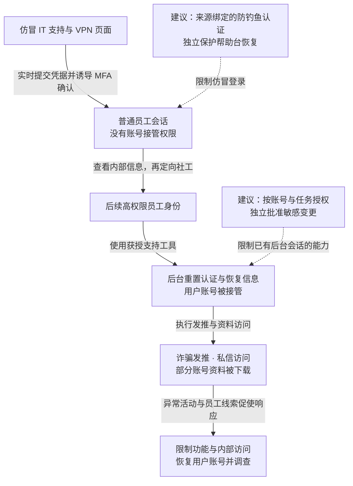

2020 年 7 月 14—15 日，攻击者冒充 IT 支持，通过假 VPN 登录页与实时转发的多因素认证确认取得 Twitter 员工访问，再利用内部信息定向攻击拥有账号管理权限的员工，接管用户账号发布比特币诈骗信息。纽约州金融服务署（NYDFS）调查记录 130 个账号受到攻击影响，其中 45 个用于发推、7 个资料被下载，最多 36 个私信收件箱被访问，诈骗所得约 118,000 美元。Twitter 随后限制部分用户功能并撤销大量员工内部访问，当晚报告多数账号恢复发推。[NYDFS 原始报告](https://www.dfs.ny.gov/reports-and-publications/other-reports/Twitter_Report)还原了攻击与响应。

## 攻击经过

### 假帮助台把真实认证变成攻击者的会话

7 月 14 日，攻击者以 VPN 故障为由联系员工，诱导其打开仿冒登录页面。远程办公期间频繁出现的 VPN 问题，使这一说辞贴近员工的日常经验。

员工在假页面输入凭据后，攻击者实时向真实登录系统提交，触发真正的 MFA 请求，再诱导员工完成确认。第二因素确实发生了，但确认的是攻击者正在建立的登录。攻击者由此取得内部访问，而非只得到一个离线密码。

### 普通员工没有后台权限，内部信息帮助定位下一批目标

最先失陷的员工无法使用账号接管工具。攻击者先访问内部站点与操作说明，了解支持流程，识别拥有目标权限的员工，再开展定向社工。

这段扩展很关键：内部信息的读取能力，帮助攻击者把最初的普通身份转成更有价值的目标线索。后续掌握高权限员工身份，才跨过用户账号管理工具的访问边界。

### 用正常支持工具改写用户的恢复条件

后台支持工具可修改恢复邮箱、重置密码以及启用或禁用 MFA。攻击者借这些合法功能，改变用户原有的登录与找回条件，再以接管的账号发布诈骗内容；早期还涉及稀有用户名交易。

| 后台操作 | 改变的安全状态 |
| --- | --- |
| 修改恢复邮箱 | 后续恢复信息发往新的收件方 |
| 重置密码或关闭 MFA | 用户原有的认证保护被支持权限覆盖 |
| 请求 Your Twitter Data | 生成账号资料导出任务，进一步可能取得下载文件 |
| 查看私信 | 直接暴露用户通信内容 |

报告记录，除 7 个资料被下载的账号外，另外 52 个账号产生了导出请求但未下载。发推、私信访问与资料下载是具体的攻击动作，130 个账号是整体受攻击范围。

### 线索出现后，平台限制后台与用户功能

7 月 15 日早晨，Twitter 收到员工关于可疑来电和登录的报告，调查期间账号接管仍在继续。当天平台限制部分认证账号发推和改密，锁定部分近期改密账号，并大幅收紧或撤销员工内部访问。当晚多数账号恢复发推，部分功能仍可能不稳定。

限制后台可以减少继续接管，限制用户功能则同时影响正常账号，包括公共机构的信息发布。处置还需处理已改变的恢复邮箱、用户会话和导出任务，使原用户重新取得控制。

下图保留普通员工与后台员工之间的区别；虚线表示本文建议，可横向滚动。

## 关键突破、成因与防护

### MFA 确认没有绑定员工正在访问的真实来源

本案利用了实时认证转发与误确认。安全培训、可疑来电报告和帮助台回拨可以减少受骗机会；来源绑定的防钓鱼认证，还可限制假站点复用认证的能力。

注册新认证器、丢失恢复和帮助台重置也需要同等保护。若这些流程允许一个被窃取的会话自行添加新的认证方式，攻击者仍能绕过登录入口的强化。即使员工会话已经失陷，后续后台敏感操作也应继续受任务授权限制。

### 支持身份能够同时改变多种用户控制条件

账号找回需要一定覆盖能力，但一次员工登录不应自动批准对任意用户改邮箱、关 MFA 和导出资料。查询、恢复、隐私访问和批量任务应分别授权，限定目标账号、操作与有效期。

执行服务需独立核验真实服务请求及批准依据，不能仅相信支持前端提交的工单号。高影响力或批量操作可以增加独立批准与原可信渠道通知；批准人应看到实际将改变的账号和状态。如果两次批准都能由同一终端、会话恢复渠道或管理员权限伪造，多人点击仍会共享同一失陷条件。

### 异常发现后，已有任务和账号状态还会持续生效

撤销员工登录可限制新的后台调用，但已经修改的邮箱、生成的导出文件和仍有效的用户会话不会因此自动恢复。处置需要沿操作链撤销错误状态、取消待执行任务并使暴露的下载授权失效。

审计应把操作员、工单、账号前后状态、导出请求与实际下载关联起来，对短时跨多个账号的敏感变更设置可暂停的限制。找回等待期与独立核验会增加客服成本，可以为真实紧急情况设计范围受限的例外，但例外不能由同一后台操作员自行解除全部约束。

## 参考资料

- [NYDFS：Twitter Investigation Report（2020）](https://www.dfs.ny.gov/reports-and-publications/other-reports/Twitter_Report)，第 5—9 页描述社工、账号操作和响应，第 13 页起分析认证及权限缺口。
