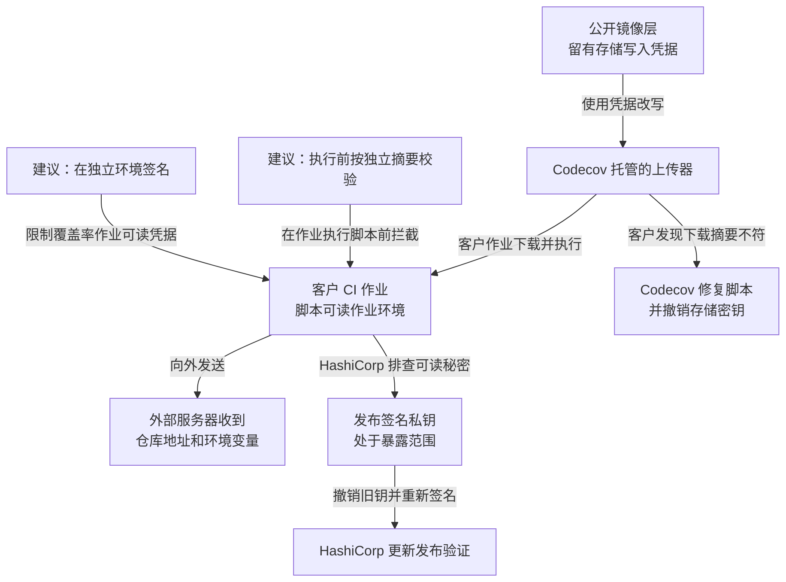

2021 年 1 月 31 日起，攻击者间歇性篡改 Codecov 托管的 Bash Uploader。Codecov 调查发现，部分客户的持续集成（CI）作业执行了被改动的脚本，作业中的环境变量和代码仓库地址被发往 Codecov 之外的服务器。4 月 1 日，一名客户比对脚本的 SHA-256 摘要，发现下载内容与 GitHub 上公布的摘要不符。Codecov 当天修复脚本，4 月 15 日公开披露。HashiCorp 于 4 月 22 日通报，用于签署产品发布校验清单的 GPG 私钥已经暴露，并撤销了旧密钥。其调查未发现旧私钥被未经授权使用，也未发现源码或二进制被恶意修改。[Codecov 安全通告](https://about.codecov.io/security-update/) · [HashiCorp 安全公告及 5 月 4 日更新](https://discuss.hashicorp.com/t/hcsec-2021-12-codecov-security-event-and-hashicorp-gpg-key-exposure/23512)

## 覆盖率脚本如何碰到发布私钥

Codecov 的复盘将入口定位在公开分发的自托管 Docker 镜像。制作镜像时留下的一个中间层含有 Google Cloud Storage 服务账号的 HMAC 密钥。镜像由多层文件组成，某一层的内容即使在最终文件视图里不可见，也可能留在已分发的镜像层里。这把密钥对应的存储权限允许改写托管的上传器，客户从托管渠道下载时就可能取到改过的脚本。凭据来自自托管产品的公开镜像，被改写的则是 Codecov 托管渠道提供的文件。客户是否受影响，要看作业实际从哪里取脚本，以及取到的是哪一份。[Codecov 根因复盘](https://about.codecov.io/apr-2021-post-mortem/) · [Codecov 安全通告](https://about.codecov.io/security-update/)

覆盖率上传器原本把测试产生的报告交给 Codecov。它作为代码运行在客户的 CI 执行环境里，可以读取该进程能访问的环境变量。篡改后的脚本就在报告上传之外，把仓库远端地址与可读环境变量发往外部服务器。只要同一执行环境提供了部署令牌或签名材料，上传器便能接触这些本来和覆盖率报告无关的秘密。直接运行 Bash Uploader 的作业，以及当时会调用它的 Codecov GitHub Action、CircleCI Orb 和 Bitrise Step，都可能走到这条路径。具体暴露范围取决于作业是否取到并执行被篡改的脚本，以及执行时实际可读的数据。[Codecov 根因复盘](https://about.codecov.io/apr-2021-post-mortem/)

HashiCorp 在少数代码仓库及其构建流水线中启用了受影响的 Codecov 组件。调查发现，这些仓库的 CI 环境变量含有敏感信息，其中就有用于签署产品发布校验清单的 GPG 私钥。如果被篡改的上传器在能读取该变量的作业里运行，就能接触这把私钥。HashiCorp 将它列入暴露范围，公开调查未证实私钥已被传出。[HashiCorp 4 月 27 日问答](https://discuss.hashicorp.com/t/hcsec-2021-12-codecov-security-event-and-hashicorp-gpg-key-exposure/23512/2)

图可横向滚动。两条标有「建议」的连线指向可阻断的位置。图中外部接收节点依据 Codecov 对整个事件的调查，HashiCorp 分支表示其调查确认的私钥暴露范围。[Codecov 安全通告](https://about.codecov.io/security-update/) · [HashiCorp 安全公告](https://discuss.hashicorp.com/t/hcsec-2021-12-codecov-security-event-and-hashicorp-gpg-key-exposure/23512)

## 一把发布密钥暴露后，下载方也要更新信任

HashiCorp 用这把 GPG 私钥签署发布文件的 SHA-256 摘要清单。以 Terraform 0.15.1 为例，发布页上的 `terraform_0.15.1_SHA256SUMS` 是摘要清单，`terraform_0.15.1_SHA256SUMS.sig` 是该清单的独立签名文件之一。下载方先用可信的公钥验证清单的签名，再计算收到的文件的摘要，与清单中对应文件名的条目比对。[Terraform 0.15.1 发布页](https://releases.hashicorp.com/terraform/0.15.1/) · [Terraform 官方验签教程](https://developer.hashicorp.com/terraform/tutorials/cli/verify-archive)

只要旧公钥仍被信任，持有旧私钥的一方就有能力让另一份校验清单通过签名验证。要让用户实际安装被替换的文件，还需要让用户取得相应的文件和清单。HashiCorp 检查了日志、签名、存储元数据，并与已知正常副本比对，未发现发布物遭修改。macOS 代码签名、Windows Authenticode 及 Debian 和 RPM 包签名使用的机制也不在这把密钥的影响范围内。[HashiCorp 安全公告，含 4 月 27 日问答及 5 月 4 日更新](https://discuss.hashicorp.com/t/hcsec-2021-12-codecov-security-event-and-hashicorp-gpg-key-exposure/23512)

Codecov 修复脚本并撤销存储密钥，切断了通过该凭据继续改写上传器的路径。已经暴露的客户凭据仍要由各自的发行方处置。HashiCorp 发布了新公钥并撤销旧密钥。它在 4 月 27 日的问答中说明，已用新钥重签大多数现有产品发布。依赖摘要清单签名的手工或自动验签流程可能需要导入新公钥。[Codecov 根因复盘](https://about.codecov.io/apr-2021-post-mortem/) · [HashiCorp 2021 年公告](https://discuss.hashicorp.com/t/hcsec-2021-12-codecov-security-event-and-hashicorp-gpg-key-exposure/23512) · [HashiCorp 4 月 27 日问答](https://discuss.hashicorp.com/t/hcsec-2021-12-codecov-security-event-and-hashicorp-gpg-key-exposure/23512/2)

Terraform 安装提供程序插件时会验证签名。HashiCorp 在 4 月 26 日发布的 Terraform 补丁版本更新了验证官方提供程序时信任的 HashiCorp 公钥。社区提供程序由各发布者用自己的 GPG 密钥签名，因此这些发布者的密钥无需随 HashiCorp 的密钥一同轮换。[HashiCorp 4 月 27 日问答](https://discuss.hashicorp.com/t/hcsec-2021-12-codecov-security-event-and-hashicorp-gpg-key-exposure/23512/2) · [Terraform 更新指南](https://discuss.hashicorp.com/t/terraform-updates-for-hcsec-2021-12/23570)

2022 年 4 月，HashiCorp 按计划从临时签名子钥切换到长期子钥。两把子钥属于同一主密钥，下载方继续使用 2021 年轮换后的主公钥验签。[HashiCorp 2022 年子钥变更公告](https://discuss.hashicorp.com/t/hcsec-2022-11-hashicorp-gpg-signing-subkey-change/38460)

## 两道防线分别拦截坏脚本和限制签名权限

**先校验真正要执行的文件。** 本案中，客户用 GitHub 上的摘要发现了托管脚本的变更。把这项检查放到执行前，并在摘要不一致时停止，能拦住与审核版本不一致的脚本。流水线可以将经过审查的摘要固定在受保护的配置里，或按事先信任的公钥验证发布签名，更新时再审查新的版本。固定 GitHub Action 的提交只能固定该 Action 本身。如果它运行时还会下载脚本，下载到的文件也需要单独验证。供应商侧应把发布存储的写权限留给专用发布身份。构建公开镜像时，可用临时构建秘密挂载，并检查最终分发的所有层没有留下秘密。Codecov 实际撤销了泄露的密钥，改造公开镜像构建，并为上传器的存储变更设置告警。[Codecov 根因复盘](https://about.codecov.io/apr-2021-post-mortem/) · [Docker 构建秘密](https://docs.docker.com/build/building/secrets/) · [GitHub Actions 安全指南](https://docs.github.com/en/actions/reference/security/secure-use)

**把覆盖率作业和发布签名放在不同的信任边界。** 覆盖率作业只需读取源码和测试报告，以及在必要时获得权限有限的上传凭据。发布作业应在独立、干净的执行环境使用受保护的发布身份。两者不应复用可写工作目录或能改动签名输入的缓存。签名服务可以保管不可导出的私钥，并独立判断每次请求能否签名。[GitHub Actions 安全指南](https://docs.github.com/en/actions/reference/security/secure-use)

例如，发布审批可以把获准发布的版本绑定到一份受保护的构建记录，其中列出每个获准产物的文件名和 SHA-256 摘要。签名服务独立核验调用者的身份和该版本的发布授权，再从这份记录生成整份摘要清单，并对生成的清单签名。调用者在请求中新增文件名或替换摘要，都无法改变服务实际签署的内容。覆盖率作业无权改写构建记录、批准发布或调用签名服务。即使私钥不可导出，这些权限限制仍然必要，因为能调用签名服务的作业可能在不接触私钥的情况下取得签名。
