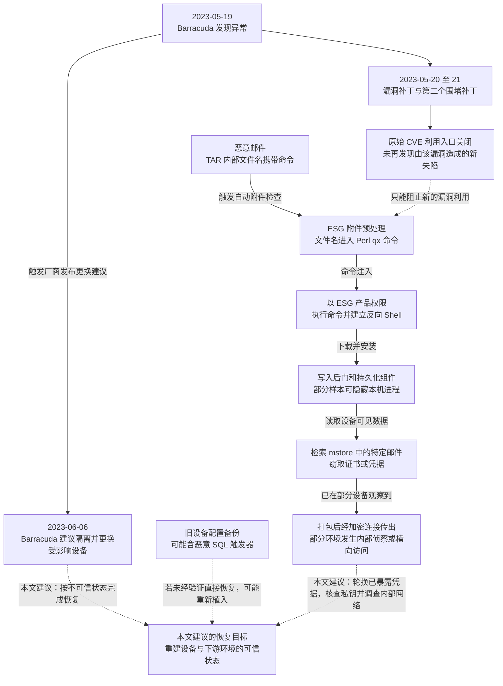

从 2022 年 10 月起，攻击者向使用 Barracuda Email Security Gateway（ESG）的机构发送带有特殊 TAR 附件的邮件。邮件不需要送达用户收件箱，也不需要有人打开附件：网关为了检查附件而读取压缩包时，未经过完整过滤的文件名进入 Perl 的命令执行逻辑，攻击者由此在网关上执行系统命令。

Barracuda 于 2023 年 5 月 19 日发现异常，随后自动下发漏洞修补和清理更新。Mandiant 的调查认为，实施这轮间谍活动的是其编号为 UNC4841、与中国有关联的攻击者。该归因是 Mandiant 的高置信度判断；CISA 对取得的恶意样本进行了独立分析，但其报告没有据此命名攻击主体。

Mandiant 后续统计称，约 5% 的 ESG 设备受到影响，接近三分之一的已识别受影响机构是政府部门。调查人员在部分设备上确认，攻击者检索特定人员或域名的邮件，将结果打包后传出；他们还窃取证书，并在少量环境中从网关侦察或进入内部系统。公开材料没有给出完整受害者名单、被窃邮件总数或每家机构的具体损失，因此这些比例不能换算成未经披露的绝对数量。[Mandiant 2023 年 6 月调查](https://cloud.google.com/blog/topics/threat-intelligence/barracuda-esg-exploited-globally)；[2023 年 8 月后续调查](https://cloud.google.com/blog/topics/threat-intelligence/unc4841-post-barracuda-zero-day-remediation)

事件最难处理的部分发生在漏洞修补以后。补丁可以阻止新的恶意附件再次触发 CVE-2023-2868，却无法自动证明此前失陷的设备已经干净。攻击者已经能改写设备模块、安装内核级隐藏组件，并把后门放入配置数据库。某些旧设备导出的配置如果直接恢复到替换设备，还可能把后门一并带过去。这也是 Barracuda 最终要求受影响客户隔离并更换设备，而不能只以“补丁安装成功”结束处置的原因。

## 攻击经过

### 一封不会被人打开的邮件先攻破了邮件网关

ESG 位于邮件进入组织的路径上，负责在投递前检查垃圾邮件、恶意附件和其他风险。这个位置使它必须主动解析不可信邮件，也使攻击者不必先骗过某位员工：只要邮件到达网关的检查流程，附件解析器就会替攻击者处理输入。

CVE-2023-2868 影响 ESG 5.1.3.001 至 9.2.0.006。问题出在 TAR 文件处理逻辑。Mandiant 公布的关键代码是：

```perl
qx{$tarexec -O -xf $tempdir/parts/$part '$f'};
```

变量 `$f` 来自压缩包内部的文件名，却被拼入由 `qx{}` 交给系统执行的命令。攻击者构造含有引号和命令替换符号的文件名，突破原本用于包裹文件名的引号边界，使其中内容变成 Shell 命令。这里需要过滤的并非附件在邮件中显示的名称，而是压缩包内部每个条目的名称。

Mandiant 最早确认的利用发生在 2022 年 10 月 10 日。早期附件使用 `.tar` 扩展名，后续样本也伪装成 `.jpg` 或 `.dat`；扩展名变化没有改变文件实际仍是 TAR 归档的事实。漏洞触发后，命令以 ESG 产品进程的权限执行。攻击者先建立反向 Shell，再从外部服务器下载后门和安装脚本。CVE 记录确认该漏洞属于远程命令注入，无需认证或用户交互；CISA 于 2023 年 5 月 26 日将其列入已知遭利用漏洞目录。[CVE 记录](https://cveawg.mitre.org/api/cve/CVE-2023-2868)；[CISA KEV 数据](https://www.cisa.gov/sites/default/files/feeds/known_exploited_vulnerabilities.json)

### 后门借用邮件协议，失陷设备同时成为监听点和跳板

取得命令执行能力后，UNC4841 没有只保留一个固定的远程连接。调查人员发现多组针对 ESG 工作方式定制的后门：

- SEASPY 监听 TCP 25 和 587 端口的流量，由特定数据包激活，再建立反向 Shell。它早期使用 `BarracudaMailService` 这一近似合法服务的文件名。
- SALTWATER 被加载进 Barracuda 的 SMTP 进程，可以执行命令、传输文件、代理和建立隧道。
- SEASIDE 从 SMTP 的 `HELO` 或 `EHLO` 内容中取得经过编码的控制地址，再调用另一个程序建立连接。
- SKIPJACK 把恶意逻辑插入合法 Lua 邮件处理模块，从特定邮件头中解密命令并交给 Shell 执行。
- SANDBAR 是被篡改的 Linux 内核模块，可以从 `/proc` 的进程列表中隐藏特定名称的进程。

这些机制共同利用了邮件网关必须接收 SMTP 流量、解析邮件字段并持续运行邮件服务的特点。只按普通服务器的“异常外连”寻找后门会遗漏被动监听；只检查本机进程列表，也可能受到 SANDBAR 隐藏行为的影响。CISA 从受害机构取得样本后，独立确认了 SEASPY、SUBMARINE、SKIPJACK、SEASPRAY、WHIRLPOOL 和 SALTWATER 等组件的命令执行及通信能力。[CISA 恶意软件分析汇总](https://www.cisa.gov/news-events/alerts/2023/07/28/cisa-releases-malware-analysis-reports-barracuda-backdoors)

### 网关中的临时邮件成为可直接检索的情报

邮件安全设备并非只看一眼附件后立即忘记全部内容。ESG 的 `mstore` 会临时保存邮件，设备中还可能保存证书、配置和用于连接其他系统的凭据。攻击者进入网关后，已经站在邮件投递链上，不必再逐个攻破用户邮箱。

Mandiant 在部分失陷设备上发现，攻击者搜索 `mstore` 中与指定邮箱账号或域名匹配的邮件，把结果整理为 `.tar.gz` 文件，再使用 OpenSSL 连接攻击者控制的服务器传出。被定向搜索的对象包括台湾和香港的学者，以及亚洲和欧洲的政府人员。调查人员还观察到客户上传的 SSL 证书被传出。[Mandiant 2023 年 6 月调查](https://cloud.google.com/blog/topics/threat-intelligence/barracuda-esg-exploited-globally)

在少量响应案例中，UNC4841 从网关内暂存的邮件中取得明文凭据，并用这些凭据首次尝试便成功登录 Outlook Web Access。攻击者也曾从 ESG 扫描内部网段，尝试通过 SSH 访问 VPN、代理服务器和其他边界设备。这些行为并不表示所有失陷 ESG 都导致内部网络被攻破，但它们证明网关权限已经能够跨越邮件、证书和内部网络三类边界。[Mandiant 2023 年 8 月后续调查](https://cloud.google.com/blog/topics/threat-intelligence/unc4841-post-barracuda-zero-day-remediation)

## 一张图看清补丁为何没有结束事件

下图回答的是：原始漏洞被封堵后，攻击者已经取得的能力为什么仍可能存在，以及旧配置怎样影响替换设备。图可横向滚动。

<div class="incident-diagram" role="region" tabindex="0" aria-label="Barracuda ESG 从恶意附件到邮件外传及补丁后持久化的因果链，可横向滚动">



</div>

攻击主线以及 Barracuda 已发生的发现和补丁下发使用实线；从发现到“Barracuda 建议隔离并更换设备”的实线只表示建议已经发布，不表示所有客户都已完成更换。虚线分别表示控制的作用边界、Mandiant 发现的潜在配置恢复路径，以及本文提出的恢复目标；它们不代表所有受影响设备都发生了相同后果，也不表示受影响环境已经恢复可信状态。

### 攻击者在修补窗口内改变了留存方式

Barracuda 于 5 月 20 日向全部 ESG 设备下发漏洞补丁，21 日又向全部 ESG 下发用于围堵的第二个补丁。[Barracuda 状态记录](https://status.barracuda.com/incidents/34kx82j5n4q9) Mandiant 的后续调查没有发现补丁之后仍通过 CVE-2023-2868 造成的新设备失陷，说明补丁对关闭原始入口有效。[Mandiant 2023 年 8 月后续调查](https://cloud.google.com/blog/topics/threat-intelligence/unc4841-post-barracuda-zero-day-remediation)

入口关闭不等于旧会话和后门同时消失。5 月 22 日至 24 日，Mandiant 观察到 UNC4841 高频修改 SEASPY、SALTWATER 等组件，试图避开清理；攻击行动覆盖至少 16 个国家。攻击者还把恶意代码插入原有 Lua 模块、启动脚本和内核模块，使执行不再依赖最初的 TAR 漏洞。[Mandiant 2023 年 8 月后续调查](https://cloud.google.com/blog/topics/threat-intelligence/unc4841-post-barracuda-zero-day-remediation)

更危险的路径是 Mandiant 称为 DEPTHCHARGE、CISA 称为 SUBMARINE 的后门。攻击者把恶意 SQL 触发器放入 ESG 配置数据库。恢复配置时常见的数据库删除操作会触发它，把编码后的安装包写到磁盘；另一处文件名处理逻辑再帮助执行安装脚本，最终通过 `LD_PRELOAD` 把恶意共享库加载进 SMTP 进程。

受影响机构通常会从旧设备导出配置，再恢复到新设备。如果导出的配置已经包含该触发器，新设备可能在恢复过程中重新安装后门。Mandiant 表述为已发现“可能发生”这种情况的实例，并通知相关机构；公开证据不足以断言每次旧配置恢复都会导致再感染。[Mandiant 2023 年 8 月后续调查](https://cloud.google.com/blog/topics/threat-intelligence/unc4841-post-barracuda-zero-day-remediation) CISA 对 SUBMARINE 样本的逆向分析独立确认了 SQL 数据库、加载脚本、`LD_PRELOAD` 共享库以及以 root 权限执行的组合机制。[CISA SUBMARINE 样本报告](https://www.cisa.gov/news-events/analysis-reports/ar23-209a)

## 关键突破、成因与防护

### 附件解析器把数据交给了命令解释器

最初突破不是员工打开了恶意文件，而是边界设备把压缩包文件名拼进 Shell 命令。即使外层扩展名看起来像图片，只要解析器识别并处理内部 TAR 结构，恶意文件名仍会到达危险代码。

根本修复应避免以字符串拼接方式调用解压命令，改用不经过 Shell 的参数数组或归档库 API，并对归档条目路径、文件名和数量施加明确限制。附件解析还应运行在权限受限、文件系统和网络能力受控的隔离环境中。只有当解析进程无法读取 `mstore`、无法写入邮件服务与启动配置等持久化路径，且网络规则只允许完成解析所需的连接时，这种隔离才能在解析器再次出现缺陷时阻止对应能力，降低缺陷扩展为邮件窃取和持久化控制的风险。

网络控制可以进一步限制初始反向 Shell：邮件网关只应连接必要的邮件中继、更新时间源和管理服务，其他主动外连需要阻断或告警。不过，本案部分后门被动监听正常 SMTP 端口，单独限制出站连接无法清除已经植入的访问路径。

### 邮件网关的业务位置放大了单台设备失陷的后果

ESG 同时接触外部邮件、内部邮件域、临时邮件内容、TLS 证书和内部网络。攻击者取得的最初身份只是 ESG 产品进程，并不自动等于域管理员；但设备中可读的邮件和凭据提供了继续跨越边界的材料，网关所在网络又可能允许它访问大量内部地址。

防护要按这些能力分别收缩。邮件服务可以获得使用 TLS 私钥完成握手的权限，但不应因此获得导出私钥的能力；条件允许时，应把私钥放在支持不可导出的硬件或独立密码服务中，并把调用权限限定给邮件服务身份。这样能限制私钥被复制的风险，却不能改变本案公开证据的边界：Mandiant 直接记录的是 `ssl_signed_cert.pem` 等客户上传的证书文件被传出，没有明确证明对应私钥也被窃。域账号则只授予投递所需的最小权限，并与设备管理身份分开。网关到内部系统只开放完成投递所需的目标和端口，管理接口放在独立网络并使用独立认证。检测数据也应发送到设备之外。攻击者若能修改内核模块或本机日志，设备自身报告的“进程正常、文件不存在”已经不能作为唯一依据。

一旦确认设备失陷，处置范围不能止于设备文件。需要轮换配置在设备中、明确存储在设备上或有证据显示已经暴露的本地及域凭据。公开证书文件本身不等于私钥；只有确认对应私钥或其他认证材料已经暴露，或者设备完全失陷后无法排除其暴露时，才需要撤销并重新签发证书。随后核对 OWA、VPN、SSH 和其他边界系统的身份日志，并结合网络流量调查是否发生邮件外传或横向移动。这些动作分别处理已经离开设备的访问能力，换机本身无法使它们失效。

### 补丁证明入口已关闭，不能证明历史状态可信

补丁解决的是“新的恶意附件还能否再次触发同一漏洞”。此前运行的命令可能已经修改启动脚本、合法模块、内核和配置数据库；攻击者也可能已经拿走凭据、证书和邮件。只查看软件版本或补丁状态，无法回答这些后果是否仍然存在。

Barracuda 因此建议受影响客户立即隔离并更换设备，不论当前补丁级别。换机时还要防止把旧信任重新带回：从受影响设备导出的配置应视为不可信输入，逐项验证后迁移，不能把完整备份直接恢复到生产设备。确需保留现场证据时，应在隔离状态下制作磁盘镜像，再以厂商可信介质或全新设备重建服务。

这起事件给边界设备响应留下了一条清楚的判断标准：如果攻击者已经能修改设备的持久化区域，而组织又缺少独立、完整的可信基线，就不能用“没有再发现已知 IOC”证明设备已恢复。恢复的目标应是重新建立可说明来源的固件、配置、密钥和网络权限，再依据设备外日志、身份日志和网络流量调查是否存在访问下一层的证据。结论必须同时注明调查覆盖的起止时间、日志来源和数据缺口；即使在覆盖范围内没有发现横向活动，也不能据此证明攻击者从未进入下一层。
