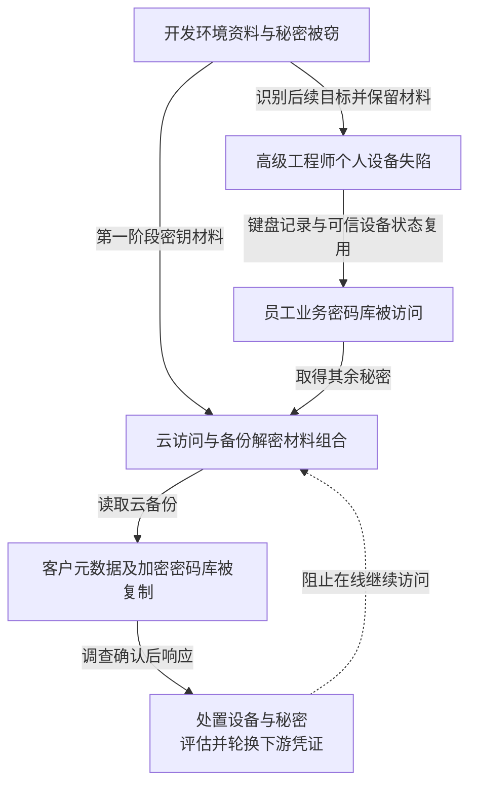

LastPass 2022 年事件不是一次“数据库里所有密码直接明文泄露”。攻击者先取得开发资料和内部秘密，再攻击高级 DevOps 人员，最终访问含客户密码库的云备份。被复制的内容既有元数据，也有独立加密的密码库；不同加密层与密钥用途决定了后续风险。

本文结合 [LastPass 2023 年 3 月更新](https://blog.lastpass.com/posts/security-incident-update-recommended-actions)与英国 ICO [2025 年 11 月处罚决定](https://ico.org.uk/media2/xfbl1uaa/lastpass-uk-ltd-penalty-notice.pdf)。前者是企业披露，后者在后续监管调查中补充了个人设备、可信设备 Cookie 与密钥组合等细节。本文不据此认定全部客户密码库已经解密。

## 两次入侵通过资料和身份连接起来

第一阶段，一名软件工程师的公司电脑失陷，攻击者访问云开发环境，取得部分源码、内部脚本、技术文档和秘密。LastPass 称该阶段没有取走客户数据，并重建开发环境、轮换相关秘密；但事后发现，被窃信息帮助攻击者识别第二阶段目标。清理已知环境没有消除已经泄露的组织知识和密钥材料。

第二阶段，攻击者针对高级 DevOps 工程师的个人电脑。ICO 记录其 Plex 软件存在已知高风险漏洞，攻击者安装键盘记录程序，取得主密码并使用窃取的可信设备 Cookie 越过当时的 MFA 控制，访问其员工业务密码库。这里被观察到的主密码是该工程师使用的密码，不是从服务端取出了所有客户的主密码。这里既涉及终端输入被观察，也涉及现成信任状态被复用，不能简写成 MFA 从未启用。

ICO 决定第 17—19 页把这个组合说得更具体：第一阶段取得的 SSE-C 备份加密密钥本身仍被加密；高级工程师业务密码库中保存了解开它的密钥及 AWS 访问密钥。第二阶段取得这些材料后，攻击者才同时具备访问存储和打开备份保护层的条件。分开保存如果仍能由同一攻击者逐步收集，就未必形成独立约束。

## 取得哪一层密钥，决定还剩哪一层保护

下表综合公司披露与 ICO 调查；处置列是针对相应暴露的建议，不表示所有客户均需同样操作。

| 数据或边界 | 加密与访问层 | 密钥来源或披露状态 | 相应处置 |
| --- | --- | --- | --- |
| 云备份存储 | AWS 访问与 SSE-C 存储加密 | 两阶段材料被组合取得 | 撤销访问与设备信任，重建备份授权 |
| 客户元数据及密码库未加密字段 | 不受用户密码库的独立字段加密保护 | 存储层打开后可暴露；包括网址等字段 | 确认资料范围，防范定向钓鱼 |
| 密码库的密码、用户名等敏感内容 | 用户主密码派生的独立加密 | 公司称未存储用户主密码；ICO 未发现这些内容以明文被访问的证据 | 评估历史密文离线风险，按风险轮换下游秘密 |
| MFA／联合身份备份 | 另一套数据库加密 | 公司披露其独立解密密钥也失窃 | 按启用功能核对验证器种子、恢复及联合身份材料 |

这里“没有明文访问证据”不等于证明历史密文永不可破解；风险要回到具体密钥与数据。

下图按两种加密边界区分结果。图可横向滚动。

实线表示已披露的能力连接，虚线表示在线遏制。图没有从“取得密码库副本”直接连到“全部密码已知”，两者之间仍有独立加密与离线破解条件。

建议关联员工密码库的设备授权、异常读取、云对象列举与备份下载，记录主体、对象范围和传出位置。可信设备 Cookie 的存在不证明设备此刻仍受管理，身份团队应能撤销设备信任和相关会话，并验证实际访问结果。

## 高权限管理不应与个人软件共享执行环境

个人电脑运行娱乐软件本身不是业务管理员失陷的充分原因；决定影响的是同一环境还可以输入或取得生产级秘密。高级管理操作应在专用受管环境完成，限制本地密码库、可信设备授权和云管理访问，避免以个人设备信任直接换取批量备份读取能力。

备份应按最高敏感数据保护，而不能仅因“不在生产”而降低要求。备份访问、解密、导出和信任策略变更可以分开授权；受限作业按对象、时间和用途获得权限，高权限人员也不能通过一个可复制秘密独立搬走全部客户备份。独立性需要落实到管理身份及恢复机制。

密钥轮换还应沿已经泄露的组合关系检查。重建开发环境可以移除已知驻留，却不会使外泄文档失去情报价值；轮换访问密钥也不会追回已复制的数据。应把可以撤销的访问能力与不可撤回的信息暴露分开核算。

## 调查、遏制与后续处罚发生在不同时间

ICO 记录，2022 年 8 月 12 日第一阶段已启动正式调查，同日高级工程师个人设备也被攻破；AWS 日志支持 8 月 19 日至 9 月 22 日发生备份外传。10 月 15 日已有 GuardDuty 告警，但调查职责沟通混乱，相关告警直到 11 月 2 日才到达 LastPass 安全运营团队。已存在告警与负责团队能采取行动，是不同状态。

公司在 2023 年 3 月更新中称，未再观察到 2022 年 10 月 26 日后的攻击者活动，并列出环境重建、访问控制变更和秘密轮换。这是公司的观察与整改陈述，不给出每个客户的下游凭证失效证明。[ICO 2025 年 11 月 20 日执法记录](https://ico.org.uk/action-weve-taken/enforcement/2025/11/lastpass-uk-ltd/)处以 £1,228,283 罚款，涉及约 160 万英国客户个人资料；这个司法辖区内的规模和罚款不能外推成全球受害总数或全部损失。

## 密码库被复制以后，处置发生在下游账号

攻击者持有历史密文后，可以脱离 LastPass 在线登录限速尝试猜测主密码。风险依赖密码强度、密钥派生设置和具体数据加密方式。提升现有账号设置或改变主密码，不能自动重加密攻击者手里的旧副本；若风险评估要求，应更新旧副本中保护的实际网站密码、API 密钥和恢复材料。

建议把验收分为企业与客户两端，本文未对其实际系统测试。企业端在隔离环境给测试者个人设备控制权及一份测试备份秘密，尝试复用受信设备状态、取得管理会话和读取其他数据域；分别由设备准入、短期授权及存储策略拒绝，并留存拒绝主体与目标。正常受管终端执行一项获批恢复任务应成功，且不因此获得全量导出权。

客户侧以一个专用下游测试账号演练：假定旧密码库副本已外泄，轮换其中的网站密码、API 密钥和恢复材料，再测试旧密码、旧令牌、旧会话与恢复路径是否仍可访问。以目标系统实际拒绝记录为证，同时证明新秘密能完成正常任务；不能用 LastPass 主密码已更新代替下游验证。

轮换大量业务集成可能造成停机，应按云管理、身份根、资金与其他敏感系统的优先级推进，保留可验证的替换结果。验收既要证明新秘密可完成获批任务，也要验证旧秘密及旧恢复路径不再授予相同能力；只把新密码保存进新密码库不是完成轮换。公开材料不足以替每个客户确定相同的密码破解概率或轮换时限。

## 资料与核验入口

- [LastPass：两阶段事件、受影响数据与措施](https://blog.lastpass.com/posts/security-incident-update-recommended-actions)。
- [ICO：LastPass UK 处罚决定](https://ico.org.uk/media2/xfbl1uaa/lastpass-uk-ltd-penalty-notice.pdf)，第 17—21 页解释密钥组合、外传时间及告警交接。
- [ICO：2025 年 11 月执法记录](https://ico.org.uk/action-weve-taken/enforcement/2025/11/lastpass-uk-ltd/)，核对罚款与英国客户范围。
