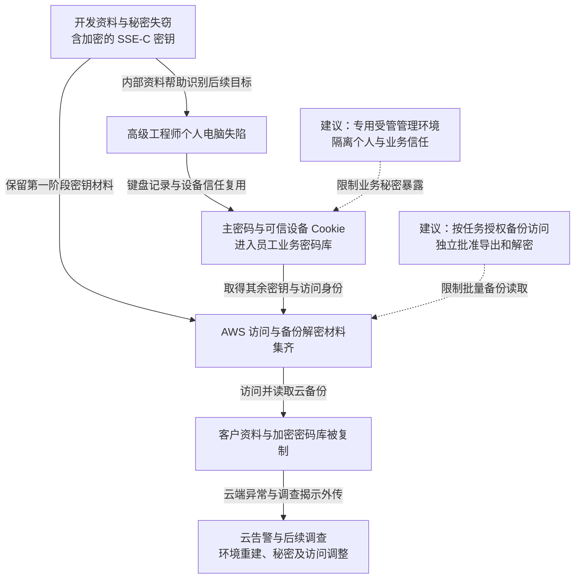

2022 年，LastPass 遭遇相互关联的两阶段入侵：攻击者先控制开发人员电脑，窃取源码、内部资料与部分秘密；再利用高级 DevOps 工程师个人电脑上的 Plex 漏洞取得主密码和可信设备 Cookie，进入员工业务密码库，补齐云访问及备份解密材料，最终复制客户资料与加密密码库。英国 ICO 后续调查确认，备份外传发生于 8 月 19 日至 9 月 22 日。LastPass 在 2023 年 3 月披露环境重建和秘密轮换，并称未再观察到 2022 年 10 月 26 日后的攻击者活动。[公司更新](https://blog.lastpass.com/posts/security-incident-update-recommended-actions)及 [ICO 调查决定](https://ico.org.uk/media2/xfbl1uaa/lastpass-uk-ltd-penalty-notice.pdf)分别提供了企业说明与后续技术证据。

## 攻击经过

### 开发环境泄露提供了后续目标与部分密钥

第一阶段，一名软件工程师的公司电脑失陷，攻击者进入云开发环境，取得源码、内部脚本、技术文档和秘密。公司称这一阶段没有取走客户或密码库数据，并曾重建开发环境、轮换相关秘密，随后认定该阶段已经关闭。

但外泄资料已经暴露内部结构和后续目标。ICO 还记录，攻击者取得了用于云备份保护的 SSE-C 密钥材料，但该密钥本身仍被加密；访问备份还需要另行保存的 AWS 访问密钥及解开 SSE-C 密钥的材料。第一阶段结束时，攻击者还没有集齐这一组合。

### 个人电脑失陷，使业务密码库暴露

ICO 记录，高级 DevOps 工程师的个人电脑于 8 月 12 日被攻破，当时运行的 Plex Media Server 存在已知远程命令执行漏洞。攻击者安装键盘记录程序，取得工程师主密码，并窃取可信设备 Cookie，利用当时的可信设备状态绕过 MFA。

该工程师的个人和业务 LastPass 账号存在关联，可通过相同主密码访问。进入员工业务密码库后，攻击者取得 AWS 访问密钥，以及解开第一阶段 SSE-C 密钥所需的解密材料。[ICO 第 18—20 页](https://ico.org.uk/media2/xfbl1uaa/lastpass-uk-ltd-penalty-notice.pdf#page=19)说明了软件漏洞、键盘记录、Cookie 与密钥之间的关系。

### 组合存储权限与解密材料，复制客户备份

攻击者随后使用窃取的密钥访问云存储。AWS 记录支持 8 月 19 日至 9 月 22 日发生备份外传。这里被打开的是备份存储保护层；备份内部的客户密码库还有用户主密码派生的加密层。

| 数据与保护层 | 失窃后的状态 |
| --- | --- |
| 云存储访问与 SSE-C 备份加密 | 两阶段材料被组合，攻击者得以读取备份内容 |
| 客户元数据及密码库未加密字段 | 姓名、联系资料及网址等信息可暴露，用于识别客户和构造定向攻击 |
| 密码、用户名和安全笔记等加密内容 | 历史密文被复制，保留用户主密码派生的独立保护，面临离线猜测风险 |
| MFA／联合身份相关备份 | 公司披露独立数据库解密密钥也失窃，需按所用功能处置相应秘密 |

因此，客户密码库被窃不代表其中每个密码已被解密；存储层失守也不代表密码库剩余的加密可以忽略。

### 告警交接延误，调查随后扩展到客户数据

10 月 15 日和 22 日出现 AWS GuardDuty 告警。ICO 记录，初始 SOC 按流程联系云基础设施邮件组，但组内成员与职责交接存在问题，LastPass 安全运营团队直到 11 月 2 日才获知告警。12 月，公司进一步确认客户备份被外传。

2023 年 3 月，公司披露环境重建、访问调整和秘密轮换。ICO 于 2025 年 11 月对 LastPass UK 处以 £1,228,283 罚款，涉及约 160 万英国客户个人资料。该执法结果对应英国调查范围。

下图保留两阶段材料汇合的关系；虚线为本文建议，可横向滚动。

## 关键突破、成因与防护

### 个人软件执行环境可以接触生产级秘密

Plex 漏洞提供了终端执行位置，真正放大后果的是同一环境可以输入业务主密码、保存可信设备状态，并访问高权限秘密。修补个人软件和终端检测可以减少感染，但业务管理环境也需独立受管。

生产管理应使用专用设备和受限会话，个人账号与业务恢复信任分离，设备准入在密码库与云访问入口独立执行。若只在浏览器里分开两个账号，而相同操作系统仍可读取输入和 Cookie，终端失陷仍能同时取得两边材料。

### 密钥分开放置，没有阻止同一攻击者组合

第一阶段的密钥被加密，确实形成了额外门槛；但解密材料与云访问权仍可经少数人员的业务密码库取得。一次后续身份失陷，就补齐了整个备份读取链。

应把备份访问、解密与批量导出按用途分开授权，恢复作业只获得指定对象和时段的权限。长期可复制秘密应减少，策略变更和大规模导出由独立身份批准。若同一管理员能改变备份权限、取得解密能力并解除导出限制，分层加密仍会共享相同的失陷边界。

告警也要能到达实际有权处置的团队，独立保存密码库访问、设备授权及云对象下载记录，减少攻击者使用正常身份后长期不被发现的机会。

### 密码库副本外泄后，风险延伸到下游账号

攻击者可以在自己持有的历史密文上离线尝试主密码，不再受到 LastPass 在线登录限速限制。风险取决于旧主密码强度、当时的密钥派生参数和字段保护方式。

改变当前主密码或提高派生强度，只改变当前受控副本，无法重加密已经外流的旧文件。客户需要依据风险更新其中保存的实际网站密码、API 密钥与恢复材料，并在相应服务撤销旧会话或授权。企业端撤销设备信任、重建环境和轮换备份秘密，则限制继续在线读取；这两端处置分别针对残留访问和已经失去控制的历史资料。大量业务集成的轮换会增加中断成本，替换过程需保留正常任务可继续完成的路径。

## 参考资料

- [LastPass：2023 年 3 月事件更新](https://blog.lastpass.com/posts/security-incident-update-recommended-actions)。
- [ICO：LastPass UK 处罚决定](https://ico.org.uk/media2/xfbl1uaa/lastpass-uk-ltd-penalty-notice.pdf)，第 17—21 页说明密钥组合、外传时间和告警交接。
- [ICO：2025 年 11 月执法记录](https://ico.org.uk/action-weve-taken/enforcement/2025/11/lastpass-uk-ltd/)。
