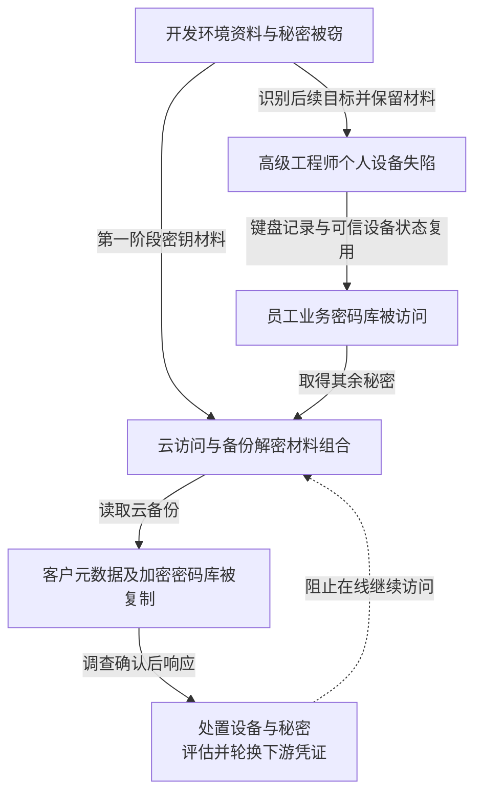

LastPass 2022 年事件不是一次“数据库里所有密码直接明文泄露”。攻击者先取得开发资料和内部秘密，再攻击高级 DevOps 人员，最终访问含客户密码库的云备份。被复制的内容既有元数据，也有独立加密的密码库；不同加密层与密钥用途决定了后续风险。

本文结合 [LastPass 2023 年 3 月更新](https://blog.lastpass.com/posts/security-incident-update-recommended-actions)与英国 ICO [2025 年 11 月处罚决定](https://ico.org.uk/media2/xfbl1uaa/lastpass-uk-ltd-penalty-notice.pdf)。前者是企业披露，后者在后续监管调查中补充了个人设备、可信设备 Cookie 与密钥组合等细节。本文不据此认定全部客户密码库已经解密。

## 两次入侵通过资料和身份连接起来

第一阶段，一名软件工程师的公司电脑失陷，攻击者访问云开发环境，取得部分源码、内部脚本、技术文档和秘密。LastPass 称该阶段没有取走客户数据，并重建开发环境、轮换相关秘密；但事后发现，被窃信息帮助攻击者识别第二阶段目标。清理已知环境没有消除已经泄露的组织知识和密钥材料。

第二阶段，攻击者针对高级 DevOps 工程师的个人电脑。ICO 记录其 Plex 软件存在已知高风险漏洞，攻击者安装键盘记录程序，取得主密码并使用窃取的可信设备 Cookie 越过当时的 MFA 控制，访问其员工业务密码库。这里被观察到的主密码是该工程师使用的密码，不是从服务端取出了所有客户的主密码。这里既涉及终端输入被观察，也涉及现成信任状态被复用，不能简写成 MFA 从未启用。

该密码库中保存了云访问与解密所需材料。攻击者把第二阶段取得的密钥与第一阶段材料组合起来，读取云备份。分开保存的秘密如果仍可由同一攻击者逐步收集，就未必形成独立保护。

LastPass 披露备份包含客户元数据、集成秘密和客户密码库副本，还包括使用另一套加密的 MFA／联合身份数据库。某些备份解密材料也被取得，不代表客户密码库使用的用户派生密钥同样被直接取得。打开备份存储层可以暴露其中的元数据与密码库密文，但后者仍由用户主密码派生的独立密钥保护；两层保护不能合并成一个“已解密”状态。

下图按两种加密边界区分结果。图可横向滚动。

实线表示已披露的能力连接，虚线表示在线遏制。图没有从“取得密码库副本”直接连到“全部密码已知”，两者之间仍有独立加密与离线破解条件。

建议关联员工密码库的设备授权、异常读取、云对象列举与备份下载，记录主体、对象范围和传出位置。可信设备 Cookie 的存在不证明设备此刻仍受管理，身份团队应能撤销设备信任和相关会话，并验证实际访问结果。

## 高权限管理不应与个人软件共享执行环境

个人电脑运行娱乐软件本身不是业务管理员失陷的充分原因；决定影响的是同一环境还可以输入或取得生产级秘密。高级管理操作应在专用受管环境完成，限制本地密码库、可信设备授权和云管理访问，避免以个人设备信任直接换取批量备份读取能力。

备份应按最高敏感数据保护，而不能仅因“不在生产”而降低要求。备份访问、解密、导出和信任策略变更可以分开授权；受限作业按对象、时间和用途获得权限，高权限人员也不能通过一个可复制秘密独立搬走全部客户备份。独立性需要落实到管理身份及恢复机制。

密钥轮换还应沿已经泄露的组合关系检查。重建开发环境可以移除已知驻留，却不会使外泄文档失去情报价值；轮换访问密钥也不会追回已复制的数据。应把可以撤销的访问能力与不可撤回的信息暴露分开核算。

LastPass 还披露，备份中的 MFA／联合身份数据库虽已加密，对应的独立解密材料也在第二阶段失窃。这类恢复种子、联合身份组件与客户密码库不是同一种对象，应根据具体启用功能单独检查并重置，不能仅更新普通网站密码。

## 密码库被复制以后，处置发生在下游账号

攻击者持有历史密文后，可以脱离 LastPass 在线登录限速尝试猜测主密码。风险依赖密码强度、密钥派生设置和具体数据加密方式。提升现有账号设置或改变主密码，不能自动重加密攻击者手里的旧副本；若风险评估要求，应更新旧副本中保护的实际网站密码、API 密钥和恢复材料。

| 负责人和失陷条件 | 验收要求 |
| --- | --- |
| 终端团队：个人设备失陷 | 无法取得企业高权限会话、密码库或云备份访问 |
| 平台团队：一份备份秘密外泄 | 不能同时读取全量对象并取得所需解密能力 |
| 身份与业务团队：历史密码库被复制 | 识别关键下游凭证，验证旧密码、密钥及会话按各系统规则失效 |

轮换大量业务集成可能造成停机，应按云管理、身份根、资金与其他敏感系统的优先级推进，保留可验证的替换结果。验收既要证明新秘密可完成获批任务，也要验证旧秘密及旧恢复路径不再授予相同能力；只把新密码保存进新密码库不是完成轮换。公开材料不足以替每个客户确定相同的密码破解概率或轮换时限。

## 资料与核验入口

- [LastPass：两阶段事件、受影响数据与措施](https://blog.lastpass.com/posts/security-incident-update-recommended-actions)。
- [ICO：LastPass UK 处罚决定](https://ico.org.uk/media2/xfbl1uaa/lastpass-uk-ltd-penalty-notice.pdf)，核对 Incident 1、Incident 2 及员工设备与密码库关联部分。
