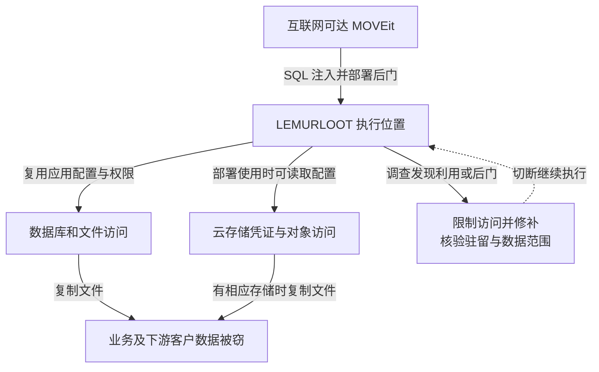

文件传输系统被信任来收发敏感资料，也因而聚集了多个业务、客户和合作方的文件。2023 年 MOVEit Transfer 的 CVE-2023-34362 被批量利用后，攻击者不必进入每家数据所有者的内部网络，就可能从共用的文件中转系统取得资料。

这起事件应区分两种关系：广泛部署的软件同时存在可利用漏洞，以及某家受害服务商持有多个客户的数据。不能把前者直接写成供应商更新包被植入后门，也不能把一家服务商的下游通知数量都算作独立服务器入侵。

技术依据为 [Mandiant 2023 年调查](https://cloud.google.com/blog/topics/threat-intelligence/zero-day-moveit-data-theft)与 [FBI／CISA 联合通报](https://content.govdelivery.com/accounts/USDHSCISA/bulletins/35ecb08)。Mandiant 在自身调查中最早观察到的利用为 5 月 27 日；这不等于已证明全球首次攻击时刻。Progress 在 5 月 31 日公布该漏洞，说明部分被观察的窃取发生在公开披露之前，不能仅从公开补丁后的修复时延归因所有受害方。

## 攻击者先控制传输系统，再借其身份读文件

正常外部访问应经用户与文件权限判断。攻击者利用互联网可达应用的 SQL 注入，使输入进入了非预期数据库操作，并部署 LEMURLOOT Web Shell，形成可远程调用的执行位置。SQL 注入是取得访问的入口，Web Shell 是后续驻留和任务接口；修复注入入口不等于已经删除先前写入的后门。Mandiant 观察到与合法组件相近的 `human2.aspx`、`_human2.aspx` 文件名，说明仅按看似熟悉的文件名检查容易遗漏新增代码。

LEMURLOOT 使用特殊请求头中的值认证，未通过时返回类似不存在的响应。攻击者的访问规则独立于正常用户登录，重置普通用户密码不能单独移除这段后门。后门能读取应用配置、连接数据库、枚举文件与文件夹，并执行窃取相关操作。

研究者还发现样本可以取得 Azure Blob 存储配置及凭证。这支持扩展读取云端文件的能力判断，但不能证明每家受害机构都把文件存放在 Azure，也不能把样本功能等同于全部功能在现场已经执行。

文件到手后，攻击者可以通过公开泄露施压勒索。本案主要解释数据窃取，不应因攻击者也经营勒索软件就补写为“所有文件都被加密”。是否存在加密破坏，需要单独的事件证据。

下图把本机和云存储路径分开。图可横向滚动。

实线表示观察或样本支持的能力路径，条件写在云存储连线上；虚线表示遏制。图不将潜在能力统计成已确认损失。

调查可关联异常 Web 请求、未批准的可执行文件、应用配置读取和大批文件下载，并保留时间与主体关系。后门文件名可能改变，攻击请求的来源也可能与后续下载来源不同；仅匹配一个名称或 IP 会遗漏路径。

## 关键问题是中转服务能持续持有什么

SQL 参数化、输入边界和及时修补是入口控制。更进一步，应让互联网接入层、文件存储和密钥访问之间存在受限接口，减少同一应用执行权直接变成全量文件读取与后门写入的机会。只读部署、制品完整性核对和限制可写目录中的脚本执行，可以约束常见驻留方式，但不能代替应用修复。

文件留存决定一次入侵可取得多少历史数据。传输完成后按业务需要清理中转副本，按客户、流程和数据域隔离存储与凭证，可以让某个任务失陷时不能读取其他客户的历史文件。清理策略需要兼顾重传、审计和法定保留需求，不能直接删除仍需保留的业务记录。

如果需要更强的数据隔离，可由发送方或接收方掌握内容加密密钥，让中转层只持有密文。这样会影响在线预览、内容扫描、格式转换和检索，需要明确取舍；若中转系统仍同时持有解密密钥，就不能声称已建立端到端内容隔离。

## 修补后还要核验驻留、身份和历史导出

| 负责人和测试条件 | 验收要求 |
| --- | --- |
| 应用团队：接入服务执行位置被控制 | 不能写入可执行后门或读取无关数据域 |
| 存储团队：单客户传输身份外泄 | 只能访问任务所需对象，不能枚举其他客户或取得其密钥 |
| 应急与业务团队：漏洞已修补 | 核验后门、配置凭证、异常文件下载与下游资料范围，测试旧存储身份是否仍可在平台外读取对象 |

关闭服务能减少继续失窃，也会阻断正常数据交换。业务负责人应准备可追踪的临时传输方式，并在恢复前验证认证、文件完整性和访问记录。外传资料涉及哪些客户、字段和时间范围，需要结合传输目录、存储对象及访问日志，不能只依据后门文件是否存在决定通知对象。服务商应把实际存储文件映射到客户、收发任务和保留区间，区分一次平台失陷与多个下游组织的数据影响，避免重复统计和遗漏。

## 资料与核验入口

- [Mandiant：LEMURLOOT 行为与观察范围](https://cloud.google.com/blog/topics/threat-intelligence/zero-day-moveit-data-theft)。
- [FBI／CISA：AA23-158A 联合通报](https://content.govdelivery.com/accounts/USDHSCISA/bulletins/35ecb08)。
