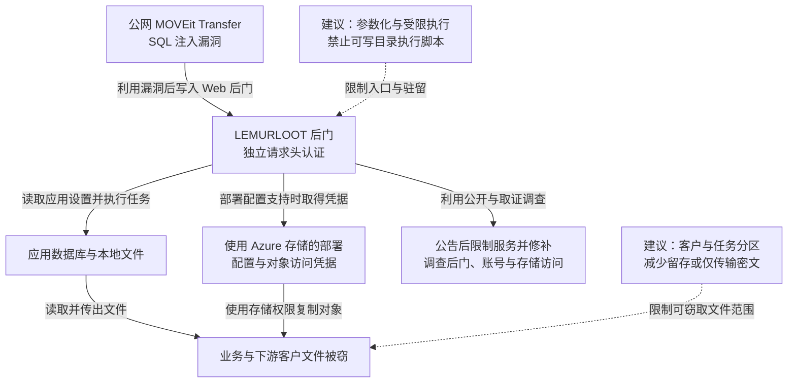

2023 年 5 月起，CL0P 相关攻击活动批量利用公网 MOVEit Transfer 的 SQL 注入漏洞，部署 LEMURLOOT 后门，再借文件中转平台的数据库、存储配置与访问权限窃取资料，并以公开泄露施压勒索。Mandiant 最早观察到的利用为 5 月 27 日，早于 Progress 5 月 31 日的漏洞公告；6 月 6 日出现攻击者公开认领。一次服务商平台入侵还可能暴露存放其中的多个下游客户文件。后续厂商修补与机构隔离需要同时处理已写入的后门和泄露的存储凭据。[Mandiant 调查](https://cloud.google.com/blog/topics/threat-intelligence/zero-day-moveit-data-theft)与 [FBI／CISA 联合通报](https://content.govdelivery.com/accounts/USDHSCISA/bulletins/35ecb08)提供了技术与活动记录。

## 攻击经过

### 从未认证的 SQL 注入进入文件中转系统

MOVEit Transfer 用于组织间的受控文件交换，正常文件访问应经过用户、客户与任务权限判断。CVE-2023-34362 使外部输入进入非预期数据库操作，攻击者利用后进一步部署 ASP.NET 后门 LEMURLOOT。

SQL 注入提供入口，后门提供可反复调用的任务接口。调查中出现 `human2.aspx`、`_human2.aspx` 等与正常组件接近的文件名；文件写入服务器后，不再需要每次重新利用原始注入点。

### 后门使用自己的认证，再调用应用已有能力

Mandiant 分析的后门检查 `X-siLock-Comment` 请求头中的样本特定值，不匹配时主动返回 HTTP 404；匹配后调用 `SystemSettings.DatabaseSettings()` 取得应用数据库连接信息，再执行任务。

这解释了两处控制被绕开：正常用户登录没有参与后门认证，应用原有数据库与文件能力却可以被后门继续调用。向页面发起普通探测得到 404，也可能只是没有满足后门的请求条件。

### 应用配置与存储权限扩大文件读取范围

后门可访问数据库及底层文件；在使用 Azure Blob 的部署中，还能读取相应存储配置与凭据，再访问对象中的资料。联合通报列出的样本特征还包括用户记录操作和文件解密调用，显示它借用了中转平台已有的数据处理能力。

本地文件与云对象是条件不同的读取路径。文件由平台集中保存，服务商还可能在同一系统中处理多个客户的资料，使单点失陷扩大到下游组织。取得文件后，攻击者以泄露资料施压，不需要先加密客户全部业务系统。

### 公告与调查促使隔离，清理范围超出补丁本身

5 月 31 日漏洞公开后，平台运营方需要限制访问、应用修复并调查既有利用。后门文件、异常数据库记录和云凭据都可能在入口修补后继续保留。

调查还需将存储对象对应到客户与传输任务，才能把平台层的窃取记录转成下游实际暴露的文件、字段和人群。业务恢复时，替代传输与积压处理需核对接收方、文件完整性及重复任务。

下图保留本地与云存储分支；虚线连接本文建议，可横向滚动。

## 关键突破、成因与防护

### 数据库输入缺陷进一步变成可长期调用的代码

参数化查询、严格的数据访问接口与及时修补，可以限制注入入口。接入层失陷后，应用仍能写入可执行目录并调用内部配置，才使一次利用变成后续远程任务能力。

程序目录只读、部署身份与运行身份分离、上传和临时目录不允许执行脚本，可以减少常见 Webshell 驻留。它们需与应用修补、运行权限隔离配合：即使不能写入新的页面，已经取得应用执行能力的攻击者仍可能直接读取文件和凭据。

### 中转平台持续持有大量可解密的客户资料

业务上用于交换文件的权限，被扩展为对集中历史资料的读取。文件传输完成后继续留存，增加了一次入侵可取得的数据量；统一应用身份也可能跨越客户和任务边界。

可按客户、传输任务及数据域隔离存储，限定任务身份可读取的对象与有效期。隔离需由存储或独立文件服务实施，不能只靠失陷应用自己检查客户编号。清理中转副本时需兼顾重传、审计与保留义务，必要历史记录可以转入不受公网传输服务直接读取的归档区域。

更强的内容隔离是由发送方或接收方掌握解密密钥，让中转服务只传输密文。代价是平台难以继续预览、全文检索和内容转换；如果平台仍能随时取得内容密钥，就保留了相同的可读边界。

### 后门认证和存储凭据不会随用户改密一起消失

LEMURLOOT 的自有请求头与正常用户登录无关，普通密码轮换无法关闭这项访问。清理要对照可信制品和可执行目录，处理异常账号，并撤销暴露的云访问凭据。云密钥泄露后，攻击者还可能从平台之外直接访问存储，单独关闭 MOVEit 页面不能限制这条路径。

检测应关联异常 Web 请求、程序目录变化、数据库记录操作和批量对象下载。日志保存在应用身份不能修改的位置，调查才能跨平台与存储还原资料范围。修复恢复的是未来交换能力，已外传文件带来的通知和泄露风险仍需按具体内容处理。

## 参考资料

- [Mandiant：MOVEit 零日利用与 LEMURLOOT 分析](https://cloud.google.com/blog/topics/threat-intelligence/zero-day-moveit-data-theft)，参见 Authentication and Database Connection。
- [FBI／CISA：AA23-158A](https://content.govdelivery.com/accounts/USDHSCISA/bulletins/35ecb08)，含漏洞、后门功能与文件特征。
