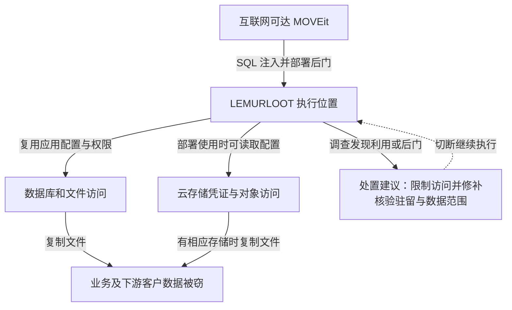

文件传输系统被信任来收发敏感资料，也因而聚集了多个业务、客户和合作方的文件。2023 年 MOVEit Transfer 的 CVE-2023-34362 被批量利用后，攻击者不必进入每家数据所有者的内部网络，就可能从共用的文件中转系统取得资料。

这起事件应区分两种关系：广泛部署的软件同时存在可利用漏洞，以及某家受害服务商持有多个客户的数据。不能把前者直接写成供应商更新包被植入后门，也不能把一家服务商的下游通知数量都算作独立服务器入侵。

技术依据为 [Mandiant 2023 年调查](https://cloud.google.com/blog/topics/threat-intelligence/zero-day-moveit-data-theft)与 [FBI／CISA 联合通报](https://content.govdelivery.com/accounts/USDHSCISA/bulletins/35ecb08)。Mandiant 在自身调查中最早观察到的利用为 5 月 27 日；这不等于已证明全球首次攻击时刻。Progress 在 5 月 31 日公布该漏洞，说明部分被观察的窃取发生在公开披露之前，不能仅从公开补丁后的修复时延归因所有受害方。

## 攻击者先控制传输系统，再借其身份读文件

正常外部访问应经用户与文件权限判断。攻击者利用互联网可达应用的 SQL 注入，使输入进入了非预期数据库操作，并部署 LEMURLOOT Web Shell，形成可远程调用的执行位置。SQL 注入是取得访问的入口，Web Shell 是后续驻留和任务接口；修复注入入口不等于已经删除先前写入的后门。Mandiant 观察到与合法组件相近的 `human2.aspx`、`_human2.aspx` 文件名，说明仅按看似熟悉的文件名检查容易遗漏新增代码。

Mandiant 的 Authentication and Database Connection 分析给出关键证据：LEMURLOOT 检查 `X-siLock-Comment` 请求头中的样本特定值，不匹配时返回 HTTP 404；匹配后读取 `SystemSettings.DatabaseSettings()` 连接应用数据库。这里的 404 是后门主动伪装的结果，不能证明文件不存在；后门调用成功也不需要正常用户完成登录。

因而，改用户密码不会撤销这套独立访问规则；只做未认证页面探测也不足以证明驻留已清除。核验需要结合可信制品对照、可执行目录完整性与数据库访问记录。上述函数和请求头来自样本分析，某家机构是否实际遭该路径窃取仍需其访问证据。

研究者还发现样本可以取得 Azure Blob 存储配置及凭证。这支持扩展读取云端文件的能力判断，但不能证明每家受害机构都把文件存放在 Azure，也不能把样本功能等同于全部功能在现场已经执行。

文件到手后，攻击者可以通过公开泄露施压勒索。本案主要解释数据窃取，不应因攻击者也经营勒索软件就补写为“所有文件都被加密”。是否存在加密破坏，需要单独的事件证据。

下图把本机和云存储路径分开。图可横向滚动。

实线表示观察或样本支持的能力路径，条件写在云存储连线上；虚线表示遏制。图不将潜在能力统计成已确认损失。

调查可关联异常 Web 请求、未批准的可执行文件、应用配置读取和大批文件下载，并保留时间与主体关系。后门文件名可能改变，攻击请求的来源也可能与后续下载来源不同；仅匹配一个名称或 IP 会遗漏路径。

## 关键问题是中转服务能持续持有什么

SQL 参数化、输入边界和及时修补是入口控制。更进一步，应让互联网接入层、文件存储和密钥访问之间存在受限接口，减少同一应用执行权直接变成全量文件读取与后门写入的机会。只读部署、制品完整性核对和限制可写目录中的脚本执行，可以约束常见驻留方式，但不能代替应用修复。

文件留存决定一次入侵可取得多少历史数据。传输完成后按业务需要清理中转副本，按客户、流程和数据域隔离存储与凭证，可以让某个任务失陷时不能读取其他客户的历史文件。清理策略需要兼顾重传、审计和法定保留需求，不能直接删除仍需保留的业务记录。

如果需要更强的数据隔离，可由发送方或接收方掌握内容加密密钥，让中转层只持有密文。这样会影响在线预览、内容扫描、格式转换和检索，需要明确取舍；若中转系统仍同时持有解密密钥，就不能声称已建立端到端内容隔离。

## 服务商修好入口，下游仍需确认资料与业务

5 月 27 日是 Mandiant 调查中最早的利用证据，5 月 31 日是漏洞公告日，6 月 6 日是其记录的攻击者公开认领与勒索威胁日；三者不能替代各服务商自己的发现和遏制时间。公开补丁可用也不能证明先前后门已清除、存储凭证已撤销或下游通知完成。

以下是分工建议，实际通知义务和期限由事件辖区与合同确定，不能套用一个全球统一数字。

| 工作 | 持有中转平台的服务商 | 资料所有者或下游客户 |
| --- | --- | --- |
| 遏制与证据 | 保全 Web、应用、数据库与存储记录，隔离并验证修复、驻留和旧身份 | 确认哪些接口停用，保留自身收发与接收记录 |
| 确定资料范围 | 把对象映射到客户、任务、字段与留存区间，区分已证实及可能访问 | 核对对象实际包含的人群与字段、去重并补充资料用途 |
| 通知与跟进 | 及时交付可用事实及后续更正，明确谁负责何种通知 | 确认通知责任和完成证据，不能因服务商“正在调查”永久搁置 |
| 替代传输与恢复 | 提供可审计替代通道与恢复准入证据 | 验证收件方、文件完整性、重复或遗漏，批准业务恢复 |

## 不以补丁安装成功作为恢复准入

建议在测试环境给测试者接入进程的执行身份，尝试在上传目录写入无害脚本并调用，再读取另一客户的测试对象。脚本应不能执行，跨客户读取应由存储授权拒绝；同时保留制品差异、运行限制与对象拒绝记录。合法发送方给获准接收方传输同一份无害测试文件应成功，证明没有依靠全站停用来通过测试。

修复与轮换后，再持有旧测试存储凭证从平台外直连对象存储，应被拒绝；用新任务身份应只能取得指定对象。服务商交付对象清单和访问时间，下游用自身收发记录核对字段、人群与重复项，再通过替代通道测试完整收发和回执。这些是建议验收，本文未对任何受害平台实测。

关闭服务会阻断正常交换，替代通道也可能增加人工核对成本。平台恢复准入由服务商确认，是否可恢复某项业务由下游负责人确认；不能把一次平台失陷与多个组织的资料影响混为同一统计单位。

## 资料与核验入口

- [Mandiant：LEMURLOOT 行为与观察范围](https://cloud.google.com/blog/topics/threat-intelligence/zero-day-moveit-data-theft)。
- [FBI／CISA：AA23-158A 联合通报](https://content.govdelivery.com/accounts/USDHSCISA/bulletins/35ecb08)。
