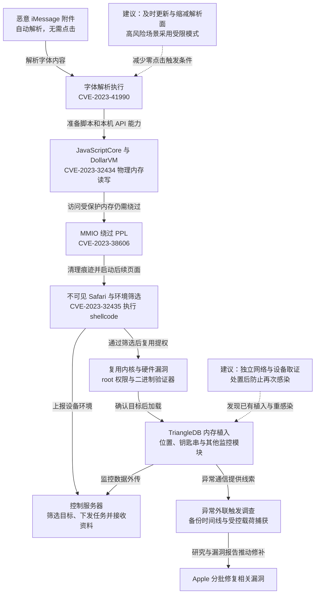

2023 年，Kaspersky 从企业网络中员工 iPhone 的异常流量发现 Operation Triangulation，调查将感染痕迹追溯到 2019 年。攻击者发送无需用户交互的 iMessage 恶意附件，串联字体解析、内核内存与硬件保护绕过等漏洞，取得高权限后筛选目标、植入间谍程序并清除痕迹。公开分析的完整链支持至 iOS 16.2，Apple 在 2023 年分批修补相关漏洞。研究者观察到的工具不支持重启后持久化，但设备可能再次被感染。[初始调查](https://securelist.com/operation-triangulation/109842/)和[完整利用链分析](https://securelist.com/operation-triangulation-the-last-hardware-mystery/111669/)分别记录了发现经过与机制。

## 攻击经过

### 消息解析替用户触发了第一段代码

iMessage 收到附件后，会调用系统组件解析内容。恶意附件利用 FontParser 对 Apple 特有 ADJUST TrueType 字体指令的处理缺陷 CVE-2023-41990，触发远程代码执行。用户无需点开附件，恶意输入已经进入自动解析路径。

随后，利用链通过多阶段原生代码与表达式处理，调整 JavaScriptCore 环境，使混淆 JavaScript 能执行提权逻辑。DollarVM（`$vm`）调试功能提供对 JavaScriptCore 内存和本机 API 的操作能力，攻击者由脚本进一步接触系统接口。这里的关键变化是消息内容先变成进程执行，再具备调用底层接口的条件。

### 内核读写之后，还要绕过硬件保护

CVE-2023-32434 位于 XNU 的 `mach_make_memory_entry`、`vm_map` 等内存映射调用，整数溢出让用户态取得设备物理内存的读写能力。拥有内存访问后，攻击者仍需处理受保护内核区域。

CVE-2023-38606 对应下一层绕过：利用硬件 MMIO 寄存器相关能力，规避页面保护层（PPL）的约束。Kaspersky 对寄存器和内存范围的分析，解释了为什么软件层面已经禁止的写入仍可能通过另一条硬件路径完成。[技术报告](https://securelist.com/operation-triangulation-the-last-hardware-mystery/111669/)给出了内存操作与保护绕过的依据。

### 不可见 Safari 再次筛选目标，并复用提权能力

完成前段提权后，利用链启动 IMAgent 清理利用痕迹，并在不可见的 Safari 进程中打开下一阶段页面。JavaScript 验证器收集运算、API 与浏览器环境信息，提交控制服务器，由服务器决定是否下发后续利用。

Safari 阶段利用 CVE-2023-32435 执行 shellcode，随后以另一套实现复用 CVE-2023-32434 和 CVE-2023-38606，取得 root 权限。二进制验证器继续核对进程、网络、越狱状态和设备标识，再加载最终间谍植入物。两轮环境筛选使不符合条件的分析环境难以拿到整条链。

植入物 TriangleDB 可接收文件与进程操作任务、提取钥匙串、采集位置，并加载音频和消息等辅助模块。获得高权限后，攻击者可直接访问设备上的敏感资料，不再依赖用户逐项授予普通应用权限。它以内存驻留维持当前运行期间的控制；初始报告观察到重启后再次感染的时间线。

### 删除痕迹后，网络与备份记录仍提供了发现入口

Kaspersky 首先发现异常外联，再使用 iOS 备份、libmobiledevice 和 MVT 整理设备时间线。已经弃用的 `BackupAgent` 进程出现网络活动，以及空附件目录在此前发生修改，成为关联感染时刻的线索。

[研究者的载荷捕获记录](https://securelist.com/operation-triangulation-catching-wild-triangle/110916/)进一步说明了取证过程：在已知受感染测试设备上安装受信根证书并经 WireGuard 与 mitmproxy 转发，捕获控制服务器通信。验证器在 HTTPS 内还有 NaCl 加密层，研究者通过修改测试环境中的密钥生成逻辑取得可知的共享密钥。

恶意 iMessage 附件还有独立的内容加密。研究者干预附件下载，使利用暂时不能触发、附件密钥未被及时清理，再从备份中的 `sms.db` 取得材料，配合捕获的附件密文还原载荷。企业网中看到的异常、设备残留和受控环境捕获，最终拼出了完整链路。Apple 的后续补丁分别关闭相关利用条件。

下图标明能力边界与阶段复用；虚线只表示本文建议，可横向滚动。

## 关键突破、成因与防护

### 不可信附件进入了自动执行的复杂解析路径

本案无需用户点击，普通防钓鱼教育难以限制入口。及时更新系统、减少不必要的消息接收与复杂附件处理，直接压缩可触发的解析面。

高风险用户可采用 [Apple 锁定模式](https://support.apple.com/en-us/105120)等受限配置，它会限制多数消息附件和部分复杂网页能力，代价是正常协作功能受限。操作系统还需持续缩小解析组件权限，使解析漏洞不直接获得设备其他资料；本案后续提权则说明，低权限执行后的内核边界仍需独立保护。

### 软件内核权限之外，还有未被覆盖的硬件写入路径

物理内存读写并未直接消除 PPL，攻击者额外利用 MMIO 路径才绕过保护。防护需要覆盖能够修改同一受保护对象的所有写入来源，包括硬件映射和调试功能，而非只检查正常内核写入接口。

这类约束主要由芯片与系统实现维护。企业侧应及时部署相关系统修复，不能用设备没有越狱、应用权限看似正常来推定底层可信。高价值身份和长期管理秘密也应减少留存在移动终端，让设备失陷后可被复制的外部权限有范围与有效期限制。

### 攻击者控制本机证据，仍需依赖外部通信

消息、附件记录和崩溃信息被清理，削弱了本机单一证据来源；网络异常与备份残留仍能从不同位置关联活动。企业可以在隐私和使用边界内保留必要的网络、设备状态与时间信息，使移动端发现能力不完全依赖手机自己报告正常。

研究环境中的中间人捕获用于还原载荷，日常防护则可结合外联特征、时间关联及可信设备取证。重启可能结束当前内存植入，但未修补设备仍可能收到新附件再次感染。可信恢复需要与系统更新、访问收紧及暴露会话和秘密的撤销配合；重新联网后的持续观察，则用于发现原入口或其他权限仍在被使用。

## 参考资料

- [Kaspersky：Operation Triangulation 初始调查](https://securelist.com/operation-triangulation/109842/)，含最早痕迹、备份分析与不支持重启后持久化的结论。
- [Kaspersky：完整利用链与硬件保护绕过](https://securelist.com/operation-triangulation-the-last-hardware-mystery/111669/)。
- [Kaspersky：如何捕获各阶段载荷](https://securelist.com/operation-triangulation-catching-wild-triangle/110916/)。
- [Apple：iOS 16.5.1 安全更新](https://support.apple.com/en-us/103837)与[锁定模式](https://support.apple.com/en-us/105120)。
