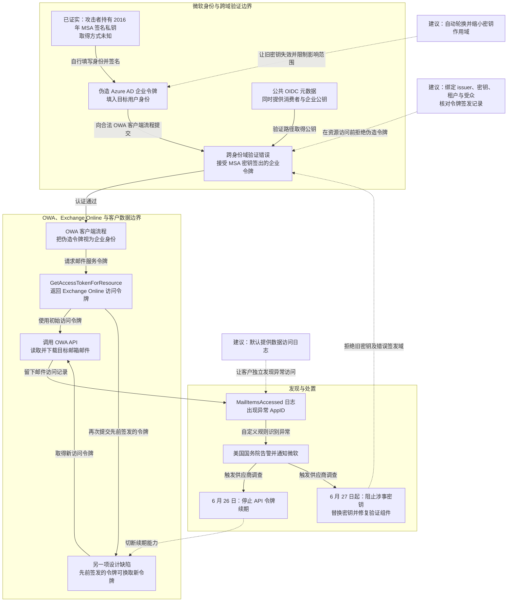

## 概述

微软日志确认的最早访问发生在 2023 年 5 月 15 日；受日志保留期限限制，Storm-0558 的活动可能开始得更早。攻击者没有取得每名受害者的密码，也不需要逐个绕过多因素认证，而是持有一把微软 2016 年创建的消费者账号签名密钥，用它自行生成能够冒充目标用户的令牌。微软邮件系统错误地接受了这些消费者密钥签出的企业身份令牌，攻击者随后通过 Outlook Web Access（OWA）取得 Exchange Online 访问令牌并读取邮件。

美国网络安全审查委员会（CSRB）在 2024 年 3 月完成的[最终报告](https://www.cisa.gov/sites/default/files/2025-03/CSRBReviewOfTheSummer2023MEOIntrusion508.pdf)认定，事件影响 22 家机构和全球超过 500 人，受害者包括美国国务院、商务部和众议院人员。攻击者从美国国务院下载了约 6 万封邮件，部分邮箱至少暴露六周。CSRB 将 Storm-0558 评估为与中华人民共和国有关联、以间谍活动为目的的攻击者。

这起事件的关键不只是签名密钥失窃。密钥本应只代表微软消费者账号，验证缺陷却把它的信任范围扩展到了企业账号；令牌又是持有即可使用的凭据。攻击者因而能够跳过受害者自己的登录过程，直接向邮件服务出示一份数学上签名正确、身份内容却由攻击者填写的令牌。

## 一张图看清伪造身份如何变成邮件访问能力

下图回答一个问题：攻击者持有消费者签名密钥后，怎样先让系统接受伪造的企业身份，再取得能够读取邮件的访问令牌，又是什么最终暴露并切断了访问？图可横向滚动。

攻击主线和企业实际采取的处置使用实线连接；处置对原有能力的切断及本文建议使用虚线。图没有补上密钥如何离开微软，因为微软和 CSRB 均未查明这一环节；早期公布的 crash dump 假说后来被微软更正，不能接入已证实主线。跨身份域验证错误与 OWA 令牌续期缺陷是两个不同问题，图中分别位于身份边界和邮件访问边界。

## 入侵始于一份云服务愿意相信的伪造身份

云邮件系统不会在每次请求中重新询问用户密码。用户完成登录后，身份系统签发访问令牌；邮件服务检查令牌，确认可以把它当成某个用户的授权证明。常见令牌使用 JWT 结构，包含签名密钥标识、签发者、目标服务、租户、用户身份和有效期等内容。

数字签名只能证明令牌由对应私钥生成，而且签名后内容没有被修改。它不能证明令牌中的用户身份是真实的，也不能证明签名者有权代表当前企业租户。正常情况下，这两层保证来自身份服务：私钥由可信签发系统保管，资源服务又严格检查签发者、受众、租户和密钥之间的对应关系。

Storm-0558 已经取得微软消费者账号系统 MSA 的一把私钥，因此可以自行填写令牌内容，再生成完全正确的签名。从密码和 MFA 的角度看，这不是一次失败或异常登录：攻击者没有尝试受害者密码，微软身份系统也没有实际签发这些令牌。问题发生在更靠后的验证环节，微软代码接受了攻击者自行制造的企业身份结果。

CSRB 明确认定，微软仍不知道 Storm-0558 怎样取得这把密钥。微软曾在 2023 年 9 月把 crash dump 描述为最可能路径，但没有找到包含涉事密钥的 dump、外传日志或其他直接证据，并于 2024 年 3 月更正说法。2021 年 Storm-0558 入侵微软企业网络的事实可以说明攻击者曾接触身份相关资料，却不能证明密钥就是在那次入侵中被取走。

## 两项验证缺陷把伪造身份变成了邮件访问令牌

微软存在两套历史不同的身份环境：MSA 服务消费者账号，Entra（原 Azure Active Directory）服务企业组织。2016 年 MSA 密钥按设计只应为消费者身份签名，即使攻击者取得它，正常影响也应停留在消费者账号范围内。

第一次边界跨越发生在身份令牌验证。为了提供统一的 OpenID Connect 入口，微软的公共元数据端点同时列出了消费者和企业身份系统的有效公钥。客户端和微软服务通过 SDK 从该端点取得公钥，再用它们检查令牌签名。CSRB 调查发现，相关 SDK 没有被充分更新，未能在公共端点内正确区分消费者密钥与企业密钥。部分应用因而会接受由 MSA 密钥签出的伪造 Azure AD 企业令牌。

[Wiz 对公开公钥端点和验证逻辑的静态分析](https://www.wiz.io/blog/storm-0558-compromised-microsoft-key-enables-authentication-of-countless-micr)进一步说明了风险：验证程序除了计算签名，还必须把公钥声明的 issuer 与令牌中的 issuer 对应起来，并核对 `aud`、`tid` 等字段。若程序只因某把公钥出现在 `common` 端点就把它视为通用信任根，攻击者便可能用消费者私钥签出看似属于其他租户的令牌。

第二次能力变化发生在 OWA 内部流程。微软 2023 年 7 月 14 日的[技术说明](https://www.microsoft.com/en-us/security/blog/2023/07/14/analysis-of-storm-0558-techniques-for-unauthorized-email-access/)称，攻击者先让合法客户端流程接受伪造令牌，再通过 OWA 使用的 `GetAccessTokenForResource` API 取得面向 Exchange Online 的访问令牌。该 API 另有一项设计缺陷：攻击者可以提交一枚先前由该 API 签发的令牌，继续取得新的访问令牌。攻击者最后用这些令牌调用 OWA API 读取邮件。

这两项缺陷不能压成同一个问题。跨身份域验证错误让消费者密钥签出的伪造 Azure AD 令牌获得企业身份意义；`GetAccessTokenForResource` 的设计缺陷则延长了已经取得的邮件访问能力。公开材料没有给出攻击中每一枚原始令牌，不能逐字段还原攻击者填写了什么，但微软说明和受害者日志共同支持这两次能力转换及最终邮件访问。

CSRB 认为，这把密钥与验证缺陷组合后，能力范围几乎可以覆盖任意 Exchange Online 账号。攻击者实际选择了有限的高价值目标。报告还指出，某些同样信任微软身份提供方的其他应用在理论上也可能受影响，特别是支持消费者账号或验证不完整的应用；现有调查没有证明 Storm-0558 在本次行动中实际利用这些应用，因此不能把潜在范围计入已发生损失。

## 邮件访问日志发现了身份系统没有发现的异常

微软日志确认的最早访问发生在 2023 年 5 月 15 日。CSRB 指出，当时的标准日志保留期只有 30 天，因此不能排除攻击活动开始得更早。攻击者使用靠近部分受害者所在地的基础设施，使请求更接近正常流量。美国国务院安全运营中心在 6 月 15 日发现邮件访问异常，次日由名为“Big Yellow Taxi”的自定义规则产生多条告警。

这条规则分析 `MailItemsAccessed` 事件。该事件记录谁通过什么客户端和应用访问了 Exchange Online 邮件。国务院发现事件中的 `ClientAppID` 和 `AppID` 不符合本组织平时的邮件访问模式，随后通知微软和 CISA。[CISA 与 FBI 的联合公告](https://www.cisa.gov/news-events/cybersecurity-advisories/aa23-193a)确认，异常 AppID 基线正是发现本案的关键，并称当时不知道还有其他审计事件能够识别同一活动。

发现能力当时还有一个直接限制：国务院购买了包含 Microsoft Purview Audit Premium 的政府 G5 许可，才能取得所需的 `MailItemsAccessed` 数据。缺少高级许可的受害者在事后启用日志，只能看到启用后的活动，无法补回已经发生的历史访问。商务部因此不能独立完成整个受影响期间的评估，只能依赖微软提供的部分数据。

事件披露后，微软在 2023 年 7 月 19 日[宣布扩大云日志的默认范围](https://www.microsoft.com/en-us/security/blog/2023/07/19/expanding-cloud-logging-to-give-customers-deeper-security-visibility/)。公告称，Purview Audit Standard 将在不增加费用的情况下获得详细邮件访问日志及 30 多类此前只供 Premium 使用的日志，默认保留期也计划从 90 天延长至 180 天；更新将从当年 9 月开始向政府和商业客户推出。这是当时公布的 rollout 计划，不能改写成 7 月 19 日已经完成全部部署。

这个发现路径绕开了身份系统自己的判断。即使身份服务把伪造令牌当成合法身份，邮件被实际读取仍会在资源层留下记录。它说明检测规则应关注“某个应用为何正在访问这些邮箱”，而不能只寻找登录失败、陌生设备或 MFA 告警。

## 三处失效共同放大了结果

### 旧密钥没有按计划退出信任链

2016 年 MSA 密钥原计划在 2021 年 3 月退役。微软消费者身份系统长期依靠人工轮换；2021 年一次与人工轮换有关的大型云故障后，微软停止轮换，却没有及时完成自动化方案，也没有建立对过期密钥年龄的告警。到 2023 年，这把旧私钥产生的签名仍会被接受。

自动轮换能够缩短私钥泄露后的可用时间，但只轮换一次涉事密钥不能解决结构问题。身份提供方还需要监控密钥年龄和每次使用，及时清除下游公钥缓存，并让消费者、企业、租户或高价值服务使用作用域更小的密钥。这样即使一把私钥泄露，也不能自然获得跨全部客户的签名能力。隔离密钥存储和 HSM 可以降低密钥被复制的概率；由于本案取得路径未知，现有证据不足以断言某一种存储措施必然能够阻止这次泄露。

### 验证器算对了签名，却信错了签发域

令牌验证必须同时回答两个问题：签名是否正确，这把密钥是否有权为当前签发者、租户和服务签名。本案的验证路径完成了前一项，没有正确完成后一项。公共公钥端点方便应用兼容多种账号，却使密钥来源的区分依赖每个 SDK 和应用正确实现额外规则。

身份平台应以统一验证库强制绑定密钥、issuer、audience 和 tenant，不能让应用自行选择是否检查。对只能接收企业身份的服务，消费者密钥应在密码学验证开始前就被排除。更新公共验证库还要覆盖所有调用方和缓存，否则同一修复可能在不同服务上产生不一致结果。

CSRB 还建议在适用场景采用有状态验证：身份服务签发令牌时保存数据库记录，资源服务接受令牌前查询记录，确认令牌确由平台生成。这样即使攻击者掌握签名私钥，自行生成的令牌仍缺少服务端签发记录。代价是增加在线依赖、延迟和可用性要求，而且第三方离线验证场景未必能够使用；它适合保护供应商自有的高价值服务，不能无条件替代标准 JWT 验证。

### 客户能看到邮件被读，却看不到供应商为何相信令牌

邮件租户无法撤销微软的根签名密钥，也不能修复 Exchange Online 的验证库。CISA 在公告中明确说明，本案核心缓解动作由微软负责。客户能够做的是从资源访问日志发现后果、保存证据并通知供应商；这些能力当时又受许可等级和历史日志保留范围限制。

微软事后宣布把详细邮件访问日志等能力扩展到 Audit Standard，并延长默认保留期，直接回应了本案暴露的许可和留存缺口。CSRB 的建议范围更广：云服务商应默认记录客户业务数据访问，以足够长的期限保留调查所需信息，并允许客户在自己的分析环境中使用这些日志。公告中的产品计划与 CSRB 的行业建议应分别理解，前者不等于后者已经全部实现。

客户还需要以应用标识、邮箱和访问模式建立基线，并保留能够关联令牌签发域和资源访问的记录。日志只能缩短攻击持续时间，不能替代供应商对签名根和验证器的控制；即便发现准确，供应商仍须撤销密钥、停止错误的令牌续期并修补云端验证路径。

## 分层处置如何切断两项缺陷

微软的处置分别对应了两次能力变化。6 月 26 日，OWA 停止接受由 `GetAccessTokenForResource` 签发的令牌用于续期，切断攻击者用旧令牌继续取得新令牌的能力。6 月 27 日，微软在 OWA 中阻止由涉事 MSA 密钥签出的令牌；6 月 29 日完成密钥替换，并撤销事发时仍有效的全部 MSA 签名密钥。微软还修复了允许消费者密钥签署 Azure AD 企业令牌的验证问题，并于 7 月 3 日阻止受影响消费者继续使用旧密钥签出的既有令牌。

这些动作处理的是不同层次：停止续期限制已经取得的 OWA 令牌继续扩展；阻止涉事密钥和清理缓存使旧签名失效；替换密钥及修复跨域验证则阻止攻击者再次把消费者签名能力变成企业身份。CSRB 时间线记录，旧密钥被撤销后，微软很快观察到 Storm-0558 转向钓鱼等方式，试图重新进入此前访问过的邮箱。这一变化支持原有伪造令牌路径已经被切断。

重置受害者密码无法单独完成同样的处置。伪造令牌不是由密码登录产生，攻击者持有的是微软身份系统的签名能力；只要资源服务仍相信旧密钥，换掉某个用户的密码不会使攻击者失去自行生成新令牌的能力。处置必须发生在供应商信任根、令牌交换和资源验证层。

不过，撤销密钥只能阻止后续使用。已经下载的邮件不会因此收回，攻击者若在其他应用建立了新的持久访问，也需要分别调查和清除。现有公开结论确认了 Exchange Online 邮件访问，没有给出所有目标邮箱的完整数据清单，也没有证明潜在受影响的其他应用均被实际利用。

## 这起事件留下的工程判断

Storm-0558 事件中，每一个伪造令牌的签名都可以在数学上正确。真正错误的是信任关系：一把消费者密钥长期没有退役，公共公钥入口把不同身份域放在同一发现面，验证库又没有强制检查这把密钥是否有权代表企业租户。伪造的企业身份进入 OWA 后，另一项令牌续期缺陷又让攻击者持续取得邮件访问令牌。

高价值云服务需要把签名、签发和授权拆开验证。密钥证明“谁能够生成签名”，issuer 和 tenant 限定“它能代表谁”，audience 限定“它能访问什么”，签发记录证明“平台是否真的生成过这枚令牌”，资源访问日志则回答“令牌最终做了什么”。OWA 一类中间令牌交换接口还要单独限制输入令牌的来源、用途和续期条件，不能因为前一步已经认证就继承全部信任。

这起事件同样划清了云客户与供应商的防护边界。客户可以通过独立日志发现邮件被异常读取，却无法自行修补供应商的身份根。供应商掌握全局签名密钥、令牌交换接口和验证代码，也必须承担默认提供可调查日志、限制单把密钥影响范围和保留密钥取证证据的责任。否则，客户只能在数据已经被读取后，从不完整的结果反推一个自己看不见的身份系统为何失效。

## 参考资料

- [Cyber Safety Review Board：Review of the Summer 2023 Microsoft Exchange Online Intrusion，2024-03-20](https://www.cisa.gov/sites/default/files/2025-03/CSRBReviewOfTheSummer2023MEOIntrusion508.pdf)
- [Microsoft：Analysis of Storm-0558 techniques for unauthorized email access，2023-07-14](https://www.microsoft.com/en-us/security/blog/2023/07/14/analysis-of-storm-0558-techniques-for-unauthorized-email-access/)
- [Microsoft：How Microsoft is expanding cloud logging to give customers deeper security visibility，2023-07-19](https://www.microsoft.com/en-us/security/blog/2023/07/19/expanding-cloud-logging-to-give-customers-deeper-security-visibility/)
- [CISA：CSRB 报告资源页](https://www.cisa.gov/resources-tools/resources/CSRB-Review-Summer-2023-MEO-Intrusion)
- [CISA 与 FBI：Enhanced Monitoring to Detect APT Activity Targeting Outlook Online，2023-07-12，7 月 14 日更新](https://www.cisa.gov/news-events/cybersecurity-advisories/aa23-193a)
- [美国国土安全部：CSRB 报告发布说明，2024-04-02](https://www.dhs.gov/news/2024/04/02/cyber-safety-review-board-releases-report-microsoft-online-exchange-incident-summer)
- [Wiz：Compromised Microsoft Key: More Impactful Than We Thought，2023-07-21](https://www.wiz.io/blog/storm-0558-compromised-microsoft-key-enables-authentication-of-countless-micr)
