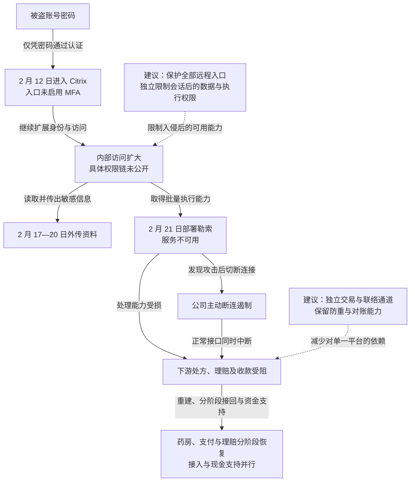

2024 年 2 月 12 日，攻击者用被盗凭证进入 Change Healthcare 未启用 MFA 的 Citrix 远程入口，随后扩大访问、外传医疗资料，并于 2 月 21 日部署勒索软件。公司将活动指向 ALPHV／BlackCat 及其关联参与者，并主动断开系统连接，依赖该平台的药房、医院和诊所遭遇处方、理赔及收款中断。药房、支付与理赔服务随后分阶段恢复；HHS 记录公司于 2025 年 7 月报告约 1.927 亿人受影响。[参议院听证记录](https://www.govinfo.gov/content/pkg/CHRG-118shrg63595/html/CHRG-118shrg63595.htm)提供入口与响应证词，[HHS 后续记录](https://www.hhs.gov/hipaa/for-professionals/special-topics/change-healthcare-cybersecurity-incident-frequently-asked-questions/index.html)给出人数口径。

## 攻击经过

### 被盗密码足以进入关键远程入口

Citrix 门户为员工提供远程桌面或应用访问。UHG 首席执行官 Andrew Witty 在 2024 年 5 月 1 日听证会上表示，攻击者于 2 月 12 日使用被盗凭证进入，该入口没有 MFA。

入口接受了有效账号密码，向攻击者提供远程工作环境。公开证词没有细述后续横向移动的具体工具与权限链，但明确记载攻击者继续扩大访问，在 2 月 17—20 日外传受保护的健康信息，2 月 21 日再部署勒索软件。

### 数据外传与加密提供了两种施压能力

外传使敏感资料脱离平台控制，加密则使服务无法正常使用。两者在时间上先后发生，攻击者不必等系统全面中断才取得数据。

2 月 21 日，公司发现勒索部署后迅速切断与 Change Healthcare 系统的连接，以限制继续感染。隔离同时阻断正常业务接口，受影响机构即使没有被勒索程序直接感染，也可能无法处理处方、提交理赔或接收支付。

### 平台集中依赖把系统故障传递到医疗业务

Change Healthcare 处于医疗交易链中，多个机构依赖其传输、处理与结算服务。服务器恢复后，仍需重新接入付款方和业务系统，处理积压请求并核对交易状态。

UHG 的 [2024 年 3 月 18 日更新](https://www.unitedhealthgroup.com/newsroom/2024/2024-03-18-uhg-cyberattack-status-update.html)记录：

| 时间 | 公司报告的恢复进展 |
| --- | --- |
| 3 月 7 日 | 恢复 99% 的药房网络服务，继续处理剩余问题 |
| 3 月 15 日 | 恢复电子支付平台，继续接入付款方 |
| 3 月 18 日 | 开始发布医疗理赔准备软件，客户随后分阶段接入 |

公司同时报告向医疗服务方预支超过 20 亿美元，用于缓解现金压力。这个资金支持动作说明，技术中断已延伸为依赖机构的经营问题。

HHS 后续记录了通知和人数的变化：2024 年 10 月报告约一亿份个人通知已发送，2025 年 1 月报告约 1.3 亿份通知已发送、约 1.9 亿人受影响，7 月 31 日受影响人数更新至约 1.927 亿。

下图保留数据窃取、加密与主动隔离三条影响关系；虚线为本文建议，可横向滚动。

## 关键突破、成因与防护

### 有效密码足以进入远程工作环境

部署强认证是直接措施，覆盖范围还需包括备用地址、旧网关、远程桌面与帮助台恢复。并购或迁移中的例外系统，往往继续承担业务，却可能没有采用统一的认证约束。

入口策略应由实际认证端执行，备用入口与账号恢复也不能仅凭相同密码发放会话。会话有效期、设备条件与高风险再认证，可以减少一次凭证泄露变成长时间访问的机会。已经签发的会话则需另外撤销，不能只修改密码策略后继续保留原会话。

### 远程访问可以继续扩大到数据与执行能力

本案已确认外传和批量加密，但内部扩展过程未完整公开。对相似架构，防护需从“远程工作环境已被控制”继续分析：普通远程业务身份是否还能调用服务器管理、全量资料导出或备份删除。

可以分开业务访问、数据提取与基础设施管理身份，按交易和记录授权数据，批量操作需要独立批准。约束由目标服务和管理系统执行，失陷桌面不能自行授予更多权限。备份删除与恢复身份还需独立于生产管理环境，使批量加密无法顺带破坏恢复能力。恢复时同时重建受损环境、撤销残留身份，并核对旧接口是否仍可访问。

### 关键交易集中在同一平台，主动断连也会放大损害

网络隔离能限制恶意代码，无法自行恢复药房和医院对交易中转服务的依赖。备用方案需要提前具备接口、接入权限、合同和容量，才能在主服务停用时承接最低限度业务。

相似机构可以保留独立的药房处理、理赔提交与应急联络通道，并使其不依赖同一身份、目录或中转服务。备用通道的请求应保留业务标识和回执，重接主平台后通过防重与对账处理积压，减少重复结算或遗漏。额外接口和较低吞吐会增加成本，但提供了隔离攻击时继续服务的选择；应急现金安排则缓解交易处理恢复前的资金压力。

## 参考资料

- [美国参议院财政委员会：2024 年 5 月 1 日听证记录](https://www.govinfo.gov/content/pkg/CHRG-118shrg63595/html/CHRG-118shrg63595.htm)，检索 February 12th、February 17-20、multifactor。
- [UHG：2024 年 3 月 18 日状态更新](https://www.unitedhealthgroup.com/newsroom/2024/2024-03-18-uhg-cyberattack-status-update.html)。
- [HHS：Change Healthcare FAQ](https://www.hhs.gov/hipaa/for-professionals/special-topics/change-healthcare-cybersecurity-incident-frequently-asked-questions/index.html)，第 11 问记录通知与受影响人数。
