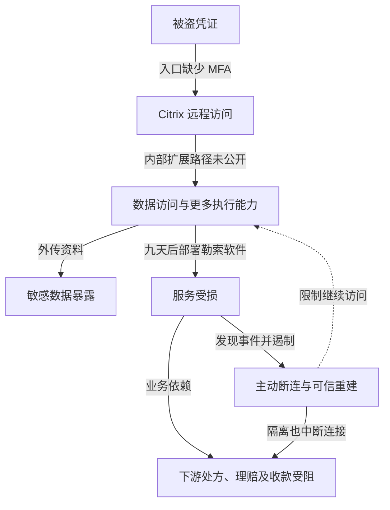

2024 年 2 月 21 日，Change Healthcare 发生勒索软件事件，其系统断连影响美国医疗机构处理处方、理赔和收款。很多下游机构不需要自己被感染，也会因共用服务停止而无法完成业务。只统计被加密的服务器，会漏掉对医疗服务与现金流的影响。

入口与内部经过主要依据 UnitedHealth Group 首席执行官 Andrew Witty 在 [2024 年 5 月 1 日美国参议院听证会](https://www.govinfo.gov/content/pkg/CHRG-118shrg63595/html/CHRG-118shrg63595.htm)的证词，恢复结果与规模另核对公司更新及 HHS 后续记录。HHS 第 11 问记录，Change Healthcare 于 2025 年 7 月 31 日报告约 1.927 亿人受影响；这是该日公司向监管机构报告的规模，不是本文独立去重的人数，也不能换算为实际收到通知或发生资金损失的人数。

## 从远程登录到窃取与加密

正常远程桌面入口应把员工带到获准的工作环境，再由目标服务判断权限。Witty 称，攻击者于 2 月 12 日使用被盗凭证访问 Change Healthcare 的 Citrix 入口，该入口没有 MFA。凭证最初怎样泄露，不能仅从“被盗”两字推定为钓鱼、终端恶意软件或密码复用中的某一种。

攻击者进入后继续横向移动、外传数据，九天后部署勒索软件。这说明进入与造成大范围中断之间存在进一步取得能力的过程，但公开证词没有提供足以逐台还原主机、权限和任务的完整记录。把未知路径标注出来，比画出一条想象中的域管理员攻击链更准确。

企业随后断开受影响系统，以限制继续伤害。下游医院、诊所和药房依赖这些接口处理业务，因此既受恶意加密影响，也受防守方主动隔离影响。主动断连可能是必要遏制措施，其业务代价仍应纳入应急准备，而不应事后全部归为直接恶意破坏。

攻击者取得的施压力来自两类资产：可被泄露的敏感数据，以及依赖集中服务的业务可用性。即使有备份，重新建立可信交易连接、完成对账并处理积压，也不一定与恢复服务器同步完成。

下图保留内部扩展路径未知，以及主动断连的业务影响。图可横向滚动。

实线区分已披露行为与业务影响，未公开的中间过程写在连线上；虚线只表示遏制对象。下游中断不代表所有医疗机构终端被攻破。

对于相似环境，可关联远程登录后的身份扩展、大量敏感读取、批量执行和恢复配置变更。公开证词不足以证明当时哪项告警出现或未出现，因此不能据这九天直接计算安全团队发现后的处置时延。

## 入口缺失 MFA 是明确原因，但不是完整解释

第一道突破已有直接证词支持：有效密码足以进入关键远程入口。强认证可以提高这道边界，但组织还需要证明全部入口、备用访问与恢复流程都受保护，而不是只证明集团存在 MFA 制度。应列出真实入口、备用地址、远程桌面网关及帮助台恢复途径，用实际测试证明策略覆盖，不以采购覆盖率代替。并购、迁移与例外系统也应逐项验证，不能把组织级标准当作每个端点的实际状态。

第二道突破是一次远程会话后还能取得更多数据和执行能力。其内部权限扩展的原因尚未完全公开，但相似系统可以按“远程工作环境已失陷”验收，限制临床业务、支付处理、批量数据导出及基础设施管理之间的能力连接。授权、管理与备份不能共用一套可被单个会话控制的信任根。

第三道突破是关键交易集中依赖少量平台。网络分段只能限制恶意代码传播，不能自动让医院在平台主动断连后继续收款。机构需要提前验证替代理赔通道、药房处理与人工降级所需数据、权限、合同和容量；临时决定换供应商，可能受接口、资质和商业条款约束。备用通道若仍依赖同一身份、目录或交易中转服务，也会一起失效；演练应检查其独立依赖、可用容量和重放防重机制。

## 药房、支付平台与理赔软件分阶段恢复

[UHG 2024 年 3 月 18 日状态更新](https://www.unitedhealthgroup.com/newsroom/2024/2024-03-18-uhg-cyberattack-status-update.html)提供了比“系统恢复”更具体的区分：

| 时间 | 公司报告的状态 | 仍不能据此认定什么 |
| --- | --- | --- |
| 2 月 12 日至 21 日 | 证词称先进入远程入口，后部署勒索软件并断连 | 内部每次提权、首个告警及所有撤销时刻未公开 |
| 3 月 7 日 | 恢复 99% 的药房网络服务 | 该比例不是全部医疗支付业务或所有患者服务均恢复 |
| 3 月 15 日 | 电子支付平台恢复，继续接入付款方 | 平台可用不等于每家机构已接通或收到全部款项 |
| 3 月 18 日 | 宣布当日开始发布医疗理赔准备软件，客户分阶段接入 | 发布安排不能写成全体客户已恢复理赔 |

公司在该更新中还报告已向医疗服务方预支超过 20 亿美元。预支是缓解现金压力的措施，与正常理赔款已结算到账是两种资金来源，不能合并成业务恢复率。上述是企业披露，本文没有逐家医疗机构的银行流水与完整积压记录。

后续隐私规模也经历了不同统计状态：[HHS FAQ 第 11 问](https://www.hhs.gov/hipaa/for-professionals/special-topics/change-healthcare-cybersecurity-incident-frequently-asked-questions/index.html)记录，2024 年 10 月 22 日公司报告约一亿份个人通知已发送，2025 年 1 月 24 日报告约 1.3 亿份通知已发送、约 1.9 亿人受影响，7 月 31 日受影响规模更新为约 1.927 亿人。通知数量和受影响人数的变化不能画成同一条增长曲线。

## 用交易状态证明业务和资金恢复

以下是相似机构的建议验收，本文没有测试 Change Healthcare 内部系统：

- 身份团队给测试者一个已泄露的测试密码，逐个尝试主入口、备用入口与帮助台恢复。认证处应拒绝仅凭密码进入，留存每个端点的实际结果；获准人员通过强认证应能正常登录。
- 平台团队再给测试者远程测试会话，尝试访问其他数据域、运行未经批准的无害批量任务和删除测试恢复副本。由相应资源授权、执行控制和独立备份身份拒绝，保留三类结果；合法单项运维任务应成功，不能用停用全部服务代替隔离。
- 业务与财务团队切断主中转平台依赖，在获准沙箱发送带专用防重标识的替代理赔请求，逐项检查接收回执、处理与结算状态、防重及积压对账。实际收款另以获准的小额真实交易或对应真实业务流水核对银行到账，不能从沙箱成功推定现金已恢复。无故障时同一业务流程应可正常闭合。

业务负责人应确定最长可容忍中断、最低服务能力和应急现金安排，不能只向技术团队索要“系统什么时候恢复”。应急通道可能成本更高或吞吐更低，需要在平时确认容量和启用条件。

付款、系统重建、数据通知与业务恢复分别报告。支付赎金不能证明所有副本已删除，也不能证明入侵者权限已经清除。新环境恢复后仍需验证残余身份、旧连接和交易数据一致性；能够登录或收到一笔测试请求，并不等于整个医疗支付流程已经恢复。验收应分别记录可信环境准入、请求提交与回执、理赔结算、积压消化和实际到账，由安全、平台及业务财务负责人分别确认。

## 资料与核验入口

- [美国参议院财政委员会听证记录：2024 年 5 月 1 日](https://www.govinfo.gov/content/pkg/CHRG-118shrg63595/html/CHRG-118shrg63595.htm)，检索 February 12th、multifactor、9 days，区分公司证词与其他材料。
- [UHG：2024 年 3 月 18 日恢复更新](https://www.unitedhealthgroup.com/newsroom/2024/2024-03-18-uhg-cyberattack-status-update.html)，区分已恢复、继续接入与计划发布。
- [HHS：Change Healthcare FAQ](https://www.hhs.gov/hipaa/for-professionals/special-topics/change-healthcare-cybersecurity-incident-frequently-asked-questions/index.html)，第 11 问保留各日期的通知及受影响口径。
