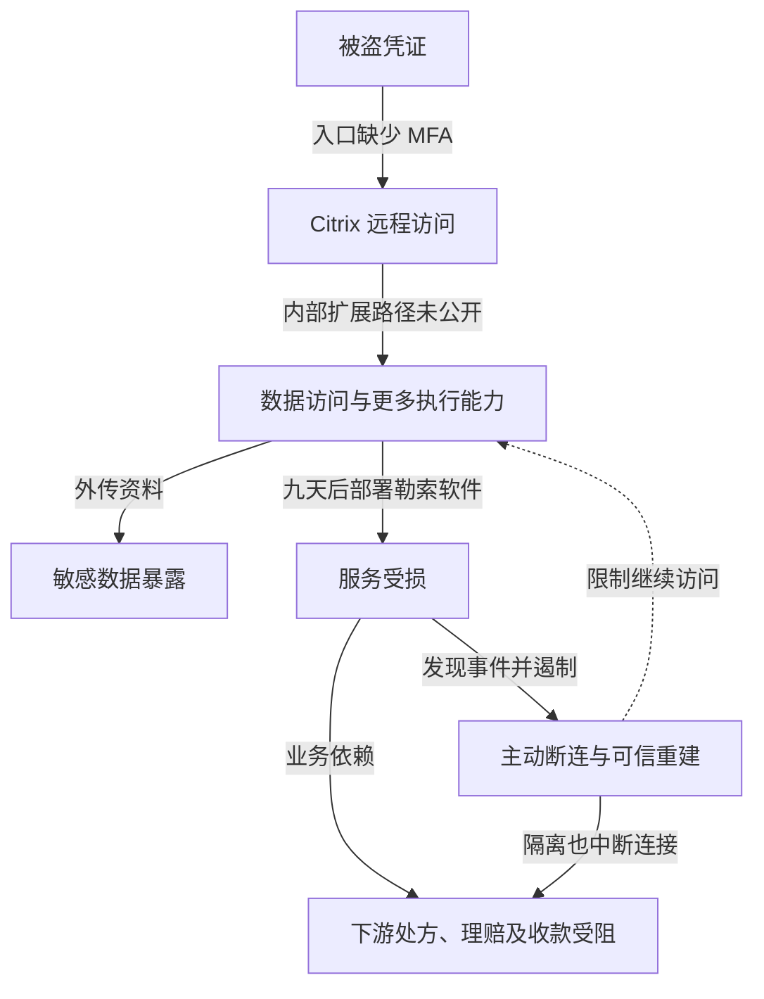

2024 年 2 月 21 日，Change Healthcare 发生勒索软件事件，其系统断连影响美国医疗机构处理处方、理赔和收款。很多下游机构不需要自己被感染，也会因共用服务停止而无法完成业务。只统计被加密的服务器，会漏掉对医疗服务与现金流的影响。

本文主要依据 UnitedHealth Group 首席执行官 Andrew Witty 在 [2024 年 5 月 1 日美国参议院听证会](https://www.govinfo.gov/content/pkg/CHRG-118shrg63595/html/CHRG-118shrg63595.htm)中的证词，辅以同场医疗服务方提交的材料。证词时完整受影响人数仍在核查，本文不把当时估计当作后来最终通知数字，也不根据公开信息补造内部横向移动细节。

## 从远程登录到窃取与加密

正常远程桌面入口应把员工带到获准的工作环境，再由目标服务判断权限。Witty 称，攻击者于 2 月 12 日使用被盗凭证访问 Change Healthcare 的 Citrix 入口，该入口没有 MFA。凭证最初怎样泄露，不能仅从“被盗”两字推定为钓鱼、终端恶意软件或密码复用中的某一种。

攻击者进入后继续横向移动、外传数据，九天后部署勒索软件。这说明进入与造成大范围中断之间存在进一步取得能力的过程，但公开证词没有提供足以逐台还原主机、权限和任务的完整记录。把未知路径标注出来，比画出一条想象中的域管理员攻击链更准确。

企业随后断开受影响系统，以限制继续伤害。下游医院、诊所和药房依赖这些接口处理业务，因此既受恶意加密影响，也受防守方主动隔离影响。主动断连可能是必要遏制措施，其业务代价仍应纳入应急准备，而不应事后全部归为直接恶意破坏。

攻击者取得的施压力来自两类资产：可被泄露的敏感数据，以及依赖集中服务的业务可用性。即使有备份，重新建立可信交易连接、完成对账并处理积压，也不一定与恢复服务器同步完成。

下图保留内部扩展路径未知，以及主动断连的业务影响。图可横向滚动。

实线区分已披露行为与业务影响，未公开的中间过程写在连线上；虚线只表示遏制对象。下游中断不代表所有医疗机构终端被攻破。

对于相似环境，可关联远程登录后的身份扩展、大量敏感读取、批量执行和恢复配置变更。公开证词不足以证明当时哪项告警出现或未出现，因此不能据这九天直接计算安全团队发现后的处置时延。

## 入口缺失 MFA 是明确原因，但不是完整解释

第一道突破已有直接证词支持：有效密码足以进入关键远程入口。强认证可以提高这道边界，但组织还需要证明全部入口、备用访问与恢复流程都受保护，而不是只证明集团存在 MFA 制度。应列出真实入口、备用地址、远程桌面网关及帮助台恢复途径，用实际测试证明策略覆盖，不以采购覆盖率代替。并购、迁移与例外系统也应逐项验证，不能把组织级标准当作每个端点的实际状态。

第二道突破是一次远程会话后还能取得更多数据和执行能力。其内部权限扩展的原因尚未完全公开，但相似系统可以按“远程工作环境已失陷”验收，限制临床业务、支付处理、批量数据导出及基础设施管理之间的能力连接。授权、管理与备份不能共用一套可被单个会话控制的信任根。

第三道突破是关键交易集中依赖少量平台。网络分段只能限制恶意代码传播，不能自动让医院在平台主动断连后继续收款。机构需要提前验证替代理赔通道、药房处理与人工降级所需数据、权限、合同和容量；临时决定换供应商，可能受接口、资质和商业条款约束。备用通道若仍依赖同一身份、目录或交易中转服务，也会一起失效；演练应检查其独立依赖、可用容量和重放防重机制。

## 把安全恢复与医疗、资金恢复同时验收

| 负责方与演练情境 | 需要交付的证据 |
| --- | --- |
| 身份团队：已知密码泄露 | 每个实际远程入口和恢复路径不能仅凭该密码进入 |
| 平台团队：远程会话已被控制 | 不能直接批量导出资料、部署加密程序或删除恢复副本 |
| 业务与财务负责人：主要中转平台完全不可用 | 替代通道能完成实际测试交易，积压、重复和拒付可对账 |

业务负责人应确定最长可容忍中断、最低服务能力和应急现金安排，不能只向技术团队索要“系统什么时候恢复”。应急通道可能成本更高或吞吐更低，需要在平时确认容量和启用条件。

付款、系统重建、数据通知与业务恢复分别报告。支付赎金不能证明所有副本已删除，也不能证明入侵者权限已经清除。新环境恢复后仍需验证残余身份、旧连接和交易数据一致性；能够登录或收到一笔测试请求，并不等于整个医疗支付流程已经恢复。验收应分别记录可信环境准入、请求提交与回执、理赔结算、积压消化和实际到账，由安全、平台及业务财务负责人分别确认。

## 资料与核验入口

- [美国参议院财政委员会听证记录：2024 年 5 月 1 日](https://www.govinfo.gov/content/pkg/CHRG-118shrg63595/html/CHRG-118shrg63595.htm)，检索 February 12th、multifactor、9 days，并区分公司证词、议员评价与医疗服务方提交材料。
