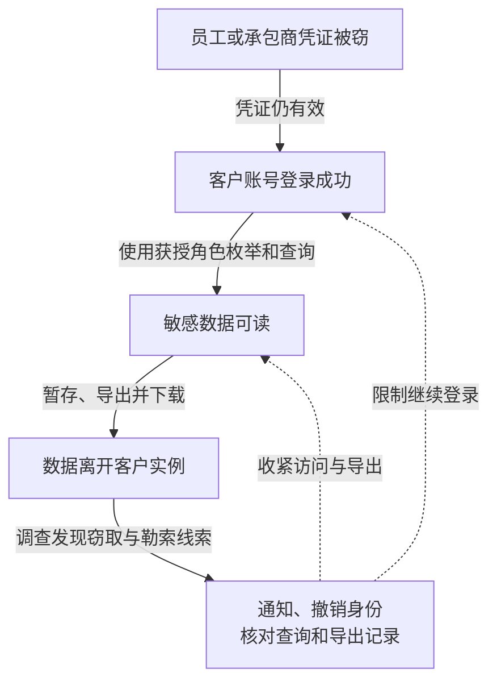

2024 年，Mandiant 调查发现，UNC5537 使用此前被窃的客户凭证访问多个 Snowflake 数据实例并窃取资料。截至其 6 月报告，Mandiant 与 Snowflake 已通知约 165 家可能暴露的组织；通知数量不能直接当作全部已经确认入侵或数据外传的客户数量。

[Mandiant 的调查](https://cloud.google.com/blog/topics/threat-intelligence/unc5537-snowflake-data-theft-extortion)没有发现本次客户账号未授权访问来自 Snowflake 企业环境失陷的证据，其直接响应的相关事件均追溯到客户凭证泄露。这一结论限定于报告的调查范围，不等于证明平台所有其他风险不存在。

## 攻击者先拿到可用身份，再调用正常数据库功能

Snowflake 是供企业集中分析数据的云平台。正常用户经认证后，在所获角色权限内查询数据；管理员还可以配置导出等能力。攻击者不一定需要利用数据库软件漏洞，合法身份及足够的数据权限就能成为窃取入口。

调查中的凭证主要来自终端窃密恶意软件。部分泄露发生在承包商设备，设备还用于个人活动且缺少组织监测。攻击者可以购买或收集旧凭证，尝试在客户实例登录。Mandiant 发现所用凭证中有与 2020 年感染相关的材料；时间久不自动等于已失效。报告中至少 79.7% 有既往凭证暴露证据的统计，分母是该活动中攻击者使用的账号，不是全体 Snowflake 客户或全部被通知组织。

报告指出三项促成条件：受影响账号没有启用 MFA，部分旧凭证没有轮换，实例没有配置仅允许可信来源访问的网络策略。它们解释了当时观察到的登录成功，不代表所有 Snowflake 客户都采用同样配置，也不是对平台当前默认设置的说明。

进入后，攻击者用数据库客户端和脚本枚举数据，再创建临时文件暂存位置，通过 `COPY INTO` 导出并压缩结果，随后下载。创建暂存位置说明准备，导出语句说明生成文件，下载记录才支持相应文件已经传出；查询结果也可能通过其他接口取走。这些功能本来支持分析与数据交换；恶意性来自使用者、业务用途、对象和访问规模，而不能仅靠出现某个客户端名称判定。

下图连接身份泄露与数据导出两道边界。图可横向滚动。

实线表示报告支持的活动路径，虚线表示响应作用。平台本身被攻破没有被作为这条链的前提。

## 登录保护不能代替数据用途授权

第一处突破是外部终端泄露的身份还能进入企业数据平台。人类交互账号应采用适合风险的强认证与受管访问环境；承包商账号要有期限、资源范围和退出机制。不能只在公司内部终端部署检测，却让第三方个人设备取得同等长期访问。

第二处突破是账号登录后拥有足够大的数据范围。分析岗位不总需要原始全量个人数据，可按任务提供脱敏视图、行列限制或隔离数据产品。数据负责人应解释谁确实需要原始数据，不能把业务分析便利直接变成所有表的读取许可。调整视图和导出权限后，应让业务用户运行代表性分析任务，确认结果仍满足用途，并给临时全量分析设置独立批准、期限与留证要求。

第三处突破是读取与大规模导出容易共处。按业务区分交互查询和批量传输身份，限制暂存、外部目标和导出规模，可以让被控普通账号不能独立搬走全库。但只禁止某个导出命令不足以阻止逐批查询取数，因此仍需按主体、数据量和时间窗口监测读取行为。

调查应把登录、角色使用、目标表、查询历史、导出与下载时间关联起来。来源地址或 DBeaver 等客户端名称只能提供线索；代理、合法自动化与正常分析都会影响判断，应结合批准任务及累计数据范围。

## 针对已泄露密码和有效会话分别测试

| 负责人和情境 | 验收对象 |
| --- | --- |
| 身份团队：历史密码被攻击者持有 | 不能从未获准环境完成登录，恢复流程也不能绕过保护 |
| 数据团队：一个分析账号失陷 | 不能跨业务域读取未经批准的敏感原始表 |
| 平台与安全团队：账号查询行为看似正常 | 能识别异常累计读取、暂存和下载，联动限制并保留调查记录 |

轮换密码后还需要核对会话、服务身份及其他长期凭证是否继续有效，按实际认证方式撤销。服务账户不能机械套用人员手机验证，可以采用短期工作负载身份、受限密钥与来源约束。谁维护这些身份、何时失效、如何监测，应由平台团队明确负责。来源允许列表只能限制连接位置；若允许的跳板或终端已被控制，仍需依赖任务和数据权限限制，不能把网络位置当作完整授权。

已下载的数据不能通过封禁账号追回。恢复安全访问与确认被窃表、字段、时间范围是两条工作线，通知和业务处置应依据后者。上述设计是针对相似系统的建议，不代表报告已证明每家受害方缺少全部控制。

## 资料与核验入口

- [Mandiant：UNC5537 针对 Snowflake 客户实例的调查](https://cloud.google.com/blog/topics/threat-intelligence/unc5537-snowflake-data-theft-extortion)，重点核对 Campaign Overview、Credential Exposure 与 Data Exfiltration 部分，日志与命令示例是行为线索，不是单独定案依据。
