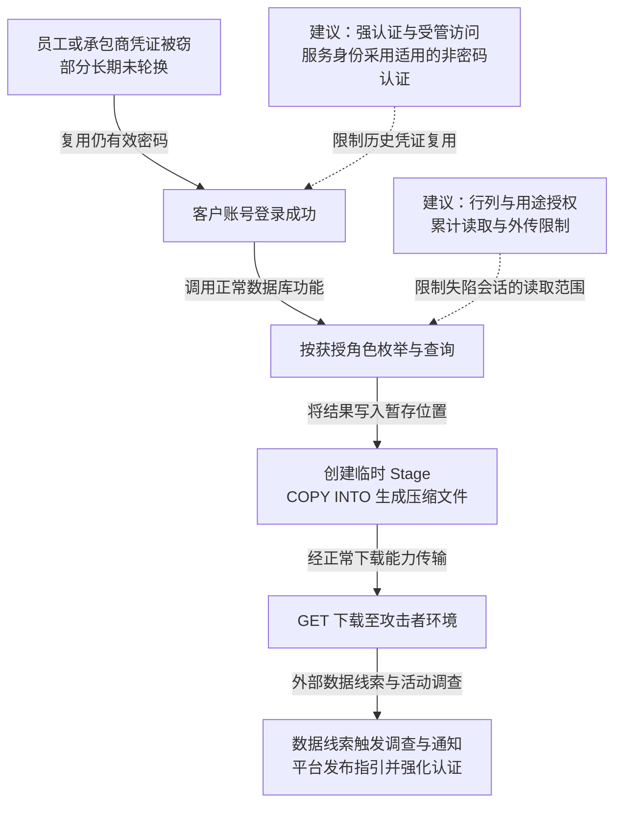

2024 年，Mandiant 追踪为 UNC5537 的攻击者利用窃密软件此前盗取且仍有效的客户凭证，登录多个 Snowflake 客户实例，再用正常查询、暂存和下载功能窃取数据并勒索。受调查账号缺少 MFA，部分旧凭证未轮换，也没有限定可信来源的网络策略。截至 6 月，Mandiant 与平台已通知约 165 家可能暴露的组织；调查将相关入侵追溯到客户凭证泄露。平台随后发布检测指引并逐步强化认证要求。[Mandiant 原始调查](https://cloud.google.com/blog/topics/threat-intelligence/unc5537-snowflake-data-theft-extortion)给出了活动范围和技术记录。

## 攻击经过

### 历史窃密记录重新成为可用的数据平台身份

Snowflake 用于企业数据分析，用户认证后可在所获角色内查询和导出。UNC5537 收集或购买终端窃密记录，尝试用其中的凭证登录客户实例。部分记录来自承包商设备；调查发现，攻击者使用的账号中至少 79.7% 存在既往凭证暴露证据，有些材料与 2020 年的感染相关。

旧密码继续有效、缺少 MFA 和来源限制，使历史终端泄露跨过了当前数据平台的认证边界。攻击者无需先攻破 Snowflake 企业环境，便能以客户账号的身份使用数据库功能。

### 使用角色枚举表，再把查询结果写入暂存位置

Mandiant 观察到攻击者使用数据库客户端与脚本枚举数据，执行 `SHOW TABLES` 和 `SELECT`，再创建临时 Stage。Stage 是用于存放导入、导出文件的暂存位置。

随后，攻击者用 `COPY INTO` 将目标表的查询结果写入暂存位置，采用 GZIP 压缩，再用 `GET` 下载到攻击者控制的本地目录。权限转换发生在账号登录之后：角色原本被允许读取的数据及创建输出文件的能力，被用于系统化搬取资料。

### 导出与查询返回都可以构成取数路径

报告展示的内部暂存、导出、下载是一条观察到的路径。按照 [COPY INTO 官方说明](https://docs.snowflake.com/en/sql-reference/sql/copy-into-location)，数据也可以直接写到获准的外部存储；一般查询返回本身同样能传回数据。

因此，调查需将登录主体、角色、目标表、查询标识与执行状态，关联到实际输出对象和传输记录。[QUERY_HISTORY](https://docs.snowflake.com/en/sql-reference/account-usage/query_history)提供查询时间、状态与身份等依据，下载和外部写入还需结合相应结果及访问记录。临时 Stage 会随会话结束消失，相关证据需要及时保全。

### 发现数据线索后，调查扩展到潜在受害方

Mandiant 在 4 月收到数据线索并受聘调查一名受害方，5 月 22 日因发现更广活动联系 Snowflake、启动潜在受害方通知，5 月 30 日平台发布检测与加固指引。约 165 家组织是当时通知的潜在暴露范围。

Snowflake 在 [2024 年 9 月公告](https://www.snowflake.com/en/blog/multi-factor-identification-default/)中宣布，从 10 月起新建账号内的人类用户默认强制 MFA。后续[单因素密码退出安排](https://docs.snowflake.com/en/user-guide/security-mfa-rollout)把人类密码登录和非人类服务账号分开处理，2026 年全量阶段按账号滚动实施，并允许部分延期与例外账号类型。

下图将身份复用和数据输出分开；虚线为本文建议，可横向滚动。

## 关键突破、成因与防护

### 终端泄露的旧密码仍能换取新的平台会话

强认证、泄露凭证轮换与可信来源限制，可以直接降低历史密码被重用的机会。承包商访问也需要有期限、设备约束与退出机制，避免个人设备上的长期秘密持续通向企业数据。

服务账号不能依赖人工手机确认，可采用适用的工作负载身份、密钥对或受限令牌，并限制签发、使用位置和有效期。允许列表只能约束连接来源，获准跳板已经失陷时仍需依靠数据授权。撤销密码之外，还要处理已建立会话与其他认证材料，避免入口加固后继续保留既有访问。

### 分析身份可以读取远超当前任务的原始资料

数据库接受的是获授角色，无法从一次正常 `SELECT` 自动判断用途是否合理。普通分析岗位若能读取大量原始个人信息，一次账号失陷就拥有相同的查询范围。

可按任务提供脱敏视图、行列限制或隔离数据产品，将原始数据访问与普通分析身份分开。授权在数据库或独立数据服务执行，策略修改与提权由另外的受保护身份批准。仅在客户端要求填写工单，无法限制攻击者换用脚本查询。需要原始批量数据的作业，可以取得限定对象、用途与时段的授权，避免所有交互用户长期持有同等能力。

### 禁止一个导出命令，仍会留下其他读取通道

限制外部目标、Stage 与批量传输身份，可以收紧报告中的导出链；但账号若仍可逐批查询全表，就保留了另一条搬取路径。

应按主体、数据域与时间窗口累计读取量，结合敏感表访问、角色变化和导出目标设置可暂停的限制。正常批处理需要独立批准与资源范围，攻击者不能通过拆分小查询或创建新会话不断重置额度。客户端名称、VPN 地址可作为线索，最终仍应关联实际数据范围与任务依据。登录保护限制进入，数据策略限制会话已有能力，两者共同决定凭证泄露后的后果。

## 参考资料

- [Mandiant：UNC5537 针对 Snowflake 客户实例的调查](https://cloud.google.com/blog/topics/threat-intelligence/unc5537-snowflake-data-theft-extortion)。
- [Snowflake：QUERY_HISTORY](https://docs.snowflake.com/en/sql-reference/account-usage/query_history)与 [COPY INTO location](https://docs.snowflake.com/en/sql-reference/sql/copy-into-location)。
- [Snowflake：2024 年默认 MFA 公告](https://www.snowflake.com/en/blog/multi-factor-identification-default/)与[单因素密码退出安排](https://docs.snowflake.com/en/user-guide/security-mfa-rollout)。
