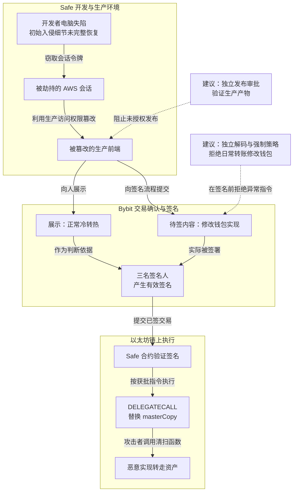

2025 年 2 月 21 日，Bybit 操作人员准备从一个以太坊冷钱包向热钱包调拨资产。这原本是一次日常操作：热钱包处理用户提款，余额不足时，再从冷钱包补充。

三名签名人按照流程确认了交易。随后发生的却不是预期转账，而是钱包执行逻辑被替换，攻击者继而转走其中的资产。

[Bybit 公告](https://announcements.bybit.com/en/article/incident-update---eth-cold-wallet-incident-blt292c0454d26e9140/)称，超过 40 万枚 ETH 及质押衍生资产被转走，价值超过 14 亿美元。[FBI 在 2 月 26 日的公告](https://www.ic3.gov/PSA/2025/PSA250226)中采用约 15 亿美元的估值，并将攻击归因于朝鲜 TraderTraitor。两份公告的披露时间和金额口径不同，这里分别保留。

攻击的关键是：**签名人看到的是正常转账，实际签署的内容却允许攻击者修改钱包。** 三份签名都有效，但它们没有代表签名人真正想做的事。

## 冷钱包、多签和网页分别保护什么

理解这次攻击，需要先区分三个环节。

冷钱包强调减少密钥日常暴露的机会，但每次转账仍然需要生成交易、核对内容并签名。如果这些步骤依赖联网电脑和网页，冷钱包的操作过程就仍然存在在线攻击面。

多签是多个密钥共同批准一笔交易。Bybit 使用的 Safe 是智能合约钱包：链上合约检查签名是否来自规定的密钥、数量是否达到门槛，再决定是否执行。它能够验证“这些密钥是否同意”，但无法知道签名人心里想批准什么。

网页则负责把操作转换为待签交易，并向人解释交易内容。网页显示“向热钱包转账”，不意味着交给签名设备的机器指令一定只做这件事。

硬件钱包可以保护私钥不离开设备，但如果设备不能清楚解释复杂合约调用，签名人仍可能依靠网页判断交易用途。本案正是利用了这处依赖。

## 攻击者先控制网页，再让签名人批准恶意指令

Safe 与 Mandiant 在 2025 年 3 月 6 日发布的[初步调查更新](https://x.com/safe/status/1897663514975649938)指出，攻击者控制了一名 Safe 开发者的电脑，并劫持其 AWS 会话令牌，进入云端环境。

会话令牌可以理解为登录后取得的访问凭证。攻击者窃取它后，能够利用已经通过验证的会话，不必重新输入密码或完成多因素认证。

攻击者随后篡改了 Safe 生产前端，也就是用户浏览器实际加载的页面程序。恶意逻辑针对 Bybit 的钱包和特定交易条件触发，使普通访问不容易暴露异常。

下图要说明的是：一个第三方开发者环境失陷，怎样经过网页和合法签名，最终变成链上的资产控制权。图可横向滚动。

实线表示调查与链上分析描述的攻击路径；虚线表示本文建议的阻断位置，不代表事发时已有这些控制。初始入侵方式没有在图中补全。云会话与环境失陷依据 Safe 初步调查，链上实现变更依据 [CertiK 技术分析](https://www.certik.com/resources/blog/bybit-incident-technical-analysis)。

Safe 表示其智能合约未受此次入侵影响。这不等于整个钱包系统没有安全问题：即使链上合约按设计执行，用户赖以理解交易的页面仍可能被修改。代码审查也不能单独证明用户实际加载的生产页面与审查版本一致。

这份调查当时仍属初步结论，部分入侵痕迹已被攻击者清除，不能把尚未恢复的初始接触细节写成定论。

## 为什么一次“转账”能改掉整个钱包

普通转账改变的是资产归属；这笔恶意交易先改变了负责执行钱包操作的代码。

Safe 使用代理合约结构。可以把它分成两部分理解：代理保留钱包地址和存储状态，实现合约提供处理操作的代码。代理通过一个名为 `masterCopy` 的地址找到实现合约。

因此，替换 `masterCopy` 后，钱包地址可以保持不变，但后续操作会交给另一套代码处理。

[CertiK 对控制权变更交易的分析](https://www.certik.com/resources/blog/bybit-incident-technical-analysis)显示，恶意交易外层仍是 Safe 正常使用的 `execTransaction`，并携带三份有效签名。关键异常在参数 `operation = 1`：

| 参数 | 执行含义 |
| --- | --- |
| `operation = 0`，即 `CALL` | 通常由被调用合约使用自己的存储执行 |
| `operation = 1`，即 `DELEGATECALL` | 借用外部合约的代码，在 Safe 代理自己的上下文中执行 |

这里危险的是第二种：外部代码获得了修改 Safe 代理存储的机会。

攻击合约借此修改存储槽 0，也就是代理保存 `masterCopy` 的位置，让它指向攻击者准备的恶意实现。之后，攻击者调用恶意实现中的 `sweepETH`、`sweepERC20` 等清扫函数，转走 ETH 和代币。

对应交易为：

[`0x46deef0f52e3a983b67abf4714448a41dd7ffd6d32d32da69d62081c68ad7882`](https://etherscan.io/tx/0x46deef0f52e3a983b67abf4714448a41dd7ffd6d32d32da69d62081c68ad7882)

`DELEGATECALL` 本身是合法机制，代理钱包也需要使用它。问题在于，一次用途明确的冷转热操作，竟能让签名人批准任意外部代码，并由这段代码改写钱包实现。

签名验证通过，只能说明三把合法密钥批准了这笔交易，无法证明这笔交易符合“向热钱包补充资产”的用途。

## 三个人为什么没有形成三道防线

多签可以防止单个密钥被盗后直接支配资产，但本案没有要求攻击者先拿到三个私钥。攻击者只需要影响三个人共同依赖的交易说明。

三名签名人分别保管密钥，却通过同一套前端理解交易。如果网页把恶意指令解释成正常转账，三个人可能分别认真检查，最后仍批准同一份错误内容。

硬件钱包也面临类似边界。保护私钥是一项能力，把复杂合约调用解释清楚是另一项能力。签名人真正需要知道的是“这次操作会替换钱包实现”，而不是只看到一个地址、一个哈希，或一段无法理解的调用数据。

哈希可以用来确认两处拿到的是同一份交易，却不能自行解释交易用途。如果预期哈希也来自被篡改的网页，单纯对照哈希仍没有增加独立性。

因此，不能把防护要求停留在“增加签名人”或“请仔细检查”。系统需要提供独立生成的交易解释，并强制限制日常转账可以做什么。

## 恢复环境之后，还要改变哪些规则

Safe 在初步调查更新中列出了重建基础设施、轮换凭证和密钥、更换开发设备、收紧服务访问、清理待处理交易，以及加强日志和恶意交易检测等措施。它还与 Blockaid 合作标记 Safe 实现变更，并提供社区开发的 Safe Utils，帮助独立核对交易哈希；完整 IPFS 托管当时仍是推进中的选项。

这些措施处理了已知入侵，并增加了发现异常的机会。接下来需要验证的是：同类上游组件再次失陷时，攻击者还能走多远。

### 发布权限不能跟着一台电脑一起失守

开发者电脑上的一个活跃会话，不应足以独立替换生产签名页面。

发布应经过独立审批，由受保护的构建系统生成产物，并提供可验证的签名和记录。验证生产内容的工具也需要有独立的信任来源；如果页面程序和校验程序都能被同一个云会话替换，校验仍可能一起失效。

内容寻址能够确认加载的是某份确定内容，但“内容确定”与“内容经过授权”是两回事。选择版本和发布入口的权限仍要受到保护。

### 日常转账只能做日常转账

对于固定冷钱包向固定热钱包补充资产的场景，允许的操作范围通常很窄。可以预先约束收款地址、资产、金额、调用方法和时间窗口，并拒绝：

- 使用日常流程执行未经允许的 `DELEGATECALL`；
- 修改 `masterCopy` 等钱包实现地址；
- 向白名单之外的地址转账；
- 超出单笔或累计限额；
- 在一次操作中同时改变权限并转移资产。

这些约束需要由独立策略执行，不能只作为网页上的风险提示。对于确实需要 `DELEGATECALL` 的合法工具，也应限定经过审查的目标、代码和用途，而不是开放任意调用。

钱包升级则应进入另一套审批流程，核验新代码、明确生效时间，并设置延迟。延迟和限制必须覆盖钱包实际执行的路径；如果替换实现就能绕过它们，保护便没有成立。

### 签名人需要独立生成的交易说明

至少一个核验工具应独立读取原始交易和链上状态，明确告诉签名人：

> 这笔交易是否只会把指定资产转给指定热钱包？它是否会改变钱包代码、权限或其他状态？

工具应使用不同于签名页面的发布权限和运行环境，并把解释结果绑定到最终待签交易。仅仅另开一个页面，或者从同一服务重新取一遍数据，不能保证独立。

对于高价值操作，还应结合独立解码、执行模拟和允许范围检查。模拟结果依赖输入与链上状态，也需要说明其适用条件。

### 单个钱包失陷不能带走全部储备

资产可以按钱包、资产类型和控制权限分散，避免一次实现变更影响过大的资产范围。不同钱包如果仍依赖完全相同的签名界面和审批来源，也可能一起受骗，分散地址并不自动等于分散风险。

限额和延迟同样需要覆盖所有可转出资产的路径。如果只限制正常转账，却允许升级实现后绕过限制，攻击者仍能先改规则、再转走资产。

## 怎样检查这些措施是否真的有效

可以在隔离测试网中准备一次正常的冷转热操作，再分别模拟网页被篡改、开发者云会话被盗、待签交易被替换，检查三个结果：

| 测试条件 | 应验证的结果 |
| --- | --- |
| 网页显示正常转账，实际提交实现变更 | 独立工具识别差异，强制策略在签名前拒绝 |
| 攻击者取得开发者活跃云会话 | 无法单独发布或替换受信生产内容 |
| 一个钱包或一组审批人员被控制 | 其他资产边界、限额和延迟仍然有效 |

还需要演练撤销：停止协调服务、清理其队列和撤销云会话，不会自动使已签名、已广播或已生效的链上操作失效。应分别确认哪些交易仍能执行，以及有哪些取消、替换或迁移手段。

这些是防护验收建议，不代表 Bybit 或 Safe 已公开完成全部测试。核心问题只有一个：

> 当一个网页、一台开发者电脑或一个云会话已经被控制时，未经授权的钱包变更和大额转账，是否仍会成功？

## 与币安热钱包文章的对照

本站的[币安热钱包事件分析](./2026-币安热钱包63亿美金被盗安全事件分析.md)讨论了员工终端、部署凭证、提款和签名服务之间的权限传播。本篇保留这一对照，但币安部分以该文所述材料为限，不作为本次重新独立核验的事件结论。

两篇文章关注的路径不同：Bybit 案例中，攻击者通过第三方钱包前端影响人工签名；币安文章讨论的则是内部系统权限如何通向钱包签名服务。

可以共同检验的设计问题是：上游提供了一笔看起来合法的请求之后，资产系统是否还有独立约束，确认它只会完成获批的业务操作。

Bybit 的三份签名证明了密钥确实参与授权，却没有证明签名人看到了真实的交易含义。要防住同类攻击，必须让“只能向指定热钱包调拨资产”成为系统可执行的规则，而不是只存在于网页说明和操作人员的预期中。

## 参考资料

- [Bybit：Incident Update - ETH Cold Wallet Incident](https://announcements.bybit.com/en/article/incident-update---eth-cold-wallet-incident-blt292c0454d26e9140/)
- [FBI：North Korea Responsible for $1.5 Billion Bybit Hack](https://www.ic3.gov/PSA/2025/PSA250226)
- [Safe：Investigation Updates and Community Call to Action（初步调查更新）](https://x.com/safe/status/1897663514975649938)
- [CertiK：Bybit Incident Technical Analysis](https://www.certik.com/resources/blog/bybit-incident-technical-analysis)
- [Etherscan：Safe 控制权变更交易](https://etherscan.io/tx/0x46deef0f52e3a983b67abf4714448a41dd7ffd6d32d32da69d62081c68ad7882)
