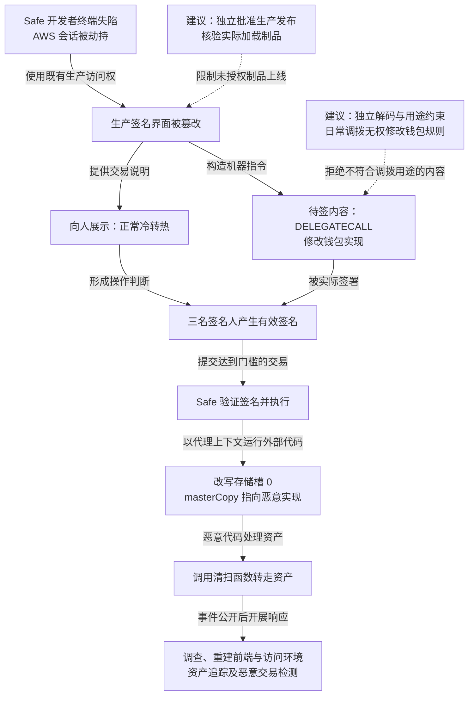

2025 年 2 月 21 日，Bybit 从以太坊冷钱包向热钱包调拨资产时，攻击者通过被篡改的 Safe 签名界面，让三名签名人看到正常转账，却批准了改变钱包实现的恶意交易，随后转走约 15 亿美元资产。调查将上游路径追至 Safe 开发者终端及 AWS 会话失陷；FBI 于 2 月 26 日将攻击归因于朝鲜 TraderTraitor。Safe 后续重建基础设施、轮换凭据并强化交易检测。[Bybit 公告](https://announcements.bybit.com/en/article/incident-update---eth-cold-wallet-incident-blt292c0454d26e9140/)采用超过 14 亿美元估值，[FBI 通报](https://www.ic3.gov/PSA/2025/PSA250226)采用约 15 亿美元，本文标题沿用后者口径。

## 攻击经过

### 冷钱包的密钥仍需依赖在线交易构造

Safe 是智能合约钱包，多个签名达到门槛后，由链上合约执行交易。硬件设备保护私钥，网页则负责构造待签内容并向人解释其用途。

本次日常任务是向热钱包补充资产。冷钱包减少密钥日常暴露，但操作人员仍需通过联网界面取得交易信息。攻击者控制这一信息来源后，可以让展示内容与实际待签内容分离。

### 开发者云会话被借用，生产前端遭针对性修改

Safe 与 Mandiant 在 [2025 年 3 月 6 日初步调查更新](https://x.com/safe/status/1897663514975649938)中指出，开发者电脑失陷及 AWS 会话令牌被劫持，使攻击者取得生产环境访问。

会话令牌代表已经认证的访问状态，窃取它后可使用其剩余权限，不必再次完成原登录的密码和 MFA。攻击者随后修改浏览器实际加载的生产前端，针对 Bybit 钱包及相应条件触发恶意交易构造。

签名页面向人显示正常冷转热操作，向签名流程提交的却是修改钱包实现的指令。三名签名人基于同一被污染的交易说明，产生了三份有效签名。

### 有效签名批准 DELEGATECALL，改变代理实现

[CertiK 技术分析](https://www.certik.com/resources/blog/bybit-incident-technical-analysis)将关键步骤对应到[控制权变更交易](https://etherscan.io/tx/0x46deef0f52e3a983b67abf4714448a41dd7ffd6d32d32da69d62081c68ad7882)。外层仍调用 Safe 的 `execTransaction`，并满足签名验证，关键差异是 `operation = 1`。

| 调用方式 | 代码在哪个上下文中执行 |
| --- | --- |
| `CALL`，即 `operation = 0` | 目标合约使用自身的存储执行 |
| `DELEGATECALL`，即 `operation = 1` | 外部代码借用调用方的地址与存储上下文执行 |

Safe 代理保留钱包地址和状态，通过存储槽 0 中的 `masterCopy` 地址找到实现代码。恶意外部代码经 `DELEGATECALL` 运行时，可以修改 Safe 自己的存储，将 `masterCopy` 指向攻击者实现。

钱包地址没有改变，后续调用却交给了新代码。攻击者继而调用 `sweepETH`、`sweepERC20` 等函数转走 ETH 与代币。一次看似普通的调拨批准，先变成了钱包执行规则的变更，再变成资产转移。

### 上游环境重建，已生效的链上变更仍需单独处理

Safe 初步调查列出重建基础设施、轮换凭据与密钥、更换开发设备、收紧访问和清理待处理交易等动作，并与 Blockaid 合作标记实现变更，提供 Safe Utils 辅助独立核对交易哈希。完整 IPFS 托管当时仍处于推进阶段。

FBI 随后发布攻击归因及资产地址，呼吁相关服务限制被盗资产流转。生产前端恢复可以阻止继续构造同类恶意内容，但已签署授权、已广播交易和链上实现状态，需要沿各自执行条件处理。

下图将“人看到的内容”和“实际签署的内容”分开；虚线表示本文建议，可横向滚动。

## 关键突破、成因与防护

### 开发会话可以直接影响高价值签名界面

开发者终端与会话保护是直接措施，已签发会话还需要独立撤销。发布环节更应限制单一生产访问权能够替换什么内容，让构建产物、批准版本与用户实际加载的制品相互对应。

发布验证与前端托管不能都由同一被盗会话修改。内容寻址可以固定制品，但版本选择和发布入口仍需独立批准；攻击者若能把入口换到另一份恶意内容，哈希地址本身不会阻止发布。重建之后也需核对实际生产文件，避免只检查代码仓库。

### 多人保管密钥，却共同依赖同一份交易解释

三份有效签名证明密钥参与批准，无法证明操作人员看到了真实调用。硬件钱包不泄露私钥，也不自动保证复杂合约调用被完整解释。

至少一条核验路径应从原始待签交易和链上状态独立解码，明确调用目标、方法、资产变化及权限变化，并将结果绑定到最终签署的交易哈希。预期哈希如果也由同一页面生成，就没有增加独立依据。模拟还需核验使用的代码和状态，避免前端同时替换模拟输入、说明与待签内容。

### 日常调拨权限可以修改钱包执行规则

冷转热的允许范围通常可以限定为指定资产、收款地址、金额与时间窗口。签名侧或独立执行策略可以校验业务调拨依据，并拒绝借日常权限调用任意外部代码、修改实现或放宽限额。

确需升级和 `DELEGATECALL` 的场景，应单独核验目标代码与用途，将规则变更放进更高约束的流程，并根据业务设置延迟。限制需覆盖正常转账、批量调用及实现变更等实际资产路径；如果日常签名权限能够先移除保护或替换实现，再绕过额度，原限制仍无法控制最终损害。

### 实现变更保留在链上，上游停用不能自动撤销

停止协调服务或清理队列，可以限制未完成的正常流程，已签名交易却可能由外部提交，已生效实现更已成为钱包状态。应按 nonce、执行状态和合约规则判断哪些内容仍可执行，采取适用的取消、可信恢复或资产迁移。

分散储备、限制单个钱包暴露额，可以减少一次实现变更影响的资产。不同地址若仍由相同前端和审批来源控制，也需独立核验，避免一次页面失陷同时误导所有签名。独立工具、规则变更延迟和储备分区会增加操作成本，但能让调拨保持自动或半自动，同时收紧改变整个钱包规则的权限。

本案与[币安热钱包事件](./2026-币安热钱包63亿美金被盗安全事件分析.md)分别经过人工签名界面和内部签名服务，两者都需要资产侧独立核对获批用途与最终执行内容。

## 参考资料

- [Bybit：ETH 冷钱包事件公告](https://announcements.bybit.com/en/article/incident-update---eth-cold-wallet-incident-blt292c0454d26e9140/)。
- [FBI：Bybit 约 15 亿美元盗款归因](https://www.ic3.gov/PSA/2025/PSA250226)。
- [Safe：初步调查与社区更新](https://x.com/safe/status/1897663514975649938)。
- [CertiK：Bybit 交易与存储变更分析](https://www.certik.com/resources/blog/bybit-incident-technical-analysis)。
- [Etherscan：Safe 实现变更交易](https://etherscan.io/tx/0x46deef0f52e3a983b67abf4714448a41dd7ffd6d32d32da69d62081c68ad7882)。
