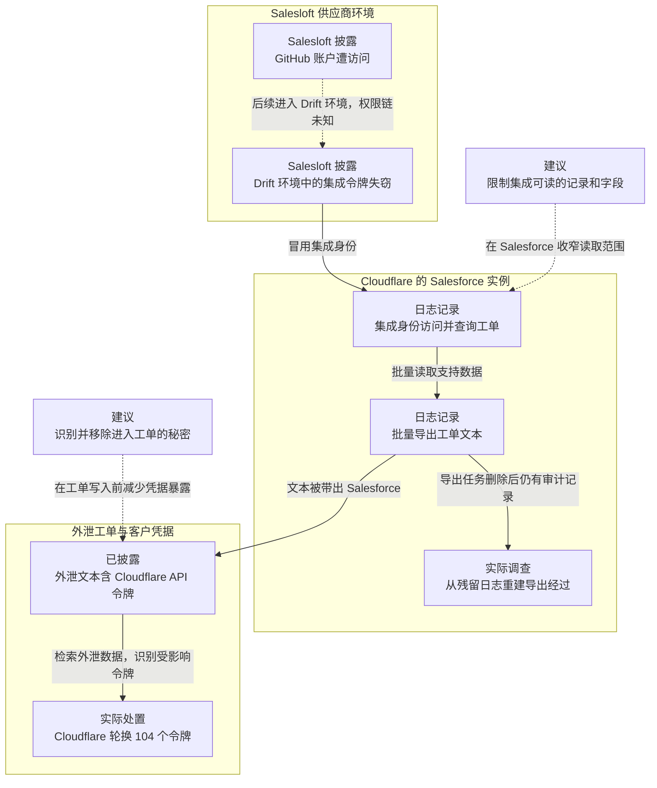

2025 年 8 月 17 日，攻击者使用从 Salesloft Drift 窃取的集成凭据，在三分多钟内从 Cloudflare 的 Salesforce 实例导出了客服工单文本。Cloudflare 从外泄数据中找到并轮换了 104 个 Cloudflare API 令牌。这个数字统计的是令牌。Cloudflare 表示未发现相关令牌被可疑使用，也未发现自身服务或基础设施因此失陷。[Cloudflare 复盘，2025-09-02](https://blog.cloudflare.com/response-to-salesloft-drift-incident/)

## 从 Drift 集成凭据失窃到工单外泄

Salesloft 公布的调查摘要称，攻击者在 2025 年 3 月至 6 月访问了其 GitHub 账户，随后进入 Drift 的 AWS 环境，取得客户集成的 OAuth 令牌。摘要没有说明攻击者最初如何取得 GitHub 访问凭据，也没有给出从 GitHub 进入 AWS 的具体权限链。[Salesloft 信任中心及 Mandiant 调查摘要](https://trust.salesloft.com/?uid=Drift%2FSalesforce+Security+Notification)

Google 威胁情报团队（GTIG）观察到，被其跟踪为 UNC6395 的攻击者至少在 8 月 8 日至 18 日使用被盗的 Drift 令牌访问多个组织的 Salesforce 实例，并在导出的数据中寻找凭据。8 月 28 日，GTIG 将通告范围扩展到少量已配置 Drift Email 集成的 Google Workspace 账户。[GTIG 技术通告，2025-08-26，含 08-28 更新](https://cloud.google.com/blog/topics/threat-intelligence/data-theft-salesforce-instances-via-salesloft-drift)

Cloudflare 原本用 Drift 接收网站访客的咨询，用 Salesforce 管理客服工单。Cloudflare 的日志显示，攻击者于 8 月 12 日开始使用被盗集成凭据访问其 Salesforce 实例，13 日开始检索工单数据，17 日通过 Salesforce Bulk API 2.0 集中导出工单文本。Cloudflare 确认导出的数据包括工单主题、往来文本和相关联系人信息，工单附件和文件未包含在这批导出中。[Cloudflare 复盘](https://blog.cloudflare.com/response-to-salesloft-drift-incident/)

实线表示公开材料记录的事件或处置。虚线标出了未公开的权限链和建议控制的位置。[Salesloft 调查摘要](https://trust.salesloft.com/?uid=Drift%2FSalesforce+Security+Notification) · [Cloudflare 复盘](https://blog.cloudflare.com/response-to-salesloft-drift-incident/)

## 聊天集成为什么能读到历史工单

OAuth 让第三方应用以获授的权限调用接口。用户在登录或授权时通过多因素认证后，应用通常可以在后台使用仍然有效的令牌，用户无需逐次批准。Cloudflare 的导出记录表明，涉事集成身份当时有权读取历史支持数据。公开材料没有列出当时完整的 OAuth 授权范围、集成用户权限集和共享规则。GTIG 将事件归因于第三方集成凭据被盗用，排除了 Salesforce 核心平台漏洞。[Cloudflare 复盘](https://blog.cloudflare.com/response-to-salesloft-drift-incident/) · [GTIG 技术通告](https://cloud.google.com/blog/topics/threat-intelligence/data-theft-salesforce-instances-via-salesloft-drift)

防护应从聊天工具实际需要读取的数据出发。允许创建工单的集成，未必需要读取既往工单及其对话全文。检查 Connected App 的 OAuth 授权范围时，还应核对集成身份实际可读的对象、记录和字段，以及哪些来源网络获准使用该身份。验收以 Salesforce 对超范围请求的拒绝结果为准。若业务确实需要读取历史记录，可以按团队或业务范围隔离访问，减少单个集成能接触的工单数量。[GTIG 防护建议](https://cloud.google.com/blog/topics/threat-intelligence/data-theft-salesforce-instances-via-salesloft-drift)

## 导出任务被删后，日志仍能划定影响范围

Cloudflare 的日志记录了 8 月 17 日 11:11:56 至 11:15:18 UTC 的批量导出，以及 11:15:42 的任务删除。残留日志让调查人员得以重建经过。Salesloft 于 8 月 20 日撤销客户的 Drift 到 Salesforce 连接，Cloudflare 于 23 日收到通知，25 日扩大调查和整改。通知到达时，工单数据已经外泄。公开复盘没有给出事发时的检测规则，无法判断为何未能更早发现。[Cloudflare 复盘](https://blog.cloudflare.com/response-to-salesloft-drift-incident/)

对于日常读取量小的集成，可以将对象访问范围突然扩大和批量读取量异常放在一起告警，并把访问日志保留在导出任务之外。这样既能在任务删除后追查哪些数据被读取，也能让值班人员依据访问异常判断是否应尽早暂停集成。告警能否在导出完成前触发，还取决于日志延迟和处置速度。[GTIG 检测建议](https://cloud.google.com/blog/topics/threat-intelligence/data-theft-salesforce-instances-via-salesloft-drift)

## 断开 Drift 后，客户凭据仍需逐项撤销

排障时贴进工单的日志或请求信息，可能夹带仍能访问客户系统的授权材料。GTIG 观察到攻击者在外泄数据中寻找 AWS 密钥、密码和 Snowflake 相关令牌。Cloudflare 从外泄文本中找到的 104 个平台 API 令牌，说明凭据也会出现在工单正文里。客服资料中的凭据暴露也见于另一种载体，即 Okta 客服系统中的排障附件。[GTIG 技术通告](https://cloud.google.com/blog/topics/threat-intelligence/data-theft-salesforce-instances-via-salesloft-drift) · [Cloudflare 复盘](https://blog.cloudflare.com/response-to-salesloft-drift-incident/) · [Okta 客服系统案例](/okta-support-session-theft-incident)

Cloudflare 禁用了 Drift 用户，撤销相关客户端凭据，断开 Salesforce 第三方集成并轮换凭据，于 9 月 2 日通过邮件和控制台通知受影响客户。Salesloft 随后披露了凭据轮换、GitHub 访问加固和权限审查等措施。撤销 Drift 的访问可以阻止后续读取。工单中已暴露的凭据由各自的资源系统验证，需要分别撤销并核对使用记录。以短时、限范围的诊断授权代替长期密钥，并在工单保存前识别和移除秘密，可以减少下一次外泄带来的凭据暴露。[Cloudflare 复盘](https://blog.cloudflare.com/response-to-salesloft-drift-incident/) · [Salesloft 调查摘要](https://trust.salesloft.com/?uid=Drift%2FSalesforce+Security+Notification)
