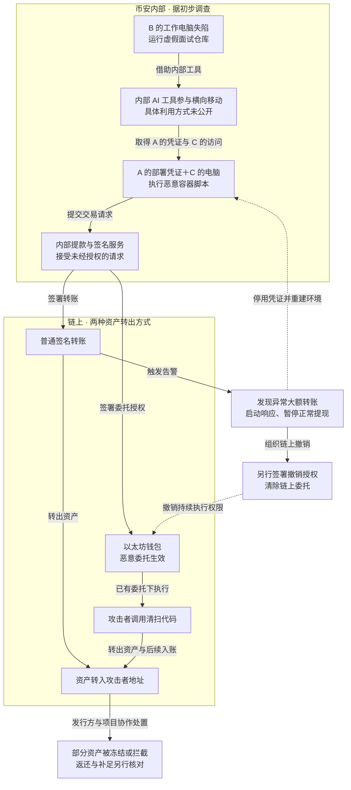
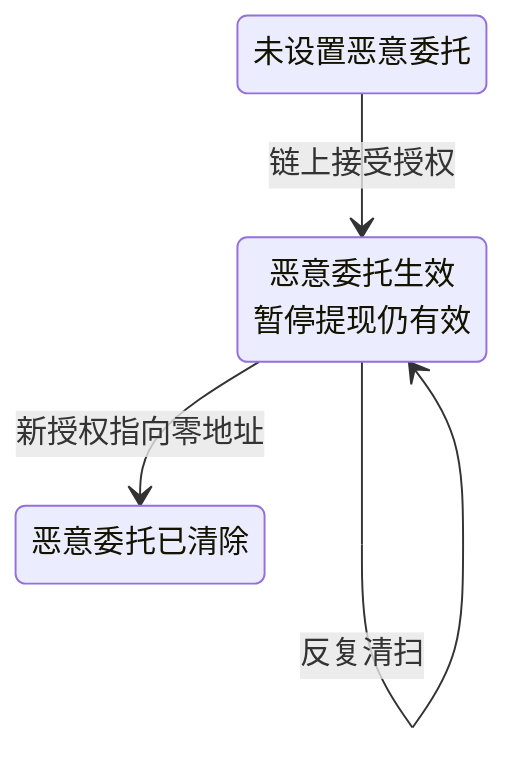

2026 年 10 月 29 日，币安多个热钱包发生未经授权的资产转出。[币安 11 月 3 日的初步调查](https://www.binance.com/en/blog/community/3229153443759566763)称，受影响的数字资产约为 63.4 亿美元，尚未发现钱包私钥泄露的证据。

币安称将承担资金损失，并已预留足额资金补足用户资产。补足用户缺口、冻结被盗资产和追回资金是不同结果，不能据此认为损失已经消失。本文使用的材料也不足以确定完整的业务中断时长或最终净损失。

热钱包在线处理日常提款等业务，内部服务提交交易，签名系统为获准内容签名。站在攻击者一侧，取得私钥只是可能的路线之一；能让现有系统替自己签署恶意内容，同样可以转走资产。本案还进一步将签名变成持续有效的链上委托，使正常提现入口关闭后仍有资产转出能力。

下面先重走这条能力获取路径，再分析四个关键突破口：外部代码进入工作环境、内部访问扩展到生产部署、部署执行触达资金签名，以及链上权限脱离平台入口继续生效。内部经过依据币安 11 月 3 日初报，链上机制结合公开分析与协议规范；用于理解未知环节的假设会单独标明，不作为币安实际架构的描述。

## 从攻击者一侧重走链路

### 让工程师替自己执行第一段代码

攻击者首先需要一个能继续接近内部资源的执行位置。9 月，工程师 B 经正常招聘平台接触到虚假招聘方，经历视频面试等建立信任的过程后，被要求下载面试作业。作业是恶意代码仓库，B 将其放到了工作电脑上，恶意代码在仓库设置过程中执行。

从攻击者的任务看，面试作业提供了一个自然的运行理由：让工程师安装、配置或调试项目，本来就是开发活动的一部分。社交身份和视频提高了可信度，真正改变权限状态的动作，则是外部代码获得了在工作环境中执行的机会。这是对已披露过程的分析，不代表已知 B 的全部登录状态或终端权限。

恶意代码还以恶意组件替换 Python 版本管理工具 `pyenv` 的合法组件，用来执行命令、连接外部服务器和隐藏活动。币安称，终端防护当时未检出该恶意软件；这支持“检测未能阻止入侵”，不能直接证明利用了零日漏洞。

### 借内部工具找到更有价值的终端和凭证

拿到 B 的电脑后，攻击者还需要寻找通向钱包系统的能力。10 月 20 日，攻击者利用该电脑和内部 AI 工具，进一步控制钱包 DevOps 工程师 A 与钱包软件工程师 C 的工作环境，并发现 A 的容器部署凭证。公开材料支持这段扩展经过，但没有公开 AI 工具的具体权限和利用方式。

可以用一个**假设场景**理解这里的风险：某个内部助手以共享服务身份执行管理任务，后台只检查“请求来自助手”，没有核对原始调用者能否操作目标资源。即使 B 本人没有管理 A、C 环境的权限，控制 B 会话的人也可能借助手的权限完成访问。这是解释权限如何被间接借用的示例，不能据此认定币安采用了这种实现，或认定本案发生了提示词注入。

这一阶段值得追踪的是能力组合：B 提供最初执行位置，内部工具参与扩大访问范围，A 提供部署凭证，C 提供后来实际使用的终端。只列“AI 工具被利用”会省掉最需要调查的部分——工具以谁的身份访问什么资源，目标服务又依据什么批准访问。

### 用部署位置和凭证换取资金签名

10 月 29 日，攻击者登录 C 的电脑，使用从 A 处窃取的凭证部署容器，运行恶意脚本，滥用内部提款与钱包签名服务提交未经授权的交易。攻击者将执行位置和部署凭证组合起来，最终取得了发起恶意资金操作的能力。以上内部路径来自[币安初步调查](https://www.binance.com/en/blog/community/3229153443759566763)。

接下来出现两条链上路径：一些钱包签署普通转账，将资产发往攻击者地址；以太坊上的 Binance 14 钱包则签署代码委托授权，让攻击者指定的清扫代码取得持续执行能力。前者取得的是具体转账，后者改变了账户以后的执行方式。

币安称，在 XRP、Solana 和 Optimism 等资产转出后，内部大额转账告警触发了调查与响应。此后暂停正常提现、停用内部访问、清除链上委托和协作冻结资产，分别作用于不同对象，任何单个动作都不能概括为整条攻击链已经失效。

### 转走之后，继续与冻结和撤销争夺时间

攻击者还需要保住所转走的资产。[Bitquery 的资金追踪](https://bitquery.io/investigations/binance-hack)显示，部分 USDT 在发行方冻结前已被转移或兑换，部分被冻结的目标地址当时已经没有相应余额。对攻击者而言，资产到达自己的地址后仍可能被限制；继续转移或改变持有的资产，会改变发行方冻结能够作用的对象。

同时，清扫代码只要仍有链上权限，就能继续被调用。这使处置面临两种竞争：阻止钱包继续流出，以及在已转出的资产离开可冻结位置前实施冻结。响应效果需要分别核对这两种结果，不能用“暂停提现”或“已冻结地址”替代资产状态。

6 月工程师 A 遇袭，与后来的链路是什么关系？

币安还披露，A 曾在 6 月为安装 AI 编程工具，下载被篡改的 Homebrew 安装程序。事后团队更换了设备、轮换了相关凭证，但 A 及其同事在钱包团队中的角色信息已经暴露。

这些信息可能帮助攻击者识别目标，但通报没有证明 9 月的虚假招聘利用了这批信息，也没有证明攻击者从 6 月一直控制 A 的电脑。因此，6 月事件不直接接入后续的持续控制主线。

下图追踪内部权限怎样变成两种资产转出能力，并标出发现与处置作用的位置。图可横向滚动。

实线表示已披露的经过与能力传递，虚线只表示处置作用于哪个对象，不表示各项处置的先后。蓝色突出权限扩展，绿色表示响应或处置结果。图依据[币安初报](https://www.binance.com/en/blog/community/3229153443759566763)与 [Bitquery 链上分析](https://bitquery.io/investigations/binance-hack)还原；内部具体校验机制仍未公开。

## 有效签名为什么仍然造成失窃

有效签名说明相应密钥签署了这份内容，不能独立证明它符合平台真实的提款用途。本案没有要求攻击者先导出私钥：一旦能够让受信服务提交恶意内容，钱包本身就可能为它产生有效签名。

多方计算（Multi-Party Computation，MPC）要求多个参与方协作生成签名，可以限制单个密钥份额独立完成操作。若协作流程共同接受了一份恶意请求，最终签名仍可能有效。因此，密钥是否泄露、是否满足协作阈值，以及签署内容是否符合业务授权，需要分别验证。

公开资料支持的失守结果是：终端和部署能力最终触达了资金签名，未经授权的操作获得了有效签名。具体哪项审批或策略未覆盖、哪项检查被绕过，仍需内部取证才能确定。整改可以从这个已知能力连接着手，无须先补写成“币安没有交易内容检查”。

## EIP-7702 怎样留下持续转出能力

[EIP-7702](https://eips.ethereum.org/EIPS/eip-7702)允许普通以太坊账户通过签名授权，委托执行指定智能合约的代码。这项委托在一笔交易结束后仍然存在，直到新的有效授权将其更新或清除。

[链上分析](https://bitquery.io/investigations/binance-hack)显示，攻击者为 Binance 14 热钱包准备了覆盖连续 nonce 的 50 份签名授权。nonce 是账户用于校验交易或授权顺序的序号；繁忙钱包仍在正常处理交易，准备一段连续序号，可以增加授权与执行时账户状态匹配的机会。50 份授权不等于 50 笔普通提款。

普通转账和委托授权签署的内容不同。EIP-7702 授权签署的核心字段是 `chain_id`、代码地址 `address` 和授权账户的 `nonce`；其中 `address` 指向要执行的代码，不能按普通提款的收款地址解释。有效授权在链上被接受后，账户代码被设置为 `0xef0100 || address`，以后调用该账户时，就在该账户的上下文中执行指定代码。

这解释了清扫代码为何能处理原钱包的资产：它以钱包账户的执行身份操作 ETH，并调用代币合约转移该钱包持有的代币。后续调用仍受这段代码自身的逻辑约束，但不必为每次清扫重新取得币安正常提款流程的签名。协议本身没有替平台附加“只允许某个收款人、某种资产或某个金额”的业务限制。

怎样核对授权交易，而不只相信“用了 EIP-7702”的描述？

[Iknaio 分析](https://iknaio.com/insights/binance-hot-wallet-hack/)给出了[设置委托的交易入口](https://etherscan.io/tx/0xad99264d5532ae0dd04b2004eebda05f25657e70dacb764f7ac8d4ccd051298b)。本文未独立重放该交易，核验时可以沿以下对象检查，并与 [EIP-7702 处理规则](https://eips.ethereum.org/EIPS/eip-7702#behavior)对照：

| 核对对象 | 它能回答什么 |
| --- | --- |
| `authorization_list` 与授权签名恢复出的账户 | 谁授权了代码委托；不要只看外层交易由谁发送 |
| 授权中的 `address`、`chain_id`、`nonce` | 委托哪段代码、适用哪条链、需要匹配什么账户状态 |
| 授权生效前后的账户代码 | 是否写入委托指示，以及指向哪个代码地址 |
| 后续调用、资产变化与撤销后代码 | 是否实际执行清扫，以及清除是否已经生效 |

规范还规定，执行阶段回滚不会自动回滚此前处理的委托设置。因此，“外层交易执行失败”也不足以单独证明委托没有生效，应读取对应区块的账户状态。

其他受影响钱包则主要通过普通签名转账流出资产，不能把所有链上的损失都归因于 EIP-7702。

各资料的覆盖范围也有差异：Bitquery 列出 17 个热钱包、九条链，[CSH / Iknaio 分析](https://csh.ac.at/news/the-binance-hot-wallet-hack-step-by-step/)列出十条链。两者不能合并为共同确认的链数量；本文的总金额沿用币安初报口径。

## 暂停提现与清除委托的作用不同

暂停用户提现，限制的是平台的正常业务入口；清除委托，改变的是已经写入区块链的钱包状态。下面只跟踪后者，解释为什么前一个动作不会自动完成后一个动作。图可横向滚动。

该图表示委托状态，起点不意味着其他提款权限安全，终点也不表示资产已经追回。授权的持续性与零地址清除机制依据 [EIP-7702 规范](https://eips.ethereum.org/EIPS/eip-7702)。

币安称，该钱包采用 MPC 协作签名，没有一把可供立即处置的单一私钥。团队因此开发并执行了专门的撤销流程，耗费了额外时间。这说明需要提前验证应急审批、协作签名与提交能力，不能据此认定 MPC 无法撤销授权。

按[币安初报](https://www.binance.com/en/blog/community/3229153443759566763)，10 月 29 日 23:56 UTC 最终确认的最后一笔未经授权转账，此前已经广播并处于待确认状态。这个确认时间不能证明攻击者当时仍在请求内部签名服务。10 月 30 日 00:10 UTC，币安通过指向零地址的新授权清除了相关委托代码。

因此，应急时需要分别核对旧凭证、会话、执行任务、已签署请求、待确认交易和已生效授权。停止服务不会自动使它们全部失效；已经确认的链上转账，也不会因撤销委托而被逆转。

## 四个关键突破口，怎样从架构上切断

下面的方案是针对相似系统的设计建议，不代表已经查明币安内部采用或缺少这些控制。这里把“解决”落实为一个可检验的目标：假设上一步已经失陷，攻击者仍不能取得下一步能力。有效性依赖这些控制及其管理权限没有随同一组身份一起失陷。

### 外部代码进入了还能接近内部资源的工作环境

第一个突破口成立，是因为恶意仓库在工作电脑执行后，攻击者仍有机会向内部扩展。培训和终端防护可以减少成功概率，但工程师的工作本身就包括运行新代码，单靠“不要运行可疑项目”难以覆盖真实开发活动。

更直接的约束是，将面试作业、未知依赖和外部演示项目放进可销毁的隔离环境：不挂载宿主机工作目录，不转发公司登录态、SSH 代理或生产凭证，也不提供通往内部管理资源的网络路径。拥有生产管理能力的操作环境则按用途隔离，避免日常浏览、外部代码执行与生产身份共处。容器只有在这些挂载、身份和访问条件都受限时，才承担所需的隔离作用。

验收应从“未知代码已经执行”开始，检查它能否取得公司身份或访问内部资源，而不只检查某份恶意样本是否被扫描器识别。

### 内部工具与部署身份扩大了攻击者的能力

第二个突破口是内部访问沿工具、终端和凭证继续扩大，并最终得到生产执行位置。A 电脑上的凭证被取走后，还能与 C 的终端组合形成部署能力，说明将权限分给不同员工，仍可能被同一攻击者收集后拼接使用。凭证为何保存在电脑上、有效期多久、是否绑定设备或存在额外放行条件，初报没有披露，不能直接归因为“使用了长期 Token”。

工具应保留原始调用者身份，目标资源同时校验调用者、工具和任务权限。共享助手或自动化服务不应凭自身的高权限替任何用户操作生产资源；这一约束同样适用于普通脚本、运维平台和 AI 连接器。[NIST SP 800-207](https://csrc.nist.gov/pubs/sp/800/207/final)也强调，企业设备或内网位置本身不应带来隐式信任，授权应围绕受保护资源建立。

生产部署还需要缩小凭证的能力：按任务短时授予权限，只能发布经独立流程批准的制品摘要，不能任意换镜像、注入启动脚本、替换配置或修改准入规则。制品验证需要核对实际内容、可信构建来源和预期参数，[SLSA 的验证说明](https://slsa.dev/spec/v1.2/verifying-artifacts)可作为依据。部署身份不能兼改批准策略、制品信任根或审批记录；否则，新增一道审批仍可能被同一次权限失陷绕过。

### 内部执行被兑换成了任意资金操作

第三个突破口最接近资产：攻击者控制的内部执行最终获得了转账和代码委托的有效签名。增加 MPC 参与方、限制私钥导出或再认证一次内部服务，都不能单独证明签名内容具有真实业务依据。

签名边界应独立验证业务凭证与最终待签内容：哪笔获批付款、哪条链、哪个收款对象、什么资产和金额，是否被重复使用或越过累计限额。负责部署的身份不能同时伪造付款依据、修改签名策略、更新收款名单和放宽限额。独立性应体现在这些管理权限与信任根上，而不仅是多部署一个进程或多设一个账号。

一种实现方式是，由独立授权方核对真实用户提款指令或获批调拨记录，签发一次性付款凭证，绑定业务编号、链、资产、收款人、金额、调用用途和有效期。签名侧验证凭证，自行构造或复核最终待签内容，并检查费用上限和重复使用。这样，即使业务工作负载已经失陷，攻击者修改收款人、金额或签名用途，也不能继续使用原凭证。该方案的前提是授权方、凭证验证规则及其管理权限未被同时控制。

签名器还应只接受能解码、能检查用途的消息类型。普通提款权限默认不包含 EIP-7702 委托等账户规则变更；确需使用时，单独批准目标代码及其变更权限。只禁止本方发送 `0x04` 类型交易还不够，因为有效授权可以由另一地址打包提交；需要限制的是授权签名本身。最终仍允许上游提交任意摘要的接口，会绕开这些用途约束。

验收时给测试者工程师终端、部署凭证和一个可运行的业务工作负载，观察其能否独立取得未经业务批准的签名；同时确认正常获批提款仍可执行。这个测试比仅确认私钥不可导出，更接近本案已经暴露的能力连接。

### 链上权限持续生效，处置又依赖受影响的签名能力

第四个突破口让损失持续：委托已经进入链上状态，攻击者后续调用它，不再依赖正常提现入口；币安执行清除时又需要完成新的协作签名。只准备“关停服务”的预案，覆盖不到这类权限。

应预先建立受限的撤销流程，在满足原有签名阈值和审批要求的前提下，能够于部分常规组件隔离时完成清除。应急通道只允许已定义的撤销或救援用途，其规则与目标地址的修改权限另行保护，避免它成为另一条任意转账入口。演练需要确认哪些组件停用后仍可完成签署、广播与链上确认，以及超过可用性边界时怎样迁移和止损。

权限盘点还要覆盖已签未用授权及其他合约授权。例如，若恶意代码额外建立了 ERC-20 代币额度，清除账户委托不会自动清除代币合约里的额度，需要另查 `Approval` 与 `allowance`；[ERC-20 规范](https://eips.ethereum.org/EIPS/eip-20)定义了这类权限。本案是否存在这种额外授权，需要交易证据，不能作为已经发生的经过。

资金暴露也应受独立约束：热钱包常驻余额、累计流出及自动补入额度一起纳入管理，异常时暂停向可疑钱包自动补充资金。只限制单笔转账，会留下拆分空间；只限制当前余额，又可能被持续补入放大。无法确认旧钱包的授权与管理环境可信时，应在可信环境生成并管理新钱包，逐项处理旧地址的残余权限和后续入账。

## 冻结、追回与平台补足分开核算

币安在 11 月 3 日称，约 28.5 亿美元资产已被冻结或拦截，仍需核对并受市场价格影响。Bitquery 的链上分析列出约 28 亿美元资产被冻结或救回。两份材料的范围、快照与金额口径不同，不相加，也不据此计算精确的追回比例。

冻结能力取决于资产类型、所在地址与响应时间。发行方可以限制特定地址上的 USDT、USDC 等资产转移，但 BTC、ETH 没有同样的发行方冻结机制。攻击者也可能在冻结前移走资产或完成兑换；一项冻结操作成功提交，并不代表该地址当时仍留有被盗资产。

平台补足用户资产是另一种结果。币安称已预留超过弥补损失所需金额 100% 的资金；截至 10 月 31 日，98% 的受影响代币资产已经补足，其余流动性较低的资产仍在购买。这不能改写成“追回了 98% 的被盗资金”，也不能把代币资产的补足进度直接当作按美元损失计算的追回比例。

冻结限制被盗资产继续流转，追回并返还需要后续处置，平台补足则覆盖用户资产缺口。三者应分别报告来源、范围和进度。

## 谁负责整改，交付什么验证结果

截至 11 月 3 日，币安披露已重建受影响的钱包系统与内部 AI 工具，调整访问控制，更换设备，停用相关凭证，并加强终端扫描、钱包风控和行为异常检测。独立第三方审查当时仍在推进，这些是已实施措施的披露，尚不能当作同类攻击已被独立验证无法再次成功。

对使用相似系统的团队，整改应先明确三项责任。资金与业务负责人确定热钱包允许暴露的资产额度、提款可用性要求和异常补入的停止条件；钱包研发与平台工程负责人交付部署、业务授权和签名策略之间的权限隔离；安全负责人组织按已失陷条件开展的验证，并与应急负责人演练撤销、资产迁移和恢复准入。

优先验证能直接放行签名、修改策略或扩大资金暴露的能力，再围绕实际入口完善终端与检测。隔离环境会增加开发摩擦，独立审批与资金限额会影响发布、提款和补入速度，需要业务方明确取舍；低风险操作可以自动化，高风险规则变更则保留独立授权。

检测应围绕这些控制点留证：开发工具异常替换、偏离批准流程的容器或配置变更、签名用途与委托代码变化、异常累计流出和自动补入。它们是建议监测的行为，不代表已经查明币安缺少相应告警。

下面是隔离测试中的验收对象，不代表币安已经公开完成这些测试。

| 要限制的能力 | 测试条件 | 应检查的结果 |
| --- | --- | --- |
| 外部代码借用公司身份 | 假设代码已在外部项目的隔离环境执行 | 不能取得公司身份、宿主机工作目录或内部管理访问能力 |
| 工具替低权限调用者执行高权限任务 | 用无目标权限的测试身份调用助手或自动化服务 | 目标资源拒绝越权，记录原始调用者与工具身份 |
| 部署身份改变生产执行与准入规则 | 使用失窃部署凭证，尝试替换制品、脚本、配置和批准策略 | 只能发布获准内容，不能单独放宽准入或签名规则 |
| 内部工作负载取得越权签名 | 同时控制部署身份和业务工作负载，提交越权转账、委托授权或任意摘要 | 在生成授权签名前拒绝越权内容，正常获批业务仍能执行 |
| 入口暂停后仍有残余资产操作 | 分别检查旧会话、任务、已签请求、待确认交易和已生效授权 | 逐项确认状态和处置结果，同时检查自动补入是否继续扩大暴露 |
| 部分组件隔离后无法撤销权限 | 在预定故障范围内演练受限应急流程 | 保持协作阈值，完成审批、签署、广播与确认，并核对委托及其他权限 |

验收时分别记录请求提交、签署、广播、链上确认和撤销生效的时间。后台显示“凭证已停用”只能证明其中一个环节，不能代替对旧会话、未执行授权和链上持续权限的检查。

## 参考资料

- [Binance：11 月 3 日初步调查与响应更新](https://www.binance.com/en/blog/community/3229153443759566763)
- [Bitquery：Binance Hack On-Chain Investigation](https://bitquery.io/investigations/binance-hack)
- [CSH：The Binance Hot Wallet Hack, Step by Step](https://csh.ac.at/news/the-binance-hot-wallet-hack-step-by-step/)
- [Iknaio：CSH 技术分析对应原文](https://iknaio.com/insights/binance-hot-wallet-hack/)
- [EIP-7702：Set Code for EOAs](https://eips.ethereum.org/EIPS/eip-7702)
- [ERC-20：Token Standard](https://eips.ethereum.org/EIPS/eip-20)
- [NIST SP 800-207：Zero Trust Architecture](https://csrc.nist.gov/pubs/sp/800/207/final)
- [SLSA v1.2：Verifying artifacts](https://slsa.dev/spec/v1.2/verifying-artifacts)
