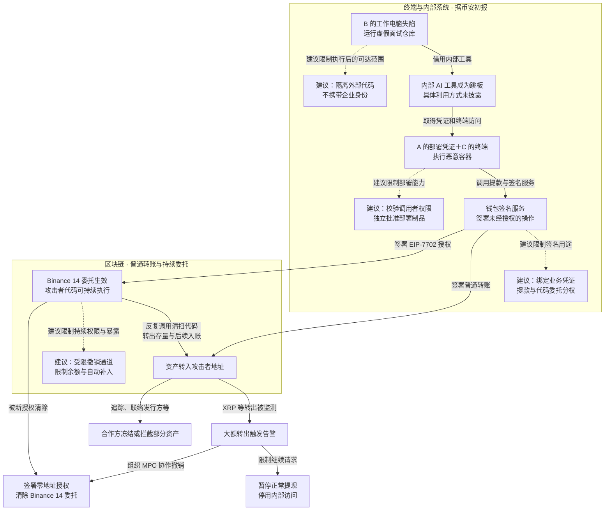

2026 年 10 月 29 日，币安多个热钱包遭攻击，约 63.4 亿美元数字资产被盗。据[币安 11 月 3 日初步调查](https://www.binance.com/en/blog/community/3229153443759566763)，攻击者通过虚假招聘控制工程师的工作电脑，再借内部工具和窃取的部署凭证运行恶意脚本，滥用钱包签名服务转出资产，并在以太坊钱包中设置持续生效的代码委托。[FBI 于 10 月 31 日通报](https://www.fbi.gov/investigate/cyber/alerts/2026/north-korea-responsible-for-6-billion-binance-attack)，将攻击归因于朝鲜 TraderTraitor。币安称尚未发现钱包私钥泄露，将承担资金损失，并已预留足额资金补足用户资产。

## 攻击经过：从面试作业到持续转出资产

热钱包在线处理日常提款，内部业务服务提交交易，签名系统生成签名，再向区块链广播。攻击者沿着工程师终端、内部工具、部署能力走到了签名服务，随后取得普通转账和代码委托两种资产操作能力。下图把这条攻击链、实际处置与四个建议阻断点放在一起，可横向滚动。

实线表示已披露的攻击、检测和处置关系；点线连接本文建议及其作用位置。蓝色表示攻击能力与资产流出，绿色表示实际响应，标有“建议”的节点对应后文四个突破点。内部经过依据[币安初报](https://www.binance.com/en/blog/community/3229153443759566763)，链上路径结合 [CSH／Iknaio 分析](https://csh.ac.at/news/the-binance-hot-wallet-hack-step-by-step/)。

### 用招聘面试让工程师执行恶意代码

9 月，工程师 B 在正常招聘平台接触到冒充项目负责人的招聘方。对方安排了人力资源面试和“CEO”面试，还用视频、社交账号及个人照片建立可信感，最后要求 B 下载一份代码作业。

B 将仓库放到工作电脑上，恶意代码在项目设置过程中执行。安装依赖、运行和调试陌生项目原本就是开发工作的组成部分，攻击者把第一次执行藏进了这套熟悉流程。随后，恶意软件替换 Python 版本管理工具 `pyenv` 的组件，用于执行命令、连接外部服务器和隐藏活动。币安称，当时的终端防护未检出该恶意软件。

这类执行可以先使用工程师当前用户的文件、工具和登录态，无须先取得整个企业的管理员权限。常用开发组件被替换后，后续正常开发操作也可能再次进入恶意代码；因此，终端上的执行身份及其可用会话，构成了通向内部系统的起点。

### 借内部工具取得钱包团队的终端与部署凭证

10 月 20 日，攻击者利用 B 的电脑和内部 AI 工具，控制了钱包 DevOps 工程师 A 与钱包软件工程师 C 的工作环境，并发现 A 电脑上的容器部署凭证。初报将内部 AI 工具列为跳板，未披露具体利用方式。

攻击者至此集齐了后续部署需要的两项能力：C 的终端访问和 A 的部署凭证。它们分属不同员工，却被同一入侵者组合使用。

### 让钱包系统为恶意请求签名

据[币安初报](https://www.binance.com/en/blog/community/3229153443759566763)，10 月 29 日，攻击者登录 C 的电脑，用从 A 处窃取的凭证部署容器，运行恶意脚本，调用内部提款与钱包签名服务，提交未经授权的操作。

部分钱包签署普通转账，直接将资产发往攻击者地址。以太坊上的 Binance 14 热钱包则签署了 EIP-7702 代码委托授权，允许攻击者指定的合约代码以该钱包的身份执行。攻击者从能够运行内部代码，进一步取得了让资金账户签署转账和改变执行方式的能力。

### 用一批授权给热钱包装上持续清扫代码

[EIP-7702](https://eips.ethereum.org/EIPS/eip-7702)允许普通以太坊账户通过签名委托执行指定合约的代码。委托生效后，调用这个账户就会运行相应代码，授权会跨交易保留，直到被新的有效授权更新或清除。

据 [CSH／Iknaio 的链上分析](https://csh.ac.at/news/the-binance-hot-wallet-hack-step-by-step/)，攻击者提交了 Binance 14 签署的 50 份授权，覆盖一段连续的 nonce。nonce 是账户用于校验操作顺序的序号；钱包仍在处理正常交易，攻击者准备多个相邻序号，提高授权命中当前账户状态的机会。研究记录显示，序号 18,914,809 的授权匹配成功，钱包开始指向清扫代码。

这段代码以 Binance 14 的账户身份转出 ETH，并调用代币合约转移钱包持有的代币。后续调用还能继续清扫新入账资产，无需每次重新经过币安的正常提款入口。

委托授权与普通转账在技术上有什么区别？

普通转账签署一笔具体交易。EIP-7702 授权签署的核心字段是 `chain_id`、代码地址 `address` 和授权账户的 `nonce`。这里的 `address` 指向要执行的代码。

授权被接受后，账户代码写入 `0xef0100 || address`。后续调用该账户时，指定代码在该账户的上下文中运行，能够操作该账户的资产。授权在交易执行前处理；即使后续执行回滚，已处理的委托设置也不会随之回滚。

可对照研究引用的[授权交易](https://etherscan.io/tx/0xad99264d5532ae0dd04b2004eebda05f25657e70dacb764f7ac8d4ccd051298b)与 [EIP-7702 处理规则](https://eips.ethereum.org/EIPS/eip-7702#behavior)，检查授权签名对应的账户、委托代码地址、nonce，以及授权前后的账户代码。

### 告警触发后，链上委托仍在执行

币安称，XRP、Solana 和 Optimism 等资产出现大额转出后，内部告警触发调查，团队随后暂停提现、停用内部访问，并联络合作方冻结资产。但 Binance 14 的恶意委托已经写入区块链，攻击者仍可直接调用清扫代码。

撤销需要钱包再签署一份有效授权。币安披露，钱包采用多方计算（MPC）协作签名，团队为此开发并执行了专门撤销流程。10 月 29 日 23:56 UTC，最后一笔此前已广播、处于待确认状态的未经授权转账最终上链；10 月 30 日 00:10 UTC，币安用指向零地址的新授权清除了相关委托代码。

指向零地址的新授权会清空账户代码，从而关闭委托执行路径，处理规则见 [EIP-7702 规范](https://eips.ethereum.org/EIPS/eip-7702#behavior)。

与此同时，攻击者转移、兑换已到手的资产，争取在发行方冻结前离开目标地址。[Bitquery 的追踪](https://bitquery.io/investigations/binance-hack)记录，部分 USDT 在冻结前已被转走，部分被冻结地址当时已没有相应余额。

截至 11 月 3 日，币安称约 28.5 亿美元资产已被冻结或拦截，并已重建受影响的钱包系统与内部 AI 工具、更换设备、停用相关凭证。公司还称，截至 10 月 31 日已补足 98% 的受影响代币资产，其余流动性较低的资产仍在购买。

## 关键突破、成因与防护

### 运行外部代码的电脑同时通向内部资源

这里跨过的是外部代码与企业工作环境之间的边界。面试作业可以借安装依赖取得执行机会，而同一台工作电脑还通向内部工具与资源。终端检测漏报后，攻击者便能继续借用这个环境扩大访问。

招聘识别、依赖检查和终端检测可以减少恶意代码执行的概率。更进一步，应把面试作业、外部演示项目和未知依赖放进可销毁的隔离环境，不挂载工作目录，不转发公司登录态、SSH 代理或生产凭证，也不开放内部管理网络。生产管理操作使用独立环境。

隔离的目标是让恶意代码即使执行成功，也拿不到继续访问企业系统所需的身份与网络路径。代价是外部项目调试与生产管理需要分开进行。

### 不同员工的权限可以被同一攻击者收集并组合

这里跨过了普通员工访问、钱包团队终端和生产部署三层边界。攻击者把 B 的工作环境、A 的凭证和 C 的终端组合起来，说明分散到不同员工手里的能力仍可被一个持续入侵者收集使用。

**假设场景：** 一个内部助手以共享管理身份执行任务，目标系统只检查“请求来自助手”，却不检查原始调用者是否有权操作目标资源。控制普通员工会话的人便可能借助手的身份扩大权限。

内部助手、自动化服务和运维平台应保留原始调用者身份。目标资源同时检查调用者、工具和任务权限，将授权绑定到具体资源与用途。调用者应由独立认证上下文确认，不能把工具自行填写的用户名当成证明；授权范围和目标资源由实际执行方核验，失陷工具无权替调用者签发更高权限。

凭证轮换与短期化可以缩短被盗凭证的使用窗口；部署能力还应限制到经独立流程批准的制品及参数。取得部署凭证的人也只能发布指定内容，无法任意更换镜像、注入启动脚本或放宽准入规则。部署身份与批准策略、制品信任根的管理权限分开，避免同一份权限同时改变待发布内容及其批准条件。

### 系统签名能力覆盖了超出真实业务目的的操作

MPC 将签名计算分给多个参与方，减少单个密钥份额失窃就能独立签名的风险。本案中，攻击者通过内部服务取得了有效签名，既能转出资产，又能签署改变账户执行方式的授权。

决定损害的是内部执行能力可以进一步变成资金操作能力。协作签名保护了密钥的使用，却仍需有独立依据判断请求是否对应真实提款，以及普通提款权限是否可以改变账户规则。

加强调用方认证、保护密钥和检测异常转出之外，签名侧还应验证获批提款或调拨记录，自行构造或复核最终待签内容。一种做法是由独立授权服务签发一次性付款凭证，绑定业务编号、链、资产、收款人、金额、用途和有效期；签名侧核对这些字段，并检查重复使用及累计限额。

付款依据、签名规则和收款名单的修改权限也要分开保护。只要独立授权方及其验证规则未同时失陷，攻击者修改收款人、金额或用途后，便无法用原凭证取得相应签名。日常提款仍可自动验证和执行，高风险规则变更则通过独立流程批准。

普通提款权限默认不包含代码委托、合约升级等账户规则变更。签名接口只接受能够解码并检查用途的内容；EIP-7702 授权需要单独控制。规范将授权签名域标记为 `0x05`，其签署对象与外层 `0x04` 类型交易不同，签名策略需识别实际被签的内容与用途。由于授权可以由其他地址打包提交，仅禁止平台自己发送 `0x04` 类型交易，仍会留下有效授权被外部使用的路径。

### 钱包权限持续存在，撤销又依赖额外签名流程

EIP-7702 把一次有效签名变成持续执行权限。暂停正常提现切断了业务入口，却没有改变钱包的链上代码状态；攻击者继续调用已有委托，币安则需要完成新的协作签名才能清除它。

清扫代码可以处理后续入账，撤销却需要在紧急隔离期间保持必要签名能力可用。防守方需要同时限制钱包持续暴露的资产，并保留直接撤销链上权限的能力。

对代码委托这类持续权限，应有满足原有协作阈值的受限撤销流程，让必要组件在常规服务隔离后仍能完成签署、广播与确认。应急通道只允许预定的撤销或救援用途，其规则和目标地址另行保护。

撤销授权同样要匹配账户当时的 nonce，并在提交后确认账户代码已经清除。对照 EIP-7702 的处理顺序，授权更新发生在交易执行前，现有恶意委托代码本身不必参与批准这次清除；但签名组件不可用、状态过期或交易未被确认，仍会拖延撤销。应急流程需要保持可信的链状态读取与广播能力，并继续跟踪此前已签署或已广播的操作。

热钱包余额、累计流出与自动补入额度需要一起限制。单笔限额会被拆分操作消耗，低余额也可能被持续补入抵消；异常时应暂停向可疑钱包补充资金，并为授权状态无法恢复可信的钱包准备迁移路径。

资金限额会影响提款与补入速度，应急通道也需要维护独立授权。可以保留受限的日常自动化，将大额累计流出、自动补入和钱包规则变更作为额外控制点。

## 参考资料

- [Binance：11 月 3 日初步调查与响应更新](https://www.binance.com/en/blog/community/3229153443759566763)
- [FBI：North Korea Responsible for $6 Billion+ Binance Attack](https://www.fbi.gov/investigate/cyber/alerts/2026/north-korea-responsible-for-6-billion-binance-attack)
- [Bitquery：Binance Hack On-Chain Investigation](https://bitquery.io/investigations/binance-hack)
- [CSH／Iknaio：The Binance Hot Wallet Hack, Step by Step](https://csh.ac.at/news/the-binance-hot-wallet-hack-step-by-step/)
- [EIP-7702：Set Code for EOAs](https://eips.ethereum.org/EIPS/eip-7702)
