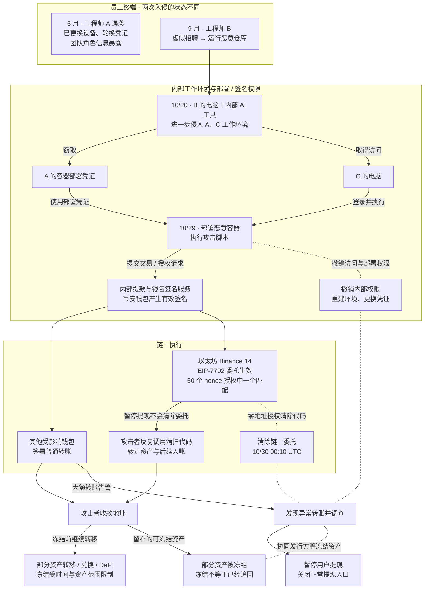

2026 年 10 月 29 日，币安多个热钱包在不到四个小时内转出约 63.4 亿美元数字资产。

目前公开信息没有显示钱包私钥泄露。攻击者先控制工程师电脑，再利用窃取的凭证和内部系统权限进入提款链路，最后让币安自己的钱包完成转账。钱包签名仍然有效，失效的是签名前后的信任链。系统接受了身份看起来合法的请求，却没有确认交易是否符合真实业务意图。

## 攻击从员工电脑开始

币安初步报告显示，攻击者从几个月前就开始准备。

6 月，钱包 DevOps 工程师 A 为安装一款 AI 编程工具，下载了被篡改的 Homebrew 安装程序。币安发现后更换了设备、轮换了凭证，但 A 和钱包团队其他成员的角色信息已经暴露。更换设备和轮换凭证不能收回攻击者已经掌握的人员信息，这些信息仍可能帮助其选择定向社工的目标。不过，通报没有证明 9 月的攻击利用了这批信息，也不能据此认定攻击者从 6 月一直控制 A 的电脑。

9 月，工程师 B 参加虚假招聘面试，被要求将一个作为面试作业的恶意代码仓库下载到工作电脑。恶意代码在仓库设置过程中执行。币安披露，攻击者以恶意版本替换了 Python 版本管理工具 `pyenv` 的合法组件，用于执行命令并与外部服务器通信，还隐藏活动、清除入侵痕迹。这意味着被污染的不只是一次性运行的面试作业，还包括工程师日常使用的开发环境。

币安称，当时终端防护工具没有检出这款恶意软件。未检出说明当时的检测没有阻止入侵，但仅凭这一点，不能认定攻击利用了零日漏洞。

10 月 20 日，攻击者利用 B 的电脑和币安内部 AI 工具，进一步侵入 A 和工程师 C 的工作环境，取得了 A 的容器部署凭证。

10 月 29 日，攻击者登录 C 的电脑，使用 A 的凭证部署容器并执行恶意脚本。币安称，攻击者随后滥用内部提款和钱包签名服务，提交未经授权的交易。[币安初步报告](https://www.binance.com/en/blog/community/3229153443759566763)和[路透社报道](https://www.reuters.com/world/binance-says-hackers-used-fake-job-interview-compromise-computer-before-63-2026-11-03/)披露了这条攻击路径。

图中两种内部权限汇合后通向签名服务，再分成普通转账与持续链上委托。应急措施分别作用于内部权限、提现入口、链上委托和收款资产；这些处置并非一条必须依次完成的流程。图可横向滚动。

<div class="incident-diagram" role="region" tabindex="0" aria-label="币安热钱包事件的入侵、链上执行与处置关系，可横向滚动">



</div>

蓝色突出权限与委托失守，绿色表示处置及冻结结果。处置节点按作用对象就近放置，无箭头虚线表示关联，不表示时间先后。6 月节点不接入持续控制主线；内部 AI 工具的具体利用方式仍未公开。图依据[币安初步报告](https://www.binance.com/en/blog/community/3229153443759566763)、[Bitquery 链上分析](https://bitquery.io/investigations/binance-hack)及 [CSH 对应的 Iknaio 技术原文](https://iknaio.com/insights/binance-hot-wallet-hack/)绘制。

Bitquery 统计约 63 亿美元资产从 17 个热钱包流出，涉及九条区块链；CSH 对应的技术分析列出十条链。两份资料的链数量不一致，此处保留各自口径，不合并为共同确认的数字。

## 合法签名如何完成非法转账

币安表示，目前没有证据证明钱包私钥泄露。多数异常转账仍由币安钱包自身完成签名。攻击者控制的可能是发起签名请求的系统，而不是私钥本身。

签名服务如果只检查请求账号、接口权限、交易格式和签名有效性，就可能放过一笔“身份合法、格式正确，但业务意图恶意”的交易。

热钱包签名服务还需要理解交易内容，至少识别向新地址转移大额资产、同时影响多个钱包和多个区块链、由新设备或新容器发起、改变账户代码或执行逻辑，以及绕过原有提款策略和审批流程等行为。

## EIP-7702 放大了以太坊部分的损失

以太坊部分的攻击使用了 EIP-7702。该机制允许普通账户通过签名授权，委托执行指定智能合约的代码。委托在交易结束后仍然生效，直到通过新的有效授权更新或清除；它不是一次交易内的临时执行权限。[EIP-7702 正式规范](https://eips.ethereum.org/EIPS/eip-7702)明确规定了这种持续性和零地址清除机制。

独立分析显示，攻击者向币安的一个以太坊热钱包提交了 50 个连续 nonce 对应的授权，其中一个授权与钱包当时的交易序号匹配。授权生效后，攻击者让该钱包执行清扫代码，一次转走大量 ETH、USDT 和其他代币。[链上交易分析](https://bitquery.io/investigations/binance-hack)显示了这部分过程。

EIP-7702 放大了已经存在的权限问题。对于高价值钱包，改变账户代码、委托新的合约逻辑和批量授权，都应该被视为高风险操作，进入独立审批、延迟生效或人工确认流程。

## 暂停提现没有马上结束攻击

币安发现异常后暂停提现、撤销权限，并与稳定币发行方、区块链项目和安全公司合作冻结资产。[币安初步报告](https://www.binance.com/en/blog/community/3229153443759566763)对此进行了说明。

币安披露，已经生效的 EIP-7702 委托独立于正常提现基础设施。即使暂停提现、关闭热钱包服务，攻击者仍可在链上调用已经委托的清扫代码。仅关闭提现入口不能撤销这项能力。

撤销过程还受到当时钱包实现和应急流程的限制。币安称，该热钱包采用多方计算（Multi-Party Computation，MPC），由多方协作完成签名，没有可直接用于立即撤销授权的单一私钥。团队因此开发并执行了专门的撤销流程，耗费了额外时间。

这不意味着 MPC 无法撤销 EIP-7702 授权。链上清除委托仍需要新的有效授权，问题在于币安本次系统能否在应急状态下及时完成签署与提交。保护私钥的日常签名流程之外，还需要提前验证恶意授权如何撤销、由谁批准，以及在部分签名服务停用后能否继续完成处置。

路透社报道显示，部分未经授权的资产转移在提现暂停后仍然继续。[币安初步报告](https://www.binance.com/en/blog/community/3229153443759566763)进一步说明，23:56 UTC 最终确认的最后一笔转账，是此前已广播但处于待确认状态的交易，不能据此推断攻击者当时仍在调用内部签名服务。币安在 10 月 30 日 00:10 UTC 清除了相关 EIP-7702 委托代码。以上时间均为 UTC。

作为防护设计，钱包系统的应急处置还应覆盖队列、容器、服务账号和签名环境，按实际依赖关系并行处理：

```text
暂停新请求 → 清理队列 → 停止执行容器
→ 撤销服务账号 → 清除链上授权 → 切换钱包和签名环境
```

这些是需要验证的防护范围，不代表公开资料已证明本次事件中每一类后台任务都在持续执行。链上已经生效的委托则是本次事件明确暴露的独立撤销对象。

## 冻结资产只能减少损失

币安在 11 月 3 日的初步通报中称，约 28.5 亿美元数字资产已被冻结或拦截，金额仍需核对，也会受到市场价格波动影响。Bitquery 分析则列出 Tether、Circle、Arbitrum 及其他项目冻结约 27 亿美元资产。两份资料的统计范围和金额表述不同，此处分别保留，不将它们相加或视为同一核算结果。

稳定币发行方可以冻结特定地址上的 USDT、USDC 等资产，但这种能力有明显边界。攻击者可以在冻结生效前把资产转到新地址，兑换成 ETH 或 TRX，或者存入 DeFi 协议。BTC、ETH 等没有发行方控制的资产，也没有同样的冻结机制。

平台补足用户资产是另一件事。币安称，损失由平台承担，已预留超过弥补损失所需金额 100% 的资金；截至 10 月 31 日，98% 的受影响代币资产已经补足，其余流动性较低的资产仍在购买中。这是币安对资产补足进度的披露，不能改写成“追回了 98% 的被盗资金”，也不能将“98%”直接当作按美元损失金额计算的追回比例。

补足资产解决的是平台如何覆盖用户资产缺口；冻结或拦截限制的是被盗资产继续流转；追回并返还则还需要后续处置。冻结不等于已经返还，平台承担损失也不等于攻击者持有的资产已被追回。

资产冻结提供了事后止损能力，无法替代钱包签名控制。损失还受链上委托持续多久、后续入账是否继续被清扫，以及资产能否在转移或兑换前被冻结等因素影响，不能只用内部签名服务被控制的时长解释。

## 已披露的整改与待完成的审查

截至 2026 年 11 月 3 日，币安称已在新环境中重建受影响的钱包系统，重建内部 AI 工具及其访问控制，更换受影响设备，停用相关工程师的凭证和令牌，并完成对所有员工设备的增强安全扫描。通报还称，已加强钱包服务风险控制和基于 AI 的行为异常检测。

这些属于币安披露的已完成措施。独立第三方网络安全审查当时仍在推进，目的是验证调查结果并提出进一步整改建议，不能据此写成整改已经通过独立验证。币安也明确表示，调查仍在继续，部分技术细节和安全措施不会公开。

## 需要补上的三道防线

第一，拆开员工终端、开发部署和资产签名权限。工程师电脑被控制后，攻击者不应因此获得大额资产签名能力。

第二，让签名服务检查交易意图。签名系统需要理解账户代码变化、跨链批量转账、新地址大额转账和异常执行环境的风险。

第三，让紧急撤销覆盖已经开始执行的任务。撤销完成之后，旧凭证、旧会话、旧容器和旧链上授权都不能再产生新的业务副作用。MPC 等签名方案也应具备经过演练的应急撤销路径，不能等恶意授权生效后才开发处置流程。

币安确认攻击者利用内部 AI 工具进入了钱包工程师的系统，但公开资料尚未披露该工具的具体权限和调用过程。因此，目前可以确认它处在攻击路径上，不能据此断定它是最初的入侵点，也不能认定具体利用方式是提示词注入、模型漏洞或 AI 自主发起攻击。

## 如何验证防护是否有效

企业可以在隔离环境中搭建一条简化链路，测试上游系统被控制后是否还能继续产生业务结果：

```text
员工终端 → 内部工具 → 容器部署服务
→ 提款服务 → 签名服务 → 模拟区块链
```

测试重点包括工程师电脑被控制、部署容器被控制、EIP-7702 授权、多链异常同时出现、暂停提现后的队列执行，以及紧急撤销完成后的残余交易。对于使用 MPC 的钱包，还应测量在部分服务停用时，完成撤销审批、协作签名和链上确认分别需要多久。

最重要的指标是：

> 撤销确认完成后，还有多少未经授权的高风险操作成功提交？

## 结语

币安事件的关键不在于某个新协议，也不在于一台电脑被攻破，而在于攻击者能够沿着员工终端、工程师凭证、内部工具、容器部署和提款服务一路走到钱包签名环节。

公开资料未发现私钥泄露证据，但钱包已经产生了有效的恶意交易与授权签名。这些签名不再代表币安的真实业务意图。

企业需要守住的边界是：

> 员工终端、内部工具或部署容器被控制后，不能直接产生跨资产、跨链和批量业务副作用。

这条边界需要通过终端隔离、权限拆分、交易语义检查、独立签名审批和可验证的紧急撤销共同实现。

## 参考资料

- [Binance：Initial Findings and Response Update](https://www.binance.com/en/blog/community/3229153443759566763)
- [Binance：11 月 3 日初步调查与响应更新（X 原文）](https://x.com/binance/status/2117626126214504729)
- [FBI：North Korea Responsible for $6 Billion+ Binance Attack](https://www.fbi.gov/investigate/cyber/alerts/2026/north-korea-responsible-for-6-billion-binance-attack)
- [Reuters：Binance hackers used fake job interview](https://www.reuters.com/world/binance-says-hackers-used-fake-job-interview-compromise-computer-before-63-2026-11-03/)
- [Bitquery：Binance Hack On-Chain Investigation](https://bitquery.io/investigations/binance-hack)
- [CSH：The Binance Hot Wallet Hack, Step by Step](https://csh.ac.at/news/the-binance-hot-wallet-hack-step-by-step/)
- [Iknaio：CSH 技术分析对应原文](https://iknaio.com/insights/binance-hot-wallet-hack/)
- [EIP-7702：Set Code for EOAs](https://eips.ethereum.org/EIPS/eip-7702)
