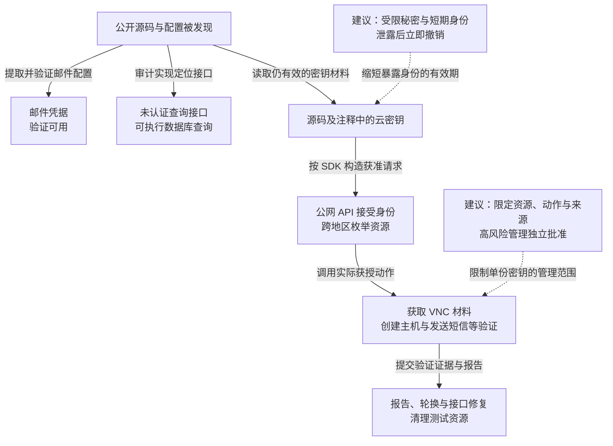

本文记录一次 UCloud 相关源码泄露的漏洞验证：GSIL 发现公开代码，研究者从中分别验证邮件身份、未认证数据库查询和云 API 密钥三条路径。暴露的云凭据可以从公网调用管理 API，枚举跨地区的数千台云主机，并完成获取 VNC 访问材料、创建测试主机和发送短信等验证。记录称问题已报告并修复，未继续执行关机、改密登录等会影响业务的动作。

## 攻击经过

### 公开源码同时提供身份材料与接口实现

[GSIL](https://github.com/FeeiCN/GSIL)发现关联仓库公开，涉及设计运营、通用计算和 UGC 等管理系统。源码中包含邮件和数据库配置，静态扫描还可定位可疑查询接口及云密钥。

这些路径并行来自同一批资料：邮件登录不依赖先完成 SQL 注入，云 API 也不需要经由数据库读取才能调用。源码泄露既可能暴露秘密，也会给攻击者提供原本不易从外部看到的实现和地址信息。

### 邮件身份与任意查询接口分别被验证

原记录用邮件账号验证了可用性，示例配置已做脱敏：

```go
send_account := "***-noreply@ucloud.cn"
send_password := "U**********3"
host := "smtp.qiye.163.com:25"
```

研究者再用 [Cobra](https://github.com/WhaleShark-Team/cobra)审计，发现未要求认证的查询接口。示例把 SQL 语句作为参数交给后端，说明风险不只是页面绕过，还包括外部请求可直接选择数据库操作：

```bash
http://106.***.***.***:***/query?q=show%20databases;
http://106.***.***.***:***/query?q=select+*+from+nginx_request+limit+200&db=nginx
```

相应原始截图如下：


查询接口的访问身份与数据库账号共同决定可读取范围。原验证展示业务数据可查，不应据此推定所有数据库及所有操作都已经执行。

### 注释中的云密钥仍能通过公网 API 使用

扫描在源码及注释中识别出三组云 API 公私钥材料。注释只影响程序是否执行该行，不会撤销远端服务对密钥的信任。原示例已脱敏：

```go
var (
	//      吴**
	//      PublicKey  = "mq0fPub*************************OVK98eW+vNYrNQ=="
	//      PrivateKey = "f7a576d87fc2***********4083f78f"

	//      孙**
	//      PublicKey      = "D/ze2*********************************yer0YOAFPg=="
	//      PrivateKey     = "de17af******************************12ab6a1dadd"

	//      ucvd 公用
	PublicKey  = "7vt40gcKGnT************************DF1ETwgsDt0hZgg=="
	PrivateKey = "3c45fd62b9*********************16d1117"

	COMMON_API_URL = "https://api.ucloud.cn/?"
)
```

代码中的 `COMMON_API_URL` 指向公网 `https://api.ucloud.cn/`。研究者结合 [UCloud API 文档](https://docs.ucloud.cn/api/summary/overview)和[官方 Python SDK](https://github.com/ucloud/ucloud-sdk-python)验证调用，泄露材料可形成通过服务端认证的 API 请求。

### 从资源枚举验证部分管理操作

原记录显示，单个 Region 可枚举数千台主机，并能跨地区查询相关资源。验证还选择了获取 VNC 访问材料、创建测试主机、发送短信等操作。由此证明，身份不仅可读源码，还可调用部分有业务后果的云管理接口。


改密登录、关机及更多关联产品操作是原文提出的进一步风险，记录没有继续执行。实际范围需要按该身份授予的资源与动作判断，不能把可枚举主机直接等同于所有产品已被接管。

记录称相关问题已报告并修复，并提出清理测试资源、更新 VNC 访问材料等处置。下图只将已验证能力接入主线；虚线为本文建议，可横向滚动。

<div class="incident-diagram" role="region" tabindex="0" aria-label="源码泄露分别导致邮件、查询接口与云资源管理能力暴露，可横向滚动">



</div>

## 关键突破、成因与防护

### 源码同时保存实现、地址与可复用的生产秘密

仓库权限、提交前秘密检测和公开代码监控可以减少泄露机会。删除仓库或改写历史无法使已下载副本失效，处置应立即撤销邮件、数据库和云身份材料，再调查使用记录。

应用通过受限秘密服务或短期工作负载身份取得业务权限，能够减少复制源码就得到长期访问权的机会。若同一开发者会话仍可领取所有生产密钥，秘密管理只改变存放位置，没有限制泄露后的能力。

### 查询工具把外部输入直接变成数据库操作

对必须存在的运维查询工具，应由独立认证与授权控制使用者及数据范围；普通业务接口应改为固定操作与参数化输入，而非接收任意 SQL 字符串。

数据库端按用途授予只读视图和限定对象，防止入口缺陷扩展到全部业务配置。即使接口已经下线，泄露的数据库密码仍需另外轮换，并核对是否从其他可达位置使用。

### 云密钥覆盖多个地区和高风险管理动作

公网 API 本来就是正常管理入口，网络可达并不意味着漏洞；风险在于泄露身份仍有效，且拥有跨地区及多动作权限。

应按系统、环境和任务分配云身份，限制资源集合、调用动作和有效期，生产变更额外核验真实管理任务。读资源列表不必同时获得控制台访问、创建主机和短信发送能力。权限与批准由云端独立执行，不能只由泄露源码里的调用程序自我限制。撤销密钥后还需核对已创建资源、已取得的访问材料和会话，避免只关闭原 API 身份却保留其派生访问。

## 参考资料

- [GSIL：源码泄露监控](https://github.com/FeeiCN/GSIL)。
- [Cobra：代码审计工具](https://github.com/WhaleShark-Team/cobra)。
- [UCloud API 文档](https://docs.ucloud.cn/api/summary/overview)与[官方 Python SDK](https://github.com/ucloud/ucloud-sdk-python)。
