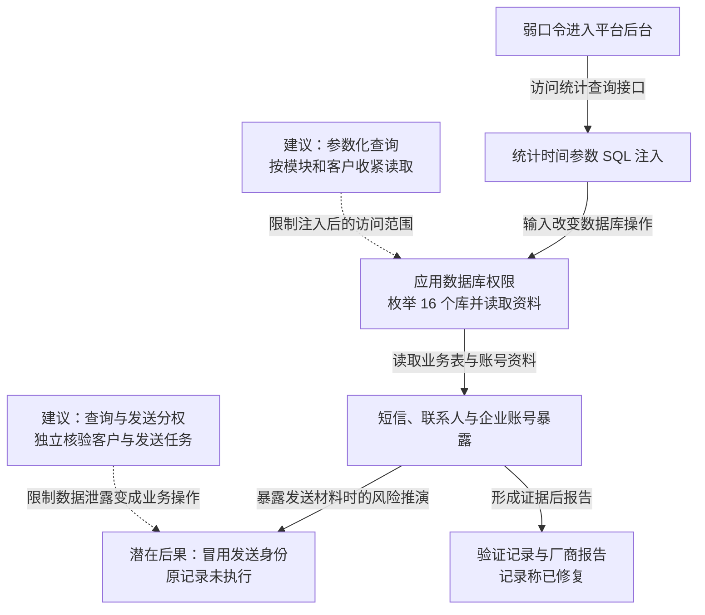

本文记录一次短信服务平台的漏洞验证：研究者先通过弱口令进入管理系统，再在统计查询的时间参数中发现 SQL 注入，枚举 16 个数据库，并取得短信业务表结构、行数及客户资料。平台集中了多个企业的短信记录和账号，使单个后台缺陷扩展为跨客户的数据风险。企业短信发送身份也可能因此被冒用，但记录没有执行该业务动作。原记录称问题已报告并修复。

## 攻击经过

### 弱口令打开管理系统，时间参数进入数据库语句

弱口令先提供了后台访问位置，之后的注入发生于统计查询接口。原验证记录支持布尔盲注、报错注入与时间盲注：数据库执行被改变后，结果差异、错误信息或响应延迟成为推断数据的通道。

这里的关键是业务参数被解释为 SQL 结构。外部请求者本来只能提交查询条件，实际却可以改变数据库操作，再借应用数据库账号的权限枚举其他对象。

### 注入操作跨过当前页面的数据范围

验证记录枚举出 16 个数据库，涵盖不同短信业务模块。下面保留原数据库列表：

```
[*] 400_gsms
[*] 400_list
[*] commission
[*] gsms2_init
[*] gsms_init
[*] information_schema
[*] list2_init
[*] list_init
[*] mos2_gsms
[*] mos_gsms
[*] mos_gsms2_1
[*] mos_gsms_2
[*] mos_list2_1
[*] mysql
[*] performance_schema
[*] test
```

在 `mos_gsms2_1` 中，`gsms_msg_ticket` 约 430 万行、`gsms_contact` 约 419 万行、状态报告表约 403 万行。这些是不同表的记录数，体现了短信业务资料的集中程度。

```
Database: mos_gsms2_1
+-------------------------------+---------+
| Table | Entries |
+-------------------------------+---------+
| gsms_msg_ticket | 4302497 |
| gsms_contact | 4191441 |
| gsms_statereport | 4031478 |
| gsms_deduct_record | 599589 |
| gsms_user_role | 360443 |
| gsms_user_role20130408 | 360110 |
| gsms_user_role20130409 | 360052 |
| gsms_msg_frame | 359263 |
| gsms_msg_pack | 241054 |
| gsms_non_white_list | 158632 |
| gsms_red_list | 124257 |
| gsms_account_carrier_price | 100360 |
| gsms_user | 58597 |
| gsms_user20130403 | 58523 |
| gsms_user20130401 | 58518 |
| gsms_user20130312 | 58275 |
| gsms_biztype_specnum | 53074 |
| gsms_enterprise_apply_detail | 49971 |
| gsms_user_business_type | 47656 |
| gsms_enterprise_specnum_bind | 39635 |
| gsms_user_account_bind | 33256 |
| gsms_business_type | 13511 |
| gsms_capital_account | 12545 |
| gsms_enterprise_apply | 12542 |
```

记录还列出 56 个数据库用户条目及其来源范围，说明验证已经触及身份配置层：

```
[*] 'cactiuser'@'192.168.10.89'
[*] 'censerver'@'192.168.10.89'
[*] 'censerver'@'localhost'
[*] 'chengxuan'@'192.168.%'
[*] 'chengxuan'@'localhost'
[*] 'innotop'@'192.168.10.83'
[*] 'monitor'@'192.168.10.89'
[*] 'monyog'@'192.168.%'
[*] 'monyog'@'localhost'
[*] 'moshengkuo'@'192.168.%'
[*] 'mscheck'@'127.0.0.1'
[*] 'mscheck'@'192.168.%'
[*] 'mscheck'@'localhost'
[*] 'private'@'192.168.10.86'
[*] 'private'@'localhost'
[*] 'program'@'172.16.200.10'
[*] 'program'@'172.16.202.101'
[*] 'program'@'172.16.202.102'
[*] 'program'@'172.16.202.203'
[*] 'program'@'183.232.65.44'
[*] 'program'@'192.168.%'
[*] 'program'@'192.168.10.100'
[*] 'program'@'192.168.10.101'
[*] 'program'@'192.168.10.102'
[*] 'program'@'192.168.10.98'
...
[*] 'program'@'localhost'
[*] 'repl'@'192.168.10.%'
[*] 'repl'@'192.168.10.130'
[*] 'root'@'%'
[*] 'root'@'192.168.%
[*] 'root'@'localhost'
[*] 'super'@'192.168.%'
[*] 'super'@'192.168.10.86'
[*] 'super'@'localhost'
[*] 'wanglianguang'@'%'
[*] 'wanglianguang'@'192.168.%'
[*] 'wanglianguang'@'localhost'
[*] 'xiaozhuan'@'192.168.%'
[*] 'xiaozhuan'@'localhost'
```

用户列表说明相关身份存在，具体注入连接具有哪些权限仍需由实际可执行操作判断；本案的已展示结果是跨库枚举与业务数据访问。

### 客户资料与平台账号一起暴露

原截图展示了短信业务及企业客户相关信息。客户包括银行、汽车、零售和物流等行业，原记录列举东风悦达起亚、安利中国、BMW 中国、人人快递网、中通物流、我要旅行网、娃哈哈集团、GXG、唯品会与酷讯等。


这些企业共用短信服务，平台内保存的客户身份与接口信息具有进一步业务价值。如果其中材料足以调用发送服务，攻击者可能冒用企业发信；这是基于暴露权限的风险推演，不是原记录已经验证的发送结果。

记录称问题已通过漏洞平台或厂商渠道报告并修复。下图只将已验证读取接入主线，潜在发送影响写在独立节点，虚线为本文建议，可横向滚动。

<div class="incident-diagram" role="region" tabindex="0" aria-label="短信平台从管理登录到统计注入、跨库读取及潜在发送风险，可横向滚动">



</div>

## 关键突破、成因与防护

### 后台登录没有限制后续数据库语句的含义

强认证和弱口令治理可以减少进入后台的机会，统计接口仍需要把时间等参数作为数据处理。日期格式和范围校验配合参数化查询，能避免输入成为 SQL 语法；仅过滤引号或关键词，难以覆盖不同注入形式。

即使某个已登录账号失陷，数据库也应只允许完成其业务所需操作。统计账号不应同时持有跨库管理和客户秘密读取权，错误回显与可观测延迟的治理则减少数据推断线索。

### 应用身份横跨多个业务模块与客户

页面上的客户筛选依赖应用代码，注入绕过这一代码后，实际边界由数据库账号决定。跨库权限与集中保存的资料共同扩大了暴露范围。

可以按数据域、租户或专用视图收紧访问，敏感账号资料交由独立服务保护，统计查询只取得必要聚合结果。租户授权由实际数据服务核验，不能只信任后台传来的客户编号；权限策略和批量读取限制也需防止由同一失陷账号修改。

### 读取客户秘密可能继续变成短信业务权限

查询资料与代表企业发送短信，应使用不同身份和任务授权。发送端核验客户、批准模板、目标范围、额度与有效期，避免仅凭从数据库取得的一组长期秘密就能任意发送。

如果发送凭据已经暴露，修复注入之后还需轮换对应身份、撤销会话并检查实际发送日志。短信记录和联系人无法靠轮换收回，异常读取检测、减少保留量及字段最小化能降低后续类似事件的影响。发送限制会影响临时营销和批量通知，可通过独立批准的任务保留所需容量。
