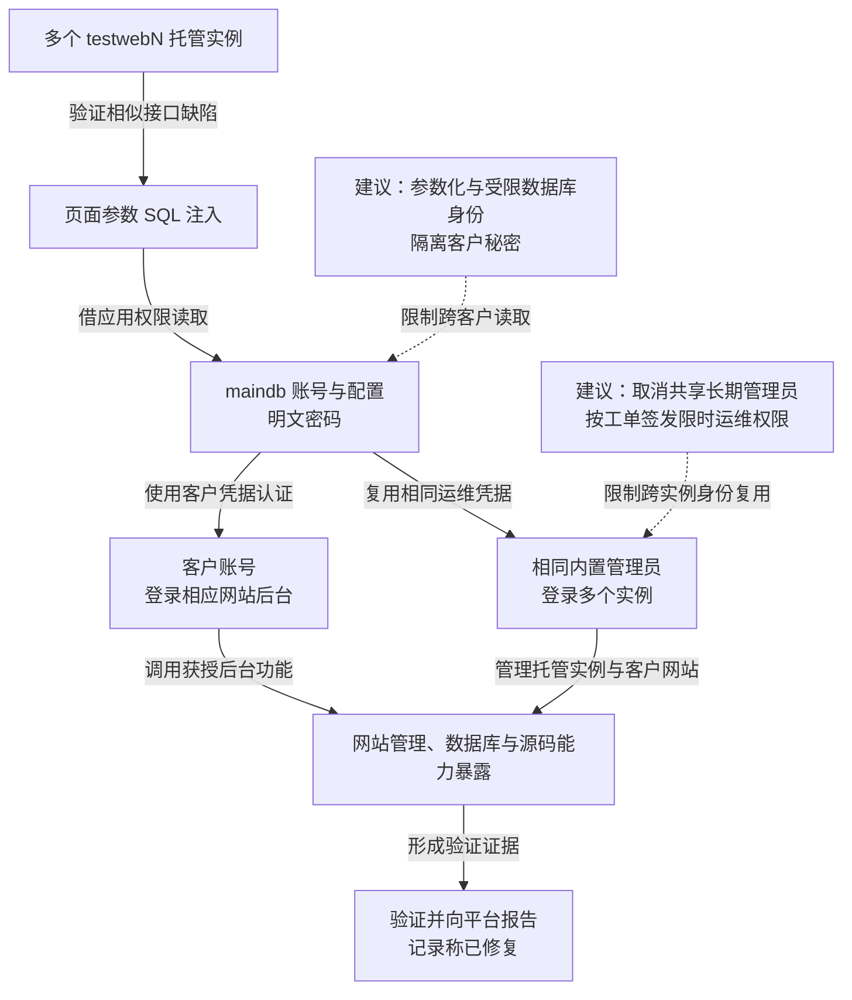

本文记录一次集中托管建站平台的漏洞验证：研究者在多个 `testwebN` 实例发现 SQL 注入，从 `maindb` 读取账号与配置，再复用内置管理员及客户身份，进入多个托管实例和客户网站后台。原记录覆盖十余个实例，单实例承载数百至近两千个网站；集中身份与明文密码放大了单个接口的风险。记录称问题已向相关漏洞渠道或厂商报告并修复。

## 攻击经过

### 临时站点入口暴露了相同应用的多个实例

厂商用 `testwebN.***world.com` 一类子域，为尚未配置独立域名等客户提供网站访问。研究者通过子域信息找到不同实例，再在其中的页面参数验证注入。

子域数量本身不构成漏洞。风险来自实例部署了相似的可注入代码，且背后采用相近的数据库和身份设计；攻击者可沿一个已识别模式继续检查其他入口。

### SQL 注入让页面参数变成账号资料读取

原记录支持布尔盲注和 UNION 注入。前者通过响应差异推断数据，后者让额外查询结果进入页面原有返回位置。实际读取使用的是应用数据库账号权限，绕过了页面原先允许的字段与对象。

`testweb` 的原始技术与数据库输出如下：

```
web application technology: PHP 5.2.13, Apache 2.2.15
back-end DBMS: MySQL >= 5.0.0
[*] 'yining'@'localhost'
available databases [4]:
[*] information_schema
[*] maindb
[*] test
[*] ...
Database: maindb
[10 tables]
+---------------------------------------+
| t_admin |
| t_bak |
| t_dict |
| t_feedback |
| t_language |
| t_log |
| t_model |
| t_plugin |
| t_progress |
| t_timeline |
| ... |
+———————————————————+
```

其他实例也出现 `maindb`，其中保存 `t_admin`、备份、配置和日志等表。以下为 `testweb2` 与 `testweb3` 的原验证输出：

```
Database: maindb 
[12 tables]
+------------+
| books |
| company |
| t_admin |
| t_bak |
| t_dict |
| t_feedback |
| t_language |
| t_log |
| t_model |
| t_plugin |
| t_progress |
| t_timeline |
| ... |
+——————+
```

```
Database: maindb
[6 tables]
+------------+
| books |
| company |
| t_admin |
| t_bak |
| t_dict |
| t_feedback |
| ... |
+------------+
```

原记录指出账号密码以明文保存，注入取得的资料可以直接用于后续认证，不需要再破解独立口令保护。

### 相同内置管理员连接多个实例，客户身份通向站点

研究者发现，不同实例存在相同的内置管理员凭据，并验证可用其登录多个后台，原记录覆盖从 `testweb` 至 `testweb11` 的十余个实例。另可使用读取到的客户账号进入相应网站后台。

这两条路径需要分开理解：共享运维身份扩大实例范围，客户身份扩大到其网站功能。后台暴露的数据库、备份和源码管理能力，又可能把账号控制推进为进一步资料访问。


记录称问题已报告并修复。下图表示验证所得能力，没有将多个实例拼成一场已确认的恶意攻击；虚线为本文建议，可横向滚动。

<div class="incident-diagram" role="region" tabindex="0" aria-label="建站平台从多实例注入到共享管理员及客户后台访问，可横向滚动">



</div>

## 关键突破、成因与防护

### 共用查询代码的缺陷在多个实例重复部署

直接修复是参数化查询，并对可变字段、排序和查询对象进行服务端允许列表校验。修补需要映射到实际部署，覆盖旧实例、临时域名与备用站点，避免只修改主站源码。

数据库账号按业务实例与用途授权，能够在另一个参数仍有缺陷时继续限制读取。管理账号表、备份配置和客户秘密不应都由普通页面查询身份访问。

### 明文与共享凭据把数据泄露变成跨实例登录

明文密码可直接复用，相同内置管理员又把一处泄露连接到其他实例。客户登录密码应以适当的单向口令派生方式保存；需要代表客户访问的长期秘密，另行受限存储与轮换。

更进一步，厂商支持不必依靠所有客户共用的一组静态密码。可由独立授权服务依据真实工单，签发限定客户、操作和时段的管理会话，目标实例自行核验。授权服务不能只信任实例传来的客户编号，普通实例也不能替自己批准跨客户权限。

### 客户网站后台同时承载过多高风险功能

网站内容编辑、数据库导出、源码读取和程序发布可以按用途分开。已失陷的客户会话不应自动拥有全部后台能力，批量导出和代码变更由独立条件约束。

处置需要更新共用代码、轮换共享身份及暴露的客户秘密，并撤销已建立的后台会话；还需核对新建账号和程序变更。修复某个注入点不能自动清除其他实例中已取得的访问。临时支持权限与功能分权会增加运维步骤，但能够限制一个客户或实例失陷后的跨租户影响。
