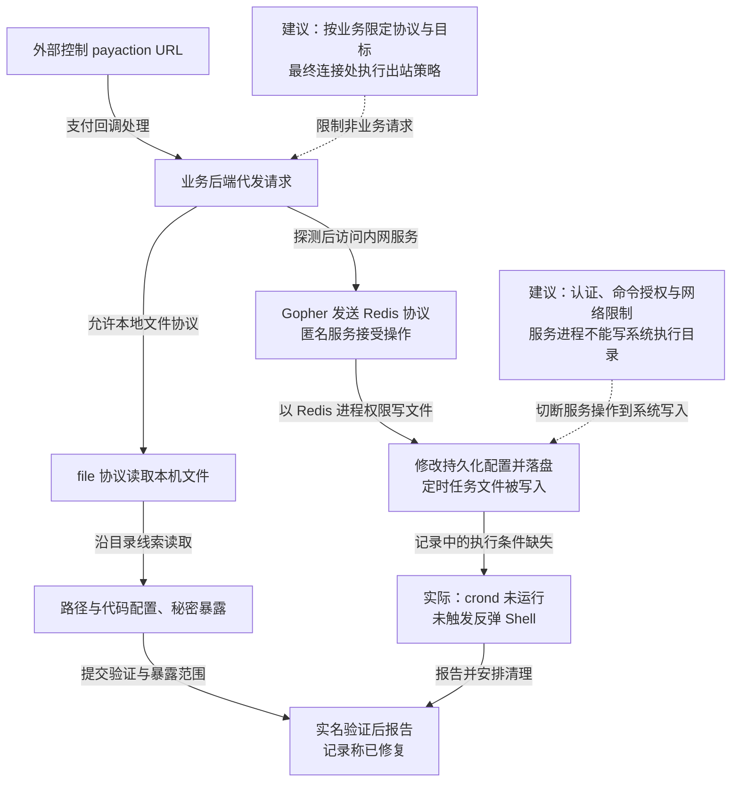

这份微博 SRC 活动记录中，研究者从支付回调参数取得服务器代发请求的能力，分别读取本机文件与代码配置、访问内网未认证 Redis，并验证了定时任务文件写入。由于测试时 `crond` 未运行，记录没有取得反弹 Shell。原文称使用本人账号实名测试，未继续连接业务数据库，问题已报告并修复，并记录严重漏洞奖励 5,000 元与 2,000 积分。

## 攻击经过

### 控制回调 URL，让业务服务器代为访问

支付接口 `topay.php` 的 `payaction` 参数包含 URL。验证者把它替换为自控服务器地址，在访问日志中观察到目标服务器发来的请求，确认外部输入可以决定服务端访问目标。

SSRF 的能力首先是借用服务器的连接位置和请求处理器。它能接触哪些地址、支持哪些协议，以及是否把响应返回外部，决定后续能否读取资料或操作内部服务。

### 文件协议与路径线索扩大到配置读取

当时的请求处理支持 `file://`，验证者读取本机定时任务文件和账号信息文件，再根据其中的脚本绝对路径寻找业务代码。记录还利用先前 rSync 匿名访问暴露的目录结构，辅助定位配置。

在取得业务目录线索后，研究者验证代码配置和密钥文件可读。原截图如下：

文件读取发生在发起请求的后端进程及其权限范围内。响应头还提示存在多后端部署，修复因而需要对应实际运行实例；一个入口的现象不能代替各实例权限与代码状态的核对。

### Gopher 将服务器请求变成内网 Redis 操作

另一条并行路径是内网服务访问。记录通过 `dict://` 探测响应和时间差，再确认数台内网 Redis 无需认证；随后用 `gopher://` 构造 Redis 协议数据，经 SSRF 发往服务端。

匿名连接还能调用配置与持久化相关命令，便可改变 Redis 落盘目录和文件名。验证将定时任务内容写入 Redis 所在主机的 cron 目录，说明网络访问已进一步变成目标服务进程权限内的文件写入。该主机与最初提供文件读取的业务后端，是需要分别分析的边界。

### 文件已写入，命令执行条件却没有满足

原记录明确写到 `crond` 未运行，反弹 Shell 没有触发。若计划任务服务、文件格式和执行条件均满足，此类写入可能继续变成命令执行；本次证据止于文件写入。

原验证声明未留存配置和密钥、未连接业务数据库、未保留后门，披露在修复后进行。后续处置需要清理测试写入、修复请求接口、限制 Redis 访问并轮换已暴露秘密。

下图将文件读取与 Redis 写入分叉；虚线只连接本文建议，可横向滚动。

## 关键突破、成因与防护

### 请求目标与协议由外部参数决定

修复入口需按业务允许列表限制协议、目标和端口，同时核验解析后的地址、重定向和最终连接。支付回调本不需要读取本地文件或任意发送其他服务协议，移除这些能力可以直接压缩攻击路径。

更深的限制由请求代理、容器或网络出口独立执行，业务进程不能自行解除内部地址访问策略。文件权限也要限制后端可读取的配置，使一次请求缺陷不直接暴露所有主机秘密。

### 内部位置被当作了 Redis 的充分信任依据

SSRF 使外部请求借用了业务服务器的网络位置，未认证服务因此暴露给间接访问者。认证、限定监听与客户端网络范围是直接措施；现代部署还可用 ACL 对身份、键空间和命令分别授权，参见 [Redis 官方安全说明](https://redis.io/docs/latest/operate/oss_and_stack/management/security/)。

普通业务身份不应获得修改持久化位置等管理命令，Redis 进程应使用专用低权限用户，并只能写入数据目录。即使服务认证或应用凭据再次失守，文件系统权限仍可限制它把数据库内容变成系统任务。客户端不能通过一项配置变更就同时扩大命令与文件写入范围。

### 配置读取与目标写入需要分别清理

读取到的秘密可以在原接口修复后继续被使用，已写入的定时任务文件也不会随 SSRF 修补消失。处置需要轮换相应身份、撤销已建立访问，并清理目标主机上的测试或异常写入。

本次未取得 Shell，仍需处理已经验证的文件与秘密暴露。检测可关联异常协议、非业务目标连接、Redis 管理命令及系统任务目录变化，记录在服务进程不能修改的位置。关闭必要内网访问会影响原业务，限定到明确客户端和命令，可以保留缓存功能并减少管理面暴露。

## 参考资料

- [Redis：安全模型、认证、ACL 与服务进程权限](https://redis.io/docs/latest/operate/oss_and_stack/management/security/)。
