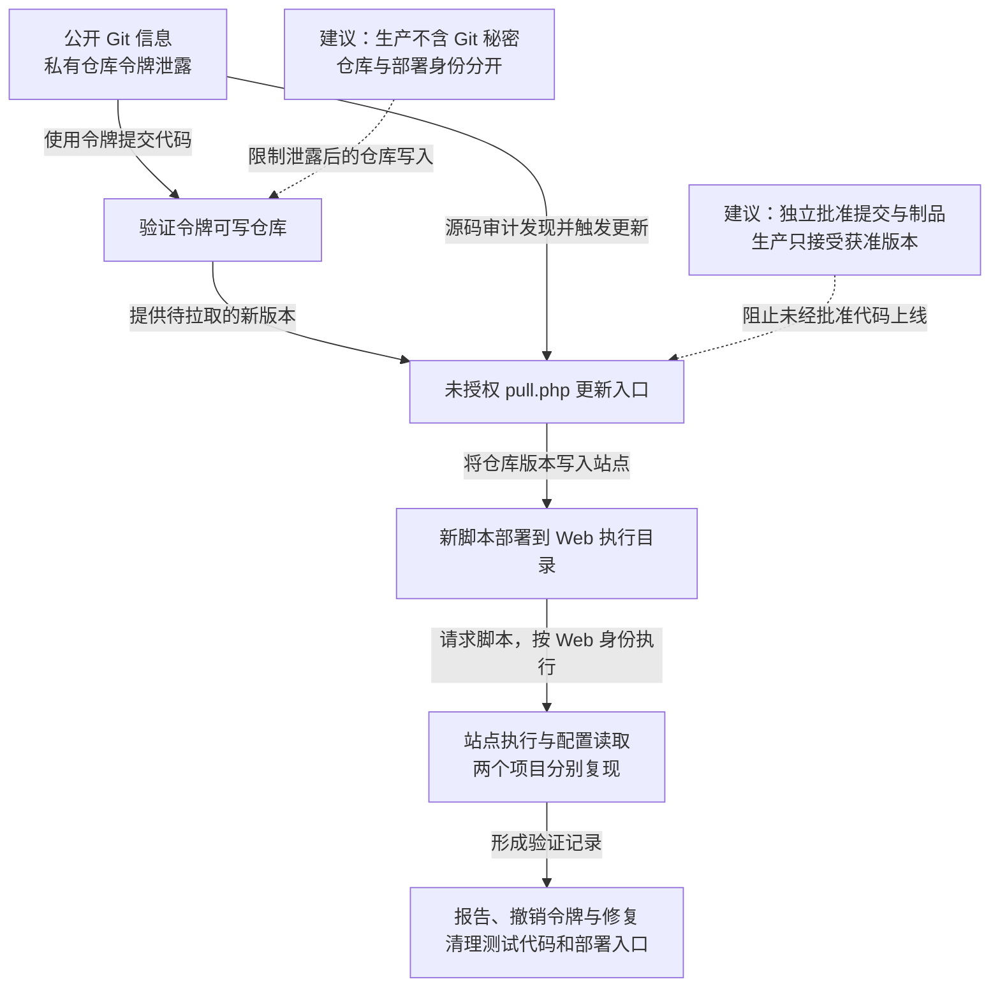

本文记录百姓金融相关站点的一次漏洞验证：研究者从公开 Git 信息取得私有仓库令牌，验证该令牌可写入代码，再调用暴露的 `pull.php` 更新入口，使服务器拉取并执行新增脚本；同组织另一个项目也验证了相同机制。仓库写入与生产部署两项能力在服务器汇合，形成站点执行及业务配置读取。原记录称问题已通过漏洞渠道或厂商报告并修复。

## 攻击经过

### Git 元数据暴露了可用于私有仓库的身份

研究者通过浏览器检测发现站点 Git 信息泄露，取得带有 `auth-token` 的 GitHub 私有仓库地址。私有仓库要求认证，但令牌已经作为连接信息的一部分被外部读取。

最初的令牌访问可帮助研究者取得源码。原验证随后完成提交，才进一步证明该令牌也拥有仓库写入能力；只看到一个仓库地址或只读令牌，并不自动包含发布权限。

### 仓库提交与在线更新在生产目录汇合

代码审计发现 `pull.php` 在线更新入口。它允许通过 HTTP 触发服务器从仓库拉取当前内容，并将其写入站点程序目录，没有独立的访问与发布批准。

研究者凭泄露令牌提交验证脚本，再请求更新入口，服务器便把该提交部署到可执行 Web 路径。访问脚本后取得站点执行能力，继承 Web 进程已有的文件、数据库配置和网络权限。

该过程同时需要仓库写入与服务器接受并执行新版本。令牌只读时无法通过同样步骤提交脚本；生产仅接受独立批准的制品时，仓库被写入也不应直接完成上线。

### 另一个项目复现相同机制

同组织另一项目也将仓库令牌放在连接地址中，并保留在线更新脚本。原记录再次完成代码提交、更新触发与站点执行验证，说明至少这些项目共享相近的部署设计。

原验证截图保留如下，包括 Git 信息发现、执行及数据库相关结果；重复图片仅展示一次：

记录称问题已报告并修复。下图显示同类机制在两个项目复现，未把它写成所有组织项目均已遭入侵；虚线是本文建议，可横向滚动。

## 关键突破、成因与防护

### 仓库地址同时携带可复用认证材料

阻止 Web 访问 `.git` 等开发元数据，是直接措施。生产发布包不应携带仓库历史和开发者令牌，拉取代码所需身份也应尽量只读并限制项目范围。

泄露发生后立即撤销令牌，并检查仓库访问、提交和其他授权。只隐藏目录或删除远端 URL，无法使已经复制的凭据失效。不同项目应使用独立身份，避免一个连接地址成为多个仓库的共同入口。

### 代码写入可以绕过独立批准直接上线

给 `pull.php` 加认证可以限制外部触发，但若同一份泄露权限仍能写仓库、请求部署并批准版本，攻击者可以继续完成整条链。

生产应由受保护的发布系统接收获准提交哈希与制品摘要，独立校验批准来源、项目和目标环境。开发仓库的写入者无权自行签发生产批准，服务器也不应只信任可变分支名。发布身份与 Web 运行身份分离，使普通应用无法修改程序或放宽部署门禁。

### 撤销仓库令牌没有自动撤销已部署代码

一旦脚本已经写入生产，撤销 Git 访问只会限制继续提交，现有脚本仍可被请求。处置需回到可信代码与制品，清理异常提交、生产文件及在线更新入口，并轮换执行过程中可读的业务秘密。

仓库历史、部署记录与 Web 请求应能按提交和文件变化对应。独立发布会增加审批和流水线维护成本，但可以让正常开发继续提交代码，同时阻止一次仓库身份失陷直接改变生产环境。
