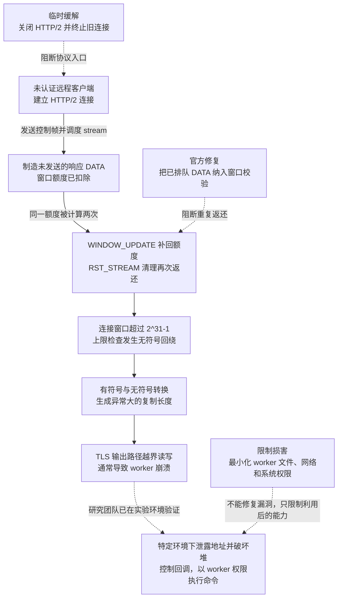

# CVE-2026-123007：NGINX HTTP/2 流控记账错误如何演变为远程代码执行

CVE-2026-123007 是 NGINX `ngx_http_v2_module` 中的内存破坏漏洞。未经认证的远程客户端只要能够连接启用了 HTTP/2 的受影响 NGINX，就可以通过一组 HTTP/2 控制帧破坏连接级发送窗口的记账，使正常的响应数据长度经过无符号整数下溢后变成异常大的内存复制长度。

通常结果是 NGINX worker 段错误退出。Xint、Rapid7 和 Wiz 的研究人员进一步证明，在特定 64 位 Linux、glibc 和堆布局条件下，这个错误可以同时造成地址泄露与堆内存覆盖，最终以 NGINX worker 身份执行命令。F5 给出的 CVSS 4.0 评分为 9.2（Critical），CVSS 3.1 评分为 8.1（High）；NGINX 安全公告将严重性标为 `major`。

漏洞影响数据面中的 HTTP/2 请求处理，不直接影响 NGINX Plus 控制面。成功利用首先获得的是 worker 进程权限，并不等于主机 root 权限。Xint 展示的容器逃逸和主机提权还使用了另一个 Linux 内核 SCTP 漏洞，不能算作 CVE-2026-123007 本身的能力。

截至 2026 年 11 月 19 日，CISA 的 CVE 补充记录把已知利用状态标为 `none`。这表示当时没有确认的野外利用证据，不影响漏洞已经由多家研究团队在实验环境中实现远程代码执行的事实。

## 影响范围

NGINX 官方安全公告给出的开源版本范围如下：

| 状态 | NGINX Open Source 版本 |
| --- | --- |
| 受影响 | 1.9.5 至 1.30.6、1.31.0 至 1.31.8 |
| 已修复 | 1.30.7 及以上稳定版、1.31.9 及以上主线版 |
| 不受这条路径影响 | 1.9.4 及更早版本，尚未包含 NGINX HTTP/2 实现 |

NGINX Plus 使用不同的版本体系，应按 [F5 K000163926](https://my.f5.com/manage/s/article/K000163926) 核对具体修订版本。已经结束技术支持的版本未被 F5 全部评估，不能把“公告未列出”解释为不受影响。

判断一台服务器能否被这条路径攻击，需要同时满足三个条件：

1. 运行的二进制仍含漏洞，且没有由发行版或设备厂商回移补丁；
2. 编译时包含 `ngx_http_v2_module`；
3. 攻击者能够与该实例建立 HTTP/2 连接。

Linux 发行版经常把安全修复回移到旧版本号中，只看 `nginx -v` 可能误判。应同时检查完整软件包版本、发行版安全公告和实际运行的二进制。若 CDN 或负载均衡器终止外部 HTTP/2，并只通过 HTTP/1.1 访问源站，这条外部路径到不了源站；但仍需检查源站地址是否可以绕过代理直接访问，以及内部代理是否会使用 HTTP/2 连接源站。

## HTTP/2 窗口为什么会被重复返还

HTTP/2 在一条连接上承载多个 stream。客户端通过流控窗口告诉服务器还可以发送多少 DATA：每个 stream 有自己的窗口，整条连接还有一个共享窗口。NGINX 使用 `h2c->send_window` 记录连接级剩余发送额度，协议允许的最大值是 `2^31-1`。

当 NGINX 把响应 DATA 放入待发送队列时，会立即从连接窗口和 stream 窗口中扣除对应长度。若 stream 在 DATA 真正发出前被取消，清理函数会删除未发送帧，再把先前扣除的额度返还给连接窗口。扣除和返还本身都合理，问题出在旧实现没有单独记录“已经排队、尚未发送”的 DATA。

攻击者可以按以下顺序制造重复返还：

1. 把连接窗口提高到协议上限，并把新 stream 的初始窗口设为零，使响应 DATA 暂留在队列中；
2. 利用控制帧响应及停止读取等方式填满输出路径，再为 stream 增加额度，使 DATA 被排队并从连接窗口扣除；
3. 对连接发送 `WINDOW_UPDATE`，先补回同样的额度；
4. 发送 `RST_STREAM` 取消这些 stream，清理逻辑再次返还仍在队列中的 DATA 额度。

若排队 DATA 总量为 `Q`，连接窗口会经历：

```text
MAX → MAX - Q → MAX → MAX + Q
```

最后一步越过了 HTTP/2 的 31 位窗口上限。旧代码只在处理 `WINDOW_UPDATE` 时检查当前可增加的额度：

```c
if (window > NGX_HTTP_V2_MAX_WINDOW - h2c->send_window) {
    return ngx_http_v2_connection_error(h2c, NGX_HTTP_V2_FLOW_CTRL_ERROR);
}
```

`h2c->send_window` 是无符号的 `size_t`。当它已经大于 `NGX_HTTP_V2_MAX_WINDOW` 时，右侧减法不会得到负数，而会回绕为很大的正数。后续 `WINDOW_UPDATE` 因此仍能通过检查，攻击者可以继续把这个 64 位计数器推向所需数值。

## 从窗口异常到堆越界读写

连接窗口随后进入响应发送路径。`ngx_http_v2_send_chain()` 会在 `size_t` 与有符号的 `off_t` 之间转换长度。当攻击者把窗口调整到接近 `2^64` 的数值时，同一组二进制位作为 `size_t` 看起来是一个很大的正数，转换为 `off_t` 后却是一个较小的负数；再次转换回 `size_t`，就成为接近 `2^64` 的复制长度。

异常长度最终到达 TLS 缓冲输出中的 `memcpy()`。最直接的结果是访问无效内存并使 worker 崩溃。研究人员发现，部分 x86-64 glibc `memcpy()` 实现会从复制区间两端取数，并在指针加法溢出后跳过理论上的巨大中间区间。这使操作不一定立即崩溃，而可能只在目标缓冲区前后复制有限的数据。

攻击者再利用可控的请求头、Range 多段响应和请求池分配布局，可以把这次有限的越界复制转化为两种能力：

- 将 NGINX 映像和堆地址带入 TLS 响应，绕过 ASLR；
- 覆盖 TLS 缓冲区附近的堆元数据，进一步改写清理回调函数指针。

当 NGINX 后续执行被覆盖的清理回调时，攻击者即可用 worker 权限执行命令。这个过程依赖架构、C 库实现、编译选项、内存布局和响应路径，因此 F5 将攻击复杂度评为高。它也解释了为什么“能够远程触发崩溃”和“能够稳定远程执行代码”不能直接画等号。

## 利用链与控制位置

<div class="incident-diagram" role="region" tabindex="0" aria-label="CVE-2026-123007 从 HTTP/2 流控记账错误到远程代码执行的因果链，可横向滚动">



</div>

实线表示公开补丁和技术报告能够核对的漏洞主线；从内存破坏到命令执行使用虚线，因为稳定利用依赖具体运行环境。图中的防护节点分别表示正式修复、临时关闭入口和利用后的权限收缩，作用并不相同。

## 官方补丁修正了哪项状态

修复提交增加了 `send_queued`，专门记录已经占用流控额度、但尚未真正发送的 DATA。DATA 入队时增加该值，发送完成或取消时减去。校验新的 `WINDOW_UPDATE` 时，同时计算当前可用窗口和待发送数据：

```diff
- if (window > NGX_HTTP_V2_MAX_WINDOW - h2c->send_window) {
+ if (window > NGX_HTTP_V2_MAX_WINDOW
+              - h2c->send_window - h2c->send_queued) {
```

从客户端视角看，排队 DATA 仍占用流控窗口；即使 NGINX 为内部调度先从 `send_window` 中扣除了它，也不能允许客户端把这部分空间再次加满。补丁把协议状态和内部队列状态重新放回同一个不变量：

```text
send_window + send_queued <= NGX_HTTP_V2_MAX_WINDOW
```

主线与稳定分支分别有对应修复提交。直接升级到官方或发行版提供的修复包，比自行摘取单个提交更可靠，因为 2026 年 11 月 18 日发布的 NGINX 版本还同时修复了其他 HTTP/2、HTTP/3、resolver、mail proxy 和 stream 模块漏洞。

## 处置与核查

### 立即升级并确认运行进程已经换成新二进制

优先升级到 NGINX Open Source 1.30.7、1.31.9 或更新版本；使用发行版、容器镜像、设备固件或 NGINX Plus 时，以对应供应商公告为准。安装软件包后需要重启服务或执行受支持的二进制热升级。只运行配置 reload 不会替换已经加载漏洞代码的 worker 二进制。

升级后应同时确认：完整软件包或镜像版本已更新、当前运行进程来自新二进制、所有副本和自动伸缩模板已经替换。仅更新镜像标签而不重建正在运行的容器，不能完成修复。

### 无法立即升级时关闭 HTTP/2

临时缓解措施是在所有受影响监听端口关闭 HTTP/2，并终止已有 HTTP/2 连接。新版本配置可使用 `http2 off;` 并移除 `listen` 中旧式的 `http2` 参数；修改后先执行 `nginx -t`，再重载配置，并从真实访问路径检查 ALPN 不再协商出 `h2`。

关闭 HTTP/2 会影响原生 gRPC 等依赖 HTTP/2 的业务，应提前确认降级结果。这个措施只阻断 CVE-2026-123007 及同批披露的另一条 HTTP/2 路径，不能替代对其他 NGINX 漏洞的升级。

### 不要把 WAF 当作主要阻断手段

触发链主要使用 HTTP/2 `WINDOW_UPDATE`、`RST_STREAM`、`SETTINGS` 和 `PING` 等控制帧。它们位于请求语义之下，使用 TLS 时网络设备看到的还是加密流量；普通基于 URL、请求头或请求体规则的 WAF 很难可靠识别这条链。能够解析并规范化 HTTP/2 状态的前置代理可以隔离源站，但前提是攻击者不能绕过代理直连 NGINX。

### 从进程、崩溃和连接三个层面排查

默认 access log 不记录大部分 HTTP/2 控制帧，不能用“没有异常 URL”排除攻击。可重点检查：

- NGINX error log、系统日志和 core dump 中是否出现 worker `SIGSEGV`、signal 11 或短期重复异常退出；
- NGINX worker 是否启动过 `/bin/sh`、脚本解释器、下载工具或其他不符合基线的子进程；
- 同一来源是否保持长时间 HTTP/2 连接，持续发送大量入站字节，而业务请求数和响应字节明显偏低；
- worker 身份可写目录中是否出现异常文件，出站连接、容器运行时事件和身份日志是否显示后续活动。

worker 崩溃本身不是利用证据，也可能来自其他故障；长期连接和高入站流量也可能是正常业务。进程派生、连接特征与同一时间段的崩溃同时出现时，可信度更高。若确认 worker 执行了异常命令，应按主机或容器失陷处理，调查其可读凭据、可写文件、出站网络和相邻系统，而不能只在升级后结束处置。

## 这个漏洞暴露出的设计问题

漏洞的核心不是单个减法写错，而是同一份流控额度分散在“可用窗口”和“已排队 DATA”两个状态中，校验只看见其中一个。取消 stream 又会异步返还额度，使本应始终成立的上限约束在状态切换中失效。

类似代码应把资源守恒关系写成可检查的不变量，并覆盖排队、部分发送、取消、连接关闭和错误清理等所有路径。测试也不能只验证单个合法帧，而应对多个 stream 的控制帧交错、背压和异常终止做状态机与属性测试。对长度执行有符号与无符号转换时，还应在转换前验证范围，避免一个协议计数错误继续扩大为内存安全问题。

即使修复了记账错误，边界服务仍应以最小权限运行。worker 不应拥有修改 NGINX 二进制、服务配置或宿主机关键目录的权限；容器应移除多余 capability、限制宿主挂载和运行时接口，并控制不必要的主动出站连接。这些措施不能阻止本漏洞触发，但能限制取得 worker 权限后的损害范围。

## 参考资料

- [F5 CVE 记录：CVE-2026-123007](https://cveawg.mitre.org/api/cve/CVE-2026-123007)，包含影响产品、版本、CWE、CVSS 和公开时间。
- [NGINX 安全公告](https://nginx.org/en/security_advisories.html)，列出漏洞严重性及开源版本修复范围。
- [NGINX 修复提交 b89c410](https://github.com/nginx/nginx/commit/b89c4100bf6762a45e4a6463eaf4b70368277c94)，展示 `send_queued` 状态及窗口校验修改。
- [Xint 技术分析](https://xint.io/blog/nginx2root-remote-code-execution)，说明窗口重复返还、无符号下溢、地址泄露和堆覆盖利用链。
- [Rapid7 独立分析](https://www.rapid7.com/blog/post/ve-cve-2026-123007-critical-nginx-http-2-integer-underflow-leads-to-rce-fixed/)，复现漏洞并分析 TLS 缓冲复制与利用条件。
- [Wiz 技术分析](https://www.wiz.io/blog/nginx-http2-rce-vulnerabilities)，分析 CVE-2026-123007 与同批 HTTP/2 use-after-free 漏洞。
- [Ubuntu CVE 跟踪页](https://ubuntu.com/security/CVE-2026-123007)，提供发行版状态、上游补丁和评分口径。
