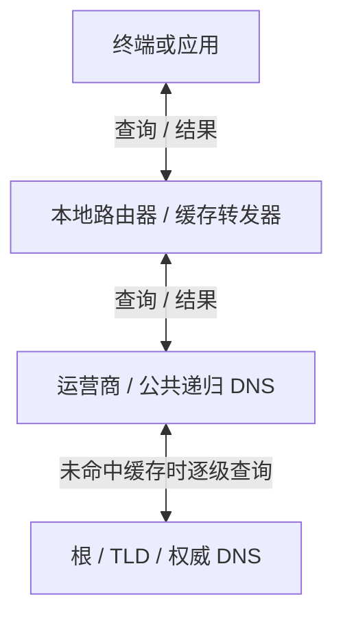

import Tabs from '@theme/Tabs';
import TabItem from '@theme/TabItem';

## 摘要

DNS 把域名转换为 IP，是访问网站、邮件、API、身份认证和内部服务的基础。DNS 本身主要解决可用性和分布式查找问题，不能自动证明“返回的地址一定真实”。攻击者可以修改权威区、污染递归缓存、伪造响应、劫持明文查询、滥用开放递归服务器进行反射放大，也可以借 DNS 隧道传输数据或建立命令控制通道。

排查 DNS 异常时，不能只看一个 IP，也不能只测试一个公共 DNS。应沿着“终端 → 本地转发器 → 网络链路 → 递归解析器 → 权威 DNS → 目标服务”的路径逐层比对，记录查询时间、记录类型、CNAME 链、TTL、响应来源、DNSSEC 验证状态和网络位置，最后形成可复核的证据链。

本文面向安全运营、网络安全、域名和基础设施工程师，讨论常见攻击、检查方法、修复思路，并以 `feei.cn` 的异常解析作为案例。文中命令只应在自有或明确授权的网络、域名和服务器上执行；公网探测、区域传送和流量抓包都应遵守组织授权和合规要求。

{/* truncate */}

## DNS 请求经过哪些环节

一次普通解析的查询与返回路径可以这样理解：



终端拿到 A、AAAA、CNAME 等解析结果后，再访问目标服务。每一层都可能改变结果，因此排查必须逐层比对。

异常可能发生在任意一层：

- 终端：hosts、浏览器安全 DNS、VPN、代理、TUN、恶意软件或应用缓存。
- 家庭路由器：DNS 代理、SmartDNS、AdGuard、OpenClash、静态重写、缓存或 IPv6 RA/DHCPv6 下发的 DNS。
- 网络链路：透明 DNS 代理、UDP/53 劫持、伪造响应、强制跳转到运营商 DNS。
- 递归解析器：缓存污染、配置错误、过期数据、错误的 DNSSEC 策略或开放递归。
- 权威 DNS、注册商和 DNS 管理账号：NS、A、AAAA、CNAME、MX、TXT、DS、DNSKEY 等记录被非法修改。
- 目标服务：CDN、GeoDNS、Anycast、ECS 或故障转移造成正常的多地址结果。

## 常见 DNS 攻击手法

### 权威 DNS 或注册商账户被接管

攻击者获得注册商、DNS 托管商或域名管理员账号后，可以修改 NS、A、AAAA、CNAME、MX、TXT、DS、DNSKEY 等记录，把网站、邮件或 API 指向攻击者控制的基础设施。CISA 对这类 DNS 基础设施篡改的建议包括检查 DNS 记录、修改账号密码、启用多因素认证和监控证书透明度日志（CT）。

特征：

- 多个递归 DNS 和权威服务器都返回同一个异常结果；
- NS、SOA、DS 或 DNSKEY 发生未经授权的变更；
- 证书透明度日志出现不应存在的新证书；
- 邮件突然转发失败或 MX 指向陌生网络。

### 域名投毒、域名影子和路由劫持

域名影子（domain shadowing）是在合法域名或被接管的 DNS 账号下批量创建隐蔽子域，用于钓鱼、恶意重定向或 C2。BGP/路由劫持则通过改变到权威 DNS、递归 DNS 或目标 IP 前缀的路由，让流量经过攻击者控制的网络；它可能与 DNS 篡改同时发生。

检查时应把新出现的子域、注册信息、NS/IP 的 ASN 变化、BGP 路径、TLS 证书和云平台资产放在同一条时间线上。单个 IP 地理位置变化不等于 BGP 劫持，必须结合路由公告和可达性证据。

### DNSSEC 密钥、签名和验证链攻击

DNSSEC 可以验证 DNS 数据的来源和完整性，但不能保护被盗的 DNS 管理账号、被篡改的 DS/DNSKEY 或错误的密钥轮换。攻击者若取得签名密钥，可能签发看似有效的错误记录；运维错误则可能使合法域名出现 SERVFAIL。检查应同时查看 DS、DNSKEY、RRSIG、签名有效期、密钥轮换记录、验证器日志和是否存在意外的 Negative Trust Anchor。

### 递归缓存污染和伪造响应

攻击者向递归解析器注入伪造的 DNS 响应，试图让解析器把错误记录缓存给后续用户。经典风险包括伪造源地址、猜测事务 ID、利用较短的随机性或在真实响应到达前发送伪造包。RFC 5452 要求解析器严格匹配问题段、事务和来源，并说明错误结果一旦进入缓存会影响所有使用该缓存的客户端。

特征：

- 只有某个递归 DNS 返回异常，换多个递归 DNS 后恢复；
- 异常记录的 TTL 不合理，且在缓存刷新后消失；
- 同一网络中不同设备同时看到相同错误结果；
- UDP 查询异常，TCP 或 DoH 查询正常。

### 明文 DNS 劫持和中间人伪造

传统 UDP/53 和 TCP/53 查询没有加密认证，链路上的设备可以观察、丢弃、修改或伪造响应。常见形式包括强制把所有 DNS 请求转发到指定服务器、对某些域名返回广告或封锁地址、对 NXDOMAIN 返回引导页。

DoH 使用 HTTPS 传输 DNS 查询，DoT 使用 TLS 传输 DNS 查询，可以减少链路设备直接篡改查询的机会；但它们不能替代 DNSSEC，也不能保证递归服务器本身返回的数据正确。RFC 8484 明确说明 DoH 的传输安全和 DNSSEC 的数据真实性是两件不同的事。

### 路由器、终端和代理中的 DNS 重写

很多“DNS 污染”实际上来自本地软件或设备：

- hosts 文件或本地 DNS 重写；
- SmartDNS、AdGuard Home、dnsmasq 的 `address=`、`server=`、`cname=` 规则；
- Clash/OpenClash/Mihomo 的 `fake-ip`、分流和 fallback；
- VPN、企业安全代理或浏览器自己的安全 DNS；
- 恶意软件修改系统 DNS、代理或路由器管理密码；
- IPv6 Router Advertisement 或 DHCPv6 下发了另一套 DNS。

如果 `192.168.31.1` 返回多个不属于目标服务的地址，而公共 DoH 返回正常结果，首先应检查路由器和终端，而不是直接认定权威 DNS 被攻破。

### DNS 反射与放大攻击

攻击者伪造受害者源地址，向允许公网递归的 DNS 服务器发送小查询，服务器把较大的响应发给受害者。DNSSEC、EDNS0 和大型 TXT 记录会增加响应体积。RFC 5358 建议递归服务只向授权客户端开放，权威服务器关闭递归，并在网络边界实施源地址验证（BCP 38）。

特征：

- 服务器出站 UDP/53 流量异常增加；
- 大量请求来自伪造或分散的源地址；
- 单个查询对应多个大响应；
- 服务器被第三方扫描为开放递归。

### NXDOMAIN 或随机子域名攻击

攻击者批量生成不存在的随机子域名，迫使递归服务器不断访问权威服务器，造成缓存无法命中、权威查询量上升和解析延迟增加。随机子域也常被用于绕过简单域名黑名单。

特征：

- NXDOMAIN 比例显著升高；
- 同一主机生成大量高熵、无语义子域名；
- 查询 QPS 高且域名几乎不重复；
- 递归服务器到某个权威域的出站请求异常增多。

### DNS 隧道、数据外传和 C2

DNS 的 QNAME、TXT、NULL 或其他记录字段可以承载编码数据。攻击者将数据切分成大量子域名发送到其控制的权威服务器，或通过 TXT 响应下发命令和数据。NIST 建议从查询量、QNAME 熵、异常长度、变化模式和恶意域名情报等角度检测 DNS 外传。

常见信号：

- 子域长度异常，字符集接近 Base32、Base64、十六进制；
- 单一主机持续查询同一低信誉域名的大量随机子域；
- TXT 查询比例或 TXT 响应大小突然升高；
- 查询间隔稳定，呈现 beacon 行为；
- 终端 DNS 查询量与业务行为不匹配。

### DNS Rebinding

攻击者先让域名解析到公网服务器，浏览器完成初次访问后，再把同一域名解析到内网或本机地址，试图绕过同源策略访问路由器、开发服务或内部 API。FIRST 建议监控低 TTL 域名，并使用 RPZ 记录或阻断指向 RFC1918 私网地址的响应；需要结合业务场景处理低 TTL，避免误报。

### 悬空 CNAME 与子域接管

域名仍保留指向第三方 SaaS、CDN 或云服务的 CNAME，但对应资源已经删除或释放。攻击者重新注册或占用该资源后，便可能控制原子域名。

检查重点：

- CNAME 是否指向已停用的云资源；
- 第三方服务是否返回“资源不存在”或默认页面；
- 证书、HTTP Host、云厂商资源 ID 是否仍归本组织所有。

### DGA、Fast Flux 和恶意解析基础设施

恶意程序可能通过域名生成算法（DGA）产生大量候选域名，或利用 Fast Flux 频繁更换 IP、TTL 和代理节点。单个 IP 不足以判断恶意，必须结合域名年龄、注册信息、ASN、证书、TTL 变化和终端行为。

### 区域传送和 DNS 元数据泄露

错误开放 AXFR/IXFR 会泄露整个 DNS 区域，包括内部主机名、管理面、邮件系统、旧资产和第三方服务。即使没有直接泄露，公开的 NS、MX、TXT、SPF、CAA、SRV 和被动 DNS 也可能帮助攻击者绘制资产图。MITRE ATT&CK 将 DNS 信息收集和未授权区域传送列为侦察风险。

授权检查示例：

```bash
dig @<权威NS> feei.cn AXFR
dig @<权威NS> feei.cn IXFR=0
```

对公网权威服务器，预期结果通常是 `REFUSED`、`NOTAUTH` 或连接被拒绝；不要对不属于自己的域名或服务器发起区域传送测试。

### LLMNR、NBT-NS 和 mDNS 伪造

严格意义上，LLMNR、NBT-NS 和 mDNS 不是公网 DNS，但它们承担本地名称解析功能。攻击者在同一网段伪造响应，可能诱导 Windows 主机连接到恶意服务并泄露 NTLM 认证材料，随后进行中继。企业环境应盘点这些协议的必要性，按业务需求禁用或限制，并监控异常响应者。

### Split-horizon、泛解析和 DNS 配置漂移

内外网使用不同视图（split-horizon）是常见设计，但配置漂移可能让内部域名意外暴露，或让外部用户拿到内部地址。泛解析、通配符、旧的 glue 记录、过期 NS 和未同步的次级权威也会产生看似随机的结果。排查时应分别从内网、外网、IPv4、IPv6 和多个递归位置查询，并记录视图、SOA serial 和权威 NS。

## 攻击面建模与安全工程师的工作边界

安全工程师处理 DNS 事件时，先划分资产和信任边界，再选择证据来源。至少建立以下资产清单：

| 资产类别 | 需要回答的问题 | 主要证据 |
|---|---|---|
| 注册商与域名账号 | 谁能修改 NS、锁定状态和联系人？是否启用 MFA？ | 注册商审计、登录日志、API 调用日志 |
| 权威 DNS | 哪些 NS 托管区文件？是否分离生产和管理面？ | 区文件、变更记录、查询日志、DNSSEC 状态 |
| 递归 DNS | 谁能使用递归？缓存多久？是否验证 DNSSEC？ | 查询日志、缓存统计、ACL、上游日志 |
| 网络路径 | 是否存在透明代理、DNS 重定向或 IPv6 旁路？ | 流量抓包、路由器规则、NetFlow、DHCP/RA |
| 终端与应用 | 谁发起查询？是否绕过企业解析器？ | EDR、进程网络连接、浏览器/VPN 配置 |
| 第三方资源 | CNAME、CDN、SaaS 资源是否仍被组织持有？ | 云平台资产、证书、HTTP/TLS、供应商审计 |

把事件影响分为三类：

- **完整性**：用户被解析到错误服务、邮件被改道、证书或登录流量被拦截；
- **可用性**：NXDOMAIN、SERVFAIL、超时、反射放大或权威服务被压垮；
- **保密性**：DNS 查询泄露、DNS 隧道外传、DoH 绕过企业监控。

安全工程师的结论应回答四件事：异常发生在哪一层、影响哪些客户端和域名、是否存在凭据或数据泄露、如何阻断并验证恢复。

## 排查方法：从现象到证据

### 第一步：固定问题边界

先记录：

- 完整域名和查询类型：A、AAAA、CNAME、MX、TXT、NS、DS、DNSKEY；
- 首次发现时间、时区和是否持续；
- 设备、操作系统、网络接口、IPv4/IPv6、Wi-Fi/蜂窝网络；
- 应用是否使用代理、VPN、TUN、浏览器安全 DNS；
- 当时的 DNS 服务器地址和查询工具版本；
- 完整响应、TTL、状态码、响应来源和截图。

不要只记录最终 IP。CNAME 链和 TTL 经常能直接指出异常所在层级。

### 第二步：查看终端当前使用的 DNS

<Tabs defaultValue="linux" groupId="operating-system">
<TabItem value="linux" label="Linux">

```bash title="查看 Linux 当前解析配置"
resolvectl status
cat /etc/resolv.conf
getent ahosts feei.cn
```

</TabItem>
<TabItem value="macos" label="macOS">

```bash title="查看 macOS 当前解析配置"
scutil --dns
networksetup -getdnsservers Wi-Fi
```

</TabItem>
<TabItem value="windows" label="Windows">

```powershell title="查看 Windows 当前解析配置"
ipconfig /all
nslookup feei.cn
Get-DnsClientServerAddress
```

</TabItem>
</Tabs>

移动设备还要检查“私人 DNS/加密 DNS”、VPN 配置、代理配置和 IPv6 网络信息。

### 第三步：并行比较多个递归 DNS

使用相同设备、相同时间、相同记录类型查询本地 DNS、运营商 DNS、国内公共 DNS 和国际 DoH。示例：

```bash
dig feei.cn A @192.168.31.1 +noall +answer
dig feei.cn A @114.114.114.114 +noall +answer
dig feei.cn A @223.5.5.5 +noall +answer
dig feei.cn A @119.29.29.29 +noall +answer
dig feei.cn A @8.8.8.8 +noall +answer
dig feei.cn A @1.1.1.1 +noall +answer
dig feei.cn AAAA @192.168.31.1 +noall +answer
```

DoH 示例：

```bash
curl -H 'accept: application/dns-json' \
  'https://dns.google/resolve?name=feei.cn&type=A'

curl -H 'accept: application/dns-json' \
  'https://cloudflare-dns.com/dns-query?name=feei.cn&type=A'
```

判断方式：

- 只有本地 DNS 异常：检查路由器、缓存和重写规则；
- 只有某一个递归 DNS 异常：怀疑该解析器缓存、配置或区域性故障；
- 明文 DNS 异常、DoH 正常：怀疑 UDP/53 或 TCP/53 链路劫持；
- 多个网络位置的公共 DNS 都异常：再检查权威 DNS、注册商和 CDN 配置；
- 只有某个应用异常：检查应用缓存、内置 DNS、代理和测试逻辑。

### 第四步：走权威链路确认源头

```bash
dig feei.cn CNAME +trace
dig feei.cn NS +trace
dig feei.cn SOA +trace
dig feei.cn DS +dnssec
```

拿到权威 NS 后，直接查询：

```bash
dig @<权威NS> feei.cn A +dnssec +multi
dig @<权威NS> feei.cn CNAME +dnssec +multi
dig @<权威NS> feei.cn AAAA +dnssec +multi
```

如果权威服务器和递归服务器一致，而本地结果不同，异常在递归之前。如果权威服务器本身已返回异常，需要检查 DNS 托管、注册商账号、变更日志和 DNSSEC 配置。

### 第五步：比较 UDP、TCP 和加密 DNS

```bash
dig @8.8.8.8 feei.cn A

dig +tcp @8.8.8.8 feei.cn A

dig @192.168.31.1 feei.cn A
```

如果 UDP 和 TCP 结果不同，重点怀疑 UDP 注入、分片丢包、EDNS0 或中间设备。若 TCP、DoT、DoH 都一致，而 UDP 异常，证据较强。

还应确认本机是否发起了非 DNS 的本地名称解析：

```bash
sudo tcpdump -ni any 'udp port 5353 or udp port 5355 or udp port 137'
```

Windows 可查看并按组织策略关闭 LLMNR、NetBIOS over TCP/IP 和不需要的 mDNS；不要仅凭发现报文就认定已被攻击，必须结合异常响应者、认证连接和终端进程证据。

抓包时只在获得授权的网络中进行：

```bash
sudo tcpdump -ni any 'port 53 or port 853'
```

Wireshark 重点字段：

- DNS Transaction ID；
- Query Name、QTYPE、QCLASS；
- 响应源 IP 和源端口；
- TTL、Answer、Authority、Additional；
- RCODE、截断位 TC、EDNS0；
- DNSSEC 的 AD、DO 和 RRSIG；
- 同一查询是否收到多个竞争响应。

### 第六步：检查路由器和终端配置

重点查看：

- 路由器上游 DNS、DNS 代理端口和重定向规则；
- `dnsmasq`、SmartDNS、AdGuard Home 的 hosts、重写和 fallback；
- Clash/OpenClash/Mihomo 的 fake-ip、nameserver、fallback、proxy-server-nameserver；
- `/etc/hosts`、Windows hosts 文件和浏览器 DoH；
- VPN、代理、企业安全客户端和终端防护产品；
- IPv6 RA/DHCPv6 提供的 DNS；
- 路由器固件版本、管理密码、远程管理和配置变更日志。

清理缓存后复测：

<Tabs defaultValue="linux" groupId="operating-system">
<TabItem value="linux" label="Linux">

```bash title="清理 systemd-resolved 缓存"
sudo resolvectl flush-caches
```

</TabItem>
<TabItem value="macos" label="macOS">

可重启 mDNSResponder 或重启网络接口：

```bash title="刷新 macOS DNS 缓存"
sudo killall -HUP mDNSResponder
```

</TabItem>
<TabItem value="windows" label="Windows">

```powershell title="清理 Windows DNS 缓存"
ipconfig /flushdns
```

</TabItem>
</Tabs>

不同系统和路由器命令会有差异，执行前应确认设备型号和运行环境。

### 第七步：检查权威 DNS、注册商和证书

域名所有者或管理员应检查：

- 注册商登录、MFA、恢复邮箱和 API Key；
- NS、A、AAAA、CNAME、MX、TXT、CAA、DS、DNSKEY 的变更记录；
- DNS 托管商审计日志和变更通知；
- 证书透明度日志中是否有陌生证书；
- 邮件 SPF、DKIM、DMARC 和 MX 是否被修改；
- 账号是否存在异常登录、API 调用或权限扩大。

CISA 建议对 DNS 管理账号启用 MFA，并持续监控 DNS 记录和 CT 日志。

## 快速判定矩阵

| 现象 | 优先怀疑 | 首要验证 |
|---|---|---|
| 只有路由器地址返回异常 | 本地重写、缓存、SmartDNS/代理 | 直连可信 DoH，检查路由器配置与抓包 |
| 所有明文 DNS 异常，DoH/DoT 正常 | UDP/53、TCP/53 被劫持或重定向 | 比较 UDP、TCP、DoT、DoH 的响应源和内容 |
| 权威 NS 也返回异常 | DNS 托管、注册商、云账号或区文件被改 | 查审计日志、DS/DNSKEY、变更时间线 |
| 只有一个应用异常 | 应用缓存、内置 DNS、代理、证书或 Host 校验 | 用系统工具和独立应用复测 |
| 仅 IPv6 异常 | RA/DHCPv6 DNS、IPv6 路径或 AAAA 配置 | 分别查询 A/AAAA，禁用 IPv6 做对照 |
| NXDOMAIN/SERVFAIL 激增 | 随机子域攻击、权威故障、DNSSEC 失败 | 查看 RCODE、权威日志、验证失败和 QNAME 分布 |
| DNS 流量小而持续、子域高熵 | DNS 隧道或 beacon | 关联进程、域名信誉、长度/熵、TXT 和时序 |

这张表用于决定下一步取证方向，不能替代完整的权威链路验证。

## 检测与监控设计

### 递归 DNS 指标

建议按客户端、域名、记录类型、RCODE 和上游权威服务器统计：

- QPS、平均延迟、P95/P99 延迟；
- NXDOMAIN、SERVFAIL、REFUSED 比例；
- 缓存命中率和过期刷新量；
- UDP、TCP、DoT、DoH 请求占比；
- 单客户端查询量、唯一域名数量和失败率；
- TXT、NULL、ANY、DNSKEY 等异常查询类型。

### 告警规则

适合建立基线后告警的场景：

- 重要域名的 A、AAAA、NS、MX、CAA、DS 发生变化；
- TTL 突然变短或 IP/ASN/国家发生异常变化；
- 域名突然指向 RFC1918、环回、链路本地或保留地址；
- 单主机随机子域、长标签、高熵标签数量激增；
- NXDOMAIN、SERVFAIL 或 TXT 流量异常上升；
- DNS 管理账号从新位置登录或修改关键记录；
- 递归服务器出现公网开放、异常大响应或出站流量峰值。

### 日志和工具

企业递归解析器可使用 dnstap、查询日志、SIEM、Zeek、DNS 防火墙和 RPZ。日志至少保留时间戳、客户端、QNAME、QTYPE、RCODE、响应 IP、TTL、上游服务器和策略命中结果。日志中应脱敏或限制访问，避免把内部主机名和用户行为无控制地暴露出去。

可以把检测逻辑拆成四类分析：

- **完整性分析**：关键域名解析结果、NS、MX、CAA、DS/DNSKEY、SOA serial 的变化检测；
- **行为分析**：客户端 QPS、唯一域名数、QNAME 长度/熵、TXT 比例和 NXDOMAIN 率；
- **基础设施分析**：返回 IP 的 ASN、地理分布、证书、HTTP 服务指纹、TTL 和历史被动 DNS；
- **关联分析**：把 DNS 查询与发起进程、用户、代理连接、EDR 告警、邮件日志和云审计关联。

伪代码示例：

```text
告警：关键域名的 A/AAAA/NS/MX/CAA/DS 变化
条件：新值不在批准清单，或变更没有对应的工单/审计事件
动作：通知域名管理员，查询注册商和 DNS 托管登录日志，冻结高风险 API Key

告警：单主机 10 分钟内高熵子域名数量超过基线
条件：标签长度高、重复率低、查询间隔稳定，且域名信誉低或 TXT 比例升高
动作：关联进程和用户，隔离终端，保存 DNS 与 EDR 证据
```

## 修复和加固

### 终端与家庭网络

- 优先使用可信 DoH/DoT 或经验证的运营商 DNS；
- 清理 hosts、代理、VPN、TUN 和浏览器 DNS 配置；
- 路由器关闭公网远程管理和公网递归；
- 更新路由器固件并更换管理密码；
- 检查 IPv6 DNS、RA、DHCPv6；
- 关闭不需要的 DNS 重写、广告过滤和 fake-ip 规则；
- 清空本地和路由器缓存后重新测试。

### 企业递归解析器

- 递归只允许内部网段访问，公网关闭递归；
- 限制出站查询和异常 QPS，启用 fetches-per-zone 等保护；
- 启用 DNSSEC 验证并监控验证失败；
- 使用 RPZ 阻断已确认的恶意域名和指向私网的 rebinding 响应；
- 对日志做集中采集、完整性保护和访问控制；
- 对外部 DoH/DoT 建立明确的访问策略，避免绕过企业 DNS 监控；
- 权威和递归服务尽可能分离。

### 权威 DNS 和域名管理

- 注册商、DNS 托管和云账号启用 MFA；
- 使用最小权限和独立 API Key；
- 对关键记录启用变更审批、双人复核和告警；
- 部署 DNSSEC，保护 DS、DNSKEY 和签名链；
- 监控 NS、MX、CAA 和证书透明度；
- 定期清理悬空 CNAME 和已删除的第三方资源；
- 保留可回滚的区文件和变更审计记录。

## `feei.cn` 案例分析

本案例可抽象为：多个公共 DNS 和运营商 DNS 返回 `feei.cn` 的同一组权威 CNAME/IP，而某个本地转发器或测试路径返回与 `feei.cn` 无关的地址。判断重点不是“某个 IP 是否和历史记录相同”，而是比较权威链路、递归结果、本地缓存、IPv4/IPv6 和明文/加密传输。

相反，`192.168.31.1` 返回了 `31.13.*`、`69.63.*`、`2a03:2880:*` 等 Meta/Facebook 相关地址；“探物”显示使用 8.8.8.8，却得到 `168.143.171.154`、`128.121.146.228`。这组现象说明：

1. `feei.cn` 的权威解析普遍正常；
2. 异常集中在本地 DNS、明文 DNS 链路、代理/应用缓存或测试工具路径；
3. 不能仅凭“界面显示 8.8.8.8”证明查询实际到达 Google；
4. 应在同一设备上比较本地 DNS、UDP/TCP、DoH、IPv4/IPv6，并抓包确认响应来源；
5. 在证书出现错误、域名跳转异常或解析到无关网络时，不应向目标站点输入账号、密码或验证码。

## 应急响应与证据保全

### 处置顺序

1. **确认范围**：固定时间、域名、记录类型、受影响网络和客户端，保存原始响应。
2. **降低风险**：对重要域名启用组织批准的 DoH/DoT 或内部验证递归；暂时阻断已确认的错误 IP、恶意域名和异常 DNS 出站路径。
3. **保护账号**：冻结或轮换注册商、DNS 托管、云平台和 API 凭据，启用 MFA；不要先删除日志或覆盖配置。
4. **修复源头**：恢复权威记录、撤销恶意 NS/CNAME/MX、修正递归 ACL、删除本地重写或恶意代理。
5. **验证恢复**：从多个网络和解析器验证 A、AAAA、CNAME、MX、NS、CAA、DS/DNSKEY，并确认 TTL、证书和应用登录链路。
6. **判断影响**：检查异常期间的 Web、邮件、身份认证、API、EDR、代理和 DNS 日志，评估是否需要密码重置、令牌吊销或通知用户。
7. **复盘改进**：形成时间线、根因、控制缺口、检测规则和回滚方案。

### 证据保全

至少保留：原始 DNS 报文或 `pcap`、命令和工具版本、查询时间、设备配置、路由器/递归/权威审计日志、注册商和云平台登录日志、证书透明度查询结果、恶意 IP/域名情报快照。对文件计算哈希并记录采集人、采集时间、时区和系统时钟状态。

不要只保存截图；截图便于沟通，但无法替代原始响应、抓包和审计日志。对可能涉及取证或合规的事件，按组织证据保全流程保存原始文件和访问记录。

## 证据记录模板

```text
事件编号：
发现时间（含时区）：
设备/系统：
网络类型：Wi-Fi / 蜂窝 / VPN / 企业网络
目标域名：
记录类型：A / AAAA / CNAME / MX / TXT / NS
使用 DNS：
查询方式：UDP / TCP / DoT / DoH
完整响应：
CNAME 链：
最终 IP：
TTL：
RCODE：
DNSSEC AD/DO/RRSIG：
响应源 IP：
是否可复现：
更换网络后的结果：
更换终端后的结果：
抓包文件哈希：
初步结论：
处置动作：
```

## 全面性检查与实战注意点

本文覆盖了 DNS 完整性、可用性和保密性三类风险，以及权威、递归、终端、网络和第三方资源五个层面。安全工程师在实际项目中还应主动检查以下容易遗漏的项目：

- **区域传送**：权威 DNS 不应向公网未授权主机提供 AXFR/IXFR；
- **本地名称解析**：Windows 的 LLMNR、NBT-NS 和 mDNS 可能被伪造，导致 NTLM 哈希泄露或中继；不需要时应通过组策略或网络控制关闭；
- **DNSSEC 运维**：检查 DS、DNSKEY、RRSIG、签名有效期、密钥轮换和验证失败日志；DNSSEC 验证失败可能表现为普通 SERVFAIL；
- **泛解析和通配符**：意外的 wildcard 记录可能把不存在的子域都指向同一服务，扩大接管和钓鱼影响；
- **CAA、MX 和邮件安全**：DNS 事件不能只检查网站 A 记录，还要检查证书签发授权和邮件路由；
- **DoH/DoT 盲区**：加密 DNS 能保护链路，但未经治理的外部 DoH 可能绕过内部 RPZ、审计和恶意域名控制；
- **缓存和 TTL**：修改记录后要等待旧 TTL 过期，并核对不同递归节点的缓存刷新时间；
- **GeoDNS/CDN/ECS**：同一域名返回不同 IP 可能是正常分流，不能把“IP 不同”直接当成攻击；要比较 ASN、证书、HTTP Host、地理位置和权威配置；
- **第三方子域接管**：定期扫描悬空 CNAME、已删除云资源和过期 SaaS 绑定；
- **检测归因**：长域名、低 TTL、不同国家 IP 和高 NXDOMAIN 率都是线索，不是单独的定案证据。

检测内容可以映射到 MITRE ATT&CK：DNS 隧道通常对应 T1071.004，DNS 侦察和区域信息收集涉及 T1590.002，LLMNR/NBT-NS/mDNS 伪造与中继涉及 T1557.001。这样可以把 DNS 告警接入现有 SIEM、EDR 和威胁狩猎流程。

## 范围边界与剩余风险

本文覆盖常见 DNS 攻击和大多数企业排查路径，但不能替代具体产品的配置审计、渗透测试、取证流程或运营商级路由分析。以下问题通常需要专门工具或供应商协助：

- BGP 劫持需要路由观测、多个外部探针和运营商侧证据；
- 权威 DNS 的密钥泄露需要结合 HSM、KSK/ZSK 管理和云托管审计；
- DoH/DoT 加密后，网络侧无法直接看到 QNAME，需要在终端、递归代理或浏览器策略侧补充日志；
- CDN、Anycast、ECS、WAF 和多云故障切换可能产生合法的 IP、TTL 和地域差异；
- 低 TTL、高熵域名、NXDOMAIN 和第三方 CNAME 都可能是正常业务现象，必须与资产、进程、账号和变更记录关联。

安全工程师交付结果至少应包括：影响范围、证据时间线、根因判断、已采取的阻断措施、恢复验证结果、残余风险和后续控制项。

## 结语

DNS 排查的核心不是寻找“唯一正确的 IP”，而是定位哪一层改变了查询结果。先固定记录类型和时间，再比较本地、运营商、公共和权威解析；接着比较 UDP、TCP、DoT、DoH，并检查终端、路由器、IPv6 和代理。对于 DNS 隧道、反射放大和权威区篡改，还要结合流量、账号、审计、证书和资产信息。只有把结果、路径和时间线放在一起，才能区分正常的 CDN/GeoDNS 分流、配置问题、链路劫持和真正的攻击。

## 参考资料

- [RFC 4033：DNSSEC 安全介绍与要求](https://www.rfc-editor.org/rfc/rfc4033.html)
- [RFC 4035：DNSSEC 协议修改](https://www.rfc-editor.org/rfc/rfc4035.html)
- [RFC 5452：增强 DNS 对伪造响应的抵抗能力](https://www.rfc-editor.org/rfc/rfc5452.html)
- [RFC 5358：防止递归 DNS 被用于反射攻击](https://www.rfc-editor.org/rfc/rfc5358.html)
- [RFC 7858：DNS over TLS](https://www.rfc-editor.org/rfc/rfc7858.html)
- [RFC 8484：DNS over HTTPS](https://www.rfc-editor.org/rfc/rfc8484.html)
- [NIST SP 800-81 Rev. 3：Secure DNS Deployment Guide](https://csrc.nist.gov/pubs/sp/800/81/r3/final)
- [CISA：Mitigate DNS Infrastructure Tampering](https://www.cisa.gov/sites/default/files/publications/CISAInsights-Cyber-MitigateDNSInfrastructureTampering_S508C.pdf)
- [FIRST：DNS Rebinding Detection and Advice](https://www.first.org/global/sigs/dns/stakeholder-advice/dns-rebinding)
- [MITRE ATT&CK T1071.004：DNS 隧道和 DNS C2](https://attack.mitre.org/techniques/T1071/004/)
- [MITRE ATT&CK T1590.002：DNS 信息收集](https://attack.mitre.org/techniques/T1590/002/)
- [MITRE ATT&CK T1557.001：LLMNR/NBT-NS/mDNS 名称解析投毒](https://attack.mitre.org/techniques/T1557/001/)
