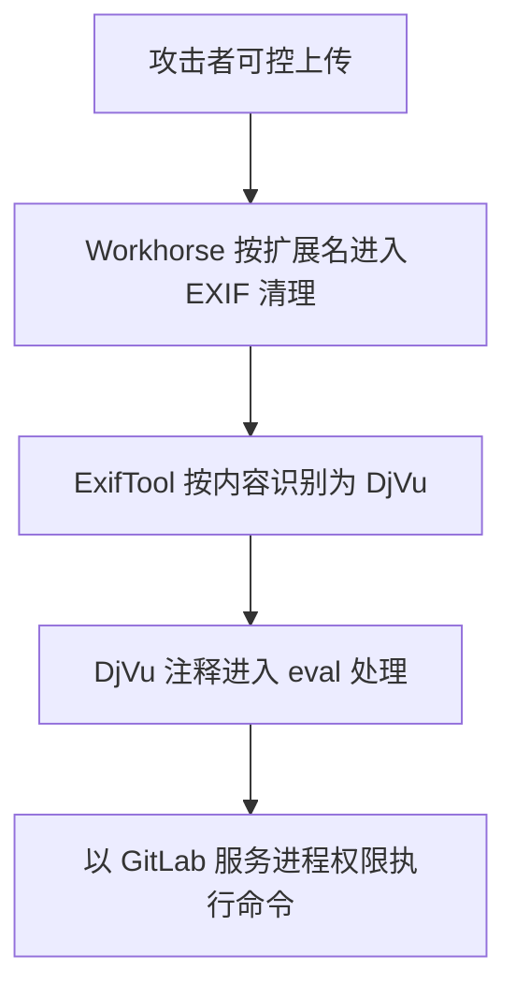

# GitLab ExifTool RCE

CVE-2021-22205 是 GitLab 上传处理链中的远程代码执行漏洞。GitLab CNA 记录将其评为 CVSS 3.1 10.0（Critical），向量为 `AV:N/AC:L/PR:N/UI:N/S:C/C:H/I:H/A:H`。受影响范围为 GitLab `>=11.9, <13.8.8`、`>=13.9, <13.9.6`、`>=13.10, <13.10.3`。

这个案例适合用于理解跨组件攻击面：应用按扩展名挑选处理路径，底层解析器却按文件内容识别格式；一旦解析器支持的某个格式存在代码注入，应用层原本以为只处理 JPEG/TIFF 的边界就失效了。

## 原始披露与 CVE 口径

研究者 vakzz 在 2021-04-07 提交的 HackerOne 报告中，通过 GitLab snippet 的附件上传复现了命令执行。报告的影响表述是：任何能够上传图片并使其经过 GitLab Workhorse 的人，都可能提交特制文件获得 RCE。

GitLab 后续 CNA 记录把完整问题定为无需权限、无需用户交互的网络攻击，CVSS 为 10.0。两份来源描述的是同一解析链，但可达性口径并不完全相同：原始报告展示了一个需进入上传界面的复现路径，CVE 记录给出的是厂商最终确认的产品影响。复盘时应分别引用，不能把其中一个口径静默替代另一个。

## 利用链如何形成

### Workhorse 按扩展名选择 EXIF 清理路径

当上传文件使用 `jpg`、`jpeg` 或 `tiff` 扩展名时，GitLab Workhorse 会调用 ExifTool 去除非白名单元数据。应用层由扩展名决定“是否交给解析器”，但扩展名并不能证明文件内容真的是 JPEG 或 TIFF。

### ExifTool 按内容识别实际格式

ExifTool 不仅信任扩展名，还会检查文件内容并选择对应解析模块。因此，把 DjVu 内容命名为 `.jpg`，仍可能进入 DjVu 解析器。这里的核心问题是两个组件对“允许格式”的判断标准不同，导致真实解析面大于应用层预期。

### DjVu 注释处理把攻击者数据带入 `eval`

原始报告指出，受影响 ExifTool 的 DjVu 模块为转换 C 风格转义序列而使用 Perl `eval`。解析器虽尝试处理引号和转义，但攻击者可以利用反斜杠加换行改变字符串边界，把 Perl 表达式带入求值过程，最终执行系统命令。

从防御视角看，关键因果链是：

## 为什么不能称为“四个低危漏洞”

扩展名筛选、内容识别、DjVu 模块和反斜杠换行构造是对利用链的工程拆解，但官方资料没有为这四项分别给出低危 CVSS。扩展名与内容识别错配更像攻击面放大条件；`eval` 注入是核心代码执行缺陷；上传接口的可达性决定攻击者是否能把恶意内容送入这条链。

因此，正确的结论不是“多个已评级低危漏洞合成高危”，而是“跨组件边界让高危解析器缺陷从可控上传面变成产品级 RCE”。完整漏洞的厂商评分是 Critical，补丁优先级应按完整可利用路径判断。

## 工程防御

- 立即升级到厂商修复版本或更新版本，不把 WAF、扩展名检查当作补丁替代品。
- 在进入复杂解析器前验证文件魔数与实际结构，并让允许格式与解析器可达模块保持一致。
- 对不需要的解析模块做显式裁剪或隔离；解析用户文件的进程使用最小权限、独立沙箱和受限出站网络。
- 禁止用通用 `eval` 解释用户可控的转义序列；若必须解析，使用只接受明确语法的状态机。
- 测试跨组件边界：扩展名、MIME、魔数、重命名、嵌套格式和解析器回退路径都应进入安全测试矩阵。

## 参考资料

- [GitLab CNA：CVE-2021-22205](https://gitlab.com/gitlab-org/cves/-/raw/master/2021/CVE-2021-22205.json)，包含受影响版本与 CVSS 3.1 评分；记录更新时间 2021-11-17。
- [GitLab 公开 Issue #327121](https://gitlab.com/gitlab-org/gitlab/-/issues/327121)，收录 2021-04-07 的报告内容与修复处理记录。
- [HackerOne #1154542](https://hackerone.com/reports/1154542)，原始研究者披露。
