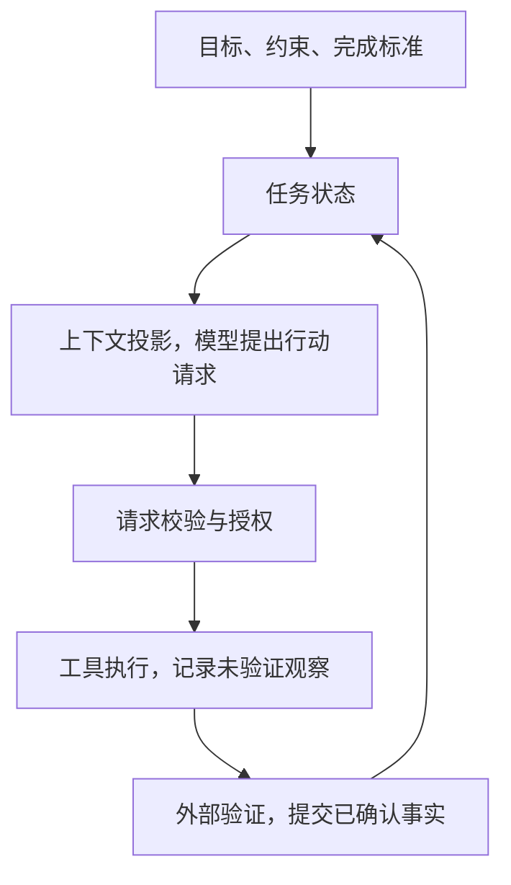

# Agent 架构基础

Agent 架构要解决一个工程问题：**如何让模型根据环境选择行动，同时让系统对过程和结果仍然可控、可验证、可恢复。**

本文采用一个工程定义：Agent 是允许模型根据当前状态和观察，在运行时选择下一步行动的软件系统。模型处理无法预先枚举的决策；宿主程序掌握状态、权限、执行、验证和终止权。生产可靠性主要来自这些模型之外的控制机制。

下文用一个仓库 Bug 修复任务贯穿全文：用户登录后被错误地重定向到首页，Agent 需要定位原因、修改代码并给出可审查的补丁。完成标准是新增回归测试、相关测试通过、差异中没有无关改动；约束是只能读写当前仓库，不得访问生产凭证或自行部署。

## 工作流与 Agent 的边界

Anthropic 在 [Building Effective Agents](https://www.anthropic.com/engineering/building-effective-agents) 中给出了一个实用区分：**工作流的控制路径由代码预先定义，Agent 则由模型根据运行时的观察动态选择路径和工具。**

两者更像一条连续谱，常见的生产形态是确定性外层包住少量 Agent 节点。仓库任务中，“只能修改工作区”、“测试失败时不能交付”适合写成确定性规则；“应该先读哪些文件”、“根据报错如何调整修复”可以交给模型决定。

已知步骤、副作用高或合规路径严格的任务，更适合工作流。路径难以预先枚举，且中间结果能及时验证时，Agent 才能发挥动态决策的价值。一次工具调用或一个聊天界面并不足以决定系统属于哪一类；控制路径由谁选择才是判断依据。

## 一次完整的行动循环

Agent 运行前需要一份任务契约：**目标说明要改变什么，完成标准说明如何证明已经完成，约束说明允许付出什么代价、进入哪些资源和产生哪些副作用。** 模糊目标会让模型有更多自由，却不会自动产生可验收的结果。

一个完整循环可以表示为：

控制器据此决定继续、重试、重规划、等待审批、转人工或结束。

每轮循环包含六个动作：

1. 控制器从持久化状态中读取当前目标、进度、制品和风险。
2. 上下文管理器只选取当前决策需要的信息，提供给模型。
3. 模型返回结构化的行动请求，例如读取文件、修改代码或运行某组测试。
4. 宿主校验参数、前置条件和权限，再在受限环境中执行工具。
5. 执行结果被解析、限长、标记来源，作为未验证观察追加到执行轨迹。
6. 验证器检查局部后置条件和整体完成标准，运行时再将已确认事实提交到任务状态。

原始观察可以带着来源和信任标记进入下一轮上下文，但不会自动升级为权威事实。模型输出也只是**行动请求**，不具有授权效力。即使模型生成了合法的 `deploy_production` 调用，宿主仍应根据当前身份、任务范围和审批状态拒绝执行。同样，成功必须由完成标准判定，模型无法通过一句“已完成”让任务进入成功状态。

## 状态、上下文与记忆

这三个概念服务于不同目的，混在一段对话中会让恢复和审计变得困难。

**状态是当前任务的权威事实源。** 它应结构化保存目标、约束、已完成动作、已确认事实、错误分类、待审批项、预算和验证结果。原始工具输出保留在执行轨迹中，状态通过引用与它关联。例如“回归测试已经复现故障”是状态中的事实，应指向已校验的命令、退出码和日志。

**上下文是某一轮决策的临时视图。** 它由状态、检索到的记忆和工具观察投影而来。修改路由逻辑时，模型需要相关源码和失败测试，通常不需要之前每次搜索的完整输出。上下文可以压缩或重建；任务事实仍保存在状态和制品中。

**记忆是跨步骤或跨任务保留、随后可检索的信息。** 它可以存放项目约定、历史决策和已验证的故障处理方法。向量数据库只是实现选择之一。检索结果需要保留来源和时效，模型生成的“失败经验”应先验证再进入长期记忆。

**制品是文件、补丁、测试日志等大对象。** 状态中保存路径、版本或校验值，用到时再读取，可以避免将大量原文反复塞入上下文。

摘要只负责导航，不能覆盖原始事实。用户约束、权限、金额、标识符和工具执行结果需要结构化保存，并指向原始来源。具体的分区、压缩、检索与跨会话管理方法见[上下文工程](/context-engineering)。

## 控制策略随任务变化

规划是一种可选的决策策略，不是 Agent 的必备存储层或固定阶段。控制策略可以按任务特征分为三类：

**反应式循环。** 模型根据最新观察选择一次行动，运行时逐步修正方向。[ReAct 论文](https://arxiv.org/abs/2210.03629) 展示了推理与行动交替如何利用环境反馈。对本文的仓库修复案例，可以先用反应式循环处理“读取报错、搜索相关代码、运行单个测试”，再根据评测结果决定是否增加显式规划。工程实现可参考 [ReAct 模式](/react-agent-loop)。

**先规划再执行。** 规划器先生成带依赖和完成条件的任务图，执行器按当前状态推进，偏离预期时触发重规划。跨数据库、API 和前端的修复会产生多个依赖步骤，并且常需在实施前审查计划。详见 [Plan-and-Execute 模式](/plan-and-execute-loop)。

**有预算的分支搜索。** 当多个根因或候选补丁值得比较时，系统可以在限定并发数、步数和成本内展开少量分支，然后用同一套测试和约束比较结果。分支数会扩大调用成本和故障面，只适合结果能独立评估的任务。

无论使用哪种策略，计划都应是可修改的任务状态，而非一段生成后必须照做的自然语言清单。系统需要记录行动、观察和决策依据，不依赖模型公开完整的内部思维过程。权限门、验证节点和停止条件仍由确定性代码掌握。

## 工具契约与权限边界

工具是 Agent 的行动接口，工具契约同时定义了模型可以请求什么，以及宿主如何判断、执行和解释这项请求。一份可用的契约至少包含：

- 目的、类型化的输入参数、稳定的返回结构和前置条件。
- 权限范围、可访问资源、副作用等级和是否需要人工确认。
- 超时、成本、幂等性、重试语义，以及外部副作用的查询或补偿方法。
- 可区分业务拒绝、暂时失败、永久失败和结果未知的错误，并提供可采取的下一步。

例如，`write_file` 应限定为当前仓库中的允许路径，在写入前检查文件版本，返回实际变更的路径和内容校验值。超时的远程写操作可能已经生效，此时应先查询状态，避免盲目重试造成重复副作用。

工具集应按任务和权限动态缩小，让模型只看到当前需要的行动空间。[MCP 架构规范](https://modelcontextprotocol.io/specification/2025-11-25/architecture) 可以统一连接建立后的能力声明、枚举和调用协议；它不负责业务授权、沙箱、工具可靠性或输出语义，这些仍需要应用层控制。

权限检查应默认拒绝，按工具、资源和动作逐次判定。凭证不进入模型上下文，只有宿主在获准执行时才注入短期凭证。网页、文档、检索结果和工具返回值都按不可信观察处理，其中的文本无权改变系统规则。权限门还要检查数据从哪里来、将流向哪里；读取不可信内容后向网络、消息系统或跨域存储发送数据，需要单独的数据流策略或审批。[OWASP 的 Prompt Injection 指南](https://genai.owasp.org/llmrisk/llm01-prompt-injection/) 也强调了外部内容可能通过间接注入影响模型行为。完整威胁模型和防护层见 [AI 安全](/ai-security)。

## 验证、恢复与停止

工具返回成功，只能说明它满足了工具契约定义的成功条件，无法证明上层任务目标已经达成。代码被写入后，Agent 还要检查差异、运行回归测试，并确认原有行为没有被意外改变。可执行的外部信号应优先于模型自评：

- **调用前检查**校验参数 Schema、前置条件、权限和审批状态。
- **动作级验证**检查退出码、返回结构和局部后置条件。
- **状态级验证**检查业务不变量、文件差异、数据对账和资源版本。
- **任务级验收**回到最初的完成标准，检查所有必要证据是否齐全。

请求检查、工具执行或结果验证未通过后，控制器先区分暂时错误、输入错误、并发冲突、策略拒绝和结果未知，再选择对应恢复动作：有上限的退避重试、修正参数、重规划、从检查点恢复、执行补偿动作或转交人工。检查点需要保存结构化状态、已完成动作 ID、制品引用、待审批项和工具结果来源。恢复上下文不会撤销已经发生的外部副作用，这类动作必须有幂等设计、补偿操作或人工处理方案。

运行状态需要区分两类：**成功、失败和取消**是终态；**等待审批、等待依赖和受阻**是可恢复的暂停态。外部条件长期无法满足时，受阻的运行可以结束为失败。步数、时限、费用、重试次数和工具调用量应有硬上限；连续重复同一动作、相同错误反复出现或状态长时间没有变化，应触发重规划或人工接管。“持续运行直到完成”只有在同时具备预算、取消和接管机制时才是完整的运行策略。将这些机制落到可追踪的运行环境中，属于 [Harness 工程](/harness-engineering)。

## 单 Agent 与多 Agent

架构设计应从一个 Agent 加一组受限工具开始。一个控制器可以维持完整状态时，把“搜索代码”、“运行测试”包装成工具，通常比增加搜索 Agent 和测试 Agent 更简单。多 Agent 不会自动提高推理能力，每一次委派都会增加模型调用、状态同步和故障追踪的成本。

只有当下列收益足以覆盖协调成本时，才值得拆分：

- 多个独立子任务可以并行执行。
- 多个独立子任务需要显著不同的上下文，拆分后能减少互相干扰。
- 子任务需要不同的工具或权限边界。
- 验证需要与执行者分离的输入、证据和验收权。

协调者负责提出任务拆解和结果合并方案；共享状态由确定性运行时单点提交，权限门和验证器决定方案是否被接受。每个子 Agent 接收一份委派契约：输入快照、允许的工具、权限子集、预算、期限、输出 Schema 和验收标准。子 Agent 不应自动继承协调者的全部权限。多个 Agent 需要协作写状态时，可以使用版本号、明确字段所有权或追加事件，避免把一段“公共对话记忆”当成并发数据库。多 Agent 的上下文拆分不构成安全边界，租户隔离仍由认证、授权、存储分区和执行环境保证。

验证器可以由确定性程序承担。编译器、测试套件、Schema 和业务不变量能提供更独立、更稳定的反馈。仅仅给同一模型换一个“评审者”角色，并不能自动形成独立验证。

## 自主程度取决于可验证性

设计 Agent 时，可以用五个问题判断应该放开多少控制权：

1. 完成标准能否在执行前写清？
2. 任务状态能否被持续观察？
3. 每个行动的资源和副作用能否被限制？
4. 错误能否在造成较大损失前被检出？
5. 失败后能否重试、回滚、补偿或转交人工？

这五个问题用于设计审查，上线前还需要评测证据。固定代表性任务集、环境、模型和工具版本，进行多次运行，至少记录经验证的任务成功率、安全规则违反、错误副作用、人工介入、恢复成功率、延迟和每个成功任务的成本。报告中同时保留验收口径和版本信息，才能判断架构改动是否真正提高了可靠性。

当测试能够覆盖完成标准、写入限定在可恢复工作区，且外部命令没有未受控副作用时，仓库内的代码修改适合让 Agent 自主进行读取、编辑和测试。测试覆盖不足时仍会出现假成功。创建 PR 会影响外部协作流程，可以在执行前请求确认；部署生产、修改权限、付款和发送外部消息的影响更大，需要更严格的授权、审批和事后对账。

自主性是一项由任务结构和控制能力决定的系统属性，不是产品的固定标签。成功标准越可观察、行动越受约束、失败越容易恢复，系统才能安全地提高自主程度。模型与工具提供候选行动能力，权限和执行环境决定实际可执行范围，状态、验证与恢复机制决定系统可以安全地放权到哪一步。更完整的能力判断见[模型能力边界](/ai-capability-boundary)，实现路径见 [Agent 实践](/ai-agent-practice)。
