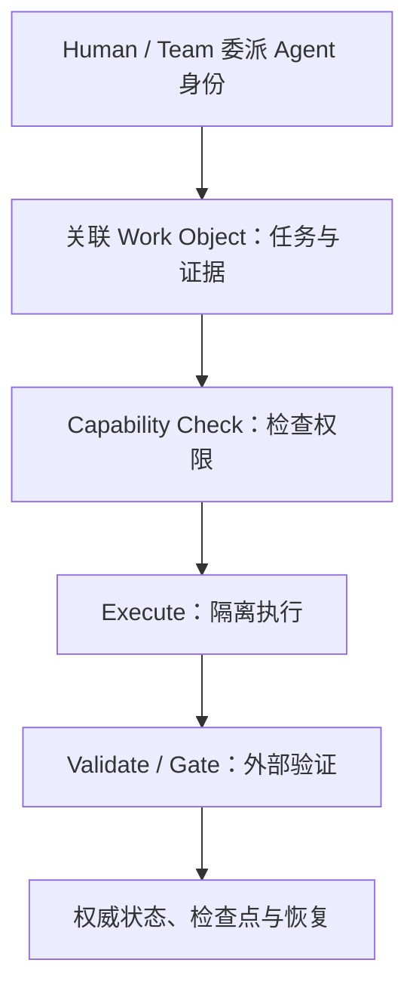

# Harness 工程

Harness 是包在模型外面的执行环境。它接收模型提出的行动请求，检查权限，在隔离工作区执行命令，再用测试和代码差异判断任务是否真的完成。模型可以提出修改方案，宿主程序始终掌握写入、执行、验证和终止权。

本文给出一个最小仓库 Harness 的实现参考，贯穿同一个 Bug：入口把已校验的 `/settings` 写入 `session['return_to']`，登录回调却读取 `session['next_path']`，因此登录后回到首页 `/`。目标是修复回跳逻辑并补充回归测试；Agent 只能修改 `src/auth/**` 和 `tests/auth/**`，不能安装依赖、访问生产凭证、连接外部网络或部署代码。

正文提供目录契约、状态结构、命令和 Gate 顺序，无法直接拼成一个独立运行的宿主程序。实际落地还要实现文件与命令拦截、原子状态写入、进程取消和沙箱隔离，并为这些控制器代码单独测试。

本文从行动请求进入宿主程序开始，只处理仓库环境和外部控制。模型如何选择下一步行动属于 [Agent 架构基础](/agent-architecture) 的范围。

## Harness Architecture：先定义模型外的控制面

Harness 的核心不是某一种 Worktree 或命令执行方式，而是把模型不能自行决定的控制放在模型之外。一套完整 Harness 至少要回答六件事：

| 控制面 | 要回答的问题 |
|---|---|
| **Identity** | 谁在行动？哪个 Human / Agent / Model / Delegation 对应这次运行？ |
| **Work Object** | 这次工作属于哪个任务，相关 Context、Patch、CI、Review、Approval 如何关联？ |
| **Capability** | Agent 能读什么、写什么、调用什么，哪些动作需要额外授权？ |
| **State & Evidence** | 哪些是模型观察，哪些是宿主确认的权威状态，证据如何引用？ |
| **Gate** | 什么条件满足后才能进入下一阶段或宣布成功？ |
| **Recovery** | 中断、超时、部分副作用和失败后从哪里恢复，如何避免重复执行？ |

可以把运行关系压缩为：



模型负责提出下一步行动和解释观察；Harness 负责身份、授权、执行、证据、状态和终止。模型能力升级可以减少 Capability Scaffold，但不能自动取消这些 Safety / Assurance Control。

下面先说明 Work Object、Event Log 和 Agent Identity，再用一个仓库修改任务展示这套架构如何落地。

## Repository Harness Reference：把架构落到真实仓库

下面继续使用登录回跳 Bug 作为贯穿案例。Git Worktree、命令 Allowlist、Diff、Test 和 Checkpoint 都只是上述 Architecture 在代码仓库中的一种实现；其他环境可以替换执行器，但仍应保留相同的身份、能力、状态、Gate 和恢复语义。

### 运行目录与前置条件

一套符合本文约束的实现，应为一次运行创建两个彼此分开的目录：

```text
parent/
  login-redirect-worktree/          # Agent 使用的隔离 Git worktree
  harness-runs/login-redirect-001/  # 只有 Harness 可以更新
    task.yaml
    state.json
    commands.jsonl
    artifacts/
    checkpoints/
```

开始前需要准备：

- 一个可以解析到具体 commit 的 Git 仓库，现有认证测试在该 commit 上能够运行。
- 项目真实可用的测试和静态检查命令。下文使用 npm 命令举例，接入其他仓库时应先替换并写入任务契约。
- 一个能拦截文件写入和命令执行的宿主程序或沙箱。仅靠提示词声明路径限制，无法形成权限边界。
- 与生产环境分离的测试配置。Harness 不向模型上下文提供生产凭证。

本文命令在 Git 2.50.1、Node.js 20.20.2 和 npm 10.8.2 环境中复核。Git worktree 的完整参数以 [Git 官方文档](https://git-scm.com/docs/git-worktree) 为准。

运行中固定使用五个概念：

| 概念 | 在 Harness 中的含义 |
|---|---|
| **行动请求** | 模型希望读取、写入或执行什么；请求本身没有授权效力 |
| **未验证观察** | 命令输出、报错和工具返回的原始结果，可能不完整或被误解 |
| **权威状态** | Harness 确认后的任务阶段、路径、Gate 和检查点，是恢复依据 |
| **外部验证** | 测试、退出码、文件差异和路径策略提供的模型外证据 |
| **完成标准** | 任务开始前写定、全部满足后才能进入成功状态的条件 |

## Work Object：不要每次从多个工具重建上下文

当 Agent 同时依赖聊天、代码仓库、CI、Review、工单和文档时，最大的上下文损耗往往发生在系统接缝。Block 的 Buzz 尝试把消息、Patch、Review、Workflow Step 和 Approval 统一记录为事件，并让人和 Agent 都围绕同一工作空间参与。([Jack Dorsey](https://x.com/jack/status/2080056638820450400))

Harness 可以借用其中更一般的思想：**不要把“连接更多工具”本身当成上下文工程，先定义一个稳定的 Work Object。**

例如一次代码任务可以拥有：

```text
Work Object: login-redirect-001
  ├─ Task Contract
  ├─ Conversation / Decision
  ├─ Patch
  ├─ Test / CI Result
  ├─ Review
  ├─ Approval
  └─ Final Outcome
```

Git、CI、Chat、Issue Tracker 和 Agent 都只是向这个对象产生或消费事件。Agent 恢复任务时，首先定位 Work Object，再读取与当前阶段有关的事件，而不是分别搜索多个系统后临时拼出一份可能不一致的历史。

这也使上下文从“聊天记录”升级成**可验证的工作轨迹**。对话解释为什么做，Patch 表示实际改了什么，CI 给出外部执行结果，Review 和 Approval 记录责任边界。不同来源可以保留各自权威性，而不需要把所有信息复制成一份巨大 Prompt。

### Event Log 是事实记录，不是所有事件都是真相

统一事件流不意味着每条事件都具有同等可信度。模型总结、人的评论、工具输出、CI 结果和最终审批应带有明确的 `type`、`source`、`timestamp`、`work_object_id` 和证据引用。

```json
{
  "work_object_id": "login-redirect-001",
  "event_id": "evt-042",
  "actor": "agent:auth-fixer/run-17",
  "type": "test_result",
  "source": "ci:auth-suite",
  "artifact": "sha256:<digest>",
  "result": "passed"
}
```

Harness 再根据事件类型决定它能更新什么权威状态。Agent 发出“测试已经通过”的消息不能替代 CI Event；CI 通过也不能自动替代 Human Approval。**One Context 不等于 One Trust Level。**

### Agent 必须拥有独立可归因身份

Agent 进入真实工作流后，不应全部藏在一个共享 Service Account 后面。一次动作至少应能追溯：

> **Agent Instance → Model / Version → Owner / Team → Delegation → Work Object → Action**

因此需要区分：

- **Human Identity**：责任主体和授权来源。
- **Agent Identity**：实际提出或执行动作的运行主体。
- **Model Identity**：该运行使用的模型与版本。
- **Delegation**：Agent 此次代表谁、在什么 Scope 和有效期内行动。

Agent Identity 不意味着 Agent 获得与人完全相同的权限。它的 Capability 仍由 Harness、短期凭证和 Approval Gate 决定。独立身份的价值是 Attribution、Revocation 和 Audit：出问题时能够撤销一个 Agent 或一次 Delegation，而不是停掉整个团队共用账号。

这种结构也降低对单一 Agent Vendor 的绑定。Work Object、Event Log、权限和证据由组织自己的 Harness 持有，Claude、Codex、Goose 或后续模型只是可以替换的参与者。**组织记忆属于工作系统，而不是属于某个模型的聊天窗口。**

### 写下任务契约

任务契约先固定目标、修改范围、命令和完成标准。下面是一份最小示例：

```yaml
id: login-redirect-001
goal: 登录成功后返回用户登录前请求的站内路径
reproduction:
  start: 未登录用户访问 /settings 后进入登录页
  actual: 登录成功后跳转到 /
  expected: 登录成功后跳转到 /settings

read_scope: repository
write_allowlist:
  - src/auth/**
  - tests/auth/**

agent_command_allowlist:
  - [npm, test, --, tests/auth/login-redirect.test.ts]
  - [npm, test, --, tests/auth]
  - [npm, run, typecheck]

forbidden:
  - 修改允许路径以外的仓库文件
  - 安装或升级依赖
  - 访问外部网络、生产凭证或生产数据
  - 推送代码、创建发布或部署

completion:
  - 回归测试在修复前因预期的回跳差异失败
  - 同一回归测试在修复后通过
  - returnTo=https://evil.example 仍被拒绝且不会外跳
  - 认证测试集和类型检查通过
  - 所有改动都位于 write_allowlist
  - diff 中没有硬编码 /settings、无关重构或调试残留
```

`agent_command_allowlist` 应保存参数数组，不接收模型拼接的一整段 Shell 字符串。这样宿主可以逐项检查可执行文件和参数，减少管道、重定向或命令替换绕过限制的空间。创建 worktree、读取 Git 状态和保存检查点属于 Harness 内部操作，使用另一组固定命令；模型不能请求这些管理命令。

契约在运行期间由 Harness 持有，模型只能读取。如果测试命令不存在、完成标准需要调整或任务必须修改其他目录，Harness 将运行置为 `blocked`，由人更新契约版本后再继续。模型不能通过修改 `task.yaml` 为自己扩大范围。

### 创建隔离工作区

从已知基线 commit 创建独立 worktree，不让 Agent 直接使用开发者正在工作的目录：

```bash
BASE_SHA="$(git rev-parse 'HEAD^{commit}')"
git worktree add ../login-redirect-worktree -b fix/login-redirect "$BASE_SHA"
cd ../login-redirect-worktree
git rev-parse HEAD
git status --porcelain=v1
```

Harness 将实际 `HEAD` 写入权威状态中的 `base_sha`。新 worktree 的 `git status` 应为空，然后运行契约中的认证测试集，确认基线和测试环境可用：

```bash
npm test -- tests/auth
```

基线测试失败时立即停止实现，将状态标为 `blocked`，并记录失败命令。此时的报错只能证明基线环境存在问题，不能归因于尚未发生的 Agent 修改。

Worktree 隔离了当前开发目录和其他任务的文件变化，但不构成安全沙箱。宿主仍要限制进程权限、网络、可见凭证、可执行命令和真实写入路径。

### 建立权威状态与命令记录

`state.json` 只保存恢复和判定所需的当前事实，不把整段聊天或完整日志塞进去：

```json
{
  "run_id": "login-redirect-001",
  "contract_version": 1,
  "base_sha": "<base_sha>",
  "worktree": "<absolute-worktree-path>",
  "status": "active",
  "phase": "baseline_verified",
  "last_checkpoint": "<base_sha>",
  "changed_paths": [],
  "gates": {
    "baseline_auth": {"status": "passed", "command_id": "cmd-001"},
    "reproduction": {"status": "pending"},
    "regression": {"status": "pending"},
    "external_url": {"status": "pending"},
    "auth_suite": {"status": "pending"},
    "typecheck": {"status": "pending"},
    "diff_scope": {"status": "pending"}
  },
  "next_step": "add_regression_test"
}
```

模型可以建议 `phase` 或 `next_step`，只有 Harness 能提交状态变化。尤其是 `status: succeeded`，必须由完成标准和 Gate 共同触发。

每次命令执行都向 `commands.jsonl` 追加一行，并把较长的标准输出和错误输出写入 `artifacts/`：

```json
{"id":"cmd-001","argv":["npm","test","--","tests/auth"],"cwd":"<absolute-worktree-path>","started_at":"2026-07-10T09:00:00+08:00","finished_at":"2026-07-10T09:00:08+08:00","exit_code":0,"stdout_artifact":"artifacts/cmd-001.stdout.log","stderr_artifact":"artifacts/cmd-001.stderr.log"}
```

日志采用追加写，状态通过 `command_id` 引用证据。命令输出进入系统时仍是未验证观察：其中的文本不能修改任务目标或权限。Harness 需要确认命令来自允许目录、参数与契约相符、进程已经结束、退出码可解释，再更新对应 Gate。任意命令返回 `0` 都不能直接证明整个任务完成。

### 执行受限修改

模型提出的结构化请求可以类似这样：

```json
{"type":"run_command","argv":["npm","test","--","tests/auth/login-redirect.test.ts"],"cwd":"<absolute-worktree-path>"}
```

宿主收到行动请求后依次检查：运行仍处于可执行状态；命令在目录和参数允许列表中；文件路径规范化后仍位于 worktree；解析符号链接后没有越过 `src/auth/**` 或 `tests/auth/**`。检查通过后才执行请求并记录结果。

这个 Bug 使用固定的落地顺序：

1. 在 `tests/auth/**` 中添加两个最小回归场景：站内 `/settings` 应恢复，外部 `https://evil.example` 应被拒绝。
2. 修复前运行定向测试，确认站内场景只因期望 `/settings`、实际得到 `/` 而失败，同时记录外部 URL 的当前拒绝行为。测试意外通过或因环境错误失败，都不能将 `reproduction` 标为通过。
3. 在 `src/auth/**` 中修改回跳逻辑。实现应恢复用户原本请求的站内路径，不能直接把目的地硬编码成 `/settings`。
4. 修复后重新运行两个场景，确认站内路径恢复且外部 URL 仍被拒绝，然后进入完整 Gate。

每次写入后，Harness 都要重新读取 Git 状态并检查全部已修改、已删除和未跟踪文件。最终 Gate 需要合并两组结构化结果：`git diff --name-only -z "$BASE_SHA"` 覆盖从基线开始的所有 tracked 变化，`git ls-files --others --exclude-standard -z` 补充未跟踪文件。只看当前 `git status` 会漏掉已经进入检查点提交的改动，只看 `git diff` 又会漏掉未跟踪文件。发现越界路径时拒绝后续执行，将运行标为 `blocked`，并保留现场供人工检查。

测试进程也可能生成快照、覆盖率或缓存文件。它们需要写入 Harness 单独允许的临时目录，或在 Gate 中被识别并清理；不能因为写入者是测试命令就跳过路径检查。

### 用测试与差异守住 Gate

修复后的验证命令按从局部到整体的顺序运行：

```bash
npm test -- tests/auth/login-redirect.test.ts
npm test -- tests/auth
npm run typecheck
git status --porcelain=v1
git diff --name-only -z "$BASE_SHA"
git ls-files --others --exclude-standard -z
git diff --check "$BASE_SHA"
git diff "$BASE_SHA" -- src/auth tests/auth
```

上面的普通 `git status` 便于人工查看；Harness 使用后续两个带 `-z` 的命令执行完整路径策略。Gate 至少检查以下内容：

| Gate | 通过条件 |
|---|---|
| **回归测试** | 同一测试具备修复前失败、修复后通过的两份命令证据 |
| **外部 URL** | `https://evil.example` 在修复后仍被拒绝，不会成为重定向目标 |
| **认证测试集** | 契约指定的 `tests/auth` 测试全部通过 |
| **静态检查** | `npm run typecheck` 正常退出 |
| **路径范围** | 修改、删除和未跟踪路径全部匹配两个允许目录 |
| **差异质量** | `git diff --check "$BASE_SHA"` 通过，人工或规则检查确认没有硬编码、无关重构和调试残留 |

测试和 diff 是外部验证。模型声称“已经修好”、工具返回“写入成功”或代码看起来合理，都不能替代这些 Gate。任何必需 Gate 失败时，权威状态保持 `active`、`blocked` 或 `interrupted`，不能进入 `succeeded`。

### 保存检查点并处理中断

至少在三个位置保存检查点：基线验证后、回归测试稳定复现后、全部 Gate 通过后。检查点应包含当前 Git commit、`state.json` 快照、命令日志位置和关键制品校验值。

对于仓库代码，可以在路径 Gate 通过后由 Harness 创建本地检查点提交：

```bash
git add -- src/auth tests/auth
git commit -m "checkpoint: reproduce login redirect"
git rev-parse HEAD
```

检查点提交只存在于隔离分支，不会自动推送。创建提交前，Harness 必须再次确认暂存路径都在允许范围内。最终交付是否保留、压缩或重写这些提交，由仓库的提交规范决定。

中断发生时按以下顺序处理：

1. 停止接受新行动请求，将状态写为 `interrupted`，刷新命令日志。
2. 保存当前未提交 diff 和未跟踪文件清单，标记为未验证制品；它们不会自动进入恢复状态。
3. 读取 `last_checkpoint`，从该 commit 创建新的恢复 worktree。
4. 加载该检查点对应的状态快照，核对 `HEAD` 和工作区为空。
5. 重跑检查点最后一个已通过的 Gate，确认环境一致后再将状态切回 `active`。

```bash
# Harness 先从 state.json 的 last_checkpoint 注入这个变量。
: "${CHECKPOINT_SHA:?missing authoritative checkpoint}"
git worktree add ../login-redirect-recovered -b recover/login-redirect "$CHECKPOINT_SHA"
cd ../login-redirect-recovered
git rev-parse HEAD
git status --porcelain=v1
```

恢复依据是检查点和权威状态，聊天摘要只能帮助导航。中断前尚未通过 Gate 的修改可以保留供人工参考，不能直接升级为已确认事实。如果命令超时且可能留下运行中的进程或外部副作用，应先查明实际状态，再决定重试。

### 故障排查与成功标准

常见阻塞应保持明确状态：

- **基线测试失败**：记录失败并停止，将任务与已有仓库故障分开处理。
- **回归测试在修复前通过**：测试没有复现目标 Bug，继续修测试，不开始实现。
- **回归测试因无关报错失败**：保留为未验证观察，修复测试环境或转人工判断。
- **出现越界文件**：拒绝后续请求，从最近检查点创建新 worktree；不要把越界修改混入补丁。
- **命令超时或日志不完整**：结果记为 `unknown`，确认进程和文件状态后再有限重试。
- **状态与命令记录不一致**：以命令记录和仓库事实重建状态，重跑相关 Gate。

一次运行只有在下面所有项目都满足时才成功：

```text
[ ] task.yaml 的版本和 base_sha 已固定
[ ] 修复前的回归失败证据可追溯到命令记录
[ ] 修复后的回归测试和外部 URL 拒绝测试通过
[ ] 认证测试集和类型检查通过
[ ] Git 状态包含的所有路径都在 src/auth/** 或 tests/auth/**
[ ] diff 已检查，没有硬编码、无关改动或调试残留
[ ] 最终检查点、状态快照和命令制品已经落盘
[ ] Harness 根据完成标准写入 status: succeeded
```

这份实现参考没有规定模型如何思考。它把任务边界、执行证据和恢复入口放到模型之外，目标是让一次仓库修改可以被复核、暂停并从已验证位置继续。
