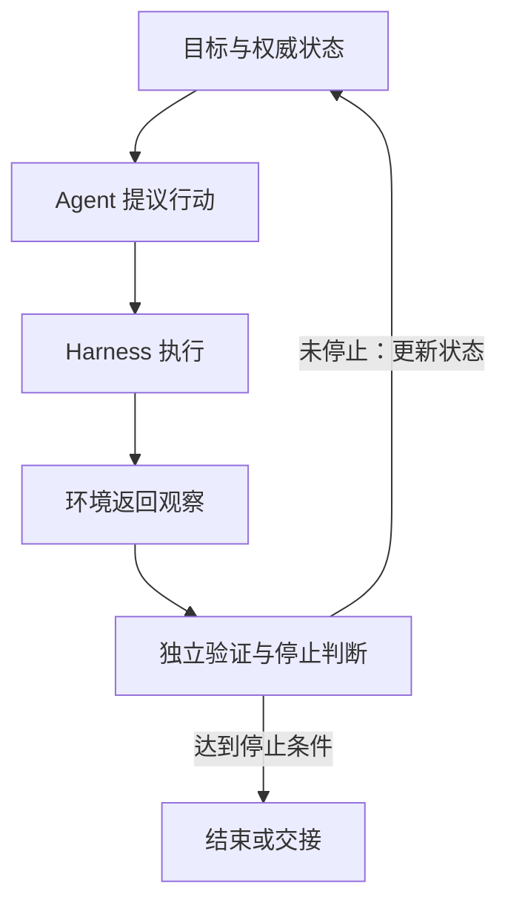
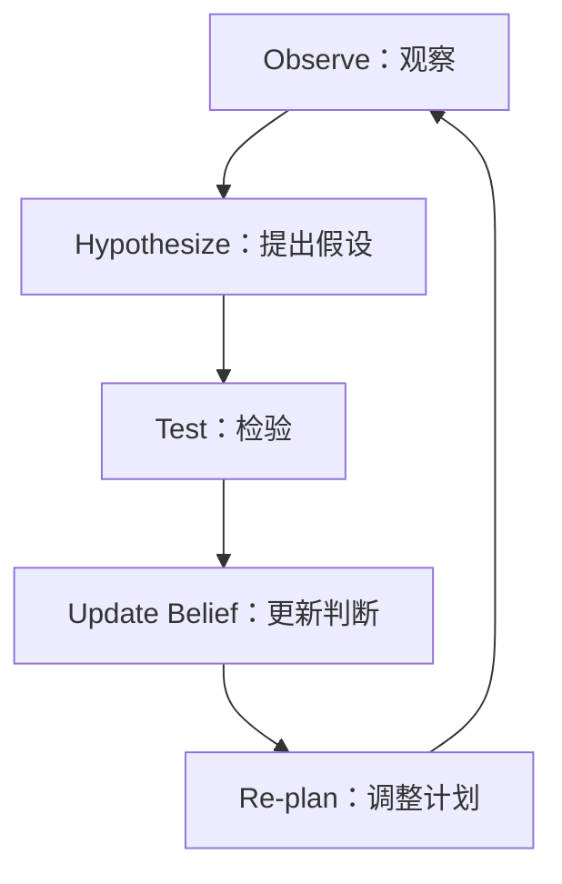

# Agent 执行循环

一个编码 Agent 修改完仓库后说“已经完成”，测试却仍然失败。最直接的补救，是让它读取测试结果再做一轮；更可靠的做法，是由宿主检查测试、预算和权限，只在未达标且仍可继续时启动下一轮。

这就是 Agent 执行循环要解决的问题：**让 Agent 围绕外部反馈反复工作，直到可验证的停止条件成立。** 循环次数本身没有价值。缺少反馈、状态和出口的循环只会重复消耗 Token，并把同一种错误做得更久。

## 执行循环是带出口的反馈系统

一个可运行的执行循环至少包含六个部分：当前状态、下一步行动、环境观察、独立验证、停止条件和资源预算。



模型可以提出行动和解释观察，Harness 负责权限、执行、状态和停止判断。测试退出码、业务状态、Schema 校验和人工批准都可以成为外部信号；“我认为已经完成”只能作为模型意见。

[Antonio Gulli 的《Agentic Design Patterns》](https://www.amazon.com/Agentic-Design-Patterns-Hands-Intelligent/dp/3032014018/)把提示链、路由、并行、反思、工具、规划、多 Agent、记忆、MCP、目标监控、恢复、人机协同、安全和评测列为不同模式。执行循环是这些模式的组合方式之一，不等于其中任意一个模式。MCP 负责连接工具，规划负责选择路径，评测负责判断结果；只有把反馈接回下一轮并定义出口，系统才形成闭环。

## 四层循环处理不同对象

[Aparna Dhinakaran 对 Loop 的梳理](https://x.com/aparnadhinak/status/2073492320159510869)区分了四种常被混用的结构。它们迭代的对象、结束信号和人类职责都不同。

| 层次 | 每轮迭代什么 | 典型出口 | 人的主要职责 |
|---|---|---|---|
| 执行循环 | 单个任务中的工具调用 | 没有下一步工具，或当前步骤已验证 | 决定可用工具和动作边界 |
| 任务循环 | 同一份规格对应的产物 | 规格满足、测试通过 | 写清规格并处理反复失败 |
| 产品循环 | 分诊、实现、评审、发布、监控 | 一项需求完成并进入运营 | 决定流程中哪些节点可以自动化 |
| 系统循环 | Prompt、Harness、模型、评测集 | 新配置在保留集上优于基线 | 防止系统为了分数修改目标本身 |

四层之上还有监督循环：设定目标、分配资源、决定暂停或放弃。自主性应分别配置。执行循环可以高度自动化，产品发布仍由人批准；系统可以自动搜索 Prompt，人仍保留评测集和目标定义权。

层次越高，错误影响越大，反馈也越容易被系统自己污染。优化任务产物时，测试可以相对独立；优化评测器时，系统可能通过降低标准获得更高分。因此，高层循环需要更稳定的保留集、审计轨迹和人工治理。

## 从最小原语开始

[Claude Code 团队的 Loop 指南](https://x.com/ClaudeDevs/status/2074208949205881033)按触发和停止方式区分轮次、目标、时间和主动式循环。迁移到任何 Agent 平台时，可以用同一组问题选型：工作何时到来，下一步由谁决定，什么证明完成，失败后是否值得重试。

| 任务形态 | 优先选择 | 原因 |
|---|---|---|
| 一次性短任务 | 单轮 Agent | 人可以直接验收，额外编排收益低 |
| 路径未知但结果可验证 | 目标循环 | Agent 可以根据新观察调整，验证器决定是否继续 |
| 固定时间生成同类结果 | 定时任务 | 调度器负责触发，脚本和模型各做擅长的部分 |
| 持续进入的事件流 | Workflow 加 Agent 节点 | 队列、状态机和幂等机制承接并发与恢复 |
| 步骤确定、输出确定 | 普通程序 | 确定性代码更便宜、更稳定、更容易测试 |

先用少量真实任务试运行，再扩大并发和频率。一个执行循环能启动数百个 Agent，不代表任务值得这样处理。触发频率应匹配外部状态的变化速度，模型档位应匹配任务难度，确定性的解析、排序、去重和格式转换交给脚本。

## 从 Pipeline 到 Hypothesis-driven State Machine

固定 Pipeline 适合步骤稳定、分支少、失败语义明确的任务；探索型任务更适合带回边的状态机。Black cat 红队 Skill 提供了一个有代表性的实现：不把 Recon、Enumerate、Validate 当成只能向前推进的阶段，而允许新观察、验证失败和假设证伪把系统重新带回前面的搜索状态。([GitHub](https://github.com/0rangec3t/Black-cat))

可以把这种 Loop 写得更严格：



这里最重要的是 **Update Belief**。测试失败只说明当前证据削弱了某个假设，不能自动证明另一个假设成立。例如“没有发现 SQL Injection”并不能推出“目标使用 ORM”，更不能直接推出“存在 Mass Assignment”。正确做法是记录失败证据，调整候选假设优先级，再为新的解释寻找独立证据。

运行时可以把 Hypothesis 管理为三个基本状态：

- **Active**：当前仍值得投入验证预算。
- **Confirmed**：已经满足预先定义的证据门槛。
- **Killed**：当前关键前提被证伪，停止继续消耗预算。

Killed 不等于删除。应同时保存 **为什么被证伪、依赖了什么证据、什么环境变化后值得重新激活**。这样失败路径既能避免重复搜索，也能在代码、配置、权限或环境变化后重新进入 Active。

Black cat 的另外几个结构也适合泛化到探索型 Agent：用单一 Tracker 保存当前任务状态；用 Decision Log 记录关键分叉的选择与理由；证据按 Observation → Reproduction → Impact 关联；按当前假设显式加载少量相关 Skill，而不是把所有 Technique 一次塞入上下文。对于会产生临时资源或副作用的任务，还应维护 Cleanup Ledger，并由宿主在结束时检查未清理项。

因此 Loop 的核心不是“重复执行直到成功”，而是：

> **每轮都必须产生新的证据、改变假设置信或改变下一步搜索策略；如果状态没有实质变化，就应该停止或升级，而不是继续循环。**

## 契约决定每轮能否收敛

GPT-5.6 的[官方提示词指南](https://developers.openai.com/api/docs/guides/prompt-guidance-gpt-5p6)建议优先写结果、关键约束、可用证据和完成门槛，再让模型选择路径。官方内部样本中，精简重复指令改善了部分编码评测并降低了 Token，但这些数字只代表该组实验；迁移现有 Prompt 时仍要逐项删除、逐项复测。

执行循环的契约可以保持很短：

```yaml
goal: 修复登录回跳问题，并保持外部 URL 继续被拒绝
evidence:
  - 旧故障由回归测试覆盖
  - 聚焦测试和仓库质量门禁通过
permissions:
  read: 当前仓库
  write: 登录模块及其测试
  external_actions: 禁止
stop:
  success: 全部 evidence 成立
  blocked: 根因需要生产数据或凭证
  budget: 最多 5 轮、30 分钟
retry:
  transient_failures: 2
  repeated_failure: 停止并报告同一失败证据
```

成功条件、阻塞条件和预算需要同时存在。只写成功条件会让不可达目标无限重试；只设轮数会让系统在尚未取得关键证据时机械停止。权限也属于契约，后续网页、README、工具结果和子 Agent 消息只能改变候选计划，不能扩大允许的动作。

## 验证和可观测性决定自主程度

一次输出不达标时，先修当前结果，再判断能否把失败转成永久能力：新增测试、完善 Skill、收窄工具、补充状态字段，或者调整停止规则。这样每次失败都能改善后续循环，而不是依赖下一次模型“更小心”。

验证者要尽量独立。新上下文中的 Reviewer、确定性测试和权威业务状态，比让同一个 Agent 复述自己的理由更有区分力。大规模运行还要分析完整 Trace：在哪一步停滞，哪些失败反复出现，人工为何接管，哪些任务在预算耗尽前仍没有收敛。抽查几段看起来顺畅的对话，无法代表生产可靠性。

可以持续记录以下指标：

- **任务成功率** = 达到全部完成条件的任务数 / 全部启动任务数。
- **无效迭代率** = 没有增加新证据或改变权威状态的轮次 / 全部轮次。
- **人工接管率** = 需要人完成或纠偏的任务数 / 全部任务数。
- **单位成功成本** = 模型、工具、基础设施和人工总成本 / 成功任务数。
- **范围违规率** = 超出权限或任务边界的行动提议数 / 全部行动提议数。

这些指标要按任务类型、模型、Harness 版本和风险等级分层。平均成功率会掩盖某一类任务持续失败，也可能把大量简单任务带来的高分误写成复杂任务能力。

## 上下文、重试和副作用都要受控

长会话会积累无关观察、失败分支和重复工具说明。任务循环可以在检查点后用干净上下文重启，但必须从外部状态恢复目标、已验证事实、未完成条件和变更摘要。清空上下文不等于清空任务状态。

重试要区分三种情况：网络抖动可以有限重试；同一证据上的推理失败需要改变方法；已经产生副作用但响应未知时，必须先查询权威状态。最后一种情况如果直接重试，可能重复发邮件、创建订单或关闭工单，因此需要幂等键、后置状态核验和补偿路径。

时间、Token、并发、费用和权限共同构成运行预算。每轮都应回答两个问题：新观察是否让任务更接近完成，继续一轮的预期价值是否高于成本和风险。两个答案都是否定时，正确动作是停止并交付证据，而不是继续循环。

## 人的判断上移，但不会消失

[一位 Staff Engineer 对 LLM 的使用复盘](https://www.seangoedecke.com/how-i-use-llms-in-2026/)提供了一个实用边界：Agent 可以并行调查 Bug、生成实现、搭环境和补测试，人仍要同步建立问题模型、提供新上下文并判断最终解释。前十三次失败会缩小搜索空间，第十四次成功仍依赖人把证据串起来。

规格、架构决策、PR 说明和对同事的沟通还承担责任与信任信号。它们可以由 AI 协助校对，作者需要保留真实判断。把执行交给 Loop 后，人会从单步操作转向目标、评测、资源和例外处理；工作量未必减少，工作对象上移了。

判断一个执行循环是否成熟，可以看人在日常运行中处理什么。若人仍反复纠正相同格式、补相同上下文和手动判断相同测试，系统还没有学会闭环。若人主要处理新目标、异常风险和标准变化，Loop 才真正把重复判断沉淀进工程系统。
