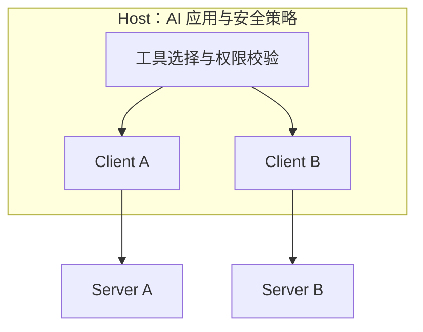

# MCP 与工具调用

模型不会直接访问数据库、文件系统或付款接口。它先根据上下文提出一个结构化的工具请求，宿主程序再决定这个请求是否可以执行。理解这条链，是理解 Agent 能力和安全边界的基础。

## 工具调用发生了什么

一次调用通常经过四步：模型选择工具并生成参数，Host 校验工具名称和参数 Schema，权限层检查身份、资源、动作和审批状态，执行器调用真实系统并把结果作为新的观察返回给模型。模型的输出只是行动请求，不具有授权效力；工具执行成功，也只说明这次调用满足了工具契约，不能直接证明整个任务已经完成。

工具描述、参数 Schema、结果 Schema、错误类型和副作用说明共同组成工具契约。契约越清楚，模型越容易提出正确请求，Host 也越容易在模型外拒绝越权或无效操作。删除、发布、付款、发送消息和修改权限等动作，应把审批、幂等、回滚或补偿写进执行层。

## MCP 连接了哪些对象

[MCP 官方架构](https://modelcontextprotocol.io/specification/2025-06-18/architecture)采用 Host、Client、Server 三层结构。Host 是承载 AI 应用和安全策略的容器，可以管理多个 Client；每个 Client 与一个 Server 建立隔离的会话，负责协议协商、能力声明和消息转发；Server 提供专门的 tools、resources 和 prompts，可以是本地进程，也可以是远程服务。

Server 暴露的是能力，Host 决定这些能力是否进入当前任务。Server 不应看到完整对话，也不应直接访问其他 Server 的内容；跨 Server 的组合由 Host 控制。这个隔离让连接方式可以复用，同时保留应用侧的权限、同意和审计责任。

## MCP 如何传输消息

MCP 使用 JSON-RPC 编码请求、通知和响应。标准传输包括本地进程常用的 stdio，以及面向远程服务的 Streamable HTTP；客户端和服务器在初始化阶段交换协议版本与能力，之后才能使用双方声明过的功能。[官方传输规范](https://modelcontextprotocol.io/specification/2025-06-18/basic/transports)还规定了会话、认证、来源校验和消息流的边界。

工具发现通常通过 `tools/list` 完成，调用通过 `tools/call` 发送工具名称和参数。协议负责把请求送到正确的 Server，并把结果带回 Client；工具是否可信、参数是否符合业务规则、调用是否需要人工确认，仍由 Host 和应用执行层负责。[工具规范](https://modelcontextprotocol.io/specification/2025-06-18/server/tools)明确要求实现考虑工具描述和结果的安全含义。

## 继续追问三个问题

接入 MCP 时，先确认 Server 能读取什么、能改变什么、凭证由谁注入；再确认每个工具的参数、结果和副作用能否被独立校验；最后确认调用记录、失败恢复和人工接管是否存在。协议让连接更容易，不能替代身份、授权、沙箱、数据流控制和业务审批。

理解 MCP 后，再回到[Agent 与工具工程](/ai-agent-practice)学习循环、Harness、计划、验证和恢复；涉及提示注入、工具越权和现实副作用时，进入 [AI 系统安全](/ai-system-security)。
