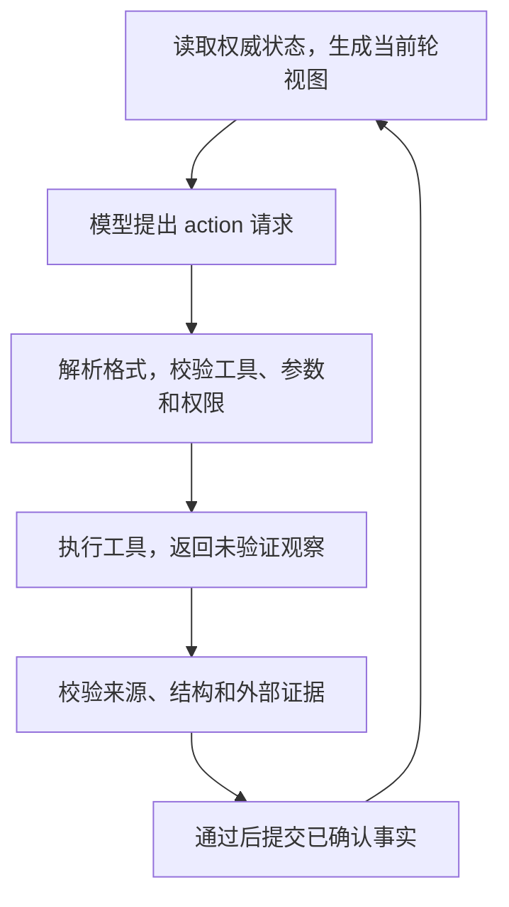

# ReAct 模式

用户登录前正在访问 `/settings`，登录成功后本应回到这个页面，实际却跳到了首页 `/`。根因尚不清楚，可能出在登录入口、会话状态、回调处理或路由逻辑。

本教程实现一个最小 ReAct 循环，让 Agent 根据每轮新证据选择下一步。它只诊断问题，不修改代码。控制器只有在回归测试、相关源码和定向测试共同支持同一结论后，才接受模型的结束请求，并根据已确认事实生成诊断。

[ReAct 论文](https://arxiv.org/abs/2210.03629) 研究了推理与行动交替，让模型利用环境反馈调整后续步骤。工程实现无需向宿主程序暴露完整推理过程。本文让模型每轮只返回两类结构化消息：行动请求或结束请求。

## 先写清任务契约

教学案例的目标是定位登录回跳错误，并给出可以复查的根因证据。运行前先固定以下边界：

- **完成标准**：回归测试复现 `/settings` 被错误改成 `/`；读取登录入口与回调源码；定向测试确认两端使用的会话键不一致。
- **允许工具**：`run_test`、`search_code`、`read_file`。
- **资源范围**：只能读取当前模拟仓库中的文件和测试结果。
- **排除项**：不写文件、不部署、不访问网络，也不读取生产凭证。
- **运行预算**：最多 8 轮；连续两次无法解析模型输出时失败；越权请求立即受阻。

示例使用 Python 3.10 及以上版本，只依赖标准库。仓库、测试和模型都由本地函数模拟，测试结果也是为讲解循环预先设置的观察，不表示后续 Plan 页面里的真实测试夹具已经存在。接入真实模型时，只需替换代码中的 `call_model`，权限和完成判定仍留在控制器中。

## 看懂一次行动循环

一次合法行动沿着以下路径运行：



模型提出 `final` 时，控制器检查完成证据，齐全才接受结束；证据不足时在剩余预算内继续。格式错误、越权或观察无效时的处理见[检查停止与失败路径](#检查停止与失败路径)。

这里有五个容易混淆的对象：

- **行动请求**来自模型，例如请求运行某个测试。它没有执行权。
- **未验证观察**来自工具，例如一段源码或测试输出。它可能不完整、过时或格式异常。
- **权威状态**由控制器维护，只记录通过校验的事实、预算和运行状态。
- **外部验证**来自测试、类型检查、Schema 或业务不变量，不依赖模型自评。
- **完成标准**在运行前定义。模型输出 `final` 只是申请结束，控制器仍要检查证据是否齐全。

控制器把当前轮需要的字段序列化成 JSON，模型只接收这份与 `AgentState` 脱钩的视图，从而无法直接修改权威状态。原始工具输出保留在轨迹中，但其中的文本不能改写任务目标、权限或停止条件。

## 运行教学代码

下面的程序故意让模拟模型在第一轮返回非 JSON 文本，用来展示解析失败后的有界恢复。后续行动由已经提交的事实决定：先复现，再搜索，再读文件，最后运行定向测试。

将完整程序保存为 `react_demo.py`，运行：

```bash
python3 react_demo.py
```

<details>
<summary>查看完整 Python 教学代码</summary>

```python title="react_demo.py"
from dataclasses import dataclass, field
import json
from typing import Any


FILES = {
    "src/auth/login.ts": "session['return_to'] = validated_path;\n",
    "src/auth/callback.ts": (
        "const target = session['next_path'] ?? '/';\n"
        "return redirect(target);\n"
    ),
}

REGRESSION_TEST = "tests/auth/login-redirect.test.ts#returns-to-requested-page"
CONTRACT_TEST = "tests/auth/login-redirect.test.ts#session-key-contract"
TEST_RESULTS = {
    REGRESSION_TEST: (1, "FAILED: expected '/settings', got '/'"),
    CONTRACT_TEST: (1, "FAILED: producer 'return_to' != consumer 'next_path'"),
}


def run_test(args: dict[str, Any]) -> dict[str, Any]:
    exit_code, output = TEST_RESULTS[args["name"]]
    return {"test": args["name"], "exit_code": exit_code, "output": output}


def search_code(args: dict[str, Any]) -> dict[str, Any]:
    query = args["query"]
    terms = query.split()
    matches = []
    for path, content in FILES.items():
        for number, line in enumerate(content.splitlines(), start=1):
            if any(term in line for term in terms):
                matches.append({"path": path, "line": number, "text": line})
    return {"query": query, "matches": matches}


def read_file(args: dict[str, Any]) -> dict[str, Any]:
    path = args["path"]
    return {"path": path, "content": FILES[path]}


TOOLS = {
    "run_test": run_test,
    "search_code": search_code,
    "read_file": read_file,
}


@dataclass
class AgentState:
    max_steps: int
    step: int = 0
    consecutive_parse_errors: int = 0
    status: str = "running"
    facts: dict[str, Any] = field(default_factory=dict)
    observations: list[dict[str, Any]] = field(default_factory=list)
    answer: str | None = None


def action(tool: str, **args: Any) -> str:
    return json.dumps({"type": "action", "tool": tool, "input": args})


def model_view(state: AgentState) -> str:
    return json.dumps(
        {
            "step": state.step,
            "consecutive_parse_errors": state.consecutive_parse_errors,
            "facts": state.facts,
        },
        ensure_ascii=False,
    )


def call_model(serialized_view: str) -> str:
    view = json.loads(serialized_view)
    facts = view["facts"]
    if view["step"] == 1 and view["consecutive_parse_errors"] == 0:
        return "我先运行登录回跳测试。"
    if not facts.get("reproduced"):
        return action("run_test", name=REGRESSION_TEST)
    if not facts.get("search_completed"):
        return action("search_code", query="return_to next_path")
    if "src/auth/login.ts" not in facts.get("files_read", []):
        return action("read_file", path="src/auth/login.ts")
    if "src/auth/callback.ts" not in facts.get("files_read", []):
        return action("read_file", path="src/auth/callback.ts")
    if not facts.get("contract_mismatch"):
        return action("run_test", name=CONTRACT_TEST)
    return json.dumps({"type": "final"})


def parse_message(raw: str) -> dict[str, Any]:
    try:
        message = json.loads(raw)
    except json.JSONDecodeError as error:
        raise ValueError("模型输出不是合法 JSON") from error

    if not isinstance(message, dict) or message.get("type") not in {"action", "final"}:
        raise ValueError("模型输出类型无效")
    if message.get("type") == "action":
        if not isinstance(message.get("tool"), str) or not isinstance(
            message.get("input"), dict
        ):
            raise ValueError("action 的工具或输入格式无效")
    return message


def authorize(action: dict[str, Any]) -> tuple[bool, str]:
    tool = action["tool"]
    args = action["input"]
    if tool not in TOOLS:
        return False, f"工具不在白名单中：{tool}"
    if tool == "run_test" and args.get("name") not in TEST_RESULTS:
        return False, "测试不在允许列表中"
    if tool == "read_file" and args.get("path") not in FILES:
        return False, "文件不在当前模拟仓库中"
    if tool == "search_code":
        query = args.get("query")
        if not isinstance(query, str) or not query or len(query) > 100:
            return False, "搜索词为空或过长"
    return True, "允许执行"


def verify_and_commit(
    state: AgentState,
    action: dict[str, Any],
    observation: dict[str, Any],
) -> tuple[bool, str]:
    tool = action["tool"]
    args = action["input"]

    if tool == "run_test":
        if (
            observation.get("test") != args.get("name")
            or not isinstance(observation.get("exit_code"), int)
            or not isinstance(observation.get("output"), str)
        ):
            return False, "测试观察的来源或结构无效"
        output = observation["output"]
        if observation["test"] == REGRESSION_TEST:
            valid = observation["exit_code"] == 1 and "got '/'" in output
            fact, summary = "reproduced", "已复现：期望 /settings，实际 /"
        else:
            expected = "producer 'return_to' != consumer 'next_path'"
            valid = observation["exit_code"] == 1 and expected in output
            fact, summary = "contract_mismatch", "定向测试确认会话键不一致"
        if not valid:
            return False, "测试没有产生预期的外部证据"
        state.facts[fact] = True

    elif tool == "search_code":
        if observation.get("query") != args.get("query"):
            return False, "搜索观察与请求不匹配"
        matches = observation.get("matches")
        if not isinstance(matches, list) or not matches:
            return False, "搜索没有返回可检查的匹配项"
        state.facts["search_completed"] = True
        state.facts["search_matches"] = matches
        summary = f"找到 {len(matches)} 处相关代码"

    else:
        path = args.get("path")
        if observation.get("path") != path:
            return False, "文件观察与请求不匹配"
        content = observation.get("content")
        if not isinstance(content, str):
            return False, "文件内容格式错误"
        state.facts.setdefault("files_read", []).append(path)
        marker, fact, value = {
            "src/auth/login.ts": (
                "session['return_to'] = validated_path",
                "producer_key",
                "return_to",
            ),
            "src/auth/callback.ts": (
                "session['next_path']",
                "consumer_key",
                "next_path",
            ),
        }[path]
        if marker in content:
            state.facts[fact] = value
        summary = f"已读取并校验 {path}"

    state.observations.append({"action": action, "observation": observation})
    return True, summary


def completion_met(state: AgentState) -> bool:
    facts = state.facts
    return all(
        (
            facts.get("reproduced"),
            facts.get("search_completed"),
            facts.get("producer_key") == "return_to",
            facts.get("consumer_key") == "next_path",
            facts.get("contract_mismatch"),
        )
    )


def answer_from_facts(state: AgentState) -> str:
    facts = state.facts
    return (
        f"登录入口把已校验路径写入 session['{facts['producer_key']}']，"
        f"回调却读取 session['{facts['consumer_key']}']；读取落到默认值 '/'，"
        "因此没有回到 '/settings'。"
    )


def run_agent(max_steps: int = 8) -> AgentState:
    if max_steps < 1:
        raise ValueError("max_steps 必须大于 0")

    state = AgentState(max_steps=max_steps)
    for step in range(1, max_steps + 1):
        state.step = step
        raw_message = call_model(model_view(state))

        try:
            message = parse_message(raw_message)
        except ValueError as error:
            state.consecutive_parse_errors += 1
            print(f"{step}. parse_error: {error}")
            if state.consecutive_parse_errors >= 2:
                state.status = "failed"
                break
            continue

        state.consecutive_parse_errors = 0
        if message["type"] == "final":
            if completion_met(state):
                state.status = "success"
                state.answer = answer_from_facts(state)
                print(f"{step}. final: accepted")
                break
            print(f"{step}. final: rejected, completion evidence is missing")
            continue

        allowed, reason = authorize(message)
        if not allowed:
            state.status = "blocked"
            print(f"{step}. blocked: {reason}")
            break

        tool = TOOLS[message["tool"]]
        observation = tool(message["input"])
        accepted, summary = verify_and_commit(state, message, observation)
        if not accepted:
            state.status = "failed"
            print(f"{step}. invalid_observation: {summary}")
            break
        print(f"{step}. {message['tool']}: {summary}")
    else:
        state.status = "max_steps"

    print(f"status={state.status}")
    if state.answer:
        print(state.answer)
    return state


if __name__ == "__main__":
    run_agent()
```

</details>

正常运行会得到类似输出：

```text
1. parse_error: 模型输出不是合法 JSON
2. run_test: 已复现：期望 /settings，实际 /
3. search_code: 找到 2 处相关代码
4. read_file: 已读取并校验 src/auth/login.ts
5. read_file: 已读取并校验 src/auth/callback.ts
6. run_test: 定向测试确认会话键不一致
7. final: accepted
status=success
登录入口把已校验路径写入 session['return_to']，回调却读取 session['next_path']；读取落到默认值 '/'，因此没有回到 '/settings'。
```

路径在第 2 轮后才逐渐确定。失败测试给出实际行为，代码搜索缩小范围，两次文件读取形成根因假设，定向测试再从模型之外确认这个假设。第一轮的自然语言输出无法解析，控制器记录错误并允许一次恢复，没有把它当成行动。

## 检查停止与失败路径

教学代码把停止权留给控制器，每种结果都有明确含义：

| 结果 | 触发条件 |
|---|---|
| `success` | 模型请求结束，并且 `completion_met` 确认全部证据齐全 |
| `failed` | 连续两次解析失败，或工具观察未通过校验 |
| `blocked` | 工具、测试或文件超出白名单和仓库边界 |
| `max_steps` | 用完轮次预算后仍未满足完成标准 |

每次成功解析结构化消息后，控制器都会把连续解析错误计数清零，因此两次被合法消息隔开的格式错误不会累计成失败。把最后一行改为 `run_agent(max_steps=3)`，程序会在搜索代码后以 `max_steps` 停止。此时已经获得的观察仍不足以确认根因，因此不会输出成功。若模型提前请求 `final`，控制器也会拒绝，并让循环在剩余预算内继续。

真实工具还需要超时、取消和输出长度限制。带副作用的工具应另外检查幂等性、审批和补偿方式。本文没有暴露部署、网络和凭证工具，所以模型即使生成这类名称，也会在 `authorize` 中被拒绝，工具函数不会执行。

## 判断是否适合 ReAct

ReAct 适合根因和行动路径需要根据中间证据不断调整的任务，例如代码排障、告警研判和资料核验。每一步都应有可观察结果，错误行动也应能在有限代价内停止或恢复。

步骤固定、路径已知的任务可以直接使用工作流；需要先审查完整任务分解时，可参考 [Plan-and-Execute 模式](/plan-and-execute-loop)。当行动循环需要持久状态、检查点、审批、审计和恢复时，再由 [Harness 工程](/harness-engineering) 承接这些运行时能力。

完成这个示例后，应能从输出中确认五件事：模型只提交请求；工具结果先作为观察；控制器维护权威状态；测试提供外部验证；成功由预先写好的完成标准判定。只要其中一项缺失，运行就不应进入 `success`。
